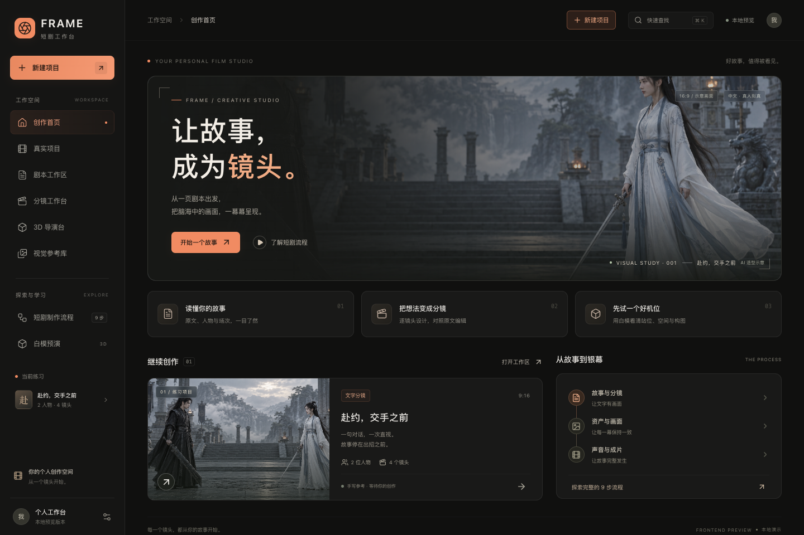
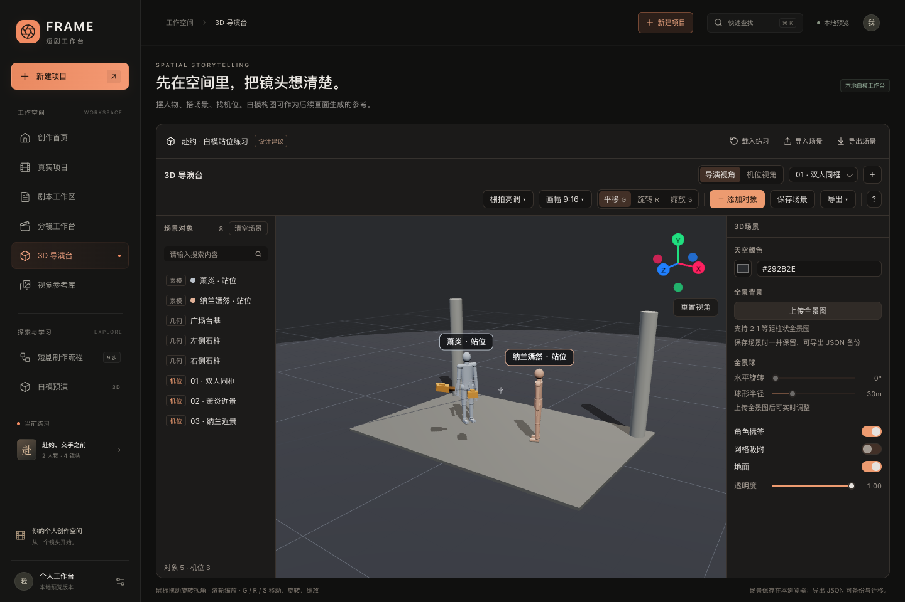

<div align="center">

<h1>FRAME</h1>

<p><strong>从一页剧本，到可推敲的每一个镜头。</strong></p>

<p>Shortdrama Agent Lab · 中文短剧创作工作台与 Agent 实验项目</p>

<p>
  
  
  
  
  
</p>

<p>
  <a href="#先看一眼">产品演示</a> ·
  <a href="#本地体验">快速开始</a> ·
  <a href="shortdrama-agent-lab/README.md">完整指南</a> ·
  <a href="shortdrama-agent-lab/docs/总体设计.md">产品路线图</a>
</p>

</div>

把剧本、分镜和 3D 机位预演放到一张工作台上。FRAME 希望让短剧创作中的每一次镜头决定，都有原文依据、有画面参考，也有可以继续修改的空间。

本仓库当前的产品入口是 **[shortdrama-agent-lab/](shortdrama-agent-lab/README.md)**。它正在独立构建从中文单集剧本到真人拟真短剧的生产流程；当前可体验电影工作台、示例分镜编辑、手工白模，以及需配置模型代理的文字 Agent 链路。

## 先看一眼

[](shortdrama-agent-lab/docs/media/product-tour.mp4?raw=true)

<p align="center">
  <a href="shortdrama-agent-lab/docs/media/product-tour.mp4?raw=true">查看 / 下载 MP4 演示</a>
  <br>
  <sub>真实前端录制 · 手写分镜样例 · 手工白模练习场景</sub>
</p>

演示展示当前可操作的界面与浏览器内白模，不包含模型自动生成或完整成片生产。

<details>
<summary>展开查看工作台与导演台截图</summary>

**电影工作台**



**3D 导演台**



</details>

## 三种方式，推敲一个镜头

### 01 · 对照原文，修改分镜

粘贴或导入 TXT 保存剧本；用内置手写样例体验原文与对白对照，调整画面设计、景别、运镜和预计时长。每行代表一个连续镜头，手工修改有标记，前端草稿可以保存并导出 JSON。导入新剧本不会自动替换样例分镜。

### 02 · 在浏览器里，摆出你的机位

进入 3D 导演台，调整人物体型、姿势、站位、焦段与光照，导入本地 GLB，用白模验证空间关系。支持场景保存、JSON 导入导出，以及 PNG、机位宫格、深度图和短 WebM 运镜预览。

### 03 · 让拆解、检查和采用有迹可循

「真实项目」已接入本地后端和 PostgreSQL：保存剧本版本，通过 Pi Agent Core 提取事实，查看程序检查，采用事实，再生成并采用分镜候选。原文引用、设计建议与采用决定分别记录。

## 本地体验

准备 **Node.js ≥ 22.19** 和 npm，即可先体验前端；无需数据库或模型账号。

```sh
git clone https://github.com/K80Tom/-.git frame
cd frame/shortdrama-agent-lab
npm --prefix web ci
npm --prefix web run dev
```

打开 [http://127.0.0.1:5173](http://127.0.0.1:5173)，浏览示例分镜，或直接进入 [3D 导演台](http://127.0.0.1:5173/#/director)。

示例草稿和白模场景保存在当前浏览器中，可通过页面导出留存。浏览器内渲染与视频录制需要 WebGL 和 MediaRecorder 支持。

想运行真实项目与文字 Agent？继续阅读 **[完整启动指南](shortdrama-agent-lab/README.md#启动真实项目与文字链路)**：需要本地 PostgreSQL、后端和另行配置的本机模型代理。当前代理只接受 `127.0.0.1` 地址，注册表与上游服务需匹配；每次生成需显式确认付费。

## 当前做到哪里

FRAME 处于 **Early Preview**。下面区分了已经落地的能力与后续建设方向：

| 当前可用 | 仍在推进 |
| --- | --- |
| 本地电影工作台、示例分镜编辑与草稿导出 | 真实项目中的完整编辑、候选比较与按场重做 |
| 手工 3D 白模、机位预演与浏览器渲染导出 | Agent 自动摆场与下游媒体生成衔接 |
| 事实拆解、程序校验、分镜候选与人工采用的代码链路 | 真实付费模型输出质量验收与语义质检 |
| PostgreSQL 保存项目、候选与执行记录 | 金额预算、持久调度、跨进程恢复与自动返修 |

独立资产库、生图、视频、声音、剪辑和完整成片尚未实现。演示样例、白模场景与真实项目候选目前分开保存；它们尚未组成统一的可编辑成片工程。

完整目标是约 1–2 分钟、竖屏 9:16、中文对白的真人拟真短剧，以及可继续编辑的项目。具体阶段与验收标准见 [总体设计](shortdrama-agent-lab/docs/总体设计.md)。

## 找到你需要的入口

| 你想做什么 | 入口 |
| --- | --- |
| 了解产品、完整启动与路线图 | [FRAME 项目 README](shortdrama-agent-lab/README.md) |
| 了解工作台操作与本地保存 | [前端说明](shortdrama-agent-lab/web/README.md) |
| 配置后端、数据库与迁移 | [本地开发](shortdrama-agent-lab/docs/本地开发.md) |
| 配置模型代理与调用限制 | [模型接入](shortdrama-agent-lab/docs/模型接入.md) |
| 看设计、架构与数据约定 | [总体设计](shortdrama-agent-lab/docs/总体设计.md) · [技术架构](shortdrama-agent-lab/docs/技术架构.md) · [数据结构](shortdrama-agent-lab/docs/数据结构-v0.1.md) |
| 反馈问题或提出想法 | [GitHub Issues](https://github.com/K80Tom/-/issues) |

## 仓库导航：产品与历史参考

**默认开发、运行与阅读入口均为 `shortdrama-agent-lab/`。** 其他同级内容用于历史阅读、方法提炼与来源核对，不是 FRAME 的运行依赖。

| 路径 | 定位 |
| --- | --- |
| **[`shortdrama-agent-lab/`](shortdrama-agent-lab/README.md)** | **当前独立产品，包含工作台、后端、测试与设计文档。** |
| `短剧Main/` | 旧平台源码参考；已授权的 3D 导演台模块已独立迁入新项目。 |
| `shortdrama-agent/` | 旧 Agent 实现与规则参考。 |
| `shortdrama-cli/` | 旧命令行方案参考。 |
| `zhongwen-shortdrama-agent` | 空占位文件，并非文件夹或可运行项目。 |
| 根目录《短剧智能体-源码分析与 MVP 建议》 | 历史调研材料；当前产品设计以新项目 `docs/` 为准。 |

启动 FRAME 无需安装或运行历史参考项目，也不依赖旧平台的 Main API、数据库、账号或部署配置。

## 来源与许可

3D 导演台和所用组件的来源、适配与许可记录见 [第三方代码说明](shortdrama-agent-lab/web/THIRD_PARTY_NOTICES.md)。项目尚未声明统一开源许可证；使用与分发时请核对各代码、样例和素材的来源与许可。

---

<div align="center">
  <p><strong>让创作从可看见的镜头开始。</strong></p>
  <p><a href="shortdrama-agent-lab/README.md">进入 FRAME 完整指南 →</a></p>
</div>
