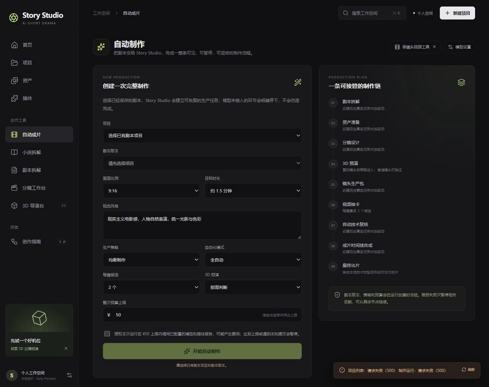
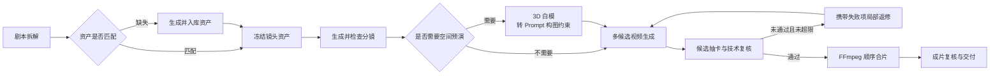
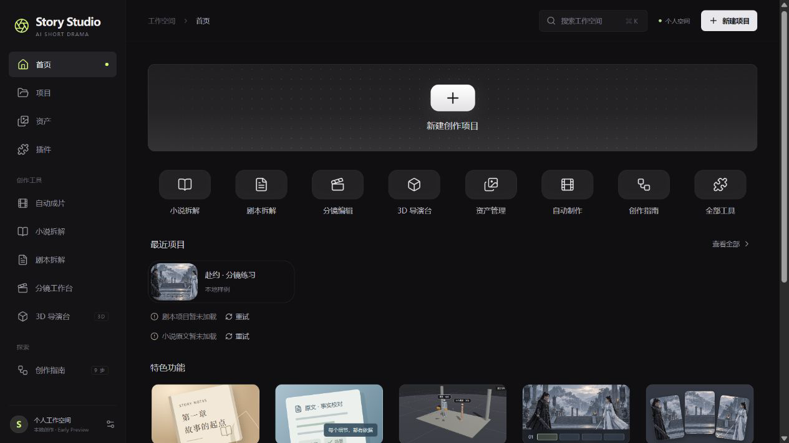
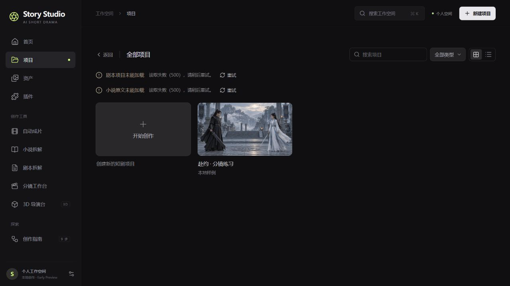
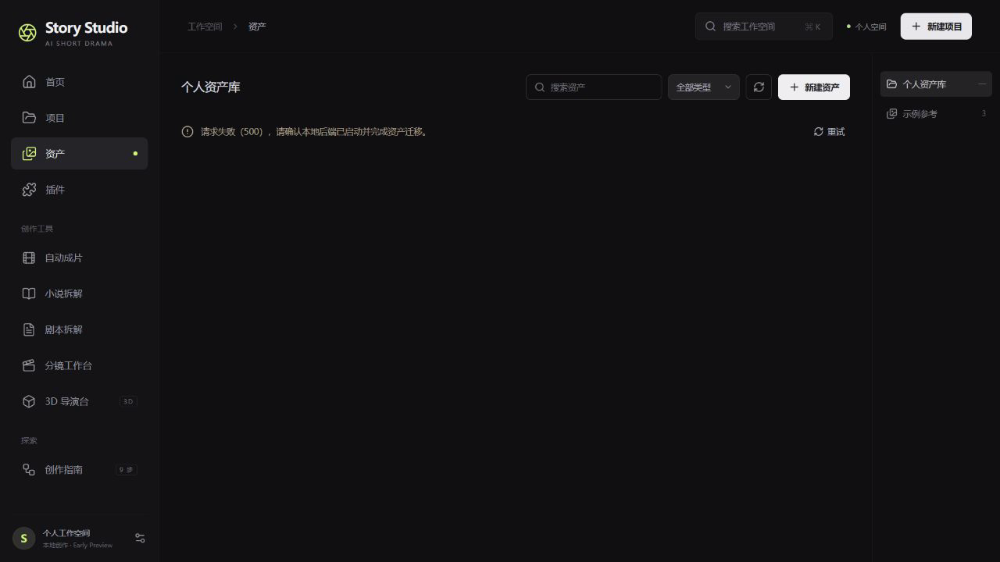
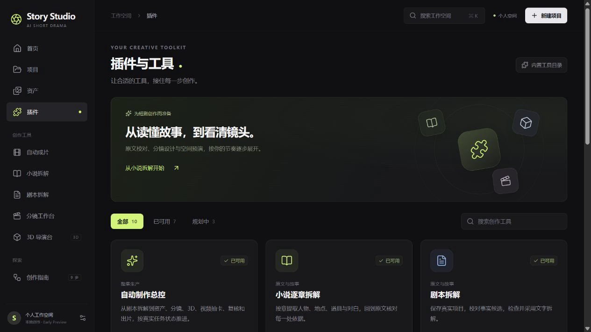
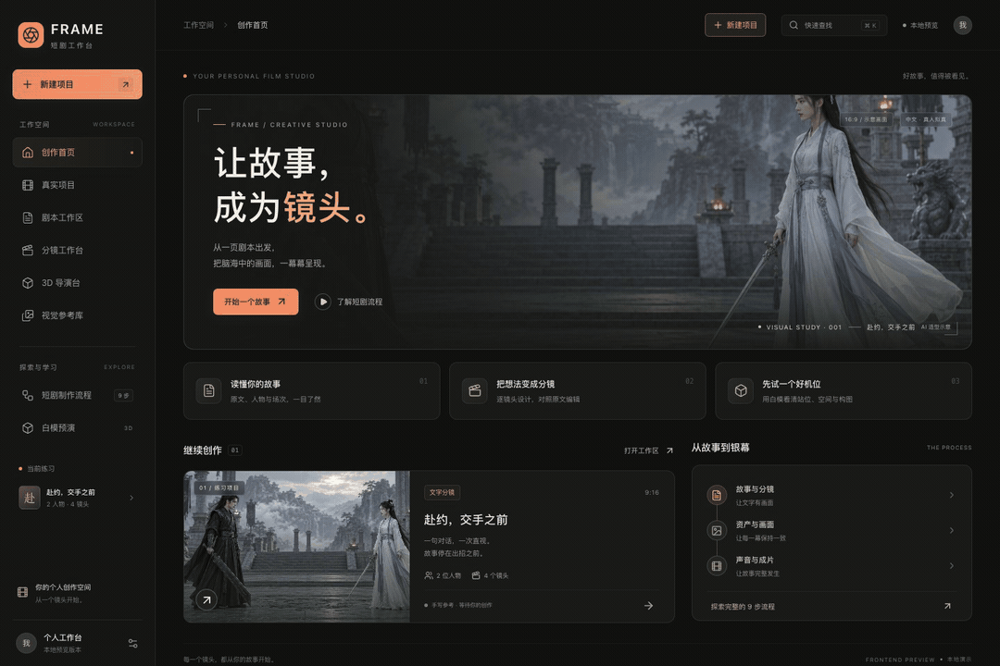

<div align="center">

<h1>Story Studio</h1>

<p><strong>把一集剧本，自动推进成可检查、可恢复、可交付的短剧成片。</strong></p>

<p>面向中文短剧的本地 AI 制片工作台</p>

<p>
  
  
  
  
  
</p>

<p>
  <a href="#一条可以停下来检查的自动化制片线">自动制片</a> ·
  <a href="#三种自动化模式">运行模式</a> ·
  <a href="#新的-story-studio-工作台">界面预览</a> ·
  <a href="#快速开始">快速开始</a> ·
  <a href="shortdrama-agent-lab/docs/Story-Studio全流程自动制片实现-v0.1.md">实现说明</a>
</p>

</div>

[](shortdrama-agent-lab/docs/media/automation.png)

Story Studio 的核心不是再增加一个“文生视频”按钮，而是把剧本拆解、资产准备、分镜、镜头生成、复核、返修和合片连接成一次完整的生产运行。每一步都有状态和输入，失败可以停在具体节点；刷新页面或重启服务后，可以从 PostgreSQL 保存的进度继续。

当前产品入口是 **[`shortdrama-agent-lab/`](shortdrama-agent-lab/README.md)**。它独立运行，不依赖仓库中的旧平台 API、数据库、账号或部署环境。

## 一条可以停下来检查的自动化制片线

创建运行时，只需选择项目和剧本版本，设置画幅、目标时长、视觉风格、质量档位、每镜候选数、3D 策略与预算。Story Studio 随后按同一个持久化流程推进整集制作：



这条流程已经落地为可运行的十阶段 DAG：

- **拆解与采用**：从固定剧本版本提取人物、地点、道具和对白事实，经过确定性检查后由 Agent 或用户采用。
- **资产匹配与补全**：按名称和别名匹配人物、场景、道具；缺失项才进入图片生成。同优先级出现歧义时暂停，不猜选、不重复消费。
- **分镜与 3D 约束**：生成并检查有序分镜；复杂镜头可按规则建立白模快照，把机位、焦距、运镜和人物站位转成文字构图约束。
- **镜头候选与返修**：每个镜头可生成多份视频候选，引用已冻结的资产图；失败项会进入有次数上限的局部返修，而不是重跑整集。
- **合片与交付**：候选进入本地私有媒体库，经哈希与 `ffprobe` 校验，再按分镜顺序使用 FFmpeg 生成整集 MP4。

## 三种自动化模式

| 模式 | 适合谁 | 执行方式 |
| --- | --- | --- |
| **全自动** | 希望一次创建后持续推进 | 自动采用通过检查的拆解与分镜，自动选择技术推荐候选，并在质量档位允许范围内局部返修。 |
| **关键节点确认** | 希望控制重要决策 | 在拆解、资产、分镜和交付等阶段停下确认，视频候选由用户选择。 |
| **共同导演** | 希望逐阶段介入 | 每个可见制作阶段都进入人工检查点，适合精细控制镜头。 |

无论选择哪种模式，预算不足、配置缺失、关键事实不明确、外部任务状态未知、技术检查失败或重试次数用尽时，流程都会暂停并给出具体问题。

### 自动运行，也保留控制权

- **一次运行，一次授权**：付费调用必须在创建运行时明确勾选，并受本次预算上限约束；每项任务先预留、再结算或释放预算。
- **刷新和重启可恢复**：任务、尝试、候选、产物、问题、时间线和预算流水保存在 PostgreSQL；页面可暂停、继续和局部重试。
- **未知任务不重复提交**：供应商结果不明时只查询原任务。无法确认后转为人工处理，避免再次提交同一付费任务。
- **局部失败局部返修**：返修会携带上一轮真实技术失败项，并只让受影响的下游节点失效。
- **输入保持冻结**：运行开始后，剧本版本、制作策略和预算不会随项目后续编辑静默变化。

## 新的 Story Studio 工作台

界面采用统一的深色创作工作台：左侧保留稳定导航，首页提供快速入口，项目、资产、插件和自动制作各自承担清晰的生产职责。

<table>
  <tr>
    <td width="50%"><strong>首页</strong><br></td>
    <td width="50%"><strong>项目</strong><br></td>
  </tr>
  <tr>
    <td width="50%"><strong>资产</strong><br></td>
    <td width="50%"><strong>插件与工具</strong><br></td>
  </tr>
</table>

自动制作页在同一个界面展示阶段轨道、镜头任务矩阵、问题收件箱、候选选择、预算摘要、事件时间线和最终交付。它既是创建入口，也是一次制作运行的可视化控制台。

<details>
<summary>查看当前 Story Studio 界面导览</summary>

[](shortdrama-agent-lab/docs/media/product-tour.mp4?raw=true)

<p align="center">
  <a href="shortdrama-agent-lab/docs/media/product-tour.mp4?raw=true">查看 / 下载 MP4 演示</a>
  <br>
  <sub>由当前 Story Studio 自动制作、首页、项目、资产和插件页面截图制作；仅用于展示产品界面，不代表模型已经完成真实生成。</sub>
</p>

</details>

## 快速开始

### 先体验界面

准备 **Node.js ≥ 22.19** 和 npm。仅浏览界面、示例分镜和手工 3D 导演台时，不需要数据库或模型账号。

```sh
git clone https://github.com/FlySword6/ai-short-drama-agent.git story-studio
cd story-studio/shortdrama-agent-lab
npm --prefix web ci
npm --prefix web run dev
```

打开 [http://127.0.0.1:5173](http://127.0.0.1:5173)。自动制作入口为 [http://127.0.0.1:5173/#/automation](http://127.0.0.1:5173/#/automation)；仅启动前端时可以浏览界面，但不能创建真实生产运行。

### 启动完整本地链路

准备 Docker Desktop 或其他可用的 Docker Compose 环境。在 `shortdrama-agent-lab/` 目录执行：

```sh
npm ci
npm run db:setup
npm run db:up
npm run db:migrate
npm run dev
```

另开一个终端启动前端：

```sh
npm --prefix web ci
npm --prefix web run dev
```

完整生产运行需要本机配置拆解、生图和生视频等用途对应的模型连接，并安装可用的 FFmpeg / ffprobe。密钥只保存在本机后端，不进入浏览器或仓库；只有用户对某次运行明确授权预算后，该次运行才可能调用付费模型。详细步骤见 [Story Studio 项目 README](shortdrama-agent-lab/README.md#启动完整本地服务) 和 [本地开发指南](shortdrama-agent-lab/docs/本地开发.md)。

<details>
<summary>开发验证命令</summary>

```sh
cd shortdrama-agent-lab
npm test
npm run build
npm --prefix web test
npm --prefix web run build
```

数据库已启动并完成迁移后，还可以运行：

```sh
npm run test:db
```

以上测试不会提交真实付费模型任务。

</details>

## 当前能力边界

Story Studio 目前是 **Early Preview**。自动化编排、持久化恢复、镜头级子图、本地媒体校验、有限返修、FFmpeg 合片和总控 UI 已实现，但需要明确理解以下边界：

- **技术复核不是视觉语义审核。** 当前自动检查验证容器与哈希，检查画幅、时长和音轨，并读取分辨率参与候选评分；它不能证明人物长相、动作、剧情、台词、表演和镜头连续性正确，也不能替代人工观看。
- **3D 目前是 `prompt-only` 约束。** 系统把规则式白模的机位、焦距、运镜和站位写入视频提示词；没有把 3D 渲染图或供应商原生相机控制参数传给视频模型，也没有 AI 视觉导演自动精调。
- **声音使用视频供应商的原生音轨。** 当前没有独立配音、口型同步、音效、配乐、混音和字幕生成或烧录子图。
- **真实生成依赖本机配置和授权。** 离线测试、前端预览和构建不会调用模型；模型质量只有在连接配置完成、用户明确授权一次预算并人工检查产物后才能验证。
- **仍是本地单机架构。** 当前没有分布式调度、对象存储、CDN 和多用户权限系统。

## 文档导航

| 想了解什么 | 从这里开始 |
| --- | --- |
| Story Studio 的完整启动、功能和路线图 | [项目 README](shortdrama-agent-lab/README.md) |
| 自动制片的十阶段实现、恢复、预算与媒体链 | [全流程自动制片实现](shortdrama-agent-lab/docs/Story-Studio全流程自动制片实现-v0.1.md) |
| 产品目标和自动化构思 | [总体设计](shortdrama-agent-lab/docs/总体设计.md) · [自动制片构思](shortdrama-agent-lab/docs/Story-Studio全流程自动制片构思-v0.1.md) |
| 后端、数据库和本地开发 | [技术架构](shortdrama-agent-lab/docs/技术架构.md) · [本地开发](shortdrama-agent-lab/docs/本地开发.md) |
| 数据结构和生产聚合 | [数据结构 v0.1](shortdrama-agent-lab/docs/数据结构-v0.1.md) |
| 模型连接和调用限制 | [独立模型配置](shortdrama-agent-lab/docs/独立模型配置.md) · [模型接入](shortdrama-agent-lab/docs/模型接入.md) |
| 前端验证范围 | [工作台验证记录](shortdrama-agent-lab/web/VERIFICATION.md) |
| 项目经历与数据口径 | [Story Studio 简历项目经历](shortdrama-agent-lab/docs/简历项目经历.md) |
| 反馈问题或提出想法 | [GitHub Issues](https://github.com/K80Tom/frame-shortdrama-agent/issues) |

## 仓库导航

默认开发、运行与阅读入口均为 **[`shortdrama-agent-lab/`](shortdrama-agent-lab/README.md)**。其他同级内容用于历史阅读、方法提炼与来源核对，不是 Story Studio 的运行依赖。

| 路径 | 定位 |
| --- | --- |
| **[`shortdrama-agent-lab/`](shortdrama-agent-lab/README.md)** | **当前独立产品，包含新工作台、生产后端、测试与设计文档。** |
| `短剧Main/` | 旧平台源码参考；已授权的 3D 导演台模块已独立迁入新项目。 |
| `shortdrama-agent/` | 旧 Agent 实现与规则参考。 |
| `shortdrama-cli/` | 旧命令行方案参考。 |
| `zhongwen-shortdrama-agent` | 历史空占位文件，不是可运行项目。 |
| 根目录《短剧智能体-源码分析与 MVP 建议》 | 历史调研材料；当前产品设计以新项目 `docs/` 为准。 |

启动 Story Studio 不需要安装或运行历史参考项目，也不依赖旧平台的 Main API、数据库、账号或部署配置。

## 来源与许可

3D 导演台和所用组件的来源、适配与许可记录见 [第三方代码说明](shortdrama-agent-lab/web/THIRD_PARTY_NOTICES.md)。项目尚未声明统一开源许可证；使用与分发时请核对各代码、样例和素材的来源与许可。

---

<div align="center">
  <p><strong>从剧本开始，让每个生产节点都可见、可控、可继续。</strong></p>
  <p><a href="shortdrama-agent-lab/README.md">进入 Story Studio 完整指南 →</a></p>
</div>
