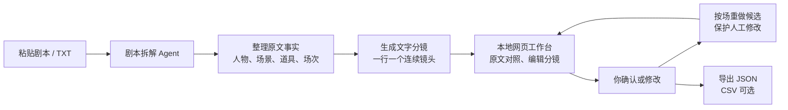

# Shortdrama Agent Lab

从零开发的独立短剧智能生产 Agent。整体目标是从中文剧本自动完成拆解、资产准备、画面与声音制作、剪辑及质检，交付真人拟真成片和网页可编辑项目。剧本拆解与制作计划是第一个开发里程碑。

当前状态：第一个文字生产切片已经贯通：保存剧本 → Pi Agent Core 事实拆解 → 程序校验与问题 → 人工采用 → Pi 分镜设计 → 分镜候选与采用。结果保存到本地 PostgreSQL，并可在 React「真实项目」页面查看。模型代理接入代码已完成，真实付费模型输出质量尚未实测；语义质检、人工编辑/按场重做、资产与媒体生产、后台恢复和完整成片仍未实现。

**模型接入：** 根目录 `.env` 配置本机代理和默认模型，`npm run dev` 启动 NestJS＋Fastify 后端，`npm run models:list` 查看配置条目。真实项目页可显式启动事实拆解与分镜设计；每次调用必须勾选付费确认。公司凭据仍由本机代理保管，浏览器不持有密钥。

**本地网页：** [打开真实项目并新建项目](http://127.0.0.1:5173/#/production) · [打开 3D 导演台](http://127.0.0.1:5173/#/director)。项目可保存原作品的 HTTPS 来源链接；链接只作为出处，不会自动下载正文。启动与能力范围见 [web/README.md](web/README.md)。

**本地数据库：** Docker Compose 管理 PostgreSQL 17，后端通过 `.env` 中的 `DATABASE_URL` 连接。首次运行 `npm run db:setup` → `npm run db:up` → `npm run db:migrate`；日常 `npm run db:up` 后运行 `npm run dev`。网页的「真实项目」已接入这些持久化接口；旧的剧本/分镜示例页仍使用浏览器本地草稿。详见[本地开发说明](docs/本地开发.md)。

## 文档入口与整体目标

- **[总体设计](docs/总体设计.md)**：已确认的 Q1–Q13 需求、功能框架、生产流程、质量与预算规则、开发里程碑和待验证问题。
- **[技术架构（讨论稿）](docs/技术架构.md)**：已确认的运行规则、工程组合与本地 PostgreSQL 方向，以及数据、局部阻断与恢复方案；已实现最小模型后端与 P0.1–P0.4 内核切片，生产 Agent 尚未完成。
- **[第一版数据结构](docs/数据结构-v0.1.md)**：剧本原文、制作计划、连续镜头、原文引用，以及任务、问题、版本和费用的逻辑结构；当前设计基线。
- **[P0.2 持久化说明](docs/持久化-P0.2.md)**：当前真实保存范围、迁移命令、内网 API、测试与明确未实现项。
- **[P0.3 候选计划](docs/候选计划-P0.3.md)**：事实候选格式、原文与关系校验、稳定 ID、数据库和未采用边界。
- **[P0.4 受控阶段执行](docs/受控阶段执行-P0.4.md)**：StageExecutor、Attempt/ModelCall 账本、Evidence Alias 还原、状态流与失败关闭。
- **[首个里程碑实现](docs/首个里程碑实现.md)**：P0.5–P1 的真实接口、校验与采用、模型调用边界和未实现功能。
- **[本地开发](docs/本地开发.md)**：Docker PostgreSQL 启停、迁移、Navicat 连接与前后端启动。
- [开发约定](AGENTS.md)：编程助手在本项目中的长期工作规则。
- [剧本拆解独立提炼指南](docs/extraction-guide.md)：第一个里程碑的旧代码参考与候选实现思路。

首批整集目标为真人拟真、约 1–2 分钟、竖屏 9:16、中文对白，首先供个人在本地网页使用。支持全自动与配置人工节点；资产来自独立资产库，白模按需使用。有限返修仍不达标或预算不足时保存成果、报告未完成并转人工处理，处理后检查并续跑。

建议按“拆解与制作计划 → 单镜头生产闭环 → 整集生产闭环”推进。以下拆解说明属于第一个里程碑，完整产品范围以总体设计为准。主工程采用 TypeScript，前端使用 React＋Vite，后端使用运行在 Node.js 上的 NestJS＋Fastify，后续结合 TS 任务调度与 Pi Agent Core。NestJS 组织 Controller、Service、Module，Fastify 处理 HTTP；本地 PostgreSQL 和对象存储的替换建议单列待确认。文本／图片理解已接入本机代理，具体生产任务选模及媒体生成模型仍待确认。

**现在从小样例开始：** [《斗破苍穹》赴约·极简拆解](examples/斗破苍穹-极简拆解.md)。用 2 人、1 场戏、4 个建议镜头理解核心能力；[v0.1 数据样例](examples/斗破苍穹-数据结构-v0.1.json) 对应当前结构。它由助手手写，尚未经过项目 Agent 运行；镜头设计允许有其他合理答案。

## 项目边界

同级的 `短剧Main`、`shortdrama-agent`、`shortdrama-cli` 为参考来源。用户于 2026-09-27 明确要求复用原版 3D 导演台，其白模模块已独立复制到 `web/src/director/`，来源与改动见 [复用说明](web/THIRD_PARTY_NOTICES.md)。本项目独立实现、独立运行，不调用旧公司的业务 API，不继承其账号、资产审核、计费或部署体系。

本阶段的“蒸馏”是提炼剧本拆解的方法：提示词中的制作规则、输入输出结构、原文引用、校验和错误修复。暂不做模型权重训练。

## 第一项能力

输入：已有的一集中文剧本，以及可选的创作要求。

输出：梗概、人物/场景/道具、场次、分镜、原文引用、待处理问题。

分镜表一行代表一个连续镜头。保留原剧情与对白，允许补充镜头设计，并将设计建议与原文事实区分。

## 第一个开发里程碑范围图

第一个开发里程碑先完成“剧本拆解 → 可修改文字分镜与制作计划”。资产、白模、生图、视频、配音与剪辑属于整体产品目标，按后续里程碑接入。



这张图说明第一个里程碑的用户操作，不代表全自动生产必须逐步人工确认。拆解能力先承担“整理事实”和“设计分镜”两项职责；具体如何协调、是否使用自主工具循环仍待验证。

```text
剧本原文
  → 编号与原文位置映射
  → 提取梗概、场次、人物与道具
  → 逐场设计镜头
  → 校验结构、引用与原文忠实度
  → 有限修复并保存阶段结果
  → breakdown.json（可选导出 storyboard.csv）
```

JSON 保存结构化拆解结果；如提供 CSV，从同一份 JSON 生成。完整可编辑项目还需要媒体素材和关联信息，不能仅以拆解结果代替。

## 怎么开始

1. **先定输出。** 已整理数据 v0.1 与小剧本样例；下一步明确各模块与模型的输入输出接口，再按授权开始实现。
2. **先跑通 Agent 内核。** 一个入口接收剧本文本和要求，返回拆解结果。内部划分提取、分镜、校验步骤，用一个可配置文本模型接口完成。
3. **接入受控阶段执行。** 已实现事实 Check/Issue 与采用门禁、Pi Executor、本机代理适配器和分镜候选。下一步是可编辑计划、按场重做、有限修复与跨进程恢复。
4. **处理信息缺口。** 无法从上下文确认的关键剧情事实集中转人工澄清；已授权制作细节自动补齐。局部问题阻断受影响任务及其依赖，其他独立任务在预算内继续。
5. **接本地网页。** 「真实项目」已连 PostgreSQL 完成创建、执行、校验和采用；原文对照、分镜编辑、按场重做和导出仍要进一步整合。

以上是一个独立 Agent 的逐步建设顺序。核心能力跑通之后，本地网页只负责操作与展示。

## 已建立的目录

```text
shortdrama-agent-lab/
├── README.md
├── AGENTS.md
├── docs/
│   ├── 总体设计.md           # 整体需求、功能框架、运行规则与里程碑
│   ├── 技术架构.md           # 讨论稿：模块、数据、执行机制与技术取舍
│   ├── 数据结构-v0.1.md      # 第一版逻辑结构与修改、采用规则
│   └── extraction-guide.md  # 剧本拆解的参考方法与候选实现
├── web/                    # React 工作台、剧本/分镜编辑、3D 导演台
├── flow-explainer/          # 保留的独立九步流程讲解页
├── src/                    # 模型后端、原文内核、draft 与事实候选持久化；正式 Agent 待实现
├── migrations/             # 显式 PostgreSQL 迁移（服务启动不自动执行）
├── prompts/                # 待编写：自己的提取与分镜规则
├── examples/               # 剧本输入、来源说明、参考拆解（Markdown/JSON/CSV）
├── tests/                  # 模型模块离线与 HTTP 集成测试
└── outputs/                # 后续本地运行结果，忽略 Git 跟踪
```

`prompts`、`outputs` 尚未建立生产能力；`src`、`tests` 当前覆盖模型接入、原文索引/分块、draft 持久化、事实候选校验与假适配器的单阶段执行，不代表候选已经语义检查或采用，也不代表生产 Agent 已实现。第一个输入样例见 [examples 说明](examples/README.md)，预期交付内容可先看 [参考拆解草稿](examples/终身大事-参考拆解.md)。

## 第一个里程碑的验收方向

- 粘贴或读取 TXT 剧本，得到结构化 JSON 和一行一个连续镜头的分镜；CSV 为可选导出。
- 每个镜头能够定位其对应原文，原对白可追溯，AI 镜头设计有标记。
- 只重做指定场次，其他场次与人工修改保持不变；冲突由人选择采用。
- 保存运行进度和错误，失败后能够读取已完成的成果。
- 本地网页能对照原文编辑结果，刷新后修改仍在。

不把题材固化为引擎架构。将来可以用某种题材先评测，但这不要求建设对应的公司业务场景。

## 开发资料

见 [独立提炼指南](docs/extraction-guide.md)。

原平台的完整调研仍保留在父目录；新项目的目标和开发记录以本目录为准。
