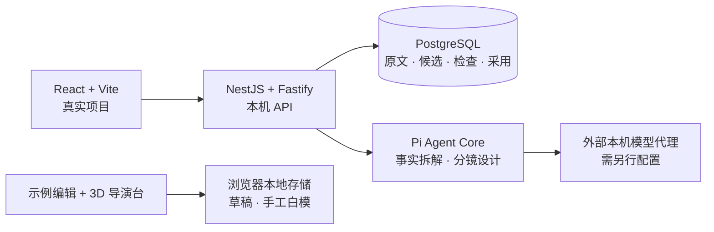

<div align="center">

<h1>FRAME</h1>

<p><strong>从一页剧本，到可推敲的每一个镜头。</strong></p>

<p>Shortdrama Agent Lab · 面向中文短剧的本地创作工作台与 Agent 实验项目</p>

<p>
  
  
  
  
  
</p>

<p>
  <a href="#产品预览">产品预览</a> ·
  <a href="#快速开始">快速开始</a> ·
  <a href="#当前进度">当前进度</a> ·
  <a href="#路线图">路线图</a> ·
  <a href="#文档导航">文档导航</a>
</p>

</div>

FRAME 把剧本、分镜和 3D 机位预演放进同一个深色电影工作台：对照原文审视一个镜头，调整景别和运镜，再在浏览器里验证人物站位与构图。

项目正在构建从中文单集剧本到真人拟真短剧的生产流程。当前是 **Early Preview**：可以体验完整前端和手工白模，也可以配置本地后端与模型代理，运行事实拆解、校验、候选分镜与人工采用这条文字链路。真实付费模型的拆解质量仍待验收，媒体自动生成与完整成片属于后续目标。

## 产品预览

[](docs/media/product-tour.mp4?raw=true)

<p align="center">
  <a href="docs/media/product-tour.mp4?raw=true">查看 / 下载 MP4 演示</a>
  <br>
  <sub>录制自真实前端；画面中的分镜为手写样例，白模为手工练习场景。演示不包含模型自动生成或成片生产。</sub>
</p>

<details>
<summary>展开查看工作台与 3D 导演台截图</summary>

**电影工作台**


**3D 导演台**


</details>

## 为每个镜头保留创作的依据

### 剧本与镜头，放在一起看

粘贴或导入 TXT 保存剧本；用内置手写样例体验原文与对白对照，编辑画面设计、景别、运镜和预计时长。每行代表一个连续镜头，手工修改有标记，前端草稿可保存并导出 JSON。导入新剧本不会自动替换样例分镜。

「真实项目」页面提供独立的后端链路：保存剧本版本、启动事实拆解、查看程序检查、采用事实，再生成并采用分镜候选。样例编辑与真实项目目前分开保存。

### 先摆出空间，再决定怎么拍

浏览器内的 3D 导演台支持人物体型与姿势、关节微调、几何物体、群众阵列和本地 GLB 导入。调整机位、焦段、光照、画幅与构图线，用白模推敲人物关系和画面节奏。

场景支持本地保存、JSON 导入导出；可预览并下载 PNG、机位宫格、深度图，以及 3 / 5 / 8 秒 WebM 运镜片段。运镜片段由浏览器渲染，需浏览器支持 WebGL 与 MediaRecorder。

### 让事实、设计和采用各有记录

原文版本、事实候选、模型执行记录、程序检查与采用决定分别保存。原文引用可核对，分镜设计单独标记；候选经过检查后，由你决定是否采用。

当前程序检查覆盖结构、引用和对白覆盖等规则。剧情忠实度与镜头质量的语义评审仍在路线图中。

## 快速开始

### 先体验工作台

准备 **Node.js ≥ 22.19** 和 npm。前端体验无需数据库或模型账号。

```sh
git clone https://github.com/K80Tom/frame-shortdrama-agent.git frame
cd frame/shortdrama-agent-lab
npm --prefix web ci
npm --prefix web run dev
```

打开 [http://127.0.0.1:5173](http://127.0.0.1:5173)，进入示例剧本、分镜和 [3D 导演台](http://127.0.0.1:5173/#/director)。

仅启动前端时，示例草稿保存于浏览器 localStorage，白模保存于 IndexedDB；「真实项目」需要下面的本地后端。清理网站数据会清除浏览器草稿与场景，请通过页面导出留存。

### 启动真实项目与文字链路

准备 Docker Desktop（或可用的 Docker Compose 环境），并启动 Docker。在 `shortdrama-agent-lab/` 目录执行：

```sh
npm ci
npm run db:setup
npm run db:up
npm run db:migrate
npm run dev
```

`db:setup` 从示例配置初始化本地 `.env`，补齐随机数据库密码，并保留已有模型设置；迁移由 `db:migrate` 显式执行。后端默认监听 `http://127.0.0.1:8788`。

另开一个终端，在同一目录启动前端：

```sh
npm --prefix web ci
npm --prefix web run dev
```

打开 [真实项目](http://127.0.0.1:5173/#/production)，创建项目并保存剧本。来源链接仅用于记录出处，不会自动下载正文。

**运行 Agent 前还需要模型代理。** 当前适配器使用本机 `http://127.0.0.1:<port>/v1` 的 OpenAI-compatible 接口；上游代理由使用者另行准备，项目不会安装或启动它。现有模型注册表来自特定代理配置，不保证任意模型服务直接可用，接入时需核对 [模型配置与限制](docs/模型接入.md) 及 `src/models/registry.ts`。

在本地 `.env` 中核对 `LLM_BASE_URL`、`LLM_DEFAULT_MODEL` 与调用限制，修改后重启后端。浏览器不保存模型密钥；每次事实拆解或分镜设计都需显式勾选付费确认。当前尚无金额预算上限控制。

配置完成后，可按以下顺序操作：

```text
保存剧本 → 事实拆解 → 查看校验问题 → 采用事实 → 生成分镜候选 → 采用分镜
```

数据库管理、迁移、端口与故障排查见 [本地开发](docs/本地开发.md)；文字链路的接口和实际范围见 [首个里程碑实现](docs/首个里程碑实现.md)。

## 当前进度

| 能力 | 当前状态 |
| --- | --- |
| 电影工作台 | 已实现首页、导航、剧本导入、示例分镜编辑、原文对照与前端草稿导出。 |
| 3D 导演台 | 已实现手工摆场、人物与机位调整、本地保存和浏览器渲染导出；尚未接入 Agent 自动摆场。 |
| 文字 Agent 链路 | 已实现 Pi Agent Core 事实拆解与分镜设计接入、程序校验、候选采用及 PostgreSQL 保存；真实付费模型输出质量待验收。 |
| 资产与媒体生产 | 独立资产库、生图、视频、声音、剪辑与完整成片尚未实现。 |
| 生产运行能力 | 已有阶段执行与调用记录；语义质检、自动修复、按场重做、金额预算和跨进程恢复尚未实现。 |

示例里的角色与资产卡片使用同一张示意图的裁切；样例分镜、手工白模、真实项目候选目前尚未组成统一的可编辑成片工程。

## 工程结构

主工程使用 TypeScript。前端负责交互与白模预演；NestJS＋Fastify 提供本机 API；Pi Agent Core 执行文字阶段，PostgreSQL 保存项目、候选与执行记录。



```text
shortdrama-agent-lab/
├── web/                React 工作台与浏览器 3D 导演台
├── src/                本机 API、模型适配、原文内核与文字阶段
├── migrations/         PostgreSQL 显式迁移
├── tests/              内核、契约与本机 HTTP 测试
├── scripts/            数据库准备、集成验证与模型检查
├── examples/           剧本练习与手写数据样例
├── docs/               设计、架构、接入说明与演示媒体
└── flow-explainer/      独立保留的九步流程讲解页
```

<details>
<summary>开发验证命令</summary>

在 `shortdrama-agent-lab/` 目录执行：

```sh
npm test
npm run build
npm --prefix web test
npm --prefix web run build
```

数据库已启动并完成迁移后，可运行：

```sh
npm run test:db
```

这些测试不调用真实模型；数据库集成测试仅创建并清理自身的测试项目。模型输出质量需单独评测，不能由离线测试结果推断。

</details>

## 路线图

- [x] 本地电影工作台、示例分镜编辑与手工 3D 白模。
- [x] 原文索引、项目持久化、受控文字阶段、程序检查与候选采用。
- [ ] 用真实模型验收拆解与分镜质量，完善语义检查。
- [ ] 打通真实项目编辑、人工修改保护、候选比较与按场重做。
- [ ] 建立独立资产库，跑通单镜头的画面、声音与返修流程。
- [ ] 接入预算、持久调度、异常处理与恢复。
- [ ] 完成多镜头时间线、成片质检和可继续编辑的整集交付。

首批整集目标为真人拟真、约 1–2 分钟、竖屏 9:16、中文对白。路线图是建设方向，具体需求与完成标准见 [总体设计](docs/总体设计.md)。

## 文档导航

| 想了解什么 | 从这里开始 |
| --- | --- |
| 产品目标、创作边界与里程碑 | [总体设计](docs/总体设计.md) |
| 已实现架构与后续设计 | [技术架构](docs/技术架构.md) |
| 前端操作与浏览器保存范围 | [工作台说明](web/README.md) |
| 本地启动、数据库与迁移 | [本地开发](docs/本地开发.md) |
| 模型代理、配置与调用限制 | [模型接入](docs/模型接入.md) |
| 当前文字链路与 API | [首个里程碑实现](docs/首个里程碑实现.md) |
| 原文引用、计划版本与数据契约 | [数据结构 v0.1](docs/数据结构-v0.1.md) |
| 拿一个小样例理解分镜 | [赴约 · 极简拆解](examples/斗破苍穹-极简拆解.md) · [样例说明](examples/README.md) |
| 深入查看阶段实现 | [持久化](docs/持久化-P0.2.md) · [事实候选](docs/候选计划-P0.3.md) · [受控阶段执行](docs/受控阶段执行-P0.4.md) |
| 开发约定与代码来源 | [AGENTS.md](AGENTS.md) · [第三方说明](web/THIRD_PARTY_NOTICES.md) |

## 仓库中的其他目录

**本项目的产品入口与开发真源是 `shortdrama-agent-lab/`。** 仓库首页以本项目为主；以下同级内容仅供历史阅读和方法参考，不是启动依赖：

| 路径 | 用途 |
| --- | --- |
| `../短剧Main/` | 旧平台源码参考；已授权复用的 3D 导演台模块已独立迁入本项目。 |
| `../shortdrama-agent/` | 旧 Agent 实现与规则参考。 |
| `../shortdrama-cli/` | 旧 CLI 方案参考。 |
| `../zhongwen-shortdrama-agent` | 空占位文件，不是可运行项目。 |
| 根目录《短剧智能体-源码分析与 MVP 建议》 | 历史调研；当前产品与技术说明以本项目 `docs/` 为准。 |

使用 FRAME 无需安装或运行上述参考项目，也不依赖旧平台的 Main API、数据库、账号或部署配置。

## 来源与许可

3D 导演台按明确授权从同仓旧平台迁入，并完成独立运行适配；具体来源与改动见 [第三方代码说明](web/THIRD_PARTY_NOTICES.md)。React Bits 组件的原始许可保留在 [REACT_BITS_LICENSE.md](web/src/vendor/REACT_BITS_LICENSE.md)。

本项目尚未声明统一开源许可证；公开代码与演示不等于授予整体再分发或商用许可。使用或分发第三方代码、样例与素材前，请核对各自来源及许可。

---

<div align="center">
  <p><strong>让创作从可看见的镜头开始。</strong></p>
  <p><a href="#快速开始">本地体验 FRAME</a> · <a href="https://github.com/K80Tom/frame-shortdrama-agent/issues">反馈问题与想法</a></p>
</div>
