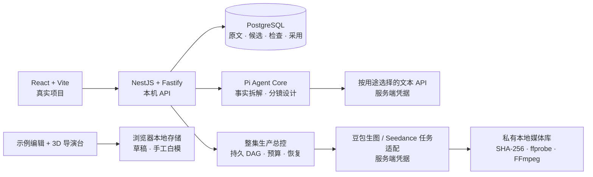

<div align="center">

<h1>FRAME</h1>

<p><strong>从一页剧本，到可推敲的每一个镜头。</strong></p>

<p>Shortdrama Agent Lab · 面向中文短剧的本地创作工作台与 Agent 实验项目</p>

<p>
  
  
  
  
  
</p>

<p>
  <a href="#产品预览">产品预览</a> ·
  <a href="#快速开始">快速开始</a> ·
  <a href="#当前进度">当前进度</a> ·
  <a href="#路线图">路线图</a> ·
  <a href="#文档导航">文档导航</a>
</p>

</div>

FRAME 把剧本、分镜和 3D 机位预演放进同一个深色电影工作台：对照原文审视一个镜头，调整景别和运镜，再在浏览器里验证人物站位与构图。

项目正在构建从中文单集剧本到真人拟真短剧的生产流程。当前是 **Early Preview**：除前端工作台、小说/剧本事实链路与手工白模外，已经建立持久化的「自动制作」总控。它把剧本拆解与采用、资产匹配和缺失补齐、分镜、规则式 3D 白模、多镜头视频候选、技术复核与有限返修、本地 FFmpeg 合片和交付串在同一个可暂停、可恢复的运行中。镜头视频会携带已绑定的参考图片、白模转写的构图约束，并请求供应商原生音频；真实模型调用需要对应的本机连接，并且必须由用户在创建该次运行时明确授权预算。页面把当前检查明确标成“镜头技术复核”，不把文件、画幅、时长和音轨检查描述成视觉语义审核。完整实现与边界见[全流程自动制片实现](docs/OHAO全流程自动制片实现-v0.1.md)。

## 产品预览

[](docs/media/product-tour.mp4?raw=true)

<p align="center">
  <a href="docs/media/product-tour.mp4?raw=true">查看 / 下载 MP4 演示</a>
  <br>
  <sub>录制自真实前端；画面中的分镜为手写样例，白模为手工练习场景。演示不包含模型自动生成或成片生产。</sub>
</p>

<details>
<summary>展开查看工作台与 3D 导演台截图</summary>

**电影工作台**


**3D 导演台**


</details>

## 为每个镜头保留创作的依据

### 从小说开始，先把原文读清楚

新增独立的「小说逐章拆解」：保留纯小说原文，按章核对人物、场景/地点、道具和对白。每项有可定位的原文依据；心理活动、引用和身份不明内容可保留待确认。支持增删校对、修正依据、保存本章新版本及查看只读历史，**不先改成剧本，也不接分镜或 3D**。使用与验证边界见 [小说逐章拆解](docs/小说逐章拆解.md)。

校对确认并保存后，可以关联同类型的已有资产，缺少素材则标记「待补」。资产选择保存进章节版本；原文条目变化后提示重新核对。资产库支持登记 HTTPS 素材链接，或导入本地 PNG、JPEG、静态 WebP 图片（最多 6 MiB），预览和下载本机保存的原图。导入本身不调用模型、不自动质检。见 [小说资产引用](docs/小说资产引用.md)。

「生成候选图片」从已确认的待补条目整理 `AssetVisualBrief`，明确区分原文事实、精确依据、可设计变量、负面约束和待确认项。每次显式额度授权只调用设置中选中的生图 API 生成一张候选，可继续逐次生成多个；成果进入 `awaitingReview`，不会自动建立章节引用。用户点击「确认并关联」后才正式关联，点击「拒绝此候选」会保留候选及溯源历史。不需要桌面自动化或 macOS 辅助功能权限，也不自动重试、自动质检、改编剧本或联动 3D；详见[豆包 API 资产候选](docs/豆包桌面一键资产.md)。

多阶段拆解已完成同一份前三章的真实模型对照：道具检出改善，地点粒度和语义复核仍不稳定，不能自动确认。完整数字、失败成本和边界见[小说拆解评测](docs/小说拆解评测-2026-10-23.md)。

### 模型连接，按用途独立配置

在「工作台设置 → 管理模型连接」保存多套完整模型连接，再为拆解、生图、生视频和通用用途分别选择。DeepSeek、Kimi、Sol、Terra 与豆包 Seedream/Seedance 可同时保留，切换无需重填接口和密钥，也不覆盖原模型。小说／剧本拆解走拆解选择，通用调用与分镜设计走通用选择，小说资产生图走生图选择，「自动成片」走生视频选择，不自动回退。密钥仅存本机后端，重启保留，页面不回显。详见[独立模型配置](docs/独立模型配置.md)。

### 剧本与镜头，放在一起看

粘贴或导入 TXT 保存剧本；用内置手写样例体验原文与对白对照，编辑画面设计、景别、运镜和预计时长。每行代表一个连续镜头，手工修改有标记，前端草稿可保存并导出 JSON。导入新剧本不会自动替换样例分镜。

「真实项目」页面提供独立的后端链路：保存剧本版本、启动事实拆解，对照原文校对人物、场景（地点）与道具，修改名称、别名和说明后保存新候选，再检查并采用。旧版本保留，原文依据只读；保存校对不调用模型。采用事实后，可继续生成并采用分镜候选。样例编辑与真实项目目前分开保存。

### 先摆出空间，再决定怎么拍

浏览器内的 3D 导演台支持人物体型与姿势、关节微调、几何物体、群众阵列和本地 GLB 导入。调整机位、焦段、光照、画幅与构图线，用白模推敲人物关系和画面节奏。

场景支持本地保存、JSON 导入导出；可预览并下载 PNG、机位宫格、深度图，以及 3 / 5 / 8 秒 WebM 运镜片段。运镜片段由浏览器渲染，需浏览器支持 WebGL 与 MediaRecorder。

### 让事实、设计和采用各有记录

原文版本、事实候选、模型执行记录、程序检查与采用决定分别保存。原文引用可核对，分镜设计单独标记；候选经过检查后，由你决定是否采用。

校对沿用实体 ID，修改文本标记为用户来源；保存不会覆盖旧候选，也不会直接替换已采用事实。历史版本可以查看，只有当前剧本的最新候选可继续编辑和采用。

当前程序检查覆盖结构、引用和对白覆盖等规则。剧情忠实度与镜头质量的语义评审仍在路线图中。

## 快速开始

### 先体验工作台

准备 **Node.js ≥ 22.19** 和 npm。前端体验无需数据库或模型账号。

```sh
git clone https://github.com/K80Tom/frame-shortdrama-agent.git frame
cd frame/shortdrama-agent-lab
npm --prefix web ci
npm --prefix web run dev
```

打开 [http://127.0.0.1:5173](http://127.0.0.1:5173)，进入示例剧本、分镜和 [3D 导演台](http://127.0.0.1:5173/#/director)。

仅启动前端时，示例草稿保存于浏览器 localStorage，白模保存于 IndexedDB；「真实项目」需要下面的本地后端。清理网站数据会清除浏览器草稿与场景，请通过页面导出留存。

### 启动真实项目与文字链路

准备 Docker Desktop（或可用的 Docker Compose 环境），并启动 Docker。在 `shortdrama-agent-lab/` 目录执行：

```sh
npm ci
npm run db:setup
npm run db:up
npm run db:migrate
npm run dev
```

`db:setup` 从示例配置初始化本地 `.env`，补齐随机数据库密码，并保留已有模型设置；迁移由 `db:migrate` 显式执行。后端默认监听 `http://127.0.0.1:8788`。

另开一个终端，在同一目录启动前端：

```sh
npm --prefix web ci
npm --prefix web run dev
```

打开 [真实项目](http://127.0.0.1:5173/#/production)，创建项目并保存剧本。来源链接仅用于记录出处，不会自动下载正文。

已有本地数据库升级后也需执行 `npm run db:migrate`，应用实体校对的 007、独立小说的 008、素材与本地图片的 009–010、单图任务与不确定任务解锁的 011–012、候选与生成溯源的 013、单段视频的 014、整集生产总控的 015，以及自动采用 actor 约束的 016，然后重启后端；服务不会自动迁移数据库。

处理纯小说时直接打开 [小说逐章拆解](http://127.0.0.1:5173/#/novel)。免费引号初稿不等于 AI 拆解；可选择单次初稿或「提取＋独立逐段查漏＋证据复核」，后者最多增加一次局部修复与复核，总计不超过五次模型调用。各阶段保存独立版本，人物/群体/生物、现场/提及/历史/设想分开记录，跨章实体表保留身份及版本出处。校对保存不消耗模型额度。模型检查不等于人工确认或准确率保证。

**运行 Agent 前需配置文本接口。** 在「工作台设置 → 管理模型连接」为“拆解”选择一份完整的文本连接；首次启动仍可从本地 `.env` 显式导入旧的 `LLM_*` 配置。原 Codewiz 代理及其模型列表已移除，系统不跨用途自动回退。密钥只保存在本机后端的忽略目录中，不进入浏览器或仓库；详见[独立模型配置](docs/独立模型配置.md)。

修改连接后，新任务会冻结当时的用途选择和版本；历史 Run、候选与校对不改写。未配置相应用途时仍可读取项目和校对已有拆解，生成会被拒绝。浏览器不保存模型密钥。小说待补资产继续采用逐张额度授权；独立单段视频工具继续采用单任务授权。整集「自动制作」使用一次运行级授权与预算上限，按任务预留和结算；外部提交结果不明时只查询原任务，不自动重发。视频完成后必须先下载、校验并进入本地私有媒体库，才能参与抽卡、复核、合片与交付。

配置完成后，可按以下顺序操作：

```text
保存剧本 → 事实拆解 → 对照原文校对实体 → 保存新候选 → 检查并采用事实 → 生成分镜候选 → 采用分镜
```

也可以打开 [自动制作](http://127.0.0.1:5173/#/automation)，选择已有项目和剧本版本，设置候选数、3D 策略、自动化模式与预算，在勾选本次付费授权后创建整集运行。默认“关键节点确认”会在拆解、资产、分镜和交付阶段等待确认；“全自动”会自动采用通过确定性检查的文字候选和技术推荐视频，但遇到预算、配置、关键事实、未知外部状态或质量门失败仍会停下等待处理。

数据库管理、迁移、端口与故障排查见 [本地开发](docs/本地开发.md)；文字链路的接口和实际范围见 [首个里程碑实现](docs/首个里程碑实现.md)。

## 当前进度

| 能力 | 当前状态 |
| --- | --- |
| 电影工作台 | 已实现首页、导航、剧本导入、示例分镜编辑、原文对照与前端草稿导出。 |
| 3D 导演台 | 已实现手工摆场、人物与机位调整、本地保存和浏览器渲染导出；生产总控可按确定性复杂度规则生成兼容白模快照，并把活动机位、焦距、运镜和人物站位转成视频 prompt 约束。白模是规则式预演，不是 3D 渲染参考图或供应商原生相机控制。 |
| 文字 Agent 链路 | 已实现 Pi Agent Core 接入、程序校验、候选采用及 PostgreSQL 保存；新模型一次真实请求成功返回，但事实候选输出协议校验失败，拆解尚未跑通。 |
| 拆解校对 | 可查看三类实体的原文依据，修改名称、别名、说明并保存不可变新候选；保留稳定 ID、用户来源、字段修改记录与历史版本。 |
| 小说资产引用 | 已确认人物、场景、道具可选择同类素材链接或本地导入图片，也可标记待补；引用与校对版本一并持久保存。生成候选只有人工接受后才成为正式关联。 |
| 媒体生产 | 已支持图片资产候选、把镜头绑定资产作为有序参考图、按镜头生成多个带供应商原生音频的视频候选、安全下载到内容寻址本地媒体库、`ffprobe` 校验、技术抽卡、携带失败项的有限局部返修、FFmpeg 顺序合片和本地 MP4 交付。独立配音、口型、音效、配乐和字幕仍属于后续声音子图。 |
| 生产运行能力 | 已实现 PostgreSQL 持久化的十阶段 DAG、镜头子图、幂等创建、CAS 更新、事务 outbox、预算预留、暂停/继续、重启恢复、外部任务对账、局部失效与重试。资产同优先级歧义会阻断而非猜选，最终交付还按质量档位检查冻结目标时长容差。当前检查在 UI 中明确为技术复核，不代表剧情和审美通过。 |

示例里的角色与资产卡片使用同一张示意图的裁切；样例分镜、手工白模、真实项目候选目前尚未组成统一的可编辑成片工程。

## 工程结构

主工程使用 TypeScript。前端负责交互与白模预演；NestJS＋Fastify 提供本机 API；Pi Agent Core 执行文字阶段，PostgreSQL 保存项目、候选与执行记录。



```text
shortdrama-agent-lab/
├── web/                React 工作台与浏览器 3D 导演台
├── src/                本机 API、模型适配、原文内核与文字阶段
├── migrations/         PostgreSQL 显式迁移
├── tests/              内核、契约与本机 HTTP 测试
├── scripts/            数据库准备、集成验证与模型检查
├── examples/           剧本练习与手写数据样例
├── docs/               设计、架构、接入说明与演示媒体
└── flow-explainer/      独立保留的九步流程讲解页
```

<details>
<summary>开发验证命令</summary>

在 `shortdrama-agent-lab/` 目录执行：

```sh
npm test
npm run build
npm --prefix web test
npm --prefix web run build
```

数据库已启动并完成迁移后，可运行：

```sh
npm run test:db
```

这些测试不调用真实模型；数据库集成测试仅创建并清理自身的测试项目。模型输出质量需单独评测，不能由离线测试结果推断。

</details>

## 路线图

- [x] 本地电影工作台、示例分镜编辑与手工 3D 白模。
- [x] 原文索引、项目持久化、受控文字阶段、程序检查与候选采用。
- [x] 人物、场景（地点）、道具的原文对照与基础文字校对，保存新候选后重新检查、采用。
- [ ] 用真实模型验收拆解、分镜与视频内容质量，完善视觉语义检查。
- [ ] 扩展实体增删合并、场次/对白等编辑、候选差异比较、跨 Run 人工修改保护与按场重做。
- [x] 建立独立资产库，跑通小说人物、场景、道具的单图候选与人工采用闭环。
- [x] 跑通独立的单段文本生视频任务、持久进度与安全恢复。
- [x] 建立项目级生产 DAG，接入正式镜头候选、运行预算、跨模块恢复和有限技术返修。
- [x] 完成本地多镜头时间线、程序化成片质检和可下载的整集 MP4 交付。
- [ ] 增加视频语义复核、独立声音/字幕制作和可继续编辑的专业时间线工程。

首批整集目标为真人拟真、约 1–2 分钟、竖屏 9:16、中文对白。路线图是建设方向，具体需求与完成标准见 [总体设计](docs/总体设计.md)。

## 文档导航

| 想了解什么 | 从这里开始 |
| --- | --- |
| 产品目标、创作边界与里程碑 | [总体设计](docs/总体设计.md) |
| 已实现架构与后续设计 | [技术架构](docs/技术架构.md) |
| 前端操作与浏览器保存范围 | [工作台说明](web/README.md) |
| 本地启动、数据库与迁移 | [本地开发](docs/本地开发.md) |
| MAAS 模型配置与调用限制 | [模型接入](docs/模型接入.md) |
| 当前文字链路与 API | [首个里程碑实现](docs/首个里程碑实现.md) |
| 一键视频的接口、恢复与能力边界 | [单条视频自动化](docs/单条视频自动化.md) |
| 整集自动制作、恢复、媒体链与边界 | [全流程自动制片实现](docs/OHAO全流程自动制片实现-v0.1.md) · [产品构思](docs/OHAO全流程自动制片构思-v0.1.md) |
| 原文引用、计划版本与数据契约 | [数据结构 v0.1](docs/数据结构-v0.1.md) |
| 拿一个小样例理解分镜 | [赴约 · 极简拆解](examples/斗破苍穹-极简拆解.md) · [样例说明](examples/README.md) |
| 深入查看阶段实现 | [持久化](docs/持久化-P0.2.md) · [事实候选](docs/候选计划-P0.3.md) · [受控阶段执行](docs/受控阶段执行-P0.4.md) |
| 开发约定与代码来源 | [AGENTS.md](AGENTS.md) · [第三方说明](web/THIRD_PARTY_NOTICES.md) |

## 仓库中的其他目录

**本项目的产品入口与开发真源是 `shortdrama-agent-lab/`。** 仓库首页以本项目为主；以下同级内容仅供历史阅读和方法参考，不是启动依赖：

| 路径 | 用途 |
| --- | --- |
| `../短剧Main/` | 旧平台源码参考；已授权复用的 3D 导演台模块已独立迁入本项目。 |
| `../shortdrama-agent/` | 旧 Agent 实现与规则参考。 |
| `../shortdrama-cli/` | 旧 CLI 方案参考。 |
| `../zhongwen-shortdrama-agent` | 空占位文件，不是可运行项目。 |
| 根目录《短剧智能体-源码分析与 MVP 建议》 | 历史调研；当前产品与技术说明以本项目 `docs/` 为准。 |

使用 FRAME 无需安装或运行上述参考项目，也不依赖旧平台的 Main API、数据库、账号或部署配置。

## 来源与许可

3D 导演台按明确授权从同仓旧平台迁入，并完成独立运行适配；具体来源与改动见 [第三方代码说明](web/THIRD_PARTY_NOTICES.md)。React Bits 组件的原始许可保留在 [REACT_BITS_LICENSE.md](web/src/vendor/REACT_BITS_LICENSE.md)。

本项目尚未声明统一开源许可证；公开代码与演示不等于授予整体再分发或商用许可。使用或分发第三方代码、样例与素材前，请核对各自来源及许可。

---

<div align="center">
  <p><strong>让创作从可看见的镜头开始。</strong></p>
  <p><a href="#快速开始">本地体验 FRAME</a> · <a href="https://github.com/K80Tom/frame-shortdrama-agent/issues">反馈问题与想法</a></p>
</div>
