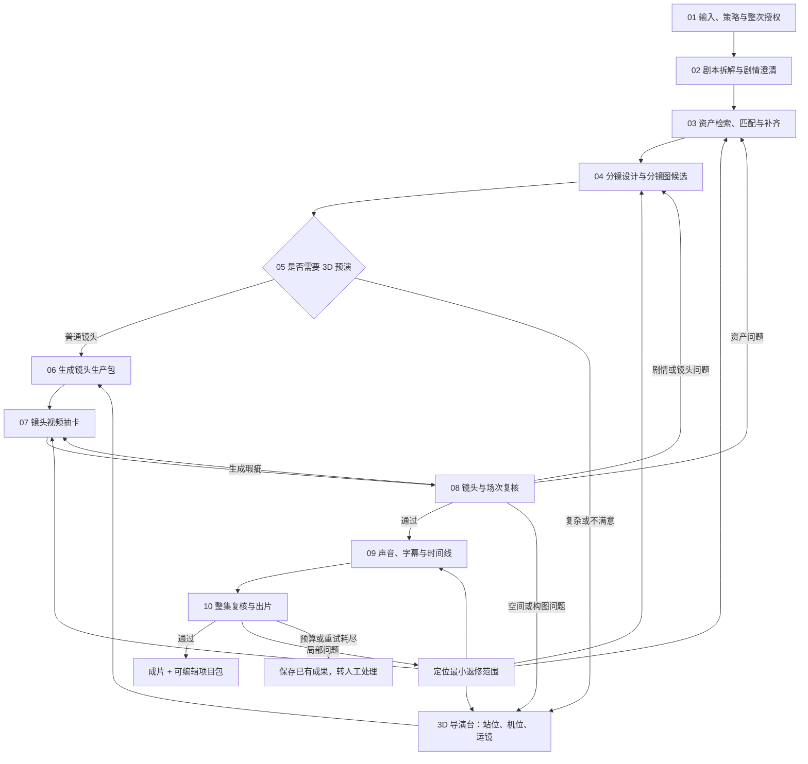
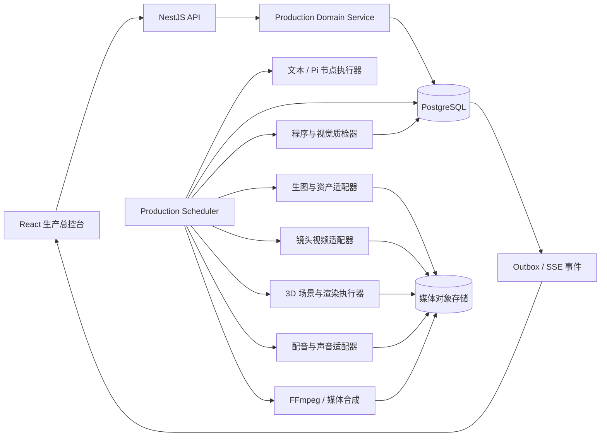

# Story Studio 全流程自动制片构思 v0.1

> 状态：产品与技术构思稿，不代表功能已经实现。
>
> 日期：2026-10-23
>
> 目标：把当前彼此独立的剧本拆解、资产、分镜、3D 导演台和视频生成能力，组织成一条可恢复、可局部返修、可人工接管的短剧生产流水线。

## 1. 这次要解决的真正问题

Story Studio 的自动化不应是“输入一句提示词，生成一条视频”。它应当是一位项目级的制片与导演 Agent：从已经确认的单集剧本出发，理解剧情，建立统一设定，准备资产，设计分镜，按需进行 3D 预演，逐镜生成候选，自动复核，局部返修，最后完成声音、剪辑和出片。

用户只需完成一次创建和授权。后续正常步骤由系统推进；遇到剧情歧义、候选难分、预算不足或连续失败时，再把具体问题交给用户。

最终产品应满足五个原则：

1. **项目驱动。** 每次运行绑定项目、集数、剧本版本、制作要求和预算。
2. **过程可见。** 用户能看到每个场次、镜头和候选的真实状态。
3. **成果可追溯。** 每条视频都能追溯到剧本、资产、分镜、3D 预演、模型调用和采用决定。
4. **局部返修。** 一个镜头失败时，只失效实际依赖它的下游，不推倒整集重来。
5. **随时接管。** 自动化负责推进，用户保留暂停、修改、选择候选和续跑的权力。

首版从已经成形的单集剧本开始。小说改编可以作为上游独立流程接入，但不能把“小说拆解成功”直接视为“剧本已可生产”。

## 2. 产品定位

一句话定义：

> 把一份剧本交给 Story Studio，系统自动完成拆解、资产准备、分镜、导演预演、镜头生成、抽卡、复核和出片，并保留可继续修改的制作工程。

当前 `#/automation` 的单段文本生视频能力不应废弃。它适合变成完整流水线中的“镜头视频生成节点”，并在插件或高级工具中保留独立试验入口。新的自动制作主入口应创建项目级 `ProductionRun`，而不是直接创建一个供应商视频任务。

## 3. 用户看到的完整流程



这不是一条只能从左跑到右的线性脚本。剧本采用后，系统会按场次、资产和镜头动态展开任务；不同场次可以并行，局部问题只阻断相关依赖。

## 4. 一键创建应该是什么体验

创建页保持简洁，只要求用户确认生产所必需的信息：

- 项目、集数和剧本版本；
- 画幅、目标时长和视觉风格；
- 生产策略：快速、均衡、高质量；
- 3D 策略：自动判断、全部预演、不使用；
- 自动化模式；
- 每类候选上限与整次预算上限；
- 本次允许调用的文本、生图、生视频、声音和质检能力。

主按钮只有一个：**开始自动制作**。

点击前，页面应展示一次预检：

- 剧本是否完整；
- 需要的人物、场景、道具和声音数量；
- 预计镜头数量；
- 已配置与缺失的模型能力；
- 预计调用范围和费用区间；
- 会在哪些节点等待用户。

用户授权的是一整次运行的明确上限，而不是允许 Agent 无限调用模型。所有候选、重试和返修都共享这次运行的预算与次数限制。

### 4.1 三种自动化模式

| 模式 | 行为 |
|---|---|
| 全自动 | 正常步骤自动采用；只在关键剧情不明、付费提交不明、预算不足、质量无法判断或重试耗尽时暂停。 |
| 关键节点确认 | 在剧本计划、核心资产、分镜方案和最终成片处等待确认；建议作为默认模式。 |
| 共同导演 | 每个场次、关键镜头和主要候选都由用户确认，适合精细创作。 |

无论选择哪种模式，系统都不能绕过预算、人工锁、版本冲突和未知付费提交的安全门。

## 5. 九个生产阶段

### 5.1 输入、策略与整次授权

系统冻结本轮使用的：

- 剧本版本和制作要求；
- 画幅、时长、风格与交付规格；
- 工作流、提示词和质检规则版本；
- 模型连接版本；
- 自动化模式与人工门禁；
- 总预算、阶段预算、候选数和返修次数。

运行开始后，修改以上内容要创建新版本并计算影响范围，不能静默替换正在执行的输入。

### 5.2 剧本拆解与剧情澄清

拆解结果至少包括：

- 场次与剧情节拍；
- 人物、人物关系和身份状态；
- 场景、道具、服装和造型状态；
- 对白、动作、情绪变化；
- 连续性要求；
- 每场建议镜头数和时长；
- 资产需求；
- 精确原文引用与仍待确认的问题。

程序先检查结构、引用、对白覆盖和版本一致性；模型负责提出语义候选与问题。模型不能自行把不确定剧情编成事实。无法确认的关键内容形成问题，只阻断相关场次。

### 5.3 自动匹配与补齐资产

系统为人物、场景、道具、服装和声音建立结构化需求，再检索资产库。

匹配分为两层：

1. **硬约束。** 类型、人物身份、时代、版权与来源、媒体可读性、版本状态不得冲突。
2. **适配判断。** 外观、服装状态、场景氛围、时间天气、道具细节、镜头角度、画幅、清晰度和既有视觉一致性。

名称相同或向量相似只能帮助召回，不能绕过硬约束。匹配结果分为：

- **直接使用：** 满足约束，自动固定具体资产版本；
- **参考变体：** 保留身份锚点，为当前场次生成服装、角度或状态变体；
- **缺失或冲突：** 进入资产候选生成。

缺失资产不应只得到一张孤立图片，而应逐步形成可复用的“资产族”。

人物资产可包含标准形象、全身/半身、侧面、主要服装、表情和声音档案；场景资产可包含主视图、空间布局、方向参考与光照版本；道具资产可包含尺寸、状态和使用关系。

生成候选必须保存：原文依据、允许设计的变量、负面约束、模型与连接版本、提示词快照、文件哈希、费用和采用决定。被拒绝的候选继续保留历史，但不得成为正式引用。

### 5.4 分镜设计

分镜 Agent 读取已经采用的剧情事实、资产版本和制作要求，为每个场次生成镜头计划。

每个镜头至少包含：

- 原文与对白绑定；
- 镜头叙事目标；
- 入画人物、造型、场景和道具版本；
- 景别、机位、焦段和运镜；
- 表演、动作和情绪；
- 预计时长；
- 首帧与尾帧意图；
- 与相邻镜头的连续性要求；
- 视频提示与负面约束；
- 是否建议进入 3D 预演及原因。

分镜先经过确定性检查：对白必须完整覆盖、引用可解析、镜号与场次顺序正确、时长能容纳对白、已锁资产不得被替换。随后再进行剧情忠实、叙事节奏和电影语言检查。

视频调用前可以先生成低成本分镜图候选，让用户或质检器判断构图与节奏。

### 5.5 条件式 3D 导演预演

3D 导演台不是每个镜头的强制步骤。以下条件可以触发：

- 多人走位、遮挡或动作关系复杂；
- 大幅运镜或空间连续性要求高；
- 存在越轴、视线或前后镜头方向风险；
- 用户因机位、构图或站位拒绝分镜；
- 自动复核发现空间问题；
- 视频候选多次因构图或动作失败；
- 用户主动要求预演。

系统生成一个版本化的 3D 场景草稿，并自动放置人物、道具、摄像机、焦段、画幅、环境和运镜轨迹。用户可以在现有导演台中接管调整。

确认后输出：

- `DirectorSceneRevision` 场景快照；
- 机位与焦段；
- 人物站位和动作路径；
- 首尾帧、参考宫格或深度图；
- 运镜参数和构图说明。

如果视频供应商支持参考图、首尾帧或深度控制，就将其作为实际输入；若不支持，只能作为提示词与人工判断依据，不能宣称精确控制。

### 5.6 镜头生产包

每个镜头在生视频前形成不可变的生产包：

```text
剧本与分镜版本
+ 资产绑定版本
+ 对白和实际音频时长
+ 3D 场景与机位版本（如有）
+ 动作、表演、画面和负面约束
+ 相邻镜头连续性要求
+ 模型、规格、候选和预算策略
```

这个生产包是局部恢复和返修的边界。生产包没有改变时，重复点击或服务重启不得产生新的付费任务。

### 5.7 镜头视频抽卡

视频按镜头生成，而不是要求模型一次生成整集。

“抽卡”是一组有计划、有上限的候选，不是无限重试。不同候选可以有意识地变化表演强度、动作节奏、运镜或光线；人物身份、剧情事实、锁定资产和硬约束保持不变。

建议支持两种策略：

- **节省模式：** 先生成一个候选；硬检查失败或质量不足时再补卡；
- **创意模式：** 为关键镜头并行生成有限的多个候选。

每个候选卡片展示：预览、生成批次、费用、人物一致性、动作完成度、构图、连续性、技术问题和推荐原因。用户可以采用、拒绝、补抽、修改分镜或进入 3D。

自动采用必须同时满足硬检查和语义/视觉质量门。候选接近或判断不确定时转人工，不依赖一个不透明总分做决定。

### 5.8 多层复核与有限返修

复核分三层：

| 层级 | 主要检查 |
|---|---|
| 镜头级 | 文件与编码、时长、黑帧/闪烁、人物身份、人数、服装、道具、动作、构图、对白和口型。 |
| 场次级 | 人物位置、视线与轴线、道具状态、光线、服装、情绪递进、节奏和相邻镜头连续性。 |
| 整集级 | 剧情顺序、对白覆盖、字幕、音画同步、响度、转场、节奏、片头片尾和输出规格。 |

检查结果统一使用 `pass / fail / uncertain`，同时保存问题位置、严重度、依据和建议。不能只保留一个分数。

返修根据原因回到最小上游：

| 问题 | 返回节点 |
|---|---|
| 剧情、对白或动作不忠实 | 分镜 |
| 人物身份、服装、场景或道具不一致 | 资产选择或资产补齐 |
| 构图、遮挡、越轴、机位或空间运动 | 3D 导演台 |
| 视频伪影、闪烁、肢体错误 | 当前镜头补卡 |
| 口型、对白时长或声线 | 声音或当前镜头 |
| 转场、字幕、响度或编码 | 时间线与合成 |
| 相邻镜头连续性 | 只失效相关邻接镜头和成片检查 |

自动返修必须受预算、候选数和尝试次数限制。达到上限后保留全部成果，报告未完成并转人工。

### 5.9 声音、时间线与出片

声音不能只在最后机械叠加。对白的实际时长会影响镜头时长和口型，因此对白音频与镜头生产需要协同。

出片阶段包括：

- 对白配音与口型处理；
- 环境音、音效和音乐；
- 字幕；
- 镜头排列、裁切和转场；
- 音量混合、调色与输出编码；
- 片头片尾；
- 最终复核。

最终交付至少包括：

- 本地持久化并校验过的成片 MP4；
- 可编辑时间线；
- 镜头视频、声音和字幕素材包；
- 资产与版本清单；
- 候选、采用和返修历史；
- 质量复核报告与成本记录。

供应商返回的临时 HTTPS 链接不能直接视为最终交付。

## 6. 自动化页的信息架构

### 6.1 创建前

左侧为创建表单，右侧为流程预览与预检摘要。

建议文案：

> **把剧本交给 Story Studio，完成一整条制作流程**
>
> 系统会自动拆解、准备资产、设计分镜、生成镜头并完成复核；需要你决定时会暂停。

高级参数默认折叠，避免用户一开始面对几十个技术选项。

### 6.2 创建后

页面成为项目生产总控台，分为四个区域：

1. **顶部状态栏：** 项目、集数、运行状态、已完成镜头数、预算使用和暂停按钮；
2. **阶段轨道：** 展示九个阶段的真实完成数量；
3. **镜头矩阵：** 按场次和镜头查看资产、分镜、3D、视频、候选和复核；
4. **右侧详情：** 当前节点输入、输出、候选、检查、费用、原因和可执行操作。

阶段轨道示例：

```text
剧本拆解      已完成
资产准备      8 / 10
分镜设计      18 / 24
3D 预演       3 / 5（按需）
镜头生成      9 / 24
抽卡采用      6 / 24
自动复核      5 / 24
剪辑合成      等待中
出片          等待中
```

进度使用可验证的离散数量，不根据等待时间伪造百分比或预计完成时间。

### 6.3 待处理收件箱

页面顶部固定一个轻量的“需要你处理”区域：

```text
需要你处理 2 项

场 02 · 镜头 05
人物资产匹配不确定
[比较候选]

场 04 · 镜头 02
连续性复核未通过
[重新抽卡] [进入 3D]
```

问题必须告诉用户：发生在哪里、为何暂停、会影响哪些镜头、推荐的处理方法和预计额外成本。

### 6.4 镜头矩阵

| 镜头 | 资产 | 分镜 | 3D | 视频 | 候选 | 复核 |
|---|---|---|---|---|---|---|
| S01-01 | 完成 | 完成 | 未触发 | 完成 | 已采用 | 通过 |
| S01-02 | 完成 | 完成 | 完成 | 生成中 | 等待 | 等待 |
| S02-01 | 待确认 | 等待 | 等待 | 等待 | 等待 | 等待 |

点击任一单元格即可打开该镜头对应阶段的详情。普通用户看到阶段和问题；供应商请求、原始日志和状态机数据放在高级信息中。

### 6.5 全站入口调整

- **首页：** 新建自动制作、正在运行、待处理事项、最近项目和最近成片；
- **项目：** 项目卡片展示当前阶段、镜头完成数和待处理问题；项目内包含概览、剧本、资产、分镜、3D、镜头、复核、成片；
- **资产：** 增加服装、声音、候选组、版本、来源和使用镜头；
- **插件：** 按文本拆解、生图、生视频、配音、音乐、视觉质检、存储与导出展示能力和连接状态；
- **自动制作：** 创建运行、查看所有运行、处理问题和进入具体项目生产中心。

视觉继续采用 Story Studio 当前的中性黑灰、低对比边框、荧绿强调和大留白。复杂依赖由系统管理，主界面不使用自由拖拽式节点编辑器；高级视图才展示实际 DAG。

## 7. 技术架构

继续采用当前已经确认的工程组合：React + Vite 前端、NestJS + Fastify 后端、自有 TypeScript 调度、PostgreSQL、Pi 阶段执行器和各类供应商适配器。



### 7.1 职责边界

- **生产总控：** 决定任务能否开始、依赖是否满足、预算是否允许、结果能否采用以及下一步是什么；
- **模型 Agent：** 在单个受限节点内生成内容候选、调用允许的工具并提出问题；
- **适配器：** 调用具体供应商，保存远端任务标识并查询结果；
- **质检器：** 输出检查事实和问题，不能直接覆盖成果；
- **数据库：** 保存当前状态、不可变版本、依赖、费用和审计记录；
- **媒体存储：** 保存真实图片、音频、视频和成片，不依赖易过期远程链接。

整集流程不能寄托在一次长模型对话里。Pi 适合执行单节点的有限推理；项目级状态必须由领域表和程序状态机维护。

## 8. DAG、状态机与恢复

### 8.1 ProductionRun 状态

```text
draft → planned → queued → running
                         ↔ waitingHuman
                         ↔ pausedBudget
                         ↔ reconciling
                         → completed
                         → partial | failed | cancelled
```

- `completed` 只有在成片文件存在、规格校验通过且所有必需质量门通过后成立；
- `partial` 表示已有可用成果，但预算、质量或人工问题导致整集未完成；
- 局部任务等待人工时，只要其他独立任务仍能运行，Run 继续显示 `running`，同时标记待处理问题。

### 8.2 ProductionTask 状态

```text
pending → ready → running
                  ├→ waitingExternal → validating → succeeded
                  ├→ retryWait → ready
                  ├→ reconciling
                  ├→ waitingHuman
                  └→ failed
```

另保留 `cancelled / invalidated / superseded`。等待供应商或人工时释放 worker 租约。

### 8.3 外部付费调用

```text
prepared → submitting → submitted → polling → succeeded | failed
                         └────────────→ unknown → reconciling
```

`unknown` 表示请求可能已经提交并计费。此时只能核对原任务，不能自动创建第二次请求。

### 8.4 恢复规则

- 有供应商任务 ID：只查询原任务；
- `submitting` 中断且没有任务 ID：进入 `unknown`，等待对账或人工处理；
- 文件已经下载但数据库未登记：按 operationKey、临时文件和 SHA-256 核对后登记；
- worker 租约过期：只表示 worker 消失，不代表远端任务失败；
- 只有明确发生在网络调用前的本地失败，才允许按原输入重试；
- 取消不代表供应商取消成功或退款，仍要查询和结算。

## 9. 核心数据对象

| 对象 | 用途 |
|---|---|
| `ProductionRun` | 绑定项目、剧本、工作流、模式、预算、人工门禁和全局状态。 |
| `ProductionTask` / `Dependency` | 表达节点、场/镜头/资产作用域、输入摘要、限制和 DAG 依赖。 |
| `TaskAttempt` | 保存每次尝试的规则、提示、模型、连接版本、结果与错误。 |
| `ExternalOperation` | 保存唯一操作键、供应商任务 ID、提交、查询、对账和计费状态。 |
| `Artifact` / `ArtifactVersion` | 统一表示文字、图片、音频、视频、3D 场景、预览和成片。 |
| `MediaObject` | 保存本地对象标识、SHA-256、MIME、尺寸、时长、编码和来源。 |
| `AssetRequirement` | 保存人物、造型、场景、道具和声音需求及原文依据。 |
| `AssetCandidate` / `AssetBinding` | 保存检索或生成候选、适配检查与最终固定版本。 |
| `StoryboardRevision` | 保存分镜候选、镜头、对白绑定和采用历史。 |
| `DirectorSceneRevision` | 保存 3D 场景、对象、相机、运镜和资产引用版本。 |
| `CandidateSet` / `Candidate` | 保存资产或镜头的抽卡批次、候选、评价和选择结果。 |
| `QualityCheck` / `QualityIssue` | 保存规则版本、pass/fail/uncertain、位置、依据和返修建议。 |
| `ReviewDecision` | 保存人工接受、拒绝、反馈和当时所见版本。 |
| `BudgetLedger` | 追加保存 estimate、reserve、charge、release。 |
| `TimelineRevision` / `Delivery` | 保存轨道、字幕、转场、输出规格、成片和项目包。 |
| `OutboxEvent` | 与状态变更同事务写入，供 worker 和前端消费。 |

每个任务保存 `inputManifest`，固定本次真正读取的剧本、分镜、资产、音频、3D、人工锁、规则和模型连接版本，并计算摘要。共享资产变化后，通过反向依赖只失效引用它的镜头、检查和成片。

## 10. 调度和并发

首版可直接使用 PostgreSQL 任务表作为队列，无需立即增加 Redis：

1. 调度器寻找依赖完成、输入有效、预算允许且没有阻断问题的任务；
2. 使用短事务、CAS、租约和 `FOR UPDATE SKIP LOCKED` 领取任务；
3. 文本、生图、生视频、3D、声音、质检和合成使用独立并发通道；
4. 等待外部结果或人工时释放执行名额；
5. 状态变化和 Outbox 事件在同一事务提交；
6. worker 可以使用短轮询或 `LISTEN/NOTIFY` 唤醒，通知丢失时仍能通过扫描恢复；
7. 前端使用 SSE 接收增量事件，并定期获取完整快照校正状态。

外部调用必须在网络请求前生成并持久化唯一 `operationKey`。供应商支持幂等键时向上游透传；不支持时仍依靠本地唯一约束和未知状态避免无意双提交。

## 11. 质量门和自动采用

| 质量门 | 确定性检查 | 语义或视觉检查 |
|---|---|---|
| 剧本与计划 | Schema、引用、对白覆盖、版本一致 | 忠实度、歧义、人物关系 |
| 资产 | 文件、类型、尺寸、来源和版本 | 身份、风格、服装和镜头适配 |
| 分镜 | 时长、对白绑定、镜号和引用 | 叙事、节奏、电影语言 |
| 3D | 对象、相机、画幅和参数范围 | 遮挡、构图、站位和动线 |
| 镜头视频 | 解码、时长、分辨率、黑帧、冻帧和音轨 | 身份连续、动作、表演、口型和视觉瑕疵 |
| 成片 | 时间线、字幕覆盖、响度和编码 | 剧情连续、节奏和跨镜头一致性 |

自动选优应遵循：先淘汰硬检查失败项，再比较合格候选；如果检查为 `uncertain`、候选差距不明显或涉及关键角色身份，就进入人工门禁。

模型质检的阈值必须用人工标注样例校准。首版不能把视觉模型的高分等同于真实质量通过。

## 12. 预算、重试与停止条件

运行策略冻结：

- 总预算和币种；
- 阶段预算上限；
- 资产与镜头候选上限；
- 每镜头返修上限；
- 每任务调用和超时上限；
- 分辨率、时长和并发上限；
- 各阶段人工门禁策略。

每次付费调用前原子预留预计最大费用，结束后记录实际费用并释放余额。`unknown` 调用继续占用预留，防止再次花掉可能已经消费的额度。

质量失败与网络失败分开计数：质量失败可以依据问题改变输入后补卡；网络提交不明只能核对。系统不能把“重试”当作统一按钮。

## 13. 当前代码的可复用基础与主要缺口

| 环节 | 当前可复用基础 | 需要新增或改造 |
|---|---|---|
| 剧本拆解 | Project、ScriptVersion、原文索引、候选、Check/Issue、采用和执行账本 | 先修通真实剧本模型协议；补全语义校验、场景编辑与局部重做。 |
| 资产 | HTTPS/本地图片目录、小说资产绑定、视觉简报、图片异步任务、候选接受/拒绝和溯源 | 自动检索与适配、剧本/镜头绑定、服装和声音类型、批量队列与视觉质检。 |
| 分镜 | StoryboardRevision、对白绑定、程序校验、不可变候选和采用保护 | 读取资产和视觉设定、按场重做、候选比较、自动采用和 3D/视频生产包。 |
| 3D 导演台 | 浏览器白模、相机、焦段、姿势、运镜、深度图、导出，以及类型化 DirectorCommand | 后端持久化、项目/镜头/资产绑定、自动摆场、版本管理和无头渲染。 |
| 生视频 | Seedance 适配器、持久任务、幂等、CAS、轮询、重启恢复和 unknown 对账 | 绑定镜头与输入版本、参考资产/首尾帧/3D、视频候选池、媒体入库和质量检查。 |
| 抽卡 | 图片候选、溯源和接受/拒绝数据模式 | 通用 CandidateSet、批量有限候选、自动排名、去重、多样性和视频候选。 |
| 复核 | 文本确定性检查、人工采用、图片人工决定、媒体容器检查 | 资产视觉适配、镜头/场次/整集 QC、问题分类和最小返修路由。 |
| 出片 | 暂无完整闭环 | 音频、字幕、时间线、FFmpeg、媒体对象存储、成片版本与工程导出。 |

最大的结构性缺口不是某个模型，而是统一的数据主线：

```text
Project
→ ScriptVersion
→ Plan / StoryboardRevision
→ Shot
→ AssetBinding
→ DirectorSceneRevision
→ CandidateSet
→ QualityCheck / Adoption
→ TimelineRevision
→ Delivery
```

## 14. 建议实施顺序

### 阶段 A：生产总控底座

- 建立 Run、Task、Dependency、Attempt、ExternalOperation、Outbox 和 Budget；
- 将当前单视频服务改造为可被镜头任务调用的适配器；
- 打通任务领取、SSE、CAS、幂等和重启恢复；
- 先用假适配器验证崩溃、迟到响应、版本失效、重复点击和预算暂停。

验收重点是流程可靠，不调用真实付费模型也能验证状态机。

### 阶段 B：一个场次闭环

范围：一个场次、3–5 个镜头。

```text
已采用剧本拆解
→ 自动分镜
→ 资产匹配 / 补一项资产
→ 条件式 3D
→ 镜头视频候选
→ 人工采用
→ 简单时间线与 MP4
```

这一步先保留剧本、核心资产、分镜和最终采用门禁，验证版本、费用、防重、恢复和真实媒体落地。

### 阶段 C：单场自动返修

- 资产适配与资产抽卡；
- 自动 3D 草稿与参考渲染；
- 多视频候选；
- 镜头视觉质检；
- 问题分类和最小返修；
- 候选和预算上限。

### 阶段 D：多镜头完整单集

- 多场次动态 DAG 和有限并发；
- 共享资产一致性和局部失效；
- 配音、音效、音乐和字幕；
- 时间线、FFmpeg 合成和成片质检；
- 1–2 分钟竖屏成片与可编辑项目包。

### 阶段 E：全自动与系列生产

- 可配置人工门禁；
- 自适应候选数量；
- 质检评测集和阈值校准；
- 无头 3D 渲染；
- 多集角色、服装、声线和场景连续；
- 成本、并发和供应商路由优化。

## 15. 工程验收底线

完整系统至少满足：

1. 关闭网页和重启后端后，可以从持久边界恢复；
2. 付费提交结果不明时，不自动重复计费；
3. 修改一个资产，只失效实际依赖它的镜头；
4. 超预算前停止新的付费任务，并保存现有成果；
5. 任一必需质量门未通过时，整集不能标记完成；
6. 用户的人工修改和已锁成果不会被迟到任务覆盖；
7. 每个最终镜头都能回溯原文、资产、分镜、3D、模型、候选、检查和采用决定；
8. 最终成片保存在本地受控媒体存储中，并通过解码、时长、分辨率和文件哈希检查；
9. 任何局部失败都能说明失败位置、影响范围、已花费用和下一步选择；
10. 一个场次的失败不会无理由阻断其他输入有效的场次。

## 16. 必须先实验验证的事项

- Seedance 是否真正支持参考图、首尾帧、深度或机位信息；
- 各供应商的任务去重、查询、取消、链接有效期和收费边界；
- 浏览器 3D 场景能否稳定迁移到后台无头渲染；
- 真人角色跨镜头一致性、精细动作和中文口型；
- 视觉质检对身份、动作、连续性和审美的可靠程度；
- 对白应该先生成以约束镜头时长，还是由视频模型直接生成；
- 本地视频存储、备份、清理和磁盘上限；
- 1–2 分钟成片的实际模型费用、生成时长和返修率。

## 17. 对可行性的判断

这套系统在工程上可行，当前项目也已有可复用底座。难点不在“能不能串几个 API”，而在于四件事：

1. 用统一版本和依赖关系串起当前独立模块；
2. 对所有付费外部任务实现幂等、对账和恢复；
3. 把抽卡、质检和返修限制在预算内，并只重做真正受影响的部分；
4. 对人物一致性、口型、动作和审美判断保留真实的质量边界。

第一版正确目标不是承诺完全无人值守地产出稳定精品，而是让系统能够自动向前推进、把问题定位到具体场次和镜头，并把少量真正需要判断的事项精准交给用户。等单场真实闭环稳定后，再扩展到完整单集和系列生产。
