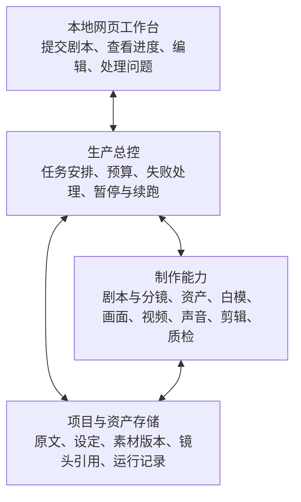
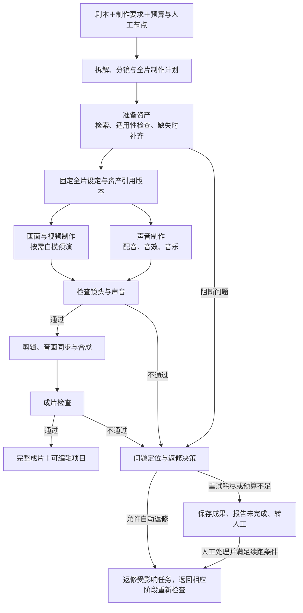

# 短剧智能生产 Agent：总体设计

更新日期：2026-10-23。

本文汇总已确认的产品需求，以及据此提出的功能框架和开发里程碑，是后续功能规格、技术架构与验收设计的依据。

**当前状态：本地 React 工作台、浏览器 3D 导演台、小说/剧本事实链路、资产库和独立单段视频任务已具备。在这些能力之上，已新增项目级「自动制作」总控：把剧本拆解与采用、资产匹配和缺失图片补齐、分镜、规则式 3D 白模、多镜头视频候选、技术抽卡与有限返修、本地 FFmpeg 合片和 MP4 交付组织成持久化 DAG。镜头视频会使用绑定资产作为有序参考图片，按需把白模机位和人物站位转成 prompt 构图约束，并请求供应商原生音频。运行支持预算预留、人工检查点、暂停、重启恢复、外部任务对账和局部重试。当前界面明确展示“镜头技术复核”，其结论覆盖文件、哈希、画幅、时长和音轨，不标记为视觉语义审核；独立配音、口型、配乐、音效和字幕仍是后续声音子图。真实模型调用依赖本机配置，并要求用户在创建该次运行时明确授权。详见[全流程自动制片实现](Story-Studio全流程自动制片实现-v0.1.md)。**

2026-10-22 用户要求移除原 Codewiz 接入，先改用一份 MAAS 文本模型；该次实测记录见[验证记录](模型接入验证.md)。2026-10-23 已进一步抽离为拆解、生图、生视频、通用四个用途选择，并从本机 `video_agent` 的既有私有配置导入 Seedream/Seedance 连接。完整接口和密钥只保存在服务端忽略目录，仓库与浏览器不保存真实凭据；不跨用途自动回退。历史 Run 保留原记录，新任务冻结当时的选择版本。配置见[独立模型配置](独立模型配置.md)。

## 1. 产品目标与范围

建设一个面向真人拟真短剧的自动生产系统。用户输入剧本和制作要求，系统自动完成剧本拆解、分镜规划、资产检索与补齐、画面和声音制作、剪辑及质量检查，交付完整成片和可编辑项目。

系统支持全自动运行，也支持在指定节点等待人工确认。自动返修仍不达标时，保存成果、报告未完成并转人工处理；人工修改后重新检查，继续生产。

- **使用者与入口：** 首先解决个人生产需求，通过本地网页操作。
- **起始输入：** 粘贴文本或 TXT 文件形式的已有中文单集剧本，以及制作要求。当前不将从整部小说自动改编剧本列为起始输入能力。
- **首批整集验收目标：** 真人拟真风格，约 1–2 分钟，竖屏 9:16，中文对白。时长按对白和表演安排，不为凑时长擅自删改剧情。
- **最终交付：** 完整成片视频，以及可在本项目网页中继续编辑和局部重做的项目；保存原始素材和中间成果。
- **独立开发边界：** 在本目录从零实现。同级旧公司仓库仅供学习，不依赖其业务 API、数据库、账号和部署环境。
- **必要的产品功能：** 自有资产库、质量检查、运行状态、编辑与恢复均属于本系统范围。企业组织权限、积分计费、企业素材审批等旧平台业务不自动进入本项目。

“蒸馏”在当前阶段指提炼方法、提示词、数据结构与校验经验，不指模型权重训练。

## 2. 已确认的关键决策

下表对应本次需求访谈 Q1–Q13，供后续核对与变更追踪。

| 编号 | 主题 | 已确认要求 |
|---|---|---|
| Q1 | 交付终点 | 完整成片＋可继续修改的项目。 |
| Q2 | 视觉形态 | 首批采用真人拟真风格。 |
| Q3 | 自动返修失败 | 有限返修仍不达标时，报告未完成并转人工修改；保留成果，支持后续检查和续跑。 |
| Q4 | 编辑方式 | 首先在自己的网页里改分镜、替换素材、调整镜头与声音、局部重新生成；外部剪辑软件工程导出作为后续扩展。 |
| Q5 | 成片规格 | 首批约 1–2 分钟，竖屏 9:16，中文单集剧本；不因此强制所有开发样例都达到该长度。 |
| Q6 | 质量底线 | 人物外观连续、对白完整、说话角色正确、口型无明显错位，无明显肢体变形、穿模或空间错误；不能通过降低这些标准将失败标为完成。 |
| Q7 | 资产来源 | 独立资产库，由用户导入素材及系统生成后检查合格的素材积累而成；支持自动查找、补齐和复用。 |
| Q8 | 创作自主权 | 允许补齐原文未写的长相、服装、场景陈设、表演语气与镜头设计等制作细节，标记为设计设定；剧情和对白遵循原文，全片沿用确定的设定。 |
| Q9 | 预算规则 | 运行前展示预计费用范围，由用户设置包含生成与返修的费用上限；预算不足以继续时保存成果、暂停并报告。 |
| Q10 | 优化优先级 | 在达到同样质量底线的前提下优先节约费用，允许后台运行和较长等待，优先复用资产、局部返修。 |
| Q11 | 白模使用 | 白模为可选制作路径；人物站位、空间关系或运镜复杂时考虑使用，记录选择原因；简单镜头可直接制作。 |
| Q12 | 跨作品复用 | 虚拟演员面孔与声线可跨作品复用；演员资产与各故事的角色身份、人物关系分别管理，同一系列后续集数沿用已确定设定。 |
| Q13 | 修改传播 | 普通修改默认只作用于选定镜头；共享设定修改先展示影响范围，再生成更新候选，用户采用后替换；保留已有成片、人工修改和可恢复版本。 |

### 剧本拆解的既有约定

- 输出梗概、人物/场景/道具、场次、分镜、原文引用和待处理问题。
- 分镜表一行代表一个连续镜头。
- 原文事实、用户要求和 AI 补充设计应可区分；剧情与对白可追溯原文。
- 支持集中澄清关键缺口后生成草稿，避免反复询问已有答案。
- 支持按场重做、比较并采用候选；保护人工修改和其他场次。
- JSON 用于保存或交换结构化拆解结果；CSV 为可选导出，不能替代完整项目，也不是首版强制交付项。

**后续已确认的交互规则（技术架构 Q19–Q20）：** 全自动模式下，已授权的制作细节自动补齐。无法从上下文确认的关键剧情事实集中转人工澄清，阻断相关任务及其依赖；其他具备独立有效输入的任务在预算内继续。问题仍未解决时整集保持未完成；具体问题分组与回答界面在功能规格中细化。

## 3. 总体功能框架

以下是根据已确认要求提出的职责划分。模块数量不等于独立 Agent 数量，也不预先决定框架、服务数量或部署方式。

| 功能模块 | 主要职责 | 主要结果 |
|---|---|---|
| 生产总控 | 安排步骤与依赖，跟踪运行，执行预算和重试规则，处理人工节点与续跑。 | 制作任务、状态、费用记录、下一步动作。 |
| 剧本与分镜 | 理解原文，提取实体和场次，设计连续镜头，形成全片制作计划。 | 原文映射、拆解、分镜、全片设定、资产需求、未决问题。 |
| 资产管理与检索 | 管理人物、造型、场景、道具、声音及版本；检索、选择、补齐、合格后入库。 | 可复用资产、候选、镜头与具体版本的引用。 |
| 画面与声音制作 | 按需白模预演，调用生图、视频、配音、音效和音乐等制作能力。 | 镜头素材、声音素材、制作参数和过程记录。 |
| 质量检查与返修决策 | 检查资产、镜头和成片，定位问题并给出返修建议。 | 检查结论、问题位置、依据、返修目标。 |
| 剪辑与交付 | 组织时间线，完成音画同步、字幕与合成导出。 | 成片及可继续编辑的项目。 |
| 人工工作台 | 查看进度与问题，配置确认节点，编辑或替换内容，比较并采用版本。 | 人工意见、修改记录、采用决定与续跑输入。 |

### 网页的四个工作区

| 工作区 | 用户操作 |
|---|---|
| 项目制作 | 输入剧本、制作要求和预算，选择人工节点，启动并查看进度。 |
| 设定与资产 | 查看、修改人物、服装、声线、场景和道具；导入素材，检查引用版本。 |
| 镜头与成片 | 对照原文查看分镜，编辑镜头和声音，替换素材，预览成片。 |
| 问题处理 | 查看失败原因和影响范围，提出修改意见或替换素材，采用候选并继续。 |

这些工作区是完整生产能力的职责划分，不直接等同于当前侧栏页面。当前可用入口和能力边界见下面的工作台信息架构；尚未实现的生产能力继续按里程碑建设。

### 当前工作台信息架构（2026-10-22）

用户要求参考 Liblib 的页面组织与浏览体验重构现有前端。一级导航确定为「首页、项目、资产、插件」，创作工具单独分组放置自动成片、小说拆解、剧本拆解、分镜工作台和 3D 导演台；保留九步创作指南、编辑样例与设置。视觉采用中性黑灰底色、荧绿强调、统一卡片和紧凑控件，首页突出创作入口。

界面对外品牌统一为 **Story Studio**，用于工作台、浏览器标题、下载文件名和项目文档；保留现有项目数据、浏览器存储键及内部协议以兼容历史记录。

- 「首页」采用简洁新建横幅、八个快捷工具、最近项目、特色功能和创作参考的纵向布局。最近项目来自已有目录；参考使用现有示意图裁切与手工白模截图，支持分类搜索，不作为公开社区作品或生成成片展示。
- 「项目」聚合已有剧本项目、小说原文和浏览器本地练习，支持搜索、类型筛选与网格/列表切换。目录只读获取已有数据，真实项目和练习分别标明，不以练习填充真实项目；打开条目进入对应 ID 的工作区。页面采用紧凑工具栏、创建首卡及封面下名称/日期的简洁布局。
- 「新建项目」先选择小说导入、剧本项目或编辑样例。已有小说仍按章校对，不因导航归入同一目录而自动改编为剧本、分镜或成片。
- 「资产」采用小标题与搜索/筛选/新建工具栏，右侧导航区分「个人资产库 / 示例参考」，手机上改为顶部切换。已有素材 HTTPS 链接登记收进新建弹窗，关闭或切换视图保留未提交输入；卡片详情保留原链接、说明、ID 与日期。正式目录继续支持搜索及小说人工关联，不上传、下载、生成或自动质检。示例区仅有同一示意图的三种裁切与五项手写计划需求，支持搜索、分类和详情查看，示例不会自动成为正式素材。
- 「插件」是内置创作工具目录，区分已可用与规划中，已可用工具打开既有工作区。当前不提供第三方安装器；自动成片已可用，独立图像工具、配音和剪辑仍为规划中并禁用。
- 保留已有模型操作的单次明确授权、人工保存与采用分离、历史只读、原文引用及未保存草稿保护。导航和视觉更新不等于增加自动生产能力。

`#/projects` 与 `#/plugins` 为目录入口；`#/automation` 是整集自动制作总控，原独立单段视频工具保留在 `#/automation/video`；`#/production/<id>`、`#/novel/<id>` 直接打开指定内容，`#/production/new`、`#/novel/new` 打开新建表单。原有无 ID 工作区、剧本/分镜示例、3D 与 `#step-N` 流程链接继续兼容。实际操作和保存边界见 [工作台说明](../web/README.md)。

### 当前整集自动制作切片（2026-10-23）

整集运行以已有项目和不可变剧本版本为起点，创建时冻结画幅、目标时长、视觉风格、质量档位、候选数、3D 策略、自动化模式和预算。固定骨架包含输入预检、剧本拆解、资产、分镜、3D、视频、抽卡、复核、合片和交付十个阶段；分镜采用后按镜头动态展开子任务。

页面展示阶段进度、镜头矩阵、问题收件箱、候选、任务详情、预算和交付。用户可暂停/继续运行，确认检查点，选择候选，解决问题，或对符合条件的候选任务整组重做。当前界面没有逐个候选“驳回”按钮；下游成果在重试时失效而不删除历史。

当前实现把“自动制作”定义为可审计、可中断的工作流，而不是一次黑盒请求。它不会把缺失执行器、临时供应商 URL、结果未知的付费提交、未入库媒体或技术检查失败的文件标成成功。实际能力、API 和安全边界见[全流程自动制片实现](Story-Studio全流程自动制片实现-v0.1.md)。

## 4. 生产流程与分支

图中的返修目标由具体失败位置决定，不代表所有问题都要重新执行整条链路。相关检查通过后继续后续未完成任务；仍未通过则再次进入受预算和次数限制的返修决策。预算规则和配置的人工确认节点贯穿各阶段。

拆解中遇到无法确认的关键剧情事实，同样进入问题处理并集中请求澄清。局部阻断沿实际任务依赖传播，独立任务继续；预算不足、全片共同依据失效等全局问题暂停全项目。

### 资产补齐与白模的分工

- **资产补齐**解决“缺少符合要求的人物、服装、场景、道具或声音素材”。当前小说切片先从已确认事实形成结构化视觉简报，再由用户逐次明确授权生成一个或多个候选；只有人工接受的候选才建立正式引用，拒绝候选保留历史。人工接受是选择动作，不等于自动视觉质检通过。
- **白模预演**用于规划空间、人物站位、机位与运动，给后续画面制作提供参考；已有资产的镜头也可能需要白模。
- 白模不必经过每个镜头。当前生产总控已经能按显式复杂度规则决定是否创建兼容现有导演台的白模快照，并生成地台、人物站位和基础机位；视频阶段只把活动机位、焦距、运镜、人物站位、朝向和姿势转换为长度受限的 prompt 构图约束。该结果是规则式预演，不是 3D 渲染控制、供应商原生相机控制或模型视觉判断。实际增益仍需真实样例实验验证。

### 画面与声音的配合

对白、角色声线、预计时长和实际音频都需要与镜头关联。声音不能只在最后机械叠加：镜头时长、口型处理与最终音画同步需要共同校准。具体生成顺序及哪些任务可以并行，由所选模型能力和任务依赖决定。

## 5. 制作计划与需要保存的信息

先形成全片制作设定和任务计划，再让各制作步骤引用同一套依据。此处定义信息类别；第一里程碑的字段已整理到[数据结构 v0.1](数据结构-v0.1.md)，接口及后续媒体结构继续细化。

| 信息类别 | 至少需要表达的内容 |
|---|---|
| 剧本与要求 | 原文、版本、引用位置、用户制作要求、允许补齐与尚未解决的信息。 |
| 全片设定 | 人物形象、服装、声线、场景风格，以及设定来自原文、用户还是 AI 设计。 |
| 分镜计划 | 场次、连续镜头、动作、对白、景别、机位与运镜、预计时长、资产需求及原文依据。 |
| 资产与引用 | 虚拟演员与故事角色的关系，素材和造型版本，结构化视觉简报、候选媒体，以及哪些章节条目或镜头正式使用了哪些具体版本。 |
| 制作任务与成果 | 任务依赖、输入版本、状态、中间成果、生成设置、模型与连接版本、提示词快照、文件校验值、费用与失败原因。 |
| 检查与人工修改 | 问题位置、依据、返修建议、人工意见、修改范围、候选及接受/拒绝决定、已采用版本。 |
| 剪辑与交付 | 镜头及声音在时间线中的关系、合成结果，以及能够继续编辑和恢复的项目数据。 |

完整可编辑项目需要包含媒体素材及其关联关系，不能仅用一张分镜表或一个拆解 JSON 冒充。具体项目格式尚未确定。

## 6. 质量、人工接管与修改规则

### 6.1 三级质量检查

| 检查位置 | 主要检查内容 |
|---|---|
| 资产检查 | 是否符合剧本和全片设定，是否与已用资产一致，角度、内容等是否满足具体镜头需求。 |
| 镜头检查 | 人物外观、动作、对白、说话人、口型、肢体与空间关系，以及与原文的对应。 |
| 成片检查 | 镜头衔接、剧情顺序、对白覆盖、字幕、音画同步和整集连续性。 |

程序负责适合确定性校验的事项，模型辅助判断视觉、表演和语义问题。检查应输出问题位置、具体原因和返修建议，而不只返回一个分数。

质量要求是验收目标，不代表模型已经能可靠判断。需要用人工审阅的样例校准检查方法；“原文引用存在”也不等于内容忠实。“外观连续”应服从剧本中的合理服装或状态变化。

当前整集生产实现把复核范围明确限定为确定性文字检查与媒体技术检查：本地 MP4 的哈希、容器、画幅、时长、分辨率和音轨。页面标题和交付文案均使用“技术复核/技术校验”；人物一致性、动作、对白/说话人/口型、肢体与空间、镜头衔接和剧情语义继续由人工观看确认，不能把程序检查 `pass` 解释为这些内容已经被模型审核。

### 6.2 三种运行模式与异常路径

- **全自动模式：** 按已给定的制作要求和预算自动选择、制作、检查及有限返修；正常生产不强制等待逐项人工确认。
- **关键节点确认模式：** 在拆解、资产、分镜和交付等关键阶段等待通过或修改意见，其余步骤自动执行。
- **共同导演模式：** 每个可见制作阶段都进入人工检查点，适合逐步把控。
- **异常转人工：** 有限返修仍不达标、预算不足或出现必须人工解决的问题时，保存成果，明确报告未完成，交由人工处理。
- **局部影响：** 一项任务等待人工不自动暂停全部任务；只阻断相关任务及其依赖。网页可同时展示正在执行的独立任务和等待处理的问题；全局问题按全项目暂停处理。
- **续跑：** 人工处理后重新检查相关成果，满足质量、预算等续跑条件后，继续未完成的任务。不能在问题仍未解决时直接标记整集完成。

建议的状态语义包括待生产、生产中、待人工确认、待人工处理、预算暂停、已完成与失败；精确状态转换将在技术架构中定义。

### 6.3 版本与修改传播

1. 普通镜头修改和按场重做默认限定在选定范围，保护其他场次与人工修改。
2. 修改共享人物形象、声线等设定时，展示受影响的镜头与成果，再生成更新候选。
3. 用户采用候选后更新相应引用；保留旧版本、旧成片与人工修改，支持比较和恢复。
4. 全局设定变化后，应重新检查受影响的镜头及成片，不能直接沿用旧版本的通过结论。
5. 局部修改如果与共享设定发生冲突，应显式报告，不能静默扩散覆盖其他镜头。

### 6.4 预算与停止条件

运行前给出预计费用范围，由用户设定本次上限；生成与自动返修均计入预算。估算不等于固定报价，具体费用取决于模型、素材时长与重试情况。

预算内自动执行，预算不足以继续时保存成果并暂停。满足质量底线的前提下，优先通过复用、局部返修等方式节约费用。模型调用与返修必须有有限停止条件；具体金额、重试次数、超时和预算核算方式尚待验证与确定。

## 7. 开发里程碑与验收方向

以下是建议的实施顺序。剧本拆解是第一个开发里程碑，整个产品目标包含资产、视频、声音和成片交付。

| 里程碑 | 能力范围 | 可观察的验收结果 |
|---|---|---|
| 一：拆解与制作计划 | 原文映射、实体和场次提取、分镜、制作设定、问题记录、可审阅的拆解结果。 | 小剧本能够得到有原文依据的单镜头分镜和资产需求；剧情对白保留，补充设计可识别。 |
| 二：单镜头生产闭环 | 资产检索与补齐、视频与声音制作、检查、有限返修、局部编辑与保存；白模路径按需要验证。 | 一个镜头从需求到媒体成果真实跑通，引用和费用有记录，失败能定位，修改后能重做与检查。 |
| 三：整集生产闭环 | 多镜头任务衔接、时间线、合成、成片检查、预算控制、可配置人工节点、人工接管与续跑。 | 达到首批约 1–2 分钟的整集目标，交付完整成片和网页可编辑项目；未达标时正确报告并支持人工处理。 |

每个里程碑还需拆成小任务，并定义输入、输出、通过条件和失败处理。保存、人工修改保护等基础能力应随涉及它们的任务实现，不等到最后才补。

现有《斗破苍穹》赴约极简练习可用于第一阶段理解和验证：2 人、1 个场景、4 个建议镜头。它是助手重写的练习，不是小说原文或官方剧本，也不能单独证明真人视频生成或整集质量达标。后续评测应增加正常、模糊、失败和多次运行的样例。

## 8. 待细化与待验证事项

主工程采用 TypeScript；模型通过 API 调用、本机后台运行、主流程受控、单项目生产和局部阻断规则已在 [技术架构](技术架构.md) 的 Q14–Q20 确认。Q21 当前确认方案为 React＋Vite、运行在 Node.js 上的 NestJS＋Fastify 后端，以及 TS 任务调度＋Pi Agent Core；用户明确选择由 NestJS 规定 Controller、Service、Module 的组织方式。以下事项仍需细化或验证：

- 第一里程碑的制作计划与运行记录按数据 v0.1 继续定义接口；后续素材版本、时间线与整集项目编辑结构仍待设计。
- 工程组合的具体版本、任务调度实现与媒体处理参数；本机 PostgreSQL 已在 P0.2 落地为迁移与适配层，对象存储的实际服务选择仍留在媒体阶段确认。
- Pi 的任务工具范围、调用限制与模型适配；程序调度与模型策略的接口细节。LangGraph、DeepSeek Harness 留作对比资料。
- 文本、视觉、生图、视频与声音模型及服务商；价格、接入条件、输出限制和实际等待时间。
- 真人角色一致性、口型处理、资产适配评审、自动质检和自动白模的实际效果。
- 质量判定尺度、无法可靠判断的处理方式、重试次数、超时、每集预算估算及防止超额调用的实现。
- 关键剧情歧义识别的样例与校验方法，集中问题的展示、回答与版本更新交互；转人工原则已确认。
- 最终视频的分辨率、帧率、编码和封装，以及完整可编辑项目的保存格式。
- 网页编辑的操作细节；外部剪辑软件工程导出留待后续扩展。

技术架构讨论稿正围绕本需求细化模块输入输出、数据流、失败与续跑机制，后续需用小样验证关键假设。技术候选不能直接写成已确定选择，样例和模拟结果不能写成已实现能力。

## 9. 文档分工

- [README](../README.md)：项目介绍、当前状态和文档入口。
- [AGENTS.md](../AGENTS.md)：编程助手的长期开发约定，以及应遵守的设计文档入口。
- 本文：产品目标、已确认需求、总体功能设计、里程碑与待验证问题。
- [剧本拆解独立提炼指南](extraction-guide.md)：第一个里程碑的旧代码参考与实现建议，不替代总体产品范围。
- [技术架构（讨论稿）](技术架构.md)：模块输入输出、数据关系、底座能力核查及待确认的技术取舍；已实现前端与最小模型后端，生产架构尚未完整实现。
- [数据结构 v0.1](数据结构-v0.1.md)：第一里程碑的逻辑字段、原文引用、计划版本、任务和问题记录；附可核对的手写样例。

需求变化时先更新相关条目，并同步 README、开发约定和后续技术方案，避免同一规则存在相互矛盾的版本。

## 10. 当前优先切片：纯小说逐章校对（2026-10-22）

2026-10-23 用户确认下一步在纯小说范围增加分类规则、独立逐段查漏、跨章实体表、一次局部修复及复核，并用配置模型对同一份《吞噬星空》前三章原文做新旧模型原稿对比。保留原有人工校对和资产引用；评测新建独立副本，不把人工校对稿用于新模型上下文或评测答案，不延伸到剧本和3D。

用户当前先处理纯小说，暂停向剧本和 3D 延伸。小说按原章划分，人物、场景/地点、道具、对白/引文均须有原文依据；保留待确认，可人工补录、修改和保存新版本。心理活动、引用、传闻与拟声不能自动当作人物对白或确定事实。

已实现独立 `#/novel` 页面与 PostgreSQL 章节/版本保存；未复用“导入新剧本替换版本”的交互，不自动生成剧本场次。程序严格引用匹配不代表语义准确或没有遗漏。具体行为、测试与模型实测边界见 [小说逐章拆解](小说逐章拆解.md)。

下一切片已接上已确认实体的资产引用：同类型选择、无资产待补、原条目变化后待重核。当前支持已有素材链接和本地 PNG/JPEG/静态 WebP 图片导入，保存不可变选择，提供本机图片预览/下载；不自动做适用性判断，不把未确认实体带入资产选择。待补项可在用户逐次确认额度后调用所选豆包生图 API，单次生成并保存一个候选，只有人工接受后才完成正式关联。见 [小说资产引用](小说资产引用.md)。

已实现切片：在小说已确认且缺少资产的人物/场景/道具上生成 `asset-visual-brief/v1` 结构化视觉简报，明确区分已确认事实、精确原文依据、可设计变量、负面约束、置信度和待确认项。每次新 `intentId` 都需要单独额度授权，只生成一张候选；同一条目可以继续显式生成多个候选。成果进入 `awaitingReview`，不会自动写入章节引用；用户接受后才追加正式关联版本，拒绝后仍保留候选、媒体与结构化生成溯源。提交结果不明时不自动重发。人工接受不等于自动视觉质检；当前不改编剧本、不接分镜或 3D。详见[豆包 API 资产候选](豆包桌面一键资产.md)。

独立单段文本生视频工具保留在 `#/automation/video`：一次显式额度授权创建一个持久 Seedance 任务，展示输入、模型、提交、生成、交付五个真实节点，并由后台查询和重启恢复。它仍只保存供应商 HTTPS 结果链接，不读取正式分镜。项目级 `#/automation` 则把绑定资产作为参考图片，请求带供应商原生音频的镜头视频，把结果安全下载入本地媒体库，再进入技术抽卡、返修、FFmpeg 合片和交付。现阶段的“技术复核”不替代人工内容审片；独立声音与字幕生产另属后续能力。详见[单条视频自动化](单条视频自动化.md)与[全流程自动制片实现](Story-Studio全流程自动制片实现-v0.1.md)。
