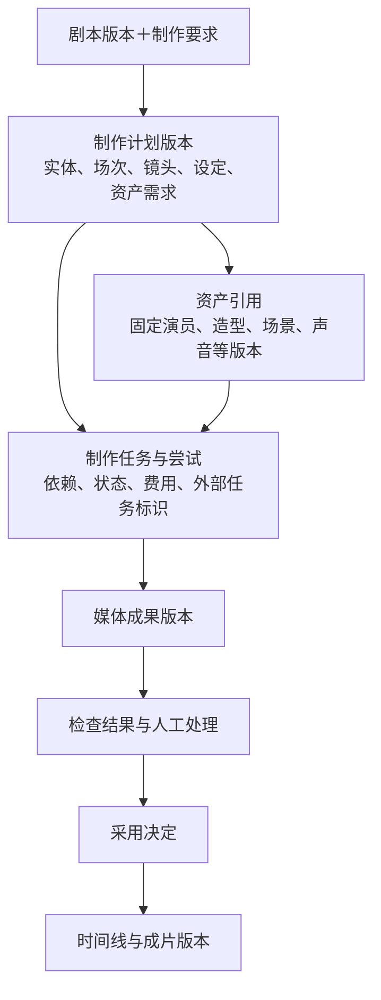
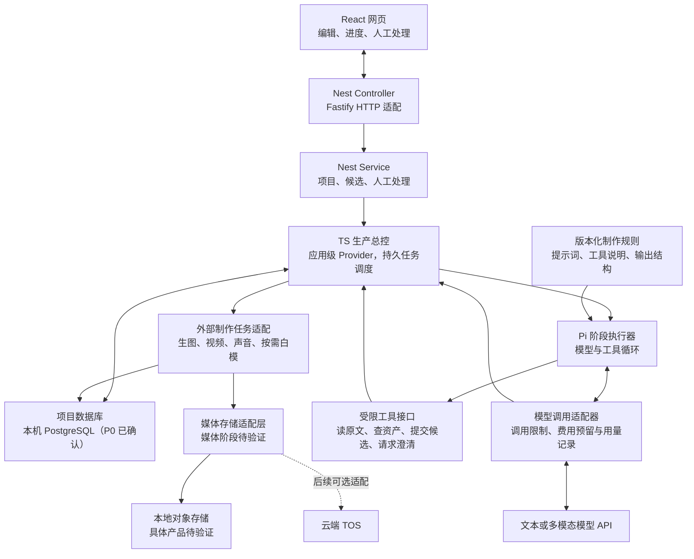
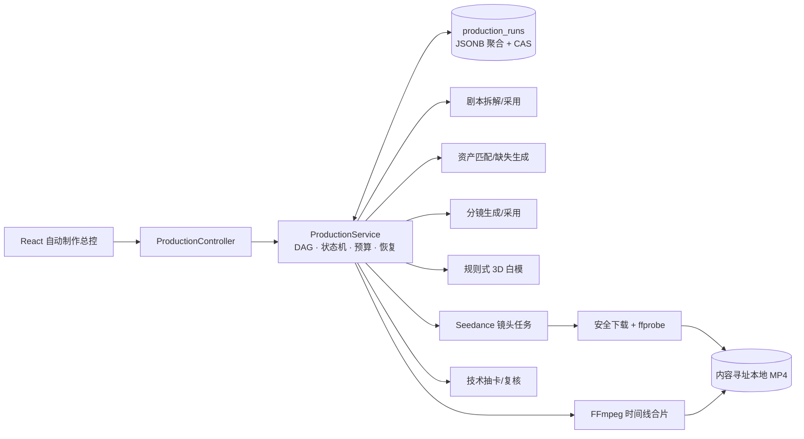

# 短剧智能生产 Agent：技术架构

状态：**前端工作台、P0.1–P1 文字生产切片、小说逐章拆解与校对、资产引用、API 单图候选和独立单段视频已实现。项目级生产总控已把剧本拆解、资产匹配与缺失生成、分镜、规则式 3D 白模、多候选镜头视频、技术复核/有限返修、本地媒体入库、FFmpeg 合片和 MP4 交付串成持久化 DAG。镜头任务会把绑定资产作为有序参考图片，把白模转为 prompt 构图约束，并请求供应商原生音频。文字与媒体调用通过按用途选择的服务端连接；创建整集运行需要用户明确付费授权和预算。当前界面和记录明确使用“技术复核”，不把容器、画幅、时长和音轨检查标记为视觉语义审核；独立配音、口型、配乐、音效和字幕是后续声音子图。** 更新日期：2026-10-23。

需求依据：[总体设计](总体设计.md)。本文将已确认产品要求转成模块接口、数据关系和执行机制。产品约定不重复访谈；技术候选、建议方案和未决事项分别标注。Q14–Q21 的运行边界与工程组合已确认；用户已确认 P0 使用本机 PostgreSQL，对象存储的实际服务仍推迟到媒体阶段。第 10–12 节仍是待细化的机制草案。

## 1. 已确认的架构约束

- 首先个人使用、本地网页操作；输入中文单集剧本，完整目标是真人拟真成片与网页可编辑项目。
- 支持自动生产与配置人工节点；有限返修不达标或预算不足时保存成果、报告未完成，人工处理后重新检查并续跑。
- 保留剧情、对白和原文依据；允许补齐制作细节，区分原文事实、用户要求与 AI 设计。
- 独立资产库支持导入、检索、生成、检查后入库；白模按需使用。
- 虚拟演员可跨作品复用，故事角色身份独立；同一系列沿用已确定设定。
- 普通修改局部生效，共享设定变更显示影响、生成候选、用户采用后替换；保留原成果和人工修改。
- 预算覆盖生成与返修，同等质量前提下费用优先。
- 旧公司代码默认供学习；用户明确授权复用的 3D 导演台代码已迁入独立前端，不依赖其服务、数据库、账号或部署环境。
- 主工程采用 TypeScript。局部阻断只影响相关任务及其依赖，独立任务继续；无法确认的关键剧情事实转人工澄清，已授权制作细节自动补齐。

## 2. 架构决策树与当前进度

```text
已确认：总体需求 Q1–Q13
├── 已确认的运行边界 Q14–Q17
│   ├── 使用模型服务 API
│   ├── 本机后台运行，网页关闭后继续，程序重启后恢复
│   ├── 主流程受控，阶段内模型自主选择策略
│   └── 一次推进一个项目，镜头可有限并发
├── 已确认的实现与异常边界 Q18–Q20
│   ├── 主工程采用 TypeScript
│   ├── 局部任务等待人工时，无关任务继续
│   └── 无法确认的关键剧情事实转人工澄清
├── 已确认的工程组合 Q21（第 9 节）
│   ├── React＋Vite 网页，NestJS＋Fastify 后台（Node.js 运行）
│   └── TS 持久任务调度＋Pi 阶段内工具循环
├── 当前取舍：Q22 存储修订（第 9.4 节）
│   ├── 已确认：P0 采用本机 PostgreSQL
│   └── 本地对象存储；云 TOS 保留为媒体阶段的后续适配选项
├── 具体机制草案（第 10–12 节，继续细化）
│   ├── 输入输出、版本与候选采用
│   └── 局部阻断、恢复、预算和第一里程碑范围
└── 根据模型和执行方案继续验证
    ├── 视频及声音能力、白模接入与检查效果
    ├── 费用估算、重试上限、超时和并发参数
    └── 实际样例、人工修改与恢复场景的验收
```

## 3. 可以从现有需求直接推导的机制

以下不需要再次确认产品原则，具体实现仍待设计：

1. **稳定标识与版本。** 剧本、人物设定、分镜、媒体与成片需要可识别的版本，避免新内容意外覆盖旧成果。
2. **固定引用。** 一次制作任务使用明确的输入版本；记录每个镜头引用的演员、造型、场景、道具和声音版本。
3. **候选与采用分开。** 自动生成、人工编辑后的候选，与当前已采用版本分别保存；采用动作有记录。
4. **按依赖判断影响。** 修改资产或设定后，能找到受影响任务和镜头；重新检查相关成果，不重做无关部分。
5. **运行状态可恢复。** 成果和关键任务状态持久保存，不能仅依赖模型对话或页面内存。
6. **检查绑定具体成果。** 检查记录对应输入与产物版本；旧结果通过，不意味着替换后的结果仍通过。
7. **预算与外部调用留痕。** 记录生成和返修的费用、尝试及外部任务标识，为暂停、恢复和防止重复提交提供依据。

## 4. 模块输入输出草案

此处约定职责边界，不是最终 API、数据库结构或 Agent 数量。各模块均需返回运行状态和可定位的问题。

| 模块 | 接收什么 | 交出什么 |
|---|---|---|
| 剧本拆解与制作规划 | 剧本版本、制作要求、已有澄清答案 | 原文映射、实体、场次、镜头、全片设定、资产需求、问题，形成制作计划版本。 |
| 资产准备 | 制作计划中的资产需求、已有设定、允许的资产来源 | 结构化视觉简报、检索或生成的候选、生成溯源、人工接受/拒绝决定，以及接受后明确的素材版本及引用。 |
| 镜头画面与视频制作 | 镜头要求、固定的资产版本、声音或时长要求、按需白模参考 | 外部生成任务记录、媒体成果版本、生成设置及费用记录。 |
| 声音制作 | 原文对白、说话角色与声线、镜头的声音要求 | 配音、音乐与音效素材、时长及其与对白和镜头的对应。 |
| 质量检查 | 具体成果版本、对应原文与制作设定、质量规则 | 检查结论、问题位置、依据与返修建议；无法可靠判断的情形需要显式表达。 |
| 剪辑与交付 | 已采用的镜头和声音、时间线安排、输出规格 | 时间线版本、成片版本、可继续编辑的项目关联。 |
| 人工处理 | 问题上下文、当前版本、候选及影响范围 | 修改意见或替换素材、候选采用决定、相关版本记录。 |
| 生产总控 | 制作计划、任务依赖、运行模式、预算、检查与人工结果 | 任务安排、状态流转、费用记录、暂停原因及续跑动作。 |

### 制作计划与其他记录的关系

制作计划说明“准备制作什么”；任务记录说明“执行到哪里”；媒体成果记录说明“实际产出了什么”。它们相互关联，避免把修改中的计划、正在执行的任务和已交付成片混为一份内容。



现有 [期望输出样例](../examples/斗破苍穹-期望输出.json) 已演示原文引用、实体、场次、镜头与草稿采用，但不是完整制作计划或生产状态格式。样例中的风格、比例缺省提示不能替代总体设计已确认的真人拟真与 9:16 要求；后续设计样例时需明确区分剧本输入与制作要求。

## 5. 候选底座的已核实边界

以下为截至 2026-09-15 的资料核查，不是选型决定，也不代表已在本项目验证。

| 候选 | 已核实的主要职责 | 本项目仍需承担的工作 |
|---|---|---|
| Pi Agent Core | 模型与工具循环、事件、取消、人工追加指令；当前仓库还提供独立 SQLite 会话后端。 | 会话持久化之外，仍需保存领域状态、安排长任务、核对外部生成任务、管理项目版本与预算。 |
| LangGraph JavaScript | 状态图、检查点、人工中断；持久检查点可用于恢复执行。 | 配置持久存储和宿主执行机制，处理节点重跑造成的重复副作用，以及资产、项目、预算和供应商任务语义。 |
| DeepSeek Harness | 插件化运行环境，提供会话与人工交互等能力；不同任务插件的持久性不同。 | 根据实际插件核实恢复能力，补足持久任务执行和本项目领域机制；还需评估开发者预览阶段的兼容性变化。 |

Pi 的具体能力见 [Agent Core 官方文档](https://github.com/earendil-works/pi/tree/main/packages/agent)。当前文档列有独立包 `@earendil-works/pi-session-backend-sqlite-node`，不能笼统表述为 Pi 不支持持久会话；但 `continue()` 在已有上下文上的继续执行，以及会话记录，都不能直接等同于整个生产项目恢复。

LangGraph 的恢复需要合适的持久化 checkpointer 与稳定的会话标识。人工中断恢复时可能重新执行当前节点，外部调用应避免重复产生副作用；内存检查点不足以覆盖进程重启。参见 [持久化](https://docs.langchain.com/oss/javascript/langgraph/persistence) 与 [人工中断](https://docs.langchain.com/oss/javascript/langgraph/interrupts)。

DeepSeek Harness 的会话提醒支持跨重启，但 `jobs-local` 明确为进程内任务；会话持久化不能直接推导为所有生产任务持久化。参见 [schedule](https://github.com/deepseek-ai/deepseek-harness/blob/master/packages/schedule/README.md)、[jobs-local](https://github.com/deepseek-ai/deepseek-harness/blob/master/packages/jobs/jobs-local/README.md)、[人工交互](https://github.com/deepseek-ai/deepseek-harness/blob/master/packages/interaction/README.md) 和 [项目状态](https://github.com/deepseek-ai/deepseek-harness)。

**应用层方案建议：** 视频等外部任务提交后保存供应商任务标识；恢复时先查询已提交任务，避免直接重新生成。提交结果不明确时，还需要对账或人工处理策略。供应商是否支持请求去重、查询和取消必须逐项核实，不能承诺仅靠框架就避免所有重复收费。

### 本地持久化的可选方案

LangGraph JavaScript 提供 `@langchain/langgraph-checkpoint-sqlite`，官方定位包含实验和本地工作流。若选择它，检查点需写入磁盘数据库；内存数据库不能保留跨进程重启的进度。该能力仅说明有可用的本地检查点方案，尚未在本项目安装验证，也不等于整个生产项目的数据已经得到管理。参见 [官方检查点存储说明](https://docs.langchain.com/oss/javascript/langgraph/checkpointers)。

SQLite 曾作为减少本地服务数量的初始建议：单库同一时刻只有一个写者，适合当前低写并发规模。用户随后提出本地 PostgreSQL；当前修订建议见第 9.4 节，不再把 SQLite 当作待落地的默认数据库。无论采用哪种数据库，都应使用短事务，避免把远程模型等待包含在数据库事务中。参见 [SQLite 适用场景](https://www.sqlite.org/whentouse.html)。

## 6. 第一轮已确认的技术取舍

用户已明确答复 Q14–Q17 均采用推荐方案。以下是已确认的运行边界，后续工程组合及存储修订见第 9 节。

| 问题 | 取舍主题 | 已确认方案 | 状态 |
|---|---|---|---|
| Q14 模型运行方式 | 模型能力的来源 | 首版使用模型服务 API，本地程序负责项目、调度和编辑；以后需要时再适配本地模型。 | 已确认 |
| Q15 持续运行范围 | 电脑关闭后的运行要求 | 首版电脑运行时由后台程序生产，关闭网页不终止任务；电脑休眠或关机时本地调度暂停，程序重启后恢复保存的进度，并核对已提交的外部任务。 | 已确认 |
| Q16 模型自主范围 | 主流程与智能决策的分工 | 固定生产阶段与必要检查，模型自主进行拆解、资产选择、镜头设计、白模路径选择和返修建议；程序执行依赖、预算及允许的状态转换。 | 已确认 |
| Q17 项目并发规模 | 同时生产的项目数量 | 一次推进一个生产项目，允许保存多个项目；项目内镜头的有限并发留作可配置能力，具体数值由模型限制和预算确定。 | 已确认 |

Q14 讨论模型算力所在位置，Q15 讨论本项目调度程序的持续运行需求，两者是独立问题。已经提交给外部服务的任务，在本地程序停止后是否仍继续，由具体服务决定。

## 7. 由运行边界推导的执行结构

以下是基于 Q14–Q17 的执行方案草案，尚未规定服务数量或进程数量：

- **网页负责发起操作和展示状态。** 页面关闭不应取消已启动的制作任务；重新打开后读取已保存状态。
- **后台总控负责推进生产。** 读取任务依赖、预算、质量门槛和人工决定，安排允许执行的工作；模型的建议经程序校验后执行。
- **制作任务负责一次明确的工作。** 每次尝试绑定输入版本，记录外部请求、任务标识、产物和费用，不依赖长时间保持一个网页请求。
- **存储负责保留事实。** 保存已采用内容、候选、任务进度、检查记录和外部任务标识，供编辑、恢复与对账。
- **恢复先核对，再继续。** 重启后检查未结束任务；有供应商任务标识的先查询结果，提交结果不明确的进入核对流程。不能把本地停止直接当作远程失败后重新付费生成。

网页接口与后台任务需要解耦，但不因此要求首版拆成多个业务服务。主流程、单次模型工具循环及外部媒体任务是不同职责，按第 9 节的工程组合组织；数据库和对象存储属于独立基础服务。

## 8. 第二轮已确认的取舍

用户已逐项确认 Q18–Q20。以下规则同时适用于剧本拆解里程碑和后续生产链路。

| 问题 | 取舍主题 | 已确认方案 | 状态 |
|---|---|---|---|
| Q18 主工程语言 | 主工程的语言范围 | 主工程使用 TypeScript，后台在 Node.js 运行；前后端共享数据类型。个别媒体或白模工具按接口接入，不要求所有工具都用同一种语言。 | 已确认 |
| Q19 局部失败的影响范围 | 独立任务是否继续 | 局部错误阻断受影响任务及其依赖，其他有效任务在预算内继续；预算不足、全片共同依据失效等全局问题暂停全项目，存在阻断项时整集仍为未完成。 | 已确认 |
| Q20 剧情歧义的处理 | 无法确认的关键剧情信息 | 转人工集中澄清；长相、服装、陈设、表演等已授权制作细节自动补齐，无法确认的剧情事实不自行编定。具体暂停范围按 Q19 的影响规则执行。 | 已确认 |

Q18 的理由是让网页、后台和模型工具接口共同使用清晰的数据约定。TypeScript 提供运行前的类型检查，但类型不会自动校验运行时收到的模型或用户数据，仍需实际数据校验。参见 [TypeScript 官方说明](https://www.typescriptlang.org/docs/handbook/typescript-from-scratch.html)。

Q19 确定失败的传播范围，Q20 确定何种缺口应转人工；两者分别决定是否触发阻断及阻断哪些任务。关键剧情缺口示例：原文“他把药交给她”涉及多位可能人物，且上下文无法确定交付双方。模型可依据上下文理解，无法确定时才触发澄清，避免把所有省略都变成人工问题。

## 9. 已确认的工程组合与存储修订

**Q21 当前确认方案：React＋Vite 网页、运行在 Node.js 上的 NestJS＋Fastify 后台、自有 TypeScript 任务调度、Pi Agent Core 阶段执行，以及配套的数据校验和媒体处理工具。** 用户明确选择用 NestJS 规定 Controller、Service、Module 的组织方式，Fastify 承担 HTTP 适配。本机 PostgreSQL 已作为 P0.2 的迁移和适配层落地；媒体对象存储仍按 Q22 留到后续里程碑验证。

### 9.1 各项技术的职责

| 部分 | 技术及确认状态 | 在本项目中负责什么 | 接入阶段 |
|---|---|---|---|
| 网页工作台 | React＋Vite | 原文对照、分镜编辑、进度、候选比较与问题处理；Vite 负责开发和打包。 | 里程碑一，内核跑通后接入。 |
| 本地后台 | NestJS＋Fastify，运行于 Node.js | NestJS 组织 Controller、Service、Module 和依赖；Fastify 作为 HTTP 适配器。选型与组织方式见第 9.5–9.6 节。 | 里程碑一。 |
| 生产总控 | 自有 TypeScript 状态转换与持久任务表 | 决定哪些任务现在可执行，控制依赖、预算、有限重试、局部阻断及恢复。 | 里程碑一从拆解任务开始扩展。 |
| 阶段内 Agent | Pi Agent Core | 将原文、规则与已有结果交给模型，执行允许的工具，将工具结果返回模型，形成有限的推理与修复循环。 | 里程碑一先启用拆解所需工具。 |
| 数据约定与校验 | TypeBox 描述 JSON Schema，Ajv 做运行时校验 | Nest 接口通过自定义 Pipe 调用共享校验器，内核直接调用；剧情忠实度另做领域检查。适配方式见第 9.6 节。 | 里程碑一。 |
| 项目与任务记录 | 本机 PostgreSQL（P0 已确认；P0.2 仅实现最小 draft 切片） | 保存计划、版本、候选、问题、任务与费用记录；同一记录系统决定当前生产状态。 | 里程碑一。 |
| 媒体存储 | 对象存储适配层（媒体阶段待选型/验证） | 保存图片、音频、视频；数据库记录对象标识、校验值和引用，具体本地产品另行验证。 | 里程碑二接入实际媒体。 |
| 音视频处理 | FFmpeg / ffprobe | 读取媒体信息，按时间线裁切、转码、合成和导出；具体编码与参数后续确定。 | 里程碑二、三。 |

React＋Vite 的建议基于本项目是本地交互工作台、后台已有独立职责；它要求自行组织前端路由与数据读取。参见 [React 建设方式](https://react.dev/learn/creating-a-react-app) 与 [Vite 说明](https://vite.dev/guide/)。Nest 接口校验接入点见 [Pipes](https://docs.nestjs.com/pipes)，共享运行时校验能力见 [Ajv](https://ajv.js.org/)。媒体处理能力见 [FFmpeg 文档](https://ffmpeg.org/ffmpeg.html)。具体依赖版本在实施前核实兼容性并锁定。

**React、Vite 与 TypeScript 的关系：** TypeScript 是编写程序的语言；React 是组织界面和交互的库；Vite 是开发预览与构建工具。我们用 TypeScript 编写 React 页面，包含界面标记的文件通常是 `.tsx`，其他逻辑是 `.ts`；构建后浏览器运行生成的 JavaScript。React 和 Vite 均支持这一组合，不需要为它们另选一门业务开发语言。参见 [React 的 TypeScript 指南](https://react.dev/learn/typescript)。

首版组织为一个工程，后端按 Nest 功能模块管理项目、拆解、生产及基础适配；共享数据约定与拆解内核保留为独立 TypeScript 代码。应用初始化且存储就绪后，由应用级 Provider 推进任务；Controller 接收操作并返回任务标识，调度逻辑不挂在某次网页请求里。媒体处理需要时作为子进程执行。任务队列将保存在 PostgreSQL；P0.2 目前只保存不执行的 draft，调度器和对象存储服务仍未接入。模块划分不改变一次推进一个生产项目的规则。

### 9.2 Agent 底座、模型与规则怎样配合



- **模型**负责理解、判断和设计；替换模型不应改变项目数据格式。
- **Pi**负责一次阶段任务里模型怎样使用工具、读取结果并继续；拆解与资产选择可以使用同一个执行库，配不同规则和工具，无须因此拆出多台服务。
- **制作规则或 Skill 资源**描述如何拆解、检查、设计镜头，应由本项目按任务显式加载并记录版本；普通提示文本无法强制执行预算和质量门槛。
- **生产总控**决定任务能否开始、结果能否采用及下一步是什么。付费操作必须经过总控的预算和调用记录机制；模型不能绕过它直接触发不受控的生成。

Pi 的每次模型请求也通过本项目的模型调用适配器，使用同一费用预留服务，并记录调用次数及输出额度；预算控制同时覆盖模型请求与付费工具。达到本次尝试限制后，适配器拒绝继续调用并把原因交回总控，不能只靠提示词要求模型自行停止。

例如拆解阶段可以调用“读取指定原文”“提交拆解候选”“报告无法确认的剧情问题”。程序检查提交结果；错误返回给模型有限修复，无法解决则保存问题。请求澄清后结束本次执行并释放执行名额，等待用户回答时不占住整个项目的运行循环。

### 9.3 为什么推荐 Pi，而没有将整集放入一个 LangGraph 运行

这是一项基于需求的工程取舍：Q19 要求局部等待不阻挡独立任务，而镜头依赖、预算、外部任务标识和采用版本本来就需要领域记录。推荐让任务表成为生产执行状态的依据，Pi 只承担阶段内的模型与工具循环，职责较少重叠。

LangGraph 的优势是图状态、检查点和人工中断。若单个阶段以后出现复杂的内部流程、多次长时间等待、需要恢复内部步骤，可以重新比较它与当前执行器。现阶段再加入一套图检查点，会增加图状态与任务表之间的对应和恢复工作。

LangGraph 的图执行按步骤同步，人工 `interrupt()` 暂停图执行；不能把“同一个整集图里某个节点等待人工”直接当成“其他分支能无限继续推进”。可以设计独立 thread 或把等待作为普通数据状态，但仍需明确调度边界。参见 [运行机制](https://docs.langchain.com/oss/javascript/langgraph/pregel) 和 [中断规则](https://docs.langchain.com/oss/javascript/langgraph/interrupts)。这不代表 LangGraph 做不到 Q19，而是推荐首版使用更直接的任务状态表达它。

Pi 方案的代价是本项目自己实现并验证状态转换、任务领取、崩溃恢复和外部请求核对。只实现本产品需要的少量任务类型与短步骤，不建设通用工作流平台。Pi 会话记录可辅助排查，但不能成为与任务表相互竞争的生产状态依据。DeepSeek Harness 继续作为候选资料保留，当前没有必须依赖其插件宿主的需求。

| 问题 | 已确认选择 | 状态 |
|---|---|---|
| Q21 本地技术组合 | 前端 React＋Vite；后端 NestJS＋Fastify，Node.js 运行；NestJS 规定 Controller/Service/Module，结合 TS 持久任务调度＋Pi 阶段执行，配套 TypeBox/Ajv 与后续 FFmpeg。存储修订单列 Q22，具体版本与服务商仍需核实。 | 已确认 |

### 9.4 本机 PostgreSQL 已确认；对象存储留到媒体阶段

2026-10-01 本地环境：`compose.yaml` 管理 PostgreSQL 17，发布 `127.0.0.1:5432`，数据保存于独立命名卷；NestJS 在宿主机通过 `pg` 连接。初始化、迁移与 Navicat 连接见[本地开发](本地开发.md)。这里只引入当前 P0.2 所需数据库，对象存储和额外队列仍留到相应阶段。

**已确认：本机 PostgreSQL 管理项目记录。** P0.2 已提供显式 SQL migration、`pg` 适配器、Project/ScriptVersion/SourceIndex/draft Run/Task 的最小保存切片；它不执行模型，也不替代完整调度。媒体仍将通过统一对象存储接口处理，TOS 保留为后续云端选项；MinIO 与 TOS 的部署性质及当前产品状态需要在媒体阶段先核实，不能直接把二者都写成本地可启动服务。具体已实现边界见[持久化 P0.2](持久化-P0.2.md)。

PostgreSQL 可以在本机运行数据库服务，Node.js 后台作为客户端连接。本项目将剧本、分镜、任务、问题、版本、预算及媒体引用存入数据库，媒体文件内容交给对象存储。相比 SQLite，需要多维护一个数据库进程、连接配置、迁移和备份；收益是开发阶段即可沿用未来独立部署数据库的组织方式。参见 [PostgreSQL 架构](https://www.postgresql.org/docs/current/tutorial-arch.html) 与 [macOS 安装方式](https://www.postgresql.org/download/macosx/)。

数据库任务表仍承担调度依据，不因使用 PostgreSQL 自动引入额外队列。领取任务可在短事务内采用行锁与条件更新；`SKIP LOCKED` 可用于多消费者任务表，但去重、执行归属、恢复和公平调度仍需应用设计，不能只加一条 SQL 就宣称任务可靠。参见 [PostgreSQL 锁定说明](https://www.postgresql.org/docs/current/sql-select.html#SQL-FOR-UPDATE-SHARE)。

| 媒体方案 | 能否本地运行 | 截至 2026-09-15 的核实结论 |
|---|---|---|
| MinIO 社区版 | 有自托管代码 | 官方仓库于 2026-04-25 归档，README 标明不再维护、社区版仅源码分发。不将旧教程镜像直接作为新项目长期依赖。 |
| MinIO AIStor | 支持本地容器部署 | 当前官方产品提供单机免费许可方案，需申请许可；部署条件与社区旧版不同。本地方案优先验证这个受维护发行路径，未视为已安装。 |
| 火山引擎 TOS | 公开资料所述为云服务 | 开通云端存储桶，通过 API/SDK 使用；未找到可公开自行部署的 TOS 服务端。本地运行 SDK 不代表媒体保存在本机。 |

来源：[MinIO 社区仓库](https://github.com/minio/minio)、[AIStor 容器部署](https://docs.min.io/aistor/installation/container/install/)、[TOS 入门](https://www.volcengine.com/docs/6349/74830?lang=en)。此处将用户的 TOS 理解为火山引擎对象存储；如指其他产品，应重新核实。

建议数据库保存 `storageBackendId`、`bucket`、`objectKey`、应用资产版本、校验值、大小和媒体类型。对象服务自己的版本标识若可用则另存，不替代应用版本。读取时生成当前可用地址，避免将会过期的签名 URL 当作永久资产标识；也不把对象存储的 ETag 统一当成文件内容校验值。

存储接口至少覆盖上传、读取、查询对象、生成受限访问地址。MinIO 与 TOS 可在适配层分别接入；TOS 的 S3 兼容存在边界，需要验证所用上传下载、签名和桶行为，不能承诺仅修改 endpoint 就完全兼容。参见 [TOS S3 兼容说明](https://www.volcengine.com/docs/6349/1294225)。若以后从本地迁到云端，还需复制对象、核对内容并更新存储引用。

云端生成服务需要参考素材时，本地 `localhost` 地址无法直接交给远程服务读取。需根据服务商能力上传文件，或提供网络可达且有效期足够的 HTTPS 地址；给本地地址签名不会改变其网络可达性。例如 [Runway 输入说明](https://docs.dev.runwayml.com/assets/inputs/) 对素材地址与上传方式有明确限制，其他模型须分别核实。选择云 TOS 后还需将存储、请求和传输费用纳入成本展示，不能把模型调用预算当成所有云账单上限。

| 问题 | 推荐修订 | 状态 |
|---|---|---|
| Q22 数据与媒体存储 | 已确认本机 PostgreSQL；P0.2 已建立最小迁移与适配。对象存储适配、MinIO/AIStor 与云 TOS 留在媒体阶段核实。 | PostgreSQL 已确认；媒体待确认 |

### 9.5 后端框架选择：NestJS＋Fastify 已确认

**采用 NestJS 管理上层应用结构，Fastify 作为 HTTP 适配器，使用 TypeScript 编写并运行在 Node.js 上。** 选择依据是用户明确希望框架规定 Controller、Service、Module 的组织方式。P0.2 已以显式 PostgreSQL migration 和 Repository 适配实现 Q22 的数据库部分；媒体存储仍未接入。

框架主要负责把“提交剧本、读取分镜、修改候选、查看进度、回答问题”等网页请求交给相应服务。领域服务负责项目和版本规则，生产总控负责持久任务，Pi 负责阶段内的模型与工具循环。它们可以组织在同一个 Node.js 工程中，仍保持职责独立。

| 框架 | 语言与运行环境 | 主要能力与组织方式 | 对本项目的判断 |
|---|---|---|---|
| Fastify | JavaScript/TypeScript，Node.js | HTTP 路由、插件封装、请求/响应结构校验、日志；独立使用时业务分层由项目组织。 | 已选择作为 NestJS 的 HTTP 适配器；业务入口与服务依赖交给 NestJS 组织。 |
| FastAPI | Python，通常配合 ASGI 服务运行 | 基于类型声明和 Pydantic 校验，生成 OpenAPI 文档，支持同步与异步接口。 | 核心实现若主要依赖 Python 库，它很合适；在已选 TS＋Pi 的条件下作为主后台，会增加 Python 与 Node 之间的服务接口和进程管理。 |
| Spring Boot | Java/Kotlin，JVM 生态 | 自动配置、依赖组合、Spring 组件，以及健康检查、指标和外部配置等支持。 | 已有 JVM 项目、团队经验或 Spring 集成需求时值得优先考虑；当前没有这些前提，保留 Pi 则还需要与 Node 服务连接。 |
| NestJS | TypeScript/JavaScript，Node.js | 通过模块、控制器、服务和依赖注入组织后台，提供较强的工程约定。 | 已采用。满足用户希望由框架规定分工的偏好，并与 Pi 保持同一语言和运行环境。 |

以上“对本项目的判断”是结合已确认需求的取舍，不是框架的能力限制或性能排名。FastAPI、Spring Boot 均能调用模型、处理并发并构建 AI 服务；选择 NestJS＋Fastify 的主要依据是语言与执行库的一致性，以及明确的代码组织约定。

资料依据：[Fastify 入门](https://fastify.dev/docs/latest/Guides/Getting-Started/)、[校验与序列化](https://fastify.dev/docs/latest/Reference/Validation-and-Serialization/)、[插件](https://fastify.dev/docs/latest/Reference/Plugins/)；[FastAPI 介绍](https://fastapi.tiangolo.com/) 与 [同步/异步说明](https://fastapi.tiangolo.com/async/)；[Spring Boot 介绍](https://spring.io/projects/spring-boot/)；[NestJS 介绍](https://docs.nestjs.com/)。

使用 `@nestjs/platform-fastify` 提供的适配器。业务路由在 Nest Controller 中声明，Service 通过 Nest 的依赖注入使用；Fastify 负责底层 HTTP 请求处理。采用此组合后，依赖 Express 的中间件、上传或会话教程需核对 Fastify 对应能力，不能直接照搬。参见 [NestJS 官方适配器说明](https://github.com/nestjs/docs.nestjs.com/blob/master/content/techniques/performance.md)。

保留 TypeBox/Ajv 作为共享结构与校验方案，并通过 Nest 自定义 Pipe 接入 Controller。Fastify 的 Type Provider 不会自动为 Nest Controller 建立请求校验；标准 Nest `ValidationPipe` 使用 class-validator，也不能直接当作 TypeBox 的校验器。适配与验证方向见第 9.6 节。

采用 NestJS＋Fastify 后仍需实现任务恢复、预算、访问边界和版本冲突等本项目规则。示例流程是：网页提交剧本 → Controller 校验入口、Service 持久保存任务 → 返回任务标识 → 后台总控安排拆解 → Pi 提交候选 → 检查并保存 → 网页读取进度与结果。长时间等待模型或制作视频不应依靠一直保持原始提交请求。

当前优先级是拆解质量、恢复正确性及费用可解释性；模型生成和媒体处理耗时需要实测，不能用 HTTP 框架的吞吐基准推断成片生产速度。以后出现维护问题时，先判断是模块边界、任务执行还是接口层的问题，再决定是否更换框架。

### 9.6 NestJS 中的职责与第一里程碑模块草案

| 层次 | 本项目职责 | 示例 |
|---|---|---|
| Controller | 定义网页接口，通过 Pipe 校验输入，调用 Service 并返回结果。 | 接收开始拆解请求，返回已保存的任务标识。 |
| Service / Provider | 协调业务规则及其依赖；由应用级 Provider 承载后台调度和基础适配。 | 保存剧本版本、创建任务、采用候选、读取问题。 |
| Module | 注册相关 Controller 与 Provider，通过 imports/exports 明确对外提供的能力。 | 将拆解接口、服务及执行器组织成拆解模块。 |
| 独立 TS 内核 | 原文映射、制作计划结构、检查规则和执行接口；可由 Nest Service 或独立验证入口调用。 | 校验镜头原文引用、区分事实与设计。 |

上述组织方式依据 [Nest 模块说明](https://github.com/nestjs/docs.nestjs.com/blob/master/content/modules.md) 与 [Providers](https://docs.nestjs.com/providers)。具体模块名称和文件位置仍是设计草案：

| 模块草案 | 第一里程碑职责 |
|---|---|
| ProjectsModule | 项目、剧本版本和制作要求的保存与读取。 |
| BreakdownModule | 拆解入口、候选协调、原文检查与分镜能力，通过执行接口使用 Pi。 |
| ProductionModule | 任务安排、预算与有限重试、问题处理及续跑；调用登记的阶段执行器。 |
| InfrastructureModule | 配置、存储实现、模型与 Pi 执行适配，通过明确接口提供给功能模块。 |

模块数量与 Agent 数量没有对应关系。生产模块与执行器通过接口和每次任务的执行上下文传递额度、工具及记录能力，避免以模块互相导入实现双向调用。将来需要资产、声音、剪辑功能时再增加相关模块。

**校验接入：** 自定义 Nest Pipe 使用共享 Ajv 校验器；后台任务和模型输出直接调用同一校验器。不要为网页接口和模型结果分别维护两套手写且可能不一致的字段定义。接口结构、错误格式与运行时校验需要实际集成验证，不能仅以 TypeScript 编译通过作为证据。参见 [Nest Pipes](https://docs.nestjs.com/pipes) 与 [ValidationPipe](https://docs.nestjs.com/techniques/validation)。

**后台生命周期：** 调度器是应用级 Provider，在依赖就绪后启动，在退出时停止领取新任务并保存可保存的进度；不使用 HTTP request scope 承载生产调度。关闭钩子需要显式启用，进程被强制终止时不能依赖钩子必然执行；恢复仍以数据库中的任务与外部调用记录为依据。参见 [Nest 生命周期](https://docs.nestjs.com/fundamentals/lifecycle-events)。

**Pi 上下文隔离：** 应用级执行适配 Provider 可管理共享客户端和工厂，但每次任务尝试的 Pi 消息、工具状态与取消信号分别管理，不能让并行镜头共享可变会话。共享的 Nest Service 实例不等于所有任务共用一个 Agent 上下文。

## 10. 数据与模块接口草案

以下为下一步细化数据结构的依据，不是已建立的数据表或固定 API。

| 记录 | 最小内容 | 引入时机 |
|---|---|---|
| 项目与生产运行 | 项目标识、本次运行标识、目标阶段、制作要求版本、模式、费用上限、运行状态与阻断原因。 | 里程碑一。 |
| 剧本版本与原文引用 | 不可变原文、版本、行号或字符位置；引用绑定具体剧本版本。 | 里程碑一。 |
| 制作计划版本 | 梗概、实体、场次、连续镜头、资产需求、对白及其原文引用；字段来源标为原文、用户或 AI 设计。 | 里程碑一。 |
| 任务与尝试 | 任务类型、作用范围、依赖、固定输入版本、状态、当前尝试、限次规则；每次尝试保存模型/规则版本、输入输出和费用。 | 里程碑一。 |
| 问题与澄清 | 类型、原文依据、影响范围、是否阻断、问题和回答版本、相关任务。 | 里程碑一。 |
| 候选、检查与采用 | 候选内容和基准版本、人工改动、检查依据与结论、当前采用版本及采用记录。 | 里程碑一。 |
| 资产与媒体版本 | 演员与故事角色关系、造型/声线/场景等版本、结构化视觉简报、候选及人工决定、存储后端与对象标识（修订草案）、校验值、生成或导入来源、章节/镜头引用。 | 小说图片候选已建立最小切片；完整媒体版本在里程碑二扩展。 |
| 外部任务、生成溯源与费用记录 | 内部操作标识、请求摘要、提示词版本与服务端快照、服务商/模型/连接版本、任务标识、提交/查询状态、结果哈希与媒体信息、费用预留与结算。 | 文本调用与小说图片候选已留痕；单段视频任务已建立最小持久切片，完整费用账本仍在里程碑二扩展。 |
| 时间线与成片版本 | 已采用素材、镜头及音轨的裁切/排列/时间位置、字幕、输出规格、成片文件及其检查结果。 | 里程碑三。 |

同一句对白可被多个镜头引用；引用表示依据，不代表最终音轨必须重复播放。实际对白片段、说话角色和播放位置需要在声音与时间线中对应，检查覆盖和错误重复。结构合法、引用存在与剧情忠实分别检查。

第一里程碑的具体字段与状态枚举见[数据结构 v0.1](数据结构-v0.1.md)，包括制作计划快照、对白片段、人工保护、输入摘要及执行记录。以下保留总体接口边界；具体函数与 HTTP 路径在下一步确定：

| 调用方向 | 输入 | 输出或结果 |
|---|---|---|
| 网页 → 项目服务 | 剧本、制作要求；启动时给定运行目标与预算。 | 已保存的项目/运行标识；后续读取状态，不等待整个生产 HTTP 请求结束。 |
| 总控 → 阶段执行器 | 任务及尝试标识、固定输入版本、允许工具、运行限制。 | 候选、结构化问题或失败原因；不能直接标记整集完成。 |
| 阶段执行器 → 模型适配器 | 尝试标识、消息、结构要求、模型配置与调用额度。 | 模型结果、用量、费用或错误；实际发出请求前检查限次与费用预留。 |
| 工具 → 领域服务 | 查询或候选请求、任务范围与输入版本。 | 校验后的结果或明确错误；实际付费提交经过费用预留和调用记录。 |
| 网页 → 人工处理服务 | 澄清回答或编辑候选、用户看到的基准版本、作用范围。 | 新版本及影响范围；基准已变化时报告冲突。 |
| 总控 → 供应商适配 | 内部操作标识、固定生成参数。 | 任务标识或完成结果、费用信息；后续支持查询，取消能力按供应商核实。 |

采用候选时检查基准版本仍有效，防止人工编辑与旧任务返回结果互相覆盖。正常全自动生产中，满足检查且不存在人工保护冲突的结果可按运行策略自动采用；人工发起的重做、修改过的内容及共享设定变更，按已确认规则比较后由用户采用。已被新输入替代的在途任务仍保存成果与费用，但不能自动覆盖当前版本。

按对象存储修订草案，媒体在本地工作目录完成必要处理，再上传到不覆盖旧资产版本的对象标识；核对上传结果后，在数据库中登记为可用成果。对象上传与数据库提交不能视为一个原子事务；响应不明、孤立对象和中断上传均需核对处理，不能据数据库缺少记录就认定上传未发生。数据库与对象内容应作为同一项目保存体系进行一致备份；单独复制数据库不能恢复媒体。首版网页通过本机后台访问项目，长期存储凭证与模型密钥保留在后台配置，运行日志不携带密钥。

## 11. 状态、局部阻断、恢复与预算草案

### 11.1 任务状态与项目状态分开

任务状态包括：等待依赖、可执行、执行中、等待外部结果、等待人工、等待重试、待核对，以及成功、失败、取消。第一里程碑的枚举及主要转换条件已写入[数据结构 v0.1](数据结构-v0.1.md#52-状态与阻断)，接口实现需遵守这些条件。

调度器从依赖通过、输入有效、未被暂停且预算允许的任务中领取工作，并在短事务内记录执行归属，防止两个后台实例重复领取。运行中的任务保留尝试标识和存活信息；进程消失后先核对原尝试，再决定是否重新安排。等待人工和等待远程结果不占用正在执行模型调用的名额。

第三个镜头等待人工时，第三个镜头的后续制作及依赖它的整集合成受阻；第四个镜头若不依赖这个问题，可以继续。共享资产问题沿实际引用传播；如果影响全片共同依据，则按全局阻断处理。

网页需要同时显示“正在继续的工作”和“等待处理的问题”。存在阻断项时整集未完成；即使其他任务结束，也不能将项目判为完成。生成任务成功表示交出了该任务要求的产物，下游质量检查通过才允许用于相应交付。拆解里程碑任务完成与完整成片完成应明确显示为不同的运行目标。

### 11.2 澄清与返修

Q20 的问题需要记录原文依据和影响范围。程序把待处理问题集中展示；用户回答后生成新的澄清记录、更新受影响的计划候选、重新检查和安排任务。用户未回答时，有明确依据的独立工作仍可执行；不能把未确定的人物身份当作已确定事实传给后续生成。

短暂网络失败与质量返修分别计数，均受有限次数、时间及预算限制；不能通过模型层、工具层、调度层各自无限重试来绕开限制。提交是否成功未知属于“待核对”，与明确失败分开处理。检查无法可靠判断时保留“不确定”及依据，达到转人工条件后停止自动返修。

### 11.3 重启恢复到已保存的工作边界

1. 读取已保存的任务、尝试、问题、费用和产物；已完成且输入仍有效的任务不重做。
2. 有外部任务标识的先查询并收取结果；服务仍在运行时继续等待。
3. 提交结果不明确时，根据内部操作标识及供应商查询或去重能力核对；无法确认时保留预留费用并转人工，不直接发起第二次付费生成。
4. 确定未完成的本地短步骤，在输入版本有效、尝试额度与预算允许时重做。未完成的文本请求可能已计费，不能承诺免费续接。
5. 已等待人工的任务继续等待；其余符合依赖和预算条件的任务恢复调度。

恢复承诺针对已保存的任务、工具结果及成果边界，不承诺恢复模型中断前的内部思考或每个输出字符。关闭网页不改变后台任务状态；本地程序退出、休眠或关机的边界遵循 Q15。

### 11.4 付费前预留，结果明确后结算

可用预算按“本次上限－已结算费用－尚未结算的预留”计算。每次文本、生成及返修请求在发出前以短事务预留费用，完成后结算并释放多余预留；未知或仍在途的调用保留预留。不能把多个并发任务都按同一笔剩余额度分别放行。

预计费用范围用于展示；自动放行还需要可执行的调用费用边界，例如输出长度上限或固定规格价格。服务商不能提供可约束的费用依据时，不宣称能够严格保证不超额，需要先补足限制或更换调用方案。暂停后不再提交新的付费任务，已提交任务仍需收取结果和对账；取消不等同于退款。

实际预算金额、调用次数、重试间隔、超时及并发上限，通过供应商规则和小样例测量确定，不在文档中虚构实测数值。

## 12. 第一里程碑怎样使用这套架构

第一条可验证链路是：保存原文 → 提取实体与场次 → 定位关键歧义 → 对信息完整的场次设计镜头 → 检查并有限修复 → 保存可审阅候选。关键歧义按 Q20 进入人工问题记录，依赖传播按 Q19 执行。

建议先把这条链路作为独立内核跑通，再接网页编辑、澄清回答与按场重做。第一阶段启用读原文、提交候选、报告问题等少量工具；每一步都有明确输出和停止条件。资产需求先保存为计划数据，媒体、白模、声音与剪辑在相应里程碑接入。

| 验证场景 | 应观察到的结果 |
|---|---|
| 小剧本正常拆解 | 剧情、对白和引用正确，分镜为连续镜头，设计补充可识别。 |
| 一场存在无法确认的人物指代 | 生成集中问题，相关任务等待人工，已具备独立输入的其他场次继续。 |
| 人工编辑后旧任务才返回 | 旧结果保存为候选，不覆盖人工修改；采用前发现版本冲突。 |
| 关闭页面、退出后台后重新启动 | 页面关闭时后台继续；后台退出后成果保留，启动时按已保存边界核对和恢复。 |
| 模型返回错误结构或内容 | 问题可定位，有限修复后仍失败则报告未完成，费用与尝试保留。 |
| 模拟响应丢失或预算不足 | 不盲目重复付费提交，暂停原因清楚，状态可恢复。 |

模拟只验证程序行为；真实模型质量、费用及供应商恢复能力必须在后续真实接入中单独验证。现有练习样例不是验收通过记录。

## 13. 后续定稿与待验证事项

工程组合 Q21 与本机 PostgreSQL 已确认；第一里程碑已形成[数据结构 v0.1](数据结构-v0.1.md)、P0.2 draft 保存、[P0.3 事实候选](候选计划-P0.3.md)、[P0.4 受控阶段执行](受控阶段执行-P0.4.md)，以及[首个里程碑实现](首个里程碑实现.md)中的 Check/Issue、采用和分镜候选。项目级生产总控、运行预算、外部任务恢复、参考图片镜头生成、供应商原生音频、技术返修、本地媒体库和 FFmpeg 合片已经形成可执行实现；仍需用真实小样例核验模型输出质量、供应商费用与媒体恢复能力。人物一致性、剧情和动作等内容判断没有被技术 `pass` 代替，口型、独立声音/字幕和白模 prompt 约束的实际增益仍需人工样例验收。

文字生产已实现 P0.1 原文索引、P0.2 保存原文和 draft Run、P0.3 事实候选、P0.4 Attempt/ModelCall、P0.5 检查/采用事实，以及 P1 分镜生成、验证和采用。两阶段的 Pi Core 共用服务端模型适配器；历史 MAAS 真实请求记录见[实测记录](模型接入验证.md)。媒体除单图候选和独立单段视频工具外，现已接入下面的镜头到整集生产总控；它复用这些能力，但使用独立的项目级任务图、预算和恢复语义。

### 实体校对切片（2026-10-22）

- 网页展示人物、场景（地点）和道具的只读原文依据，只提交已有实体的名称、别名、说明；`POST /api/plan-revisions/:id/entity-edits` 通过共享 TypeBox/Ajv 校验，再交由独立领域函数生成候选，不进入 Pi 或模型适配器。
- Service 保留基准的 Run、Task、制作要求和稳定实体 ID，创建 `user/manualEdit` 子版本；修改文本标记 `origin=user`，`manualLocks` 记录修改字段及引入版本。原文引用、场次、对白和未修改内容不变；模型提取契约继续限制为 `origin=source`。
- Repository 在项目行锁下核对当前剧本、已采用指针和最新候选，再追加不可变快照。历史列表通过 `GET /api/projects/:id/plan-revisions` 读取，按内部 `revision_order` 升序；界面可以查看旧版，但仅当前剧本最新候选可编辑和采用。
- 保存不改变活动版本、不复制检查结果；新候选重新检查通过后，由用户单独采用。采用仍使用期望指针比较，并要求候选为当前剧本最新版本。
- `007_entity_edit_revisions.sql` 放宽人工版本来源约束并添加确定保存顺序；既有记录按原 `created_at/id` 顺序回填。升级时显式执行 `npm run db:migrate` 并重启服务，启动就绪检查要求 007，应用不会自行迁移。
- 本轮不支持实体增删合并、引用/场次/对白/梗概编辑、资产引用或历史恢复。人工锁只记录校对链的修改字段；跨新 Run 自动继承、合并及按场重做保护尚未实现，新提取候选仍需重新人工核对与采用。

## 独立模型连接（2026-10-23）

`src/models/connections.ts` 使用 v2 私有连接库保存 `profiles[]` 和 `breakdown/image/video/general` 四个用途选择。每个 profile 独立保存模型、完整操作地址、鉴权、密钥和限制；用途只保存 profileId 与选择版本，可共用同一文本 profile。显式切换不覆盖其他模型，更新共享 profile 会失效所有引用它的用途版本；修改未被选中的 profile 不影响当前任务。v1 格式启动时无损迁移并保留原选择版本；损坏不回退，导入旧环境配置需显式操作且不补回已清除密钥。HTTP 仅返回脱敏视图，配置文件原子保存。模型按操作启动时冻结，网页请求绑定显示的选择版本，防止其他标签页换模型后按旧授权发出请求。剧本 Run 已由自身连接版本保护；生图任务同样保存 image 选择版本。`DoubaoImageClient` 已进入小说待补资产流程，`SeedanceVideoClient` 由独立的 `video-automation` 服务用于单段文本生视频；它不改动 3D，也不冒充镜头或整集生产。详见[独立模型配置](独立模型配置.md)。

## 历史模型、P0.1 原文内核与 P0.2–P0.4 持久化（2026-10-22）

用户要求移除原 Codewiz 接入；旧模型目录与调用入口不再使用。下列段落记录 2026-10-22 首次切换到单一 MAAS 文本模型时的实现，当前多用途连接和媒体边界以“独立模型连接”及后文资产生成章节为准。

- 根目录 Node.js 工程采用 NestJS＋Fastify；Controller、Service、Module 与独立模型适配器分层，TypeBox/Ajv 统一校验直接调用和 HTTP 输入。
- `.env` 由服务端读取获授权的 HTTPS 网关基础地址、API key 和调用限制；适配器追加 `/chat/completions`，通过 `api-key` 头认证。真实地址与凭据不提交仓库、不发给浏览器，不依赖旧代理登录或业务 Main API。
- 当时 provider 固定为 `maas`、模型为 `deepseek-v4.1-flash-1017`，推理设置为 `model-default`；该历史调用不自动换模型、回退旧服务或重试。金额预算仍未实现。
- 当时只启用文本并采用非流式 `stream:false`；一次真实请求获得 HTTP 200 与完整 JSON，但事实候选输出协议校验失败。该结果不代表后续小说拆解或媒体接口验收；详见[实测记录](模型接入验证.md)。
- 缺少网关或密钥时仍可启动本地读取/校对，模型调用被拒绝。历史 Run、调用记录和候选不批量改写；新模型需新建 Run，原候选仍可校对和采用。
- `src/breakdown/source-index.ts` 已实现 P0.1：物理 `SourceUnit` 无损覆盖原文、`SourceSpan` 的标题/场标/对白/动作候选标注、标题/blank/预算优先的递归 Prompt Chunk，以及 primary/context-only 的所有权校验。它使用保守 Unicode 码点估算，不把估算伪称为供应商 tokenizer。
- P0.1 的 alias 只在当前 Chunk 生效：`E001...` 可作为 primary evidence，`C001...` 是 context-only；两者均由后端还原成 canonical `SourceRef`，不能由模型直接写入正式计划。
- P0.2 已建立 Project/ScriptVersion/SourceIndex/draft Run/draft Task 映射；P0.3 新增事实 Candidate PlanRevision；P0.4 新增 Attempt/ModelCall、alias 还原和 waitingHuman 状态；P0.5–P1 新增 Pi 单轮执行、程序检查、事实与分镜采用。这里描述的是早期文字 Run；项目级生产恢复与金额预算由后文 `src/production/` 实现，不能反向解释为旧文字 Run 已增加全部媒体字段。

接口、环境变量及实际运行命令见 [模型接入](模型接入.md)，测试范围见 [模型接入验证](模型接入验证.md)。


## 当前前端实现（2026-10-22 更新）

用户调整开发顺序：先改善整个网页的可用性与视觉，保留九步流程，并直接复用旧仓 3D 导演台的白模功能。

- 工程位于 `web/`，React＋TypeScript＋Vite，采用 hash 路由。2026-10-22 按用户提供的 Liblib 参考重构为中性黑灰与荧绿主题，一级导航为首页、项目、资产、插件；自动成片、小说、剧本、分镜和 3D 为创作工具，流程说明与设置保留。
- `navigation.ts` 集中定义导航与 hash 解析，新增 `#/projects`、`#/plugins`；`#/production/<id>` 和 `#/novel/<id>` 解析资源 ID 并传给既有编辑器，`new` 打开创建/导入表单。旧无 ID 工作区、示例路由与 `#step-N` 仍兼容。切换页面或资源前由导航保护检查未保存内容，用户取消时不卸载编辑器。
- `project-catalog.ts` 为 `WorkspaceHome.tsx` 最近项目和 `ProjectsPage.tsx` 共享只读目录逻辑，请求 `GET /api/projects` 与 `GET /api/novels`，分别校验摘要格式并管理加载、失败、超时与重试；卸载时取消请求，迟到结果不覆盖当前视图。目录在浏览器内完成搜索、类型过滤、创建时间排序和网格/列表切换，本地练习单独标记。目录本身不创建数据或调用模型。
- 首页样式独立在 `home.css`，依次展示创建入口、快捷工具、最近项目、功能卡片和可筛选的示例参考；3D 预览使用本项目已录制的截图，不在首页初始化 Three.js。`#/assets/references` 通过资产页初始页签直达示例区，正式素材登记仍保持挂载与未保存保护。
- `LibraryPages.tsx` 的插件页只维护内置工具元数据与页面入口，支持关键词和可用状态筛选；规划工具禁用，没有安装、权限授予、动态代码加载或模型调用。JSON 导出卡片进入现有示例分镜的导出入口。
- `AssetWorkspace.tsx` 以右侧导航组织个人资产库与示例参考，窄屏移至顶部。登记组件 `AssetLibrary` 始终挂载，保留表单和未保存状态回调；支持 HTTPS 素材登记和受限本地图片导入。小说页的待补条目另有显式授权的候选生成入口；每次授权只生成一张，成果须人工接受后才建立章节关联。资产目录本身不自动批量生成或质检。`LibraryPage` 的 `compact` 模式只读取本地 `sampleImage` 与手写 `plan`，不写入真实资产目录。
- `web/src/director/` 来自同仓库 `短剧Main/frontend/shortdrama-rag-demo/src/components/director/`。保留 Three.js／React Three Fiber／Zustand 的人物骨架、姿势、场景、机位、变换与本地渲染导出，适配本地保存与 UI。
- 手工白模场景存在 IndexedDB `frame-director-v1`；用户上传 GLB 与全景图以内嵌数据保存，可导出/导入 JSON。图片和运镜小样在浏览器渲染，无旧公司 API、云素材库或付费模型调用。项目级生产另行生成规则式 `directorScene` 快照，并把活动机位和人物站位转成视频 prompt；它没有把手工导演台、3D 渲染画面或供应商原生相机控制打通。
- 示例剧本与分镜 UI 草稿仍在 localStorage，白模使用单独数据结构。「真实项目」已连接 PG 中的事实与分镜候选；白模、媒体资产和浏览器手工草稿尚未打通为统一可编辑成片工程。
- 2026-10-22 增量：「真实项目」可对照原文修改已有三类实体的名称、别名、说明，保存为 PG 中的新候选并查看版本历史；旧版本只读，保存后需重新检查再采用，不等于完整事实/分镜编辑器。
- Three.js 按进入白模页面时加载，主首页不承担 3D 初始化。保留的原独立流程页仍在 `flow-explainer/`。
- 验证命令：在 `web/` 执行 `npm test` 与 `npm run build`。来源和差异见 `web/THIRD_PARTY_NOTICES.md`。


## 小说章节独立切片（2026-10-22）

2026-10-23 增量：`NovelReviewWorkflow` 增加固定的提取、独立逐段扫描、语义复核、一次局部修复/复核流程（最多五次配置模型请求）。每段扫描结构、引用、局部写入范围由程序约束，语义检查由模型执行，不等于客观验收。`registry.ts` 从最新章节版本重建有出处的跨章实体表，模型按原文上下文复用身份；无名称相似自动合并。optional 元数据保存在原有 JSONB，兼容旧记录，不新增迁移。各阶段保存不可变版本并比较章节指针，失败保留成果；调用总账记录累计安全用量。详见[小说逐章拆解](小说逐章拆解.md)。

`src/novel/` 包含 Domain、Extractor、Repository、Service、Controller；`web/src/NovelBreakdown.tsx` 是独立校对页。输入先程序分章、生成整文码点位置，Pi 单轮模型仅给出段落/引号 ID，程序还原原文与校验，最后追加章节版本。模型和人工校对均不进入旧剧本 PlanRevision 或资产/分镜生成。

迁移 008 新建小说四表；主服务只读检测迁移，缺少 008 时小说接口返回 503，不自动建表或降级内存保存。章级行锁＋期望版本检查保护人工修改，submitted/unknown 调用阻止重复付费；保存校对不调用模型。完整 API、紧凑协议、限额与未知调用恢复边界见 [小说逐章拆解](小说逐章拆解.md)。

### 小说资产引用（2026-10-22 增量）

`src/assets/` 提供独立目录的 Contracts、Repository、Service、Controller，迁移 009 仅添加 `asset_catalog`。`NovelService.bindAssets` 将客户端选择的目录 ID 解析成可信登记快照，交给 `applyNovelAssetBindings` 校验并写入新的章节版本；仍由现有章级 CAS 保护，无模型请求或远程媒体下载。

`NovelContent.assetBindings` 为可选字段，兼容旧记录。只允许已保存确认且无歧义的人物/地点/道具选择同类型资产；缺少时待补。校对改变原条目后引用转为待重核，历史保持不变。迁移 009 不可用只禁用资产目录/引用，不阻断已迁移 008 的小说校对。

前端 `AssetLibrary` 负责登记与查找已有素材，`NovelAssetPanel` 负责当前条目的显式选择、待补和版本保存；草稿受页面/章节/版本切换保护。目录不自动预览外链，也不把示意裁切图当成真实素材。不可变登记不是远程媒体内容固定或版权/适用性质检。接口与边界见 [小说资产引用](小说资产引用.md)。

2026-10-23 本地图片导入增量：迁移 010 的 `asset_media` 在 PostgreSQL 保存受限 PNG/JPEG/静态 WebP 字节、内容哈希和检测到的 MIME；与目录记录在同一事务提交。`media.ts` 检查 Base64、大小、容器结构及像素上限，服务不接收任意文件路径、不下载任意用户 URL。导入返回固定的 `/api/assets/<id>/content`，内容接口带 nosniff、sandbox、no-store，支持预览和下载；前端只自动预览这类服务器持有的图片。同内容与元数据的重试返回原记录。没有 010 时保留原链接目录功能，仅阻断本地导入。该迁移当时只建立媒体存储；后续 011 和 API 适配器在此基础上增加单图任务，仍没有视觉质量评审。

### 豆包 API 资产候选

`src/desktop-assets/`（保留历史兼容目录名）提供单张图片协调服务、持久任务仓库和本机 API；运行时由 `DoubaoImageApiAdapter` 读取“生图”用途的私有连接，按 `video_agent` 已使用的豆包图片契约请求一张图，验证真实图片后写入受控任务目录，再复用 `AssetService` 保存候选媒体。完整接口、鉴权和密钥不进入任务 JSON、浏览器或仓库。此前开发的 `desktop-helper/` 是历史桌面验证工具，当前主服务不实例化、不需要 macOS 辅助功能权限。

生成前由程序建立 `AssetVisualBrief`，固定 `schemaVersion="asset-visual-brief/v1"`，保存 `itemId/kind/name/confirmedFacts/evidence/designVariables/negativeConstraints/confidence/pendingConfirmations`。其中 `evidence` 的每项包含 `evidenceId/documentId/start/end/quote`；已确认事实和精确原文依据不能由提示词中的视觉设计覆盖。旧 `description/sourceQuotes/designNotes/promptPreview` 暂时保留兼容。

每次生成请求携带新的稳定 `intentId`，jobKey 由章节、完整条目快照和该 intent 共同形成。同一 intent 防止重复提交；用户再次显式确认额度并创建新 intent 时，同一条目可以再生成一个候选。迁移 011 建立任务表，迁移 012 将全局活跃任务唯一索引收窄为 queued / submitting / generating / importing，version CAS 保护任务更新。提交前再次核对 image 选择版本；`submitting` 中断后改为 `unknown`，网络超时、上游错误或结果解析失败均不自动重发，以免重复计费。

迁移 `013_asset_generation_candidates.sql` 新增 `asset_generation_candidates`，显式保存 `id/task_id/asset_id/chapter_id/item_id/status/version/review_note/accepted_revision_id/created_at/updated_at`。`provenance_json` 保存 `promptVersion/promptSnapshot/model/modelConnectionRevision/inputRevisionId/sourceItem/brief/result`；结果摘要包含 `sha256/mimeType/bytes`。迁移前在途任务若没有可信提交快照，会明确记为 `legacy/unknown`、`provider: unknown` 和空快照，不反推不存在的精确历史。公开任务只返回候选的安全摘要，不暴露内部 jobKey、锁版本、完整提示词、条目内部快照或私有连接。

新生成成果进入 `awaitingReview`，不会自动写入章节绑定。通用资产引用接口也会拒绝尚未接受、已拒绝或待重核的生成候选，不能绕过审核。`POST /api/asset-generation/:id/decision` 接收 `{ decision: "accept" | "reject", expectedRevisionId, note? }`，旧 `/api/desktop-assets/:id/decision` 路径保持兼容；接受后才由 `NovelService` 创建新章节版本并正式关联，拒绝后仍保留候选、媒体与溯源历史。候选终态是公开任务状态的权威来源，任务摘要写入短暂失败也不会重新显示审核按钮或重复建立版本。`completed` 仅用于迁移前任务的读取兼容，新任务使用 `awaitingReview/accepted/rejected`。生成期间章节改变时只保留素材并进入 `needsReview`，不覆盖新版本。人工接受不等于自动视觉质检；本切片不自动重试、不改编剧本，也不连接分镜或 3D。设置、接口、恢复与验证边界见[豆包 API 资产候选](豆包桌面一键资产.md)。

### 单段视频自动化

`src/video-automation/` 由严格输入契约、Seedance 适配器、持久仓库、服务和 Controller 组成。`POST /api/video-automation-runs` 只保存 `queued` 任务并返回 202；应用级 worker 随后在写入 `submitting` 后调用供应商，再用任务 ID 查询结果。公开进度固定为输入检查、模型确认、提交任务、视频生成和获取结果五个节点，只按离散事实变化，不伪造供应商百分比。

迁移 014 建立 `video_automation_runs`，`client_request_id` 唯一，版本 CAS 和单活动任务部分唯一索引防止重复提交。同一请求标识只返回原任务；另一个活动任务存在时拒绝新建。进程启动时，残留 `submitting` 且没有供应商任务 ID 的记录改为 `unknown`，不自动重发；已有任务 ID 的记录只恢复查询。网络结果不明也进入 `unknown`，显式 reconcile 只查询原任务。切换生视频连接后，旧任务保留冻结的模型与连接版本，不能借新密钥查询旧端点。

前端 `#/automation/video` 提供提示词、比例、时长、分辨率、声音开关和一次额度确认。它轮询本机状态与历史，响应丢失时用 `clientRequestId` 核对已保存任务；成功只显示经校验的 HTTPS 链接，不自动加载、下载或登记远程视频。这个独立工具不读取项目分镜、不拼接多镜头，也没有金额预算上限；项目级流程由下面的生产总控处理。

## 项目级全流程生产总控（2026-10-23）

`src/production/` 是项目级持久化编排内核。它不把整集交给一个长时间驻留的 Agent，而是把运行编译成有明确输入、依赖、尝试上限和产物类型的任务图。固定骨架包含 `prepare / breakdown / assets / storyboard / director / video / candidates / review / compose / deliver`；分镜采用后用稳定 key 动态展开每镜资产、可选 3D、多路视频、抽卡和复核任务。



迁移 015 建立 `production_runs` 和 `production_outbox_events`；迁移 016 允许通过确定性检查的计划和分镜以 `agent` actor 采用，同时保留公开 HTTP 的默认 `user` actor。运行的完整聚合保存在 `run_json`，同时把 ID、项目、剧本、状态和版本投影为受约束列。仓库更新用 `version` compare-and-swap；新增 outbox 事件与聚合状态在同一事务提交。`clientRequestId` 是创建幂等键，同标识不能代表不同输入。

每个执行器先返回费用估算、输入摘要、执行器版本、是否付费和供应商。调度器先检查可用预算，写入 Attempt、预算预留和稳定 `operationKey`，持久化后才调用外部能力。成功、失败、等待外部、等待人工和阻断由统一 outcome 物化为产物、候选、问题、质量检查、动态任务、时间线或交付。没有执行器或输入条件时显式阻断，不写虚构产物。

运行重启会扫描未终态聚合：无外部操作的本地 `running` 任务转人工确认；已有外部操作的任务转 `reconciling`/`unknown`，仅用已保存供应商任务 ID 查询。暂停采用相同原则。局部重试使依赖它的任务、候选、产物、时间线和交付失效，保留历史，再从满足依赖的最小节点继续。

文字执行器复用现有 `BreakdownService`、`ExtractFactsStageRunner` 和 `StoryboardService`。全自动模式只有在候选通过确定性检查时才以 `agent` actor 采用；关键节点和共同导演模式仍要求用户复核。资产执行器按同类型名称/别名精确匹配资产目录；同最高优先级有多个结果时阻断并列出歧义候选，不按创建时间猜选，也不触发缺失生成。真正缺失的图片才通过已配置生图连接生成并由 `AssetService` 安全导入。

镜头资产绑定会成为视频阶段的真实输入：稳定去重后最多 30 个资产 ID，本地 PNG/JPEG/静态 WebP 由后端读取为 `data:image/...`，远程登记保留 HTTPS 资源 URL，Seedance prompt 同时写明每张图片对应的实体。图片不可读、绑定无效或空引用会在模型调用前阻断。

3D 执行器的复杂度判断和白模快照由版本化规则产生。视频执行器读取有效活动机位，把相机位置、注视目标、焦距、运镜及人物站位、朝向、动作转成最长 1800 字的 prompt 控制段；产物元数据写入 `directorConstraintMode="prompt-only"` 和 `directorSceneArtifactId`。这不是 3D 渲染控制或供应商原生相机控制。

`src/production-media/` 提供私有媒体底座。供应商 MP4 只通过受限 HTTPS 下载器进入：DNS 结果和实际连接 IP 都必须是公网地址，不跟随重定向，并限制类型、时间和大小。媒体对象以 SHA-256 内容寻址，写入时和读取时都检查路径边界、文件类型、字节哈希与 `ffprobe` 元数据。浏览器只拿到 `/api/production-media/:id`，拿不到绝对路径。

候选选优和复核只使用已入库本地 MP4。视频请求开启 `generateAudio`，现有得分与检查依据是画幅、分辨率、时长和音轨等技术属性；产物用 `semanticVideoReview=false` 标明这是一条技术检查记录。质量档位决定自动技术返修上限：快速档不自动返修，均衡档最多一轮，高质量档最多两轮；返修任务把前一轮具体失败项去重、限数、限长后写入新 prompt，并要求保持人物、场景、道具和构图连续性。预算和任务尝试上限仍同时约束。总控 UI 只提供采用候选和符合条件时整组重做，不提供逐个候选驳回按钮。

`TimelineComposer` 按已采用分镜顺序接受本地媒体 ID，用 FFmpeg 统一尺寸并拼接 H.264 MP4；所有输入都有音轨时输出 AAC。最终交付再次核对本地哈希、容器、画幅、音轨和冻结目标时长：高质量、均衡、快速档的时长容差分别为 12%、20%、30%，下限均为 3 秒。页面与数据把结果称为本地技术校验；供应商原生音频会随镜头合片，独立配音、口型、音效、配乐和字幕需要另外的声音子图。

前端 `#/automation` 与以下接口对应：

- `GET/POST /api/production-runs`
- `GET /api/production-runs/:id`
- `POST /api/production-runs/:id/actions`
- `POST /api/production-runs/:id/reviews`
- `GET /api/production-media/:id`

创建运行必须由用户在表单明确允许该次付费调用并设置预算；离线测试不会调用真实模型。具体操作、状态和边界见[全流程自动制片实现](OHAO全流程自动制片实现-v0.1.md)。
