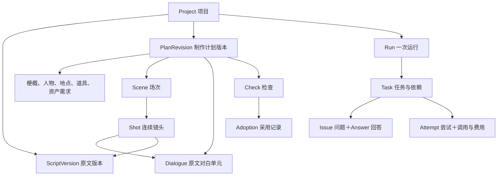

# 剧本拆解 Agent：第一版数据结构

状态：**v0.1 数据设计基线；已实现 Project、ScriptVersion、SourceIndex、draft Run、事实 Candidate PlanRevision、Attempt/ModelCall、程序 Check/Issue/Adoption，以及独立的候选 StoryboardRevision 和采用。现有实体的名称、别名和说明可校对并保存新候选；小说资产切片另已增加结构化视觉简报、图片候选、人工接受/拒绝和生成溯源。单段视频另有独立的持久任务与恢复切片；其他事实/分镜编辑、CostEntry、通用生产恢复与按场重做仍未实现。** 更新日期：2026-10-23。

依据：[总体设计](总体设计.md)与[技术架构](技术架构.md)。范围是第一个里程碑：中文单集剧本 → 可编辑的拆解与文字分镜。本文确定逻辑数据结构；本机 PostgreSQL 已确认并逐步映射，对象存储留到媒体阶段。P0.2 draft 边界见[持久化说明](持久化-P0.2.md)，事实候选见[P0.3](候选计划-P0.3.md)，不要求下面每个逻辑对象各占一张表。

2026-10-23 模型配置增量：本机私有文件 v2 保存多个 `profiles[]`（id/name/kind/endpoint/model/authType/apiKey/maxOutputTokens/timeoutMs/revision/source）和四类 `assignments`（profileId/revision）。密钥不进入项目成果、HTTP 读取响应或浏览器草稿。用途选择可共用 profile，切换和共享 profile 修改会更新对应用途 revision。v1 四用途配置启动时迁移，原选择不变。`BreakdownRun.modelConfig.connectionRevision?` 只标识不含密钥的用途版本，仍保存在原 JSONB，无需数据库迁移；旧记录可读，执行校验版本。小说和分镜按操作冻结配置快照，网页请求可带 `expectedModelConnectionRevision` 防止按过期显示发起付费调用。尝试账本保留模型名。详见[独立模型配置](独立模型配置.md)。

## 1. 先看用户会看到的内容

| 内容 | 数据名称 | 示例与作用 |
|---|---|---|
| 剧本 | ScriptVersion | 保存输入原文；每次改原文都是新版本。 |
| 梗概、人物、地点、道具 | PlanRevision 中的内容 | 萧炎、纳兰嫣然；云岚宗空地；剑、重尺。 |
| 场次 | Scene | 故事在某个地点、时段发生的一段戏。 |
| 分镜 | Shot | 一行一个连续镜头；记录原文依据、对白分配与镜头设计。 |
| 待处理问题 | Issue、Answer | 哪段剧情不明确、影响什么、用户如何回答。 |
| 运行进度 | Run、Task | 正在拆哪一场，哪些完成、哪些等待人工。 |

**地点与场次分开：** 一个地点可以发生多场戏；每场戏包含多个镜头。界面可以显示“场次 1”，数据的 `order` 是排序号，稳定 `id` 用于引用；排序号不进入人物名或场次事实。



## 2. 保存方式：内容快照与执行记录分开

第一版每个 `PlanRevision` 保存完整的单集文字计划快照：梗概、实体、场次、对白、镜头、资产需求和人工保护标记。原版本不可修改；编辑、重做或澄清后的结果创建新版本。

`Project.activePlanRevisionId` 指向当前采用版本。未采用的新版本只是候选；候选也能预览、比较和检查。首版文字体量小，完整快照方便比较和恢复。资产库及媒体独立版本在后续里程碑扩展，当前先记录资产需求。

任务、问题、回答、检查、采用与费用记录独立保存。模型生成了一份分镜，不代表任务已完成、费用已结算或用户已采用。

## 3. 通用字段约定

- 字段使用 `camelCase`。ID 为程序生成的不透明字符串；示例里的 `shot_01` 只是便于阅读，生产 ID 不随排序改变。
- 时间使用带时区的 ISO 8601 字符串；`createdAt` 保存创建时间。
- `null` 表示尚未确定或不适用，`[]` 表示没有条目。未知身份不能填一个猜测的人物 ID。
- 金额使用整数 `Micros`，一货币单位为 1,000,000 micros；例如人民币 0.001 元为 1,000 micros。金额配币种，不用浮点累加。跨币种费用没有明确折算依据时不得直接相加。
- 时长用正整数毫秒 `durationMs`，第一版均为设计估计，不能标为实测音频或视频时长。
- 新镜头与拆分后的镜头分配新 ID；沿用同一镜头做局部修改时保留 ID。不得凭数组位置认定是同一镜头。

### 3.1 原文引用 SourceRef

| 字段 | 类型 | 约定 |
|---|---|---|
| scriptVersionId | string | 绑定不可变原文版本。 |
| start、end | integer | 全文 Unicode 码点偏移，零基、左闭右开；换行也计入。 |
| quote | string | 必须等于该范围的原文，用于展示和核对。 |

存储 `rawText` 时保留原文，包括换行；`contentSha256` 对完整原文的 UTF-8 字节计算。行号由偏移推导显示，不作为唯一定位依据。TS 实现需按码点处理，不能直接将 UTF-16 的字符串索引当作本规范偏移；验证要包含 emoji 等非 BMP 字符。

引用只能证明“这段原文存在”；语义忠实度仍需检查。角色对白中的猜测也不能直接转为叙事事实。

### 3.1.1 P0.1 内部原文索引与 Prompt Chunk

`SourceRef` 是正式计划、问题和检查记录使用的 canonical 引用；P0.1 额外建立内部的 `ScriptSourceIndex`，但它不替代 `SourceRef`。

```text
ScriptVersion.rawText
→ SourceUnit（物理行，含换行；无重叠、可完整拼回原文）
→ SourceSpan（标题/场标候选、对白候选、动作候选等保守结构标注）
→ SourceBlock（标题、空行和段落优先的逻辑分块）
→ PromptChunk（模型任务材料）
```

- `SourceUnit` 的 `start/end` 覆盖完整原文，包含换行；它们按顺序无重叠地复原 `rawText`。
- `SourceSpan` 只表达保守结构线索，例如 `headingCandidate`、`dialogueTurnCandidate`，不是已确认的场次、人物或剧情事实。
- `PromptChunk.primarySpanIds` 对非空 `SourceSpan` 完整覆盖且每条只属于一个 Task；标题、空行和 token 预算是切分线索，不是剧情边界结论。
- `PromptChunk.contextSpanIds` 只在 blank/budget 等软边界引入前后一个完整单元，标为 context-only；它不计入覆盖率，也不能单独作为正式事实依据。
- 模型只看当前 Task 的局部 alias：primary 证据为 `E001...`，context-only 为 `C001...`。alias 是版本和 Task 绑定的导航层，后端必须还原并验证后才创建正式 `SourceRef`。
- P0.1 的 token 预算是保守 Unicode 码点估算，不宣称等于任一模型 tokenizer；正式调用记录实际 usage 后再校准。token 预算不得改变 canonical `SourceRef` 的边界。
- 完整对白轮次优先保持原子性；一个对白单元超预算时允许对应 Chunk 超预算，并标记为 oversized，不能从中间静默截断。

### 3.1.2 P0.2–P0.4 当前物理映射边界

`migrations/001_breakdown_p0.sql` 当前只创建 `projects`、`script_versions`、`breakdown_runs` 和 `breakdown_tasks`。其中：

- `script_versions.raw_text`、`content_sha256` 和 `source_index_json` 一起保存；保存时后端重建并校验 `ScriptSourceIndex`，读取时再次验证索引与行字段一致。
- `projects.current_script_version_id` 与创建剧本版本在同一短事务更新；剧本显示版本号在项目行锁下递增。
- `breakdown_runs` 仅允许 `target=breakdown`、`status=draft`；`breakdown_tasks` 仅允许初始 `extractFacts/pending` Task。它们保存需求、模型与限制快照以及 `inputManifest`，但不会执行。
- P0.3 的 `plan_revisions` 保存结构与引用校验通过的事实候选快照；初次提取候选的镜头、资产需求和人工锁为空，保存候选不修改项目的 `active_plan_revision_id`。
- P0.4 的 `breakdown_attempts` 和 `model_calls` 保存事实提取执行；`plan_revisions.attempt_id` 回溯候选来源。Pi 执行器通过服务端 MAAS 文本通道调用模型；离线测试使用假适配器。一次真实非流式请求已成功返回，但事实候选输出协议校验失败，未生成候选，拆解尚未跑通，见[实测记录](模型接入验证.md)。历史 Run 与调用记录保留原模型快照，不批量改写；使用新模型需新建 Run。
- P0.5 的 `plan_checks`、`plan_issues`、`plan_adoptions` 保存事实候选的程序检查与采用，采用使用项目指针的版本比较。
- P1 的 `storyboard_attempts`、`storyboard_revisions`、`storyboard_adoptions` 保存分镜设计、引用/对白覆盖校验结果与人工采用；每个镜头的设计字段标为 `designSuggestion`。它尚未写回 v0.1 `PlanRevision.scenes[].shots`，属于独立候选阶段。
- `007_entity_edit_revisions.sql` 扩展 `plan_revisions`，允许 `user/manualEdit` 及非空父版本；校对候选沿用原 Run/Task，`attempt_id=null`，实体 ID 不变。内部 `revision_order` 用于最新版本判断和列表排序；既有记录按 `created_at/id` 顺序回填。保存校对、保存提取候选及采用均在项目行锁下检查相关版本，不能用旧页面静默覆盖新候选。
- CostEntry、语义质检、按场重做、预算预留和跨进程恢复仍未实现；不能从调用记录推断这些能力存在。

迁移由 `npm run db:migrate` 显式执行；HTTP 服务不在启动时建表，避免把一次服务启动变成未审阅的 schema 写操作。

已有数据库使用实体校对前须应用 007 迁移并重启服务。历史检查与候选继续保留；新校对候选需独立生成当前规则的 Check 并通过后采用，不能复用父版本的检查。

### 3.2 有来源的字段 Value<T>

梗概、实体名称/说明、场次标题/时段、镜头设计使用以下结构：

```text
Value<T> = {
  value: T,
  origin: "source" | "user" | "design",
  sourceRefs: SourceRef[],
  answerIds: string[]
}
```

- `source`：从剧本提取或忠实概括，必须有原文依据；只有对白和 SourceRef.quote 必须逐字相同。
- `user`：用户补充的要求、回答或直接修改。来自澄清时引用 Answer；直接编辑通过版本创建人与变更记录追溯。
- `design`：AI 补充的景别、运镜、表演、外观等已授权制作设计，可附相关原文作为设计依据。

谁生成版本由 `createdBy` 表达，与内容来源不同：AI 提取的人物名仍可为 `source`；用户采用 AI 设计不会把其来源自动改为 `source`。输入制作要求整体来源于用户配置，作为版本快照单独保存。

## 4. 项目、原文与制作计划

### 4.1 Project 与 ScriptVersion

| 对象 | 必需字段 | 说明 |
|---|---|---|
| Project | id、title、createdAt、currentScriptVersionId、activePlanRevisionId；可选 source | 后两个指针允许为 null；source 保存 HTTPS 来源链接及可选作品/作者/章节标题，仅用于出处核对，不代表自动抓取；选择新原文不会删除旧计划，原文版本不匹配的旧结果不得继续当作当前有效计划。 |
| ScriptVersion | id、projectId、version、rawText、contentSha256、createdAt | version 为显示序号；保存完整输入，不通过模型重新生成原文。 |

### 4.2 PlanRevision

| 字段 | 类型 | 用途 |
|---|---|---|
| id、projectId、scriptVersionId | string | 计划身份及原文依据。 |
| parentRevisionId | string 或 null | 创建候选时基于哪个计划；初版为空。 |
| rebasedFromRevisionId | string 或 null | 冲突后合并生成新候选时，记录原候选。 |
| createdAt、createdBy | 时间、agent/user/system | 版本作者与创建时间。 |
| reason | extract/storyboard/manualEdit/regenerateScene/clarification/rebase | 创建原因。 |
| scope | Scope | 本次允许修改的范围。 |
| requirements | object | language、visualStyle、aspectRatio、targetDurationSeconds；最后一项是 min/max 或 null，为制作参考，不允许据此删对白。 |
| synopsis | Value<string> 或 null | 梗概；尚未完成提取时可为空。 |
| characters、locations、props | Entity[] | 人物、地点、道具。 |
| dialogues | Dialogue[] | 原文对白单元。 |
| scenes | Scene[] | 场次与各场的镜头。 |
| assetRequirements | AssetRequirement[] | 后续资产准备需要什么。 |
| manualLocks | ManualLock[] | 明确保护哪些人工修改。 |

`Scope = { kind: "project" | "scene" | "shot", targetId: string|null }`；project 的 targetId 为空，其余必须存在。第一版重做入口以按场为主，shot 用于定位编辑或问题。

### 4.3 Entity、Scene、Dialogue

| 对象 | 字段 | 约束 |
|---|---|---|
| Entity | id、name: Value<string>、aliases: Value<string>[]、description: Value<string>或null、sourceRefs | 通过所属 characters/locations/props 数组区分类型；同一人物的别名归入同一实体。外貌或服装未写时不伪造原文描述。 |
| Scene | id、order、title: Value<string>、locationId: string或null、characterIds、sourceRefs、timeOfDay: Value<string>或null、shots: Shot[] | locationId 引用 locations；角色列表包含本场参与者，不等于每个镜头都能看到的人。未知地点可为空并记录问题。 |
| Dialogue | id、sceneId、speakerId: string或null、speakerSourceRefs、speakerAnswerIds、sourceRef | sourceRef.quote 仅包含要说的原文，不含“萧炎：”这类标注。说话人依据单独记录；角色不明时为 null 并阻断相关任务。 |

场次可以先存在而 shots 为空，用来表达等待澄清或尚未设计；不能靠编造镜头凑齐结果。人物、场景、对白 ID 的引用需在同一计划与原文版本内可解析。

2026-10-22 实现补充：`extract-facts-completeness/2` 对索引已识别的简单单行对白检查完整正文边界，防止有效 SourceRef 只覆盖一个字或带入说话人标注。正文含括号说明等不确定边界时返回阻断问题，不猜测拆分；这不是任意小说/多行对白的完整语义检查。SourceRef 和原文索引的持久化结构未改变。旧检查版本保留读取，重新采用事实需通过当前规则；历史已采用结果不会自动重检或撤销。具体边界见[首个里程碑实现](首个里程碑实现.md)。

### 4.4 Shot：分镜表的一行

| 字段 | 类型 | 用途 |
|---|---|---|
| id、sceneId、order | string、string、integer | 稳定镜头身份、所属场次、显示顺序。 |
| sourceRefs | SourceRef[] | 这个镜头对应哪些原文。 |
| actionRefs | SourceRef[] | 原文动作，界面可直接展示 quote。 |
| visibleCharacterIds、propIds | string[] | 计划入画的人物与使用的道具；它们是镜头安排，不代表新增剧情事实。 |
| dialogueBindings | DialogueBinding[] | 分配到该镜头的对白片段。 |
| design.visualDescription | Value<string> | 怎么呈现原文动作与人物，补充内容必须在授权范围内。 |
| design.shotSize | Value<string> | 如双人中景、近景；原文没写时为 design。 |
| design.cameraPosition | Value<string> | 机位与拍摄方向。 |
| design.cameraMovement | Value<string> | 固定、推、拉、移动等；一个镜头内保持连续。 |
| design.performance | Value<string>或null | 语气、表情、节奏等设计。 |
| design.durationMs | Value<integer> | 预计时长。 |

`DialogueBinding = { dialogueId, start, end }`；start/end 按对白单元 quote 的 Unicode 码点切片。每个原文对白单元在完成的分镜计划中需完整覆盖，默认不重叠、不无故重复；跨镜头对白拆成不同片段绑定。同一原文引用可以出现在多个镜头，引用重复本身不等于对白播放重复。说话人可在画外，因此不强制出现在 visibleCharacterIds。

绑定范围满足 `0 ≤ start < end ≤ 对白码点长度`。按场次 order、镜头 order、dialogueBindings 数组顺序播放时，保持原文对白的顺序；同一句跨镜头的片段按 start 递增，不能只有覆盖完整却把前后半句倒置。后续若支持原文明确的同时发声，需单独扩展时间关系，不能默默打乱顺序。

`AssetRequirement = { id, kind, entityId, shotIds, description }`；kind 为 character/location/prop，description 使用 Value<string>。这是资产需求，不是实际素材；此版不填虚假的图片地址、演员资产 ID、音频或视频结果。

`ManualLock = { targetType, targetId, fields, introducedInRevisionId }`；targetType 可为 requirements/synopsis/entity/scene/shot/dialogue，根级字段的 targetId 为空。fields 为该对象的字段名或嵌套路径，如 `design.cameraMovement`，`*` 表示整个对象。目标按稳定 ID 定位，不能按“数组第 3 项”定位；删除受保护对象也算冲突。

**2026-10-22 当前实体校对切片：** 实际只写入 `targetType=entity`，`fields` 取 `name/aliases/description`。校对保留实体及字段的 SourceRef，新增或改变的文本使用 `origin=user`；未改变的文字保留原来源，别名重排/删除或说明清空也记录对应字段。`introducedInRevisionId` 指向引入该次修改的候选，后续校对沿用稳定实体 ID，保留未重改字段的记录。模型提交仍只接受原文事实 `origin=source`，不能自行添加人工锁或伪装成人工校对。

这个切片不允许新增、删除、合并实体，不改原文引用、场次、对白、说话人、梗概、资产需求或镜头。`manualLocks` 当前是人工修改的字段记录；跨新 Run 的锁继承、冲突合并和解除保护协议尚未实现。新事实提取是独立候选，会分配新实体 ID，不承诺自动带入旧版人工内容。

## 5. 任务、问题和运行记录

以下记录由程序维护，模型只能提交内容候选及问题建议，不能自己写入“已通过”“已采用”“已结算”等执行结论。

| 对象 | 第一版字段 | 核心用途 |
|---|---|---|
| Run | id、projectId、target、scriptVersionId、basePlanRevisionId、requirements、modelConfig、scope、mode、humanCheckpoints、status、globalPauseReason、budget、sealedAt、createdAt | target 固定为 breakdown；拆解完成不等于完整成片。requirements 保存本次要求快照，modelConfig 保存 provider/model 或 null。mode 为 auto/checkpoints。budget 保存 currency 与 limitMicros，未设置上限时为 null，不能启动付费运行。 |
| Task | id、runId、type、scope、basePlanRevisionId、dependsOnTaskIds、inputManifest、state、blockedByIssueIds、limits、activeAttemptId、lease、createdAt | type 为 extractFacts/storyboardScene/validatePlan/adoptPlan；按场重做使用 storyboardScene。limits 包含最大尝试数、最大模型调用数和超时时间，数值在真实接入时校准。 |
| Attempt | id、taskId、number、status、startedAt、endedAt、promptVersion、executorVersion、inputDigest、outputPlanRevisionId、error | 每次尝试独立记录；失败不能覆盖前一次的结果或费用。 |
| ModelCall | id、attemptId、operationKey、provider、model、requestDigest、providerRequestId、status、usage、createdAt、endedAt | 付费前登记内部操作；远端标识可能为空，需区分尚未提交与提交结果未知。 |
| CostEntry | id、runId、modelCallId、kind、currency、amountMicros、pricingRef、createdAt | kind 为 reserve/release/charge。账目追加保存，预留、释放与实扣分开。 |
| Issue | id、projectId、runId、planRevisionId、scope、kind、message、sourceRefs、blocking、affectedTaskIds、status、resolution | 定位问题及实际阻断范围；部分引用可为空，例如配置问题。 |
| Answer | id、issueId、text、supersedesAnswerId、createdAt | 回答历史不覆盖。当前回答由版本关系确定；已有回答不反复追问。 |
| Check | id、projectId、planRevisionId、scope、ruleVersion、method、result、issueIds、createdAt | result 为 passed/failed/uncertain；method 为 program/model/human，分别说明检查来源。 |
| Adoption | id、projectId、fromRevisionId、toRevisionId、actor、checkIds、createdAt | 采用记录与项目当前指针同事务更新；fromRevisionId 初次为空。 |

### 5.1 固定输入与局部有效性

`inputManifest` 保存本次实际读取的输入项，每项为 `{ kind, id, revisionId, fields, digest }`。kind 可为 script/requirements/entity/scene/dialogue/plan/answer/manualLocks；revisionId 为所属不可变版本，fields 列出实际读取的字段路径，`["*"]` 表示整个选中对象。digest 为这份输入的摘要。任务保留基准计划，但不能仅因整份计划 ID 变化就判定所有镜头输入失效。

按场设计登记所用对白与说话人字段，不能只登记 Scene，因为 Dialogue 独立保存在计划中。validatePlan/adoptPlan 登记待检查或采用的确切 plan 摘要；按场生成则登记实际需要的局部输入，避免无关场次修改造成全部失效。

例如第一场改了运镜，第二场任务读取的原文、场次和共享设定都没变，第二场可以继续。任务使用哪些字段必须在执行前明确，摘要覆盖这些字段及相关人工保护标记。script 摘要使用原文 contentSha256；其余使用对象键递归按 Unicode 码点字典序排列、数组保持顺序、无多余空白的 UTF-8 JSON 计算 SHA-256，数值限于安全整数，文本不额外标准化。算法实现及跨 TS/校验工具的一致性需在编码时验证。

Run 在 draft 阶段可修改输入配置，排队前补齐预算、模型、任务 limits 并重新计算输入清单，设置 sealedAt 后冻结剧本、requirements 和模型配置；调整输入要创建新 Run。后续 PlanRevision 从本次已冻结要求形成快照。运行中提高预算须记录用户授权的预算变更事件，不能由模型自行修改 limitMicros；相关操作接口另行细化。

草稿中的 Task.limits 允许为 null，Task 只能保持 pending；排队前填入 `maxAttempts`、`maxModelCalls`、`timeoutMs` 等正整数限制。maxModelCalls 统计该任务所有尝试的调用总数，timeoutMs 限制单次尝试；自动重试不能重置任务额度。草稿 inputManifest 仅供预览，不表示输入已冻结。

`lease = { ownerId, expiresAt }` 或 null。领取任务和记录尝试使用短事务；过期仅表示需要核对，不能直接证明远端生成失败。

### 5.2 状态与阻断

- Run.status：draft/queued/running/waiting/completed/failed/cancelled。draft 可缺少预算和模型配置；进入执行前必须补齐。存在独立运行任务时仍可为 running，同时展示待处理问题。
- Run.globalPauseReason：null/budget/invalidSharedInput/user。全局暂停时停止提交新付费工作，已在途调用继续收取结果并对账。
- Task.state：pending/ready/running/waitingExternal/waitingHuman/retryWait/reconciling/succeeded/failed/cancelled。等待人工或远端结果释放执行名额。
- Attempt.status：running/succeeded/failed/unknown/cancelled。ModelCall.status：prepared/submitted/succeeded/failed/unknown。
- Issue.kind：storyAmbiguity/validation/versionConflict/quality/budget/configuration/execution；status 为 open/answered/resolved。非阻断提示也保留 blocking=false。

主要转换为 pending → ready → running → succeeded；失败进入有界重试或转人工。blockedByIssueIds 非空且问题阻断时不得 ready。resolved 问题解除直接阻断后，仍要满足依赖、输入有效性和预算条件才能继续。

Answer 保存后，Issue 先变为 answered。相关计划更新并检查通过后，才设为 resolved，resolution 保存采用的 answerIds、planRevisionId 和 checkIds；不能“有回答就直接解锁”。不需要回答的问题可通过修复或核对解决，但同样需要保留依据。

接收回答后，程序安排读取该 Answer 的修订与检查任务；这类用于解决问题的任务不被同一问题阻断。依赖未确认剧情事实的生产任务继续等待，避免“必须先解决才能运行修复”的循环依赖。

Task.dependsOnTaskIds 构成无环依赖图；局部问题阻断相关任务及其后续依赖，其他任务继续。完成判断还要检查目标场次有完整分镜、对白覆盖及所需 Check 通过，不能只看任务数量。

### 5.3 调用与预算

调用前原子登记 ModelCall 与 reserve，额度不足不发请求。一个操作的 reserve 表示占用额度；结算时同时 charge 实际费用并 release 原预留。部分释放、补充预留应有明确原因和记录，不静默改账。各调用未释放预留之和加已实扣不得超过允许额度，所有重试使用同一 Run 预算。

prepared 表示已有意图记录但尚未确认发出；进程在提交边界中断时也可能需要核对。unknown 的预留保留，恢复时根据 operationKey、远端标识和供应商能力核对，不能盲目再付一次。后台无权假定取消就退款。

## 6. 修改、比较与采用规则

1. **手工修改：** 在当前版本上创建新 PlanRevision，标明 changed scope；本次人工改动添加 manualLocks。原文仍按 ScriptVersion 保留。
2. **按场重做：** 任务固定原文、该场输入、共享实体/要求与人工保护标记；生成新候选，不改变其他场内容。
3. **采用：** 检查候选、人工保护及用户看到的基准；正常自动生产可按模式采用，人工重做及受保护内容由用户比较选择。采用不改变 origin。
4. **基准变化：** 不直接拿旧整份快照覆盖当前版本。只有修改范围及读取的输入都未冲突时，程序才可把局部变化合并到当前版本，创建新的 rebase 候选，再检查和采用；有冲突转人工。
5. **恢复旧版：** 在当前版本上创建以旧内容为依据的新候选，再检查采用；旧版本、旧采用记录和所有人工修改历史保留。

Snapshot 保持不可变，但项目的当前指针可变。用户采用操作需带期望的当前版本，防止两个页面或迟到任务互相覆盖。锁定的是具体字段和对象，取消保护也必须来自用户明确操作。

当前实现比完整恢复/合并设计更保守：实体校对和事实采用仅允许当前剧本的最新候选，保存时还校验调用者所见的 `expectedActivePlanRevisionId`；旧剧本或已被新候选替代的版本只读。手工保存创建 `parentRevisionId=基准版本`、`createdBy=user`、`reason=manualEdit` 的新候选，不改变活动计划，不自动复制旧 Check。上述按场重做、自动合并、恢复旧版及跨 Run 人工保护仍是后续设计，不由本轮字段记录代表已完成。

## 7. 模型能看到和返回什么

模型输入是本任务需要的原文、制作要求、已知实体、已采纳回答、当前场次与受保护字段。模型输出是内容候选与问题建议；创建 ID、写任务状态、保存检查结果、费用结算和正式采用由程序负责。

新实体或镜头可先使用本次输出内的临时标识，由程序分配稳定 ID 并一次性重映射全部引用。模型对已有 ID 的删除、替换和身份合并必须校验；不能因为名字相同就直接复用不同人物的 ID。

页面面向用户展示原文、清单、场次卡片和分镜行；运行记录放在进度与问题视图。完整记录集合用于程序保存和恢复，不直接当作用户界面，也不整包交给模型修改。

## 8. 样例与核对

对应[赴约第一版数据样例](../examples/斗破苍穹-数据结构-v0.1.json)：2 人、1 个地点、1 场戏、3 段对白、2 件道具、4 个连续镜头。它是手写的设计样例，保留已有练习原文，不是模型运行成果。

样例展示一份尚未采用的计划候选和未启动的运行草稿：预算及执行参数尚未配置，没有模型调用、费用、检查通过或采用记录。约 19 秒是短练习的设计时长，用于字段演示，不承担 1–2 分钟整集验收。制作要求仍明确真人拟真、9:16 和中文。

至少核对以下约束：

- 原文摘要、引用范围和 quote 一致，包含非 BMP 字符时仍按码点定位。
- ID 唯一，镜头归场正确，实体/对白/资产需求引用可解析，排序不会改变 ID。
- 分镜一行一个连续镜头，时长为正；对白片段完整覆盖、不重叠，动作没有把“握紧重尺”改成“拔出重尺”。
- 人工锁按稳定 ID 定位；删除、覆盖受保护对象或旧候选替换新版本会被阻断。
- 问题回答与问题解决分开；独立场次任务继续不受无关输入变化影响。
- 模型调用与费用不会由模型输出直接确认；未配置预算的草稿不可执行。

其中结构和引用可用程序检查，镜头连续性、剧情忠实及真实任务恢复还需后续内核与模型验证。样例一致性检查不能当作这些能力已经实现。

2026-09-15 样例核对：临时 Python 检查通过 67 处原文引用、原文与要求摘要、实体关联、3 段对白的顺序与覆盖、4 镜头合计 19 秒；6 个故意损坏的样例被拒绝，并核对了非 BMP 码点切片。该检查未实现或运行 TypeBox/Ajv 契约、模型调用、生产调度及恢复功能。


## 9. 独立小说事实结构（2026-10-22 已实现切片）

2026-10-23 兼容增量：`NovelItem` 可选增加 `entityType`（person/group/creature/place/object/material）、`occurrence`（present/mentioned/historical/imagined）、`aliases`、`canonicalEntityId`；对白 classification 增加 sound。旧数据缺少这些字段不强制回填。`NovelContent.analysis` 可选，包含 version/status/calls/contextRevisionIds/paragraphCoverage/issues；issues 的 targetId 使用当前版本的真实条目ID，段落ID绑定该章不可变原文索引。跨章表是带章/版本/条目/原文出处的派生读模型，不凭同名合并，不改写原章事实。人工校对改变这些字段时保留新版本、重核已有资产引用，并将旧语义检查标为 humanEdited。

小说不直接填入以上剧本场次或镜头结构。`NovelSource` 保存不可变 rawText、SHA-256、sourceUrl；`NovelChapter` 保存 order/title/start/end 和本章 latestRevisionId。`NovelRevision` 保存 chapterId、parentRevisionId、createdBy（model/user/program）与不可变 content。

`NovelItem` 分 character/location/prop/dialogue，含 label、description、sourceRefs、speakerId、classification、uncertainty、review、origin。每处依据必须等于该章原文精确码点切片；对白 label 等于第一处依据，其他依据用于归属上下文。未知不硬合并，模型项初始 unreviewed，修改项标记 user；只允许章内人物引用，不宣称跨章身份已统一。

`NovelAttempt` 独立登记 submitted/succeeded/failed/unknown 与安全 usage。保存使用 expectedRevisionId；人工保存和模型迟到并发时拒绝旧基准覆盖。迁移 008、约束和字段使用说明见 [小说逐章拆解](小说逐章拆解.md)。

`NovelContent.assetBindings?` 保存 `{ itemId, status: linked | missing | needsReview, asset: AssetRecord | null, note }[]`。不含该字段的旧版本保持兼容。引用只指向本章人物/场景/道具；明确选择时必须已保存确认且无未解决说明，linked 必须同类型。图片候选在 `awaitingReview` 或 `rejected` 时不得写入这里，只有人工接受后才新增 linked 快照。修改条目身份/描述/依据/确认状态后引用变为 needsReview，保留旧快照。记录不可变，旧基准不能覆盖新版本。

迁移 009 新增 `asset_catalog`，`AssetRecord = { id, kind: character | location | prop, name, description, resourceUrl, createdAt }`。迁移 010 保持字段兼容，允许服务端生成的 `/api/assets/<自身ID>/content` 作为本地图片地址，新增 `asset_media(asset_id, mime_type, sha256, content BYTEA)` 原子保存图片。HTTPS 链接不固定远程内容，本地导入固定原始字节；两者均不表示适用性质检通过。绑定时由服务端从目录读取快照，拒绝客户端传入资产内容。具体接口与状态见 [小说资产引用](小说资产引用.md)。

## 10. 单张资产生成任务、候选与人工采用

迁移 011 新增 `desktop_asset_jobs(id, job_key, chapter_id, status, version, task_json, created_at, updated_at)`，迁移 012 重建全局单活跃任务索引。每次生成请求带新的稳定 `intentId`；jobKey 对章节、完整已确认条目快照和 intent 计算 SHA-256。同一 intent 不会重复提交，用户再次显式确认额度并创建新 intent 时，同一条目可以再生成一个候选。task_json 保存输入版本、条目快照、结构化视觉简报、提交时间、资产ID、关联版本ID及安全状态说明；返回浏览器时去掉内部快照、key、锁版本和提交时间。

`AssetVisualBrief` 的固定版本为 `asset-visual-brief/v1`：

```text
AssetVisualBrief = {
  schemaVersion: "asset-visual-brief/v1",
  itemId,
  kind,
  name,
  confirmedFacts,
  evidence: [{ evidenceId, documentId, start, end, quote }],
  designVariables,
  negativeConstraints,
  confidence,
  pendingConfirmations
}
```

`confirmedFacts` 和 `evidence` 来自当前已确认小说条目及其精确原文位置；`designVariables` 只表达允许补齐的视觉设计，`negativeConstraints` 防止把未写信息伪装为事实，`pendingConfirmations` 保留尚不能确定的内容。旧 `description/sourceQuotes/designNotes/promptPreview` 暂保留兼容，但不替代结构化简报。

任务状态为 queued / submitting / generating / importing / awaitingReview / accepted / rejected / completed / needsReview / failed / unknown；只有前四项共享全局唯一活跃槽。新成果进入 `awaitingReview`，不会自动写入 `assetBindings`。`accepted` 表示用户已接受并追加正式章节关联，`rejected` 保留候选与决定，`completed` 只用于迁移前旧任务的读取兼容。unknown 表示原请求可能已计费，不会自动重发，只能显式核对原结果；它不再永久占用其他条目的生成槽。failed 只有在明确未发送且任务目录安全为空时才允许新的显式授权。固定任务目录内的 `submit-intent.json` 在发送键前持久化；`result.png` 经文件检查后保存。

迁移 `013_asset_generation_candidates.sql` 新增 `asset_generation_candidates(id, task_id, asset_id, chapter_id, item_id, status, version, review_note, accepted_revision_id, provenance_json, created_at, updated_at)`。`provenance_json` 保存：

```text
{
  promptVersion,
  promptSnapshot,
  model,
  modelConnectionRevision,
  inputRevisionId,
  sourceItem,
  brief,
  result: { sha256, mimeType, bytes }
}
```

`POST /api/asset-generation/:id/decision`（兼容路径 `/api/desktop-assets/:id/decision`）接收 `{ decision: "accept" | "reject", expectedRevisionId, note? }`。接受动作在章节版本比较通过后写入 `accepted_revision_id`；拒绝只记录 `review_note` 和状态，不删除候选媒体或溯源。公开任务只返回安全候选摘要，不返回完整提示词、内部 jobKey、条目快照或行锁版本。任务状态不修改小说事实；接受关联会追加章节版本，冲突保留素材而不覆盖。人工接受不等于自动视觉质检。本切片不自动重试、不改编剧本，也不接分镜或 3D。详见[豆包 API 资产候选](豆包桌面一键资产.md)。

生成候选即使已保存到 `asset_catalog`，在 `awaitingReview/rejected/needsReview` 状态也会被服务端资产引用策略拒绝，不能从普通绑定接口绕过人工接受。候选终态是公开任务状态的权威来源；迁移前任务缺少可信提交快照时，溯源使用 `legacy/unknown` 与 `provider: unknown`，而不是按当前代码重建历史提示词。

接受决定先以候选 CAS 写入内部恢复凭据（基准 `expectedRevisionId`、nonce、审核备注），再保存小说关联。中断恢复只认可该基准版本本身或其直接子版本中的同条目、同资产关联；任意更早的历史关联不能证明这次接受，只能标记 `needsReview`。相同接受意图复用同一凭据，不同基准或备注返回冲突；恢复不会触发新的模型调用。

## 11. 独立单段视频任务

迁移 014 新增 `video_automation_runs(id, client_request_id, status, provider_task_id, version, run_json, created_at, updated_at)`。`client_request_id` 永久唯一；`version` 做 CAS 更新；部分唯一索引只允许一个 queued / submitting / generating 任务。unknown 不占活动槽，但原请求标识仍保持幂等，不能借重试再次提交。

`run_json` 固定保存提示词、9:16 或 16:9 比例、4–30 秒时长、720p 或 1080p、是否生成声音、可选的有序 `referenceAssetIds`、冻结的模型与连接版本、供应商任务 ID、安全结果链接、错误摘要及 unknown 对账次数 `reconciliationAttempts`。参考资产 ID 去重且最多 30 个；适配器提交前从资产库读取，本地 PNG/JPEG/静态 WebP 转成 data URL，远程登记使用 HTTPS URL。任一参考资产不可读或校验失败都会阻断提交。公开状态为 queued / submitting / generating / completed / failed / unknown。结果只保存 `{ videoUrl }`，必须是无凭据的 HTTPS URL；独立单段工具本身不下载媒体，项目级生产执行器会在后续把结果安全入库。unknown 连续 3 次仍无法确认时停止查询并转人工，保留原任务 ID，不创建第二次提交。

公开进度由服务端推导为 input / model / submit / generate / deliver 五个节点，状态为 pending / running / waitingExternal / succeeded / failed / needsAttention。`progress.completed` 只统计已证实成功的节点，不把轮询时间换算成假百分比。重启后 queued 可以首次提交；残留 submitting 没有任务 ID 时变为 unknown；generating 或带任务 ID 的 unknown 只查询原任务。显式 reconcile 接口接受空对象且不会创建新任务。

## 12. 项目级全流程生产聚合（2026-10-23 已实现）

迁移 `015_production_orchestration.sql` 新增 `production_runs` 和 `production_outbox_events`。迁移 `016_agent_adoptions.sql` 将计划和分镜采用 actor 扩为 `user | agent`；外部人工接口仍默认写 `user`，只有生产总控全自动模式在确定性检查通过后使用 `agent`。它们承载从固定剧本版本到本地成片的整集运行，与第 5 节早期文字 Run 草案并存；下面是当前代码真实使用的生产聚合契约。

### 12.1 ProductionRun 创建输入与状态

`CreateProductionRun` 固定保存：

```text
{
  projectId,
  scriptVersionId,
  ratio: "9:16" | "16:9",
  targetDurationSec: 15..900,
  visualStyle,
  qualityPreset: "fast" | "balanced" | "quality",
  automationMode: "auto" | "checkpoints" | "coDirector",
  candidateLimit: 1..4,
  directorPolicy: "auto" | "always" | "never",
  budgetMicros,
  currency,
  allowPaid: true,
  clientRequestId
}
```

`clientRequestId` 唯一。同标识与相同输入返回原运行；同标识与不同输入冲突。创建接口拒绝额外字段和 `allowPaid !== true`，因此授权和预算是运行的冻结输入，不从浏览器旧状态或服务端默认值暗中补齐。

`ProductionRun.status` 为 `queued / running / waitingHuman / paused / pausedBudget / reconciling / completed / partial / failed / cancelled`。完整运行以 JSONB 聚合保存，关系列同时投影 id、幂等键、项目、剧本版本、状态、version 和时间。仓库用 version compare-and-swap 更新，避免并发操作最后写入覆盖。

### 12.2 阶段、任务与尝试

`ProductionStage` 固定顺序为：

```text
prepare → breakdown → assets → storyboard → director
        → video → candidates → review → compose → deliver
```

`ProductionTask` 保存 `stage/label/scope/status/dependencies/attemptCount/maxAttempts/version/blockingReason/inputManifest/createdAt/updatedAt`。scope 为整集，或具体 scene、shot、asset。任务状态包含 `pending / ready / running / waitingExternal / validating / retryWait / reconciling / waitingHuman / succeeded / failed / cancelled / invalidated / superseded / skipped`。

固定骨架先创建整集任务；分镜采用后，程序按稳定 key 动态创建镜头资产、可选 3D、`candidateLimit` 个视频、候选和复核任务。局部技术返修再创建镜头级“视频 → 候选 → 复核”子图。动态子任务的依赖会加入直接下游整集任务，防止协调任务先完成就绕过真实镜头工作。

`TaskAttempt` 保存任务、第几次尝试、执行器版本、输入摘要、状态、开始/结束和安全错误摘要。已开始尝试不会被新尝试覆盖。

### 12.3 外部操作与预算

`ExternalOperation` 保存 `operationKey/provider/providerTaskId/status/estimatedCostMicros/actualCostMicros` 及关联任务、尝试和时间。状态为 `prepared / submitting / submitted / polling / unknown / succeeded / failed`。`operationKey` 由运行、任务版本、尝试号和输入摘要稳定计算，用于阻止未知提交后的重复付费。

`BudgetEntry` 是追加式流水，kind 为 `estimate / reserve / charge / release`。可用金额按“运行上限－charge－尚未释放的 reserve”计算；下一任务的预留超过上限时进入 `pausedBudget`。当前供应商未提供统一可核验账单，执行器的 `actualCostMicros` 可能采用保守估算值，不应解释为供应商发票。

### 12.4 产物、候选、检查与问题

- `ProductionArtifact`：关联任务，kind 为 `text/image/audio/video/directorScene/timeline/delivery/report`，保存本地 URI、SHA-256、元数据和 current/superseded。
- `CandidateSet`：关联任务和 scope，kind 为 `asset/storyboard/director/video/audio`；候选保存 artifactId、标签、摘要、技术分数和 selected/rejected 状态。
- `QualityCheck`：保存 shot/scene/episode 级结果、规则版本、摘要和问题；当前视频检查为程序方法，不是视觉语义模型。
- `ProductionIssue`：保存任务、阶段、scope、严重度、影响范围、建议动作、追加费用估算和解决时间。
- `ReviewDecision`：保存 approve/reject/selectCandidate/resolveIssue、候选或问题 ID、反馈和时间。

全自动模式只自动选择执行器给出的推荐候选；关键节点和共同导演模式保持候选组 open，等待 `selectCandidate`。协议仍保留任务级 `reject` 决定供状态机失效下游，但当前生产总控界面不提供逐个候选驳回按钮，只展示“采用”，并在任务可重试时提供“整组重做”。重试或任务级驳回会把受影响下游的 current 产物、候选和检查标为失效/替代，不删除历史。

镜头视频产物的 metadata 还记录 `mediaId/videoRunId/shotId/candidateIndex/storyboardRevisionId`、探测到的时长/尺寸/音轨、模型及连接版本。引用白模时增加 `directorConstraintMode: "prompt-only"` 和 `directorSceneArtifactId`；返修时增加 `repairReportArtifactId`。`prompt-only` 表示相机与人物空间信息已转成文字约束，不是 3D 渲染或供应商原生相机控制。

### 12.5 时间线与交付

`TimelineRevision` 保存有序 video/audio/subtitle 轨及关联产物 ID、版本、时长和 candidate/adopted/superseded 状态。当前镜头请求开启供应商原生音频，合片只建立 video 轨并保留输入 MP4 音轨；audio/subtitle 类型是契约预留，用于后续独立声音和字幕子图。

`ProductionDelivery` 保存交付 artifactId、validating/ready/failed、画幅、时长、MP4 容器及 verifiedAt。只有产物为本地 `/api/production-media/:id`、有 SHA-256、执行器明确 `verified=true` 且整集检查通过，才能物化为 ready 交付。交付检查还保存冻结的 `targetDurationSec` 与 `durationTolerance`：高质量、均衡、快速档分别允许 12%、20%、30% 偏差，容差最小 3 秒。

### 12.6 本地媒体对象

本地 MP4 不写入 PostgreSQL 字节列。`LocalVideoObject` 清单保存在后端私有媒体目录：

```text
{
  schemaVersion: "production-local-video/1",
  id: "media_<sha256>",
  sha256,
  bytes,
  mimeType: "video/mp4",
  relativePath,
  sourceKind: "buffer" | "ownedFile" | "providerDownload" | "composition",
  probe: { container, durationSeconds, width, height, videoCodec, hasAudio, audioCodec },
  createdAt
}
```

时间线清单为 `production-timeline/1`，记录有序输入的 mediaId、哈希、时长、尺寸、音轨和输出对象，以及 FFmpeg 编码策略。生产聚合中的媒体产物只保存受控 API URI、哈希和 mediaId；绝对路径不序列化给浏览器。远程 HTTPS URL 不是本地媒体 ID，不能直接参与候选、合片或交付。

### 12.7 Outbox 与完成条件

每次生产状态变化追加 `OutboxEvent { id, runId, sequence, type, payload, createdAt }`。迁移把事件复制到 `production_outbox_events`，与聚合更新同事务提交；当前页面读取聚合内事件作为时间线，尚无独立消息队列投递器。

运行完成不能只看任务数量。必须同时满足：所有有效任务 succeeded/skipped、交付为 ready 且有 verifiedAt、至少一个 episode 级检查 pass。任一开放问题、等待人工、未知外部操作、缺失本地媒体或技术失败都不能把整集标为 completed。完整执行语义见[全流程自动制片实现](OHAO全流程自动制片实现-v0.1.md)。
