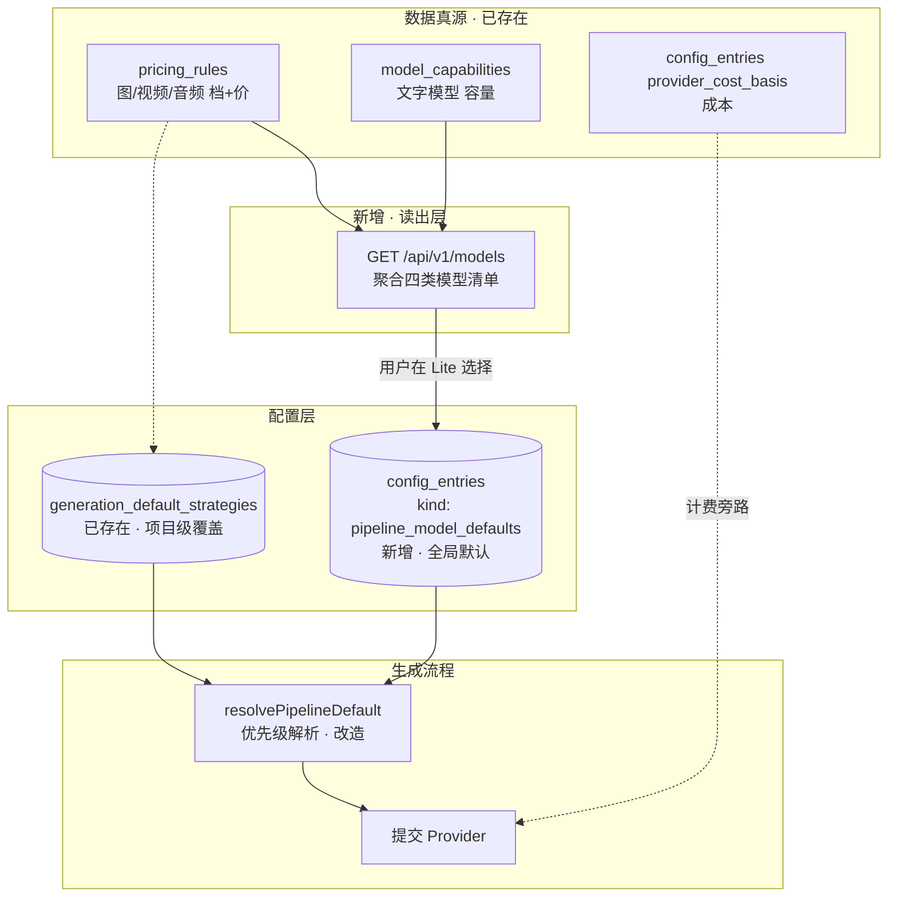
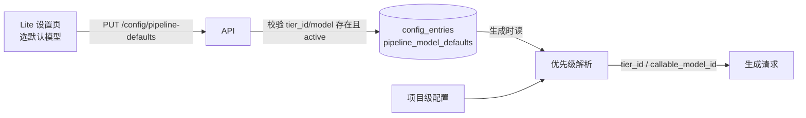
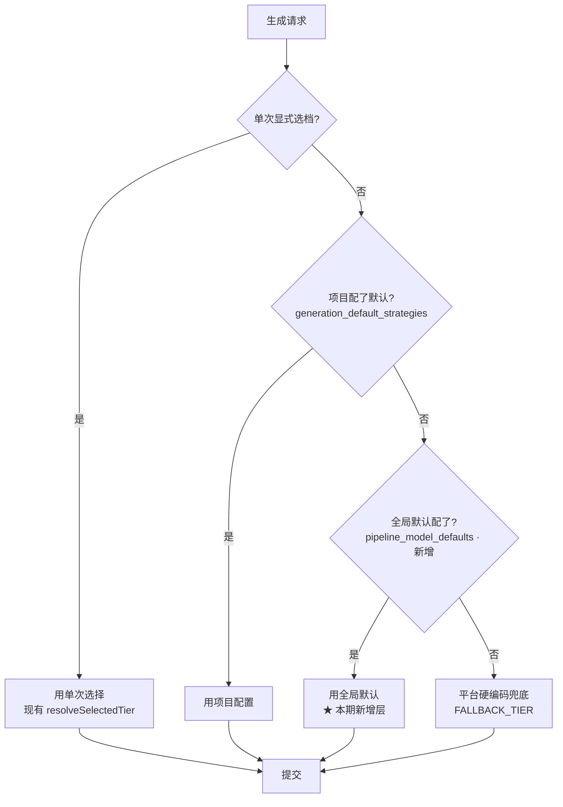

# 全局模型默认配置（流水线选模）设计文档

> 状态：草案 · 2026-08-12
> 范围：Lite 版新增「全局默认模型」选择能力；模板配置维持项目级不动。
> 关联裁决：#151（全局提示词/风格面板已删，理由「只存不注入=假控件」）——本方案必须保证选出来的模型**真正进生成流程**。

---

## 一、背景与目标

### 1.1 现状问题

目前项目的模型分散登记在三处，**没有统一的「模型清单」读出口，也没有「全局默认模型」的概念**：

| 真源 | 存什么 | 谁读 |
|---|---|---|
| `pricing_rules`（seed: [seed-pricing-tiers.mts](../../scripts/seed-pricing-tiers.mts)） | 图/视频/音频的「档」（原子参数组合 + 价） | capability-tiers 接口 → 前端参数行 |
| `config_entries` kind=`provider_cost_basis`（[038](../../migrations/038_s84_provider_cost_ledger.sql)/[039](../../migrations/039_seed_audio_provider_cost_basis.sql)/[055](../../migrations/055_suchuang_image_provider_cost_basis.sql)） | provider+model+media_kind 的成本核算 | provider-cost 计费流程 |
| `model_capabilities`（[059](../../migrations/059_model_capabilities.sql)） | 文字模型容量/限流 | 网关、剧本拆解、适配器 |

用户想「罗列所有模型、选一套默认、整个流水线照着走」，今天做不到：
- 没有 API 一次性返回「图/视频/音频/文字各有哪些模型」——capability-tiers 是**按媒介分接口、返回的是档不是模型**。
- 没有「全局默认模型」存储——`generation_default_strategies` 是**项目级**的，新项目/没配的项目各走各的硬编码兜底。
- 文字模型（deepseek / doubao）完全不在档体系里，走的是环境变量（`ARK_*_MODEL`）+ model_capabilities，前端无从选择。

### 1.2 目标

1. **一个 API 罗列全部模型**：图/视频/音频/文字四类，每类列出可选模型（含供应商、展示名、价、状态）。
2. **一个全局默认配置**：用户在 Lite 版选好默认模型，存一次，整个流水线（没被项目覆盖时）照着走。
3. **真正注入生成**：选出来的模型必须在生成时被读到，不能重蹈 #151「只存不注入」的覆辙。

### 1.3 非目标（明确不做）

- ❌ **不做全局提示词模板 / 全局风格**——#151 已删，模板维持项目级（[lite-project-config-page.tsx](../../frontend/shortdrama-rag-demo/src/pages/lite/lite-project-config-page.tsx) 走 `generation_default_strategies` 不动）。
- ❌ **不做模型上下架后台**——模型增删仍由 pricing_rules seed + 管理员改库完成，本期只做「读 + 选默认」。
- ❌ **不做模型比价/竞技场**——已有 [v030-model-arena.md](v030-model-arena.md) 单独的议题。

---

## 二、现状盘点：已有 vs 缺漏

### 2.1 已有（可直接复用）

| 能力 | 现状 | 文件 |
|---|---|---|
| 档（图/视频/音频）读取 | `GET /api/v1/generation/capability-tiers` 已上线，按媒介返回 active 档 | [capability-tiers.ts](../../frontend/shortdrama-rag-demo/src/capability-tiers.ts) |
| 文字模型容量读取 | `model_capabilities` 表 + 同步器 | [059](../../migrations/059_model_capabilities.sql) |
| 项目级默认档存储 | `generation_default_strategies` 表 + `PUT /generation-defaults/:kind` | [lite-project-config-page.tsx](../../frontend/shortdrama-rag-demo/src/pages/lite/lite-project-config-page.tsx) |
| 通用软配置表 | `config_entries`（kind + entry_key + payload JSONB） | [022](../../migrations/022_config_entries_release_plan.sql) |
| 模型中文标签 | provider/model → 人话标签 | [display-labels.ts](../../frontend/shortdrama-rag-demo/src/display-labels.ts) |
| 档价展示 | `tierPriceLabel` / `tierLabel` | [capability-tiers.ts:122](../../frontend/shortdrama-rag-demo/src/capability-tiers.ts#L122) |

### 2.2 缺漏（本期要补）

| 缺漏 | 影响 |
|---|---|
| 无「全模型聚合」读 API | 前端要发 3~4 个请求拼，且文字模型根本没接口 |
| 无全局默认模型存储 | 新项目只能走硬编码兜底，用户选不了 |
| 生成流程无「全局默认」优先级层 | 即使存了也不进生成（#151 同款坑） |
| 文字模型无选择入口 | 文字流程只能用环境变量定的那一个 |
| Lite 无「流水线默认」设置页 | 用户没有地方一次性配好整套 |

---

## 三、总体流程

### 3.1 数据流全景



### 3.2 选模 → 生效流程



### 3.3 优先级链（核心，决定「选了到底生不生效」）



> **这条优先级链是本方案的命脉。** #151 删全局面板的根因就是「存了不进流程」。本期新增的第 3 层（全局默认）必须在 [generation/repository.ts](../../src/modules/generation/repository.ts) 的 `resolveProjectGenerationConfig` / `resolveSelectedTier` 里实打实地插进去，否则就是又一个假控件。

---

## 四、数据库方案：是否要入库？

### 4.1 结论：模型本身不用新建表，全局默认存 config_entries

| 问题 | 答案 | 理由 |
|---|---|---|
| 模型要新建表吗？ | **不用** | 模型已经登记为档（pricing_rules）、容量（model_capabilities）、成本（config_entries）。再建一张 `models` 表会和现有三处重复，变成第四个真源。 |
| 全局默认要存哪？ | **config_entries**（新增 kind） | 这是项目既定的「软配置」表，有 status/source/checksum 基建，admin config API 已能校验 payload，加新 kind 不动表结构。 |
| 要新迁移吗？ | **可选一条 seed**（061） | 给一个出厂默认 seed，让表建好就有内容；也可纯运行时写，不强制。 |

### 4.2 全局默认存储结构

`config_entries` 新增一行，kind = `pipeline_model_defaults`：

```jsonc
// entry_key: "pipeline-model-defaults"
// kind: "pipeline_model_defaults"
{
  "image": {
    "tier_id": "img-seedream5pro-916-2k-1",
    "provider": "ark",
    "model": "doubao-seedream-5-0-pro-260628",
    "display_name": "Seedream 5 Pro"
  },
  "video": {
    "tier_id": "vid-seedance20fast-916-720p-4s",
    "provider": "ark",
    "model": "doubao-seedance-2-0-fast-260128",
    "display_name": "Seedance 2.0 Fast"
  },
  "audio": {
    "tier_id": "aud-seedaudio10-30s",
    "provider": "openspeech",
    "model": "seed-audio-1.0",
    "display_name": "Seed Audio 1.0"
  },
  "text": {
    "callable_model_id": "deepseek-v4-flash-ga-260731",
    "provider": "ark",
    "model": "deepseek-v4-flash-ga",
    "display_name": "DeepSeek V4 Flash"
  }
}
```

**关键字段说明：**

- 图/视频/音频：以 **`tier_id`** 为生效键（档是原子的，下游 `tierSubmitInput` 按 tier_id 取参数组合）。`provider`/`model`/`display_name` 是**冗余展示字段**，方便前端不二次查档。
- 文字：文字模型**不在档体系**，以 **`callable_model_id`**（model_capabilities 的唯一键）为生效键。
- 这种「图视音用 tier_id、文字用 callable_model_id」的不对称是**真实的业务差异**（文字不走 generation-tiers 流程），不是设计缺陷，文档要显式标注。

### 4.3 seed 迁移（061，可选）

```sql
-- migrations/061_pipeline_model_defaults_seed.sql
-- 出厂全局默认：与 FALLBACK_TIER 同值，让"没配"和"配了出厂"行为一致。
INSERT INTO {{schema}}.config_entries (
  id, kind, entry_key, status, sort, payload, source, created_at, updated_at
) VALUES (
  '84000000-0000-4000-8000-000000000010',
  'pipeline_model_defaults',
  'pipeline-model-defaults',
  'published',
  100,
  '{"image":{"tier_id":"img-seedream5pro-916-2k-1","provider":"ark","model":"doubao-seedream-5-0-pro-260628","display_name":"Seedream 5 Pro"},"video":{"tier_id":"vid-seedance20fast-916-720p-4s","provider":"ark","model":"doubao-seedance-2-0-fast-260128","display_name":"Seedance 2.0 Fast"},"audio":{"tier_id":"aud-seedaudio10-30s","provider":"openspeech","model":"seed-audio-1.0","display_name":"Seed Audio 1.0"},"text":{"callable_model_id":"deepseek-v4-flash-ga-260731","provider":"ark","model":"deepseek-v4-flash-ga","display_name":"DeepSeek V4 Flash"}}'::jsonb,
  'seed:pipeline-model-defaults:出厂',
  now(),
  now()
) ON CONFLICT (kind, entry_key) DO NOTHING;
```

> 注意：按 CLAUDE.md，迁移要在容器里用迁移账号跑，文件含 `{{schema}}` 占位符，**不能 psql 直跑**。

---

## 五、后端 API 设计

### 5.1 模型聚合接口（新增）

```
GET /api/v1/models
```

登录即可读。聚合 pricing_rules（图/视/音）+ model_capabilities（文字），按媒介分组。

**响应：**

```jsonc
{
  "image": [
    {
      "model": "doubao-seedream-5-0-pro-260628",
      "provider": "ark",
      "display_name": "Seedream 5 Pro",
      "tiers": [
        { "tier_id": "img-seedream5pro-916-2k-1", "label": "9:16 · 2K · 1 张", "price": "60 积分/张", "status": "active" }
      ]
    }
    // ... image-01, gpt-image-2, nanobanana-2 等
  ],
  "video": [ /* Seedance 系列 */ ],
  "audio": [ /* Seed Audio / MiniMax speech */ ],
  "text": [
    {
      "callable_model_id": "deepseek-v4-flash-ga-260731",
      "model": "deepseek-v4-flash-ga",
      "provider": "ark",
      "display_name": "DeepSeek V4 Flash",
      "context_window_tokens": 1048576,
      "max_output_tokens": 393216
    }
    // ... doubao-seed-2-1-pro
  ]
}
```

**聚合规则：**
- image/video/audio：从 capability-tiers 数据源（pricing_rules）按 `provider + model` 归并档，每个模型带它的 active 档列表。
- text：从 `model_capabilities` 读，不含档（文字无档概念）。
- 冻结档（experimental/retired）默认不返回；带 `?include_frozen=true` 才返回并标灰。

### 5.2 全局默认读写接口（新增）

```
GET  /api/v1/config/pipeline-defaults      → 404 = 没配过，前端按"未配置"展示
PUT  /api/v1/config/pipeline-defaults      → 管理员/有权限者
```

**PUT 请求体：**

```jsonc
{
  "image":  { "tier_id": "img-seedream5pro-916-2k-1" },
  "video":  { "tier_id": "vid-seedance20fast-916-720p-4s" },
  "audio":  { "tier_id": "aud-seedaudio10-30s" },
  "text":   { "callable_model_id": "deepseek-v4-flash-ga-260731" }
}
```

**服务端处理：**
1. 校验每个 tier_id 在 pricing_rules 里存在且 active（图/视/音）；callable_model_id 在 model_capabilities 里存在（文字）。**不存在的拒绝，避免配了无效档。**
2. 回填 provider/model/display_name 冗余字段（客户端只发 id，服务端补全展示信息）。
3. 写入 config_entries（upsert by kind+entry_key）。
4. 返回补全后的完整 payload。

> 权限：复用现有 admin config 写权限。是否放开给普通项目创建者，列为决策点（见第八节）。

### 5.3 生成流程改造（最关键）

在 [generation/repository.ts](../../src/modules/generation/repository.ts) 的档解析处插入「全局默认」层。改动点：

```
现有 resolveSelectedTier(tiers, selectedId, projectPreference):
  active.find(selectedId) ?? resolveProjectDefaultTier ?? is_default ?? active[0]

改造为 resolvePipelineDefault(tiers, selectedId, projectPreference, globalDefault):
  active.find(selectedId)                    // ① 单次显式
  ?? resolveProjectDefaultTier(projectPref)  // ② 项目级
  ?? active.find(globalDefault.tier_id)      // ③ 全局默认 ← 新增
  ?? active.find(is_default)                 // ④ 平台兜底
  ?? active[0]
```

调用方（生成路由、Lite 分镜页）在启动生成前多读一次 `pipeline_model_defaults`（可缓存），把 `globalDefault` 传进解析函数。

**文字模型流程**（assistant / 剧本拆解 / 适配器）单独改：把现在硬编码/读环境变量的 `ARK_*_MODEL` 取值点，加一层「先查 pipeline_model_defaults.text，没有再回落环境变量」。改动点分散在文字网关适配器，需要逐个排查。

---

## 六、前端原型（Lite 版）

### 6.1 新增页面：流水线模型默认

在 [lite-shell.tsx](../../frontend/shortdrama-rag-demo/src/pages/lite/lite-shell.tsx) 导航加一项「模型默认」，挂到新页面 `lite-model-defaults-page.tsx`。

**布局（ASCII 原型）：**

```
┌──────────────────────────────────────────────────────────┐
│  流水线模型默认                                          │
│  选好一次，本项目所有生成默认走这套；项目配置仍可覆盖。  │
├──────────────────────────────────────────────────────────┤
│                                                          │
│  ┌─ 图片生成模型 ─────────────────────────────────────┐  │
│  │  ◉ Seedream 5 Pro     火山方舟   60 积分/张        │  │
│  │     9:16 · 2K · 1 张                                │  │
│  │  ○ MiniMax image-01   MiniMax    …                 │  │
│  │  ○ GPT Image 2        速创网关   …                 │  │
│  │  ○ NanoBanana 2       速创网关   …                 │  │
│  │  ○ Gemini 3.1 Pro Image 速创网关 …                 │  │
│  └────────────────────────────────────────────────────┘  │
│                                                          │
│  ┌─ 视频生成模型 ─────────────────────────────────────┐  │
│  │  ◉ Seedance 2.0 Fast 火山方舟  80 积分/秒          │  │
│  │  ○ Seedance 2.0      火山方舟  …                   │  │
│  │  ○ Seedance 2.0 Mini 火山方舟  …                   │  │
│  │  ○ Seedance 2.5      火山方舟  (自建接入点)        │  │
│  └────────────────────────────────────────────────────┘  │
│                                                          │
│  ┌─ 音频生成模型 ─────────────────────────────────────┐  │
│  │  ◉ Seed Audio 1.0    火山语音   12 积分/秒         │  │
│  │  ○ Seed Audio 1.0 多语言 火山语音 …                │  │
│  │  ○ MiniMax speech-2.8-turbo MiniMax …              │  │
│  │  ○ MiniMax speech-2.8-hd    MiniMax …              │  │
│  └────────────────────────────────────────────────────┘  │
│                                                          │
│  ┌─ 文字 / 对话模型 ──────────────────────────────────┐  │
│  │  ◉ DeepSeek V4 Flash 火山方舟  104 万 tokens 上下文│  │
│  │  ○ Doubao Seed 2.1 Pro 火山方舟  26 万 tokens 上下文│  │
│  └────────────────────────────────────────────────────┘  │
│                                                          │
│  [ 保存默认模型 ]    已保存 / 未配置，按出厂默认执行     │
└──────────────────────────────────────────────────────────┘
```

**交互要点（对齐项目既有口径）：**
- 每个模型卡用 radio 单选；选中的档用 `tierLabel`（[capability-tiers.ts:130](../../frontend/shortdrama-rag-demo/src/capability-tiers.ts#L130)）展示参数与价。
- 冻结档置灰带原因（`availability_reason`），不可选——与 [lite-project-config-page.tsx](../../frontend/shortdrama-rag-demo/src/pages/lite/lite-project-config-page.tsx) 同口径。
- 文字模型卡额外显示上下文/输出上限（来自 model_capabilities）。
- 保存调 `PUT /config/pipeline-defaults`；未配过（404）时显示「未配置，按出厂默认执行」，不报错。
- 保存成功后提示「已保存，本项目生成时按这套默认执行」（**这句话是 #151 的红线检查：必须明确告诉用户"会生效"**）。

### 6.2 项目配置页加「跟随全局」提示

[lite-project-config-page.tsx](../../frontend/shortdrama-rag-demo/src/pages/lite/lite-project-config-page.tsx) 现有的图片/视频配置卡不动逻辑，但在「未配置」态加一行说明：

> 「未配置时，跟随流水线默认模型（在「模型默认」页设置）。」

让用户知道两套配置的关系，避免「我在这里配了为什么没生效」的困惑。

### 6.3 用户可见文案红线

按 CLAUDE.md「用户看得见的地方一律说人话」：
- 不出现 `tier_id`、`callable_model_id`、`ark`、`openspeech` 这类内部名（用 [display-labels.ts](../../frontend/shortdrama-rag-demo/src/display-labels.ts) 的中文标签）。
- 模型名用展示名（Seedream 5 Pro），不用 `doubao-seedream-5-0-pro-260628`。

---

## 七、模板配置：明确边界（本期不动）

| 配置类型 | 粒度 | 存储 | 本期是否动 |
|---|---|---|---|
| 提示词模板 | **项目级** | `generation_default_strategies.parameters.prompt_template`（Lite 路径 B） | ❌ 不动 |
| 风格描述/参考图 | **项目级** | `projects.image_style_description` 等（路径 A） | ❌ 不动 |
| **默认模型** | **全局级（新）** | `config_entries` kind=`pipeline_model_defaults` | ✅ 新增 |

> 模板维持项目级是有意为之：#151 已经验证过「全局模板只存不注入」是假控件，本期不重开这个口子。如果未来要做「全局兜底模板注入」，必须像本方案的模型默认一样，在 promptCompiler 编译流程里实打实插一层优先级，否则不做。

---

## 八、改动清单与决策点

### 8.1 改动文件清单

**后端（新增）：**
| 文件 | 作用 |
|---|---|
| `src/modules/models/routes.ts` | `GET /api/v1/models` 聚合接口 |
| `src/modules/models/service.ts` | 合并 pricing_rules + model_capabilities |
| `src/modules/config/pipeline-defaults.ts` | 读写 config_entries kind=`pipeline_model_defaults` |
| `migrations/061_pipeline_model_defaults_seed.sql` | 出厂默认 seed（可选） |

**后端（改造）：**
| 文件 | 改动 |
|---|---|
| [src/modules/generation/repository.ts](../../src/modules/generation/repository.ts) | 档解析插入「全局默认」优先级层 |
| 文字网关适配器（assistant/剧本拆解） | 文字模型默认读取改为「全局默认 → 环境变量」 |
| 路由注册（app/server） | 挂载 `/models` 与 `/config/pipeline-defaults` |

**前端（新增）：**
| 文件 | 作用 |
|---|---|
| `pages/lite/lite-model-defaults-page.tsx` | 选模设置页 |
| `api.ts` | `api.models()` / `api.pipelineDefaults()` / `api.putPipelineDefaults()` |
| `types.ts` | ModelCatalog / PipelineDefaults 类型 |

**前端（改造）：**
| 文件 | 改动 |
|---|---|
| [pages/lite/lite-shell.tsx](../../frontend/shortdrama-rag-demo/src/pages/lite/lite-shell.tsx) | 导航加「模型默认」项 |
| [pages/lite/lite-project-config-page.tsx](../../frontend/shortdrama-rag-demo/src/pages/lite/lite-project-config-page.tsx) | 未配置态加「跟随全局」提示 |

### 8.2 待裁决的决策点

| # | 决策点 | 选项 | 建议 |
|---|---|---|---|
| D1 | 全局默认的写权限 | (a) 仅管理员 / (b) 项目创建者也能写 | (a)——全局影响所有项目，应收口管理员 |
| D2 | 文字模型默认是否本期做出来 | (a) 本期一起做 / (b) 先只做图/视/音 | (a)——用户明确点了文字模型，且改动不大 |
| D3 | 「全局默认」是系统级还是用户级 | (a) 系统级一套 / (b) 每用户一套 | (a)——config_entries 现状是系统级；用户级要加 user_id 维度，复杂度高 |
| D4 | 项目配置是否允许「显式跟随全局」 | (a) 不配即跟随 / (b) 加"跟随全局"显式选项 | (a)——缺省即跟随，少一个状态更清晰 |
| D5 | 模型聚合接口是否分页 | (a) 一次性全返回 / (b) 分媒介分页 | (a)——当前模型总数 <30，无需分页 |

---

## 九、风险

1. **「选了不生效」风险（#151 同款）**：如果生成流程改造漏了某个入口（如文字网关有多个取 model 的点），会出现「全局配了但这条流程没用上」。**对策**：改造后用 grep 全量排查所有读 `ARK_*_MODEL` / model 的点，加测试覆盖每个流程。

2. **档下架后全局默认悬空**：管理员把某档从 active 改 retired 后，全局默认指向一个不可用档。**对策**：PUT 时校验 active；运行时解析时，全局默认档若已不可用，跳过该层落到平台兜底（不报错，但前端配置页要提示「你选的档已下架」）。

3. **config_entries 并发写**：多人同时改全局默认。**对策**：config_entries 是系统级单行，用 payload checksum 或 updated_at 做乐观锁（与 generation-defaults 的 expected_version 同思路）。

4. **文字模型不对称**：图视音用 tier_id、文字用 callable_model_id，前端类型和校验要分开处理，不能强行统一成一个结构。

---

## 十、实施顺序建议

1. **DB**：写 061 seed 迁移（可选，也可运行时写）。
2. **后端读出**：`GET /api/v1/models` 聚合接口 + 测试。
3. **后端配置**：`GET/PUT /config/pipeline-defaults` + 校验 + 测试。
4. **后端注入**：generation/repository 档解析插全局默认层 + 文字网关改造 + **全流程测试**（这条最关键，验证「选了真生效」）。
5. **前端**：lite-model-defaults-page + api/types + shell 导航。
6. **前端**：project-config 页加「跟随全局」提示。
7. **验收**：配一套全局默认 → 新建一个不配项目默认的项目 → 生成，确认走的是全局默认而非硬编码兜底。

> 步骤 4 是整个方案的成败点，必须先有测试再合并，否则就是 #151 的重演。

