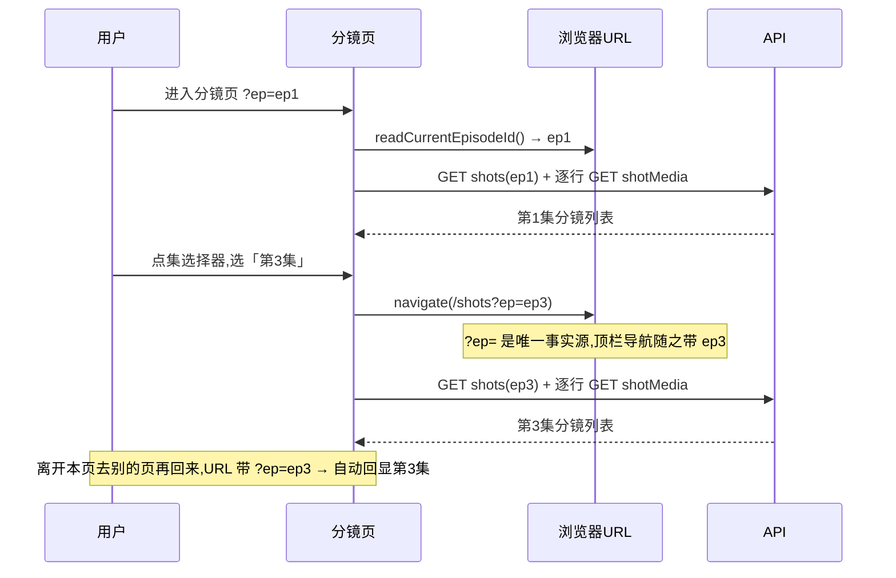
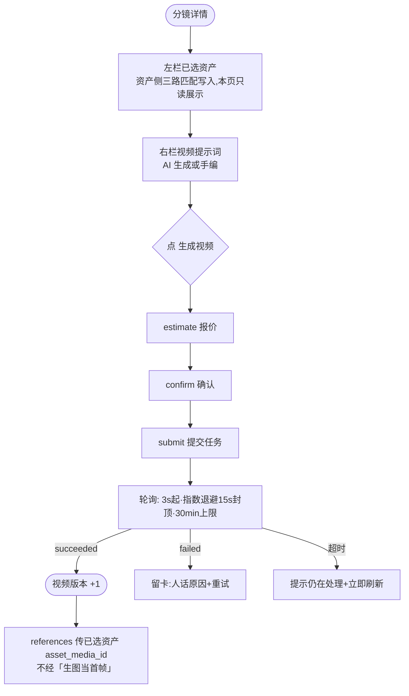
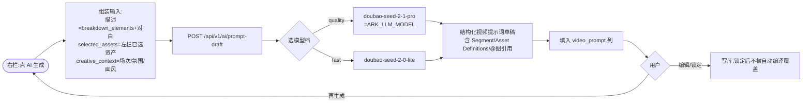
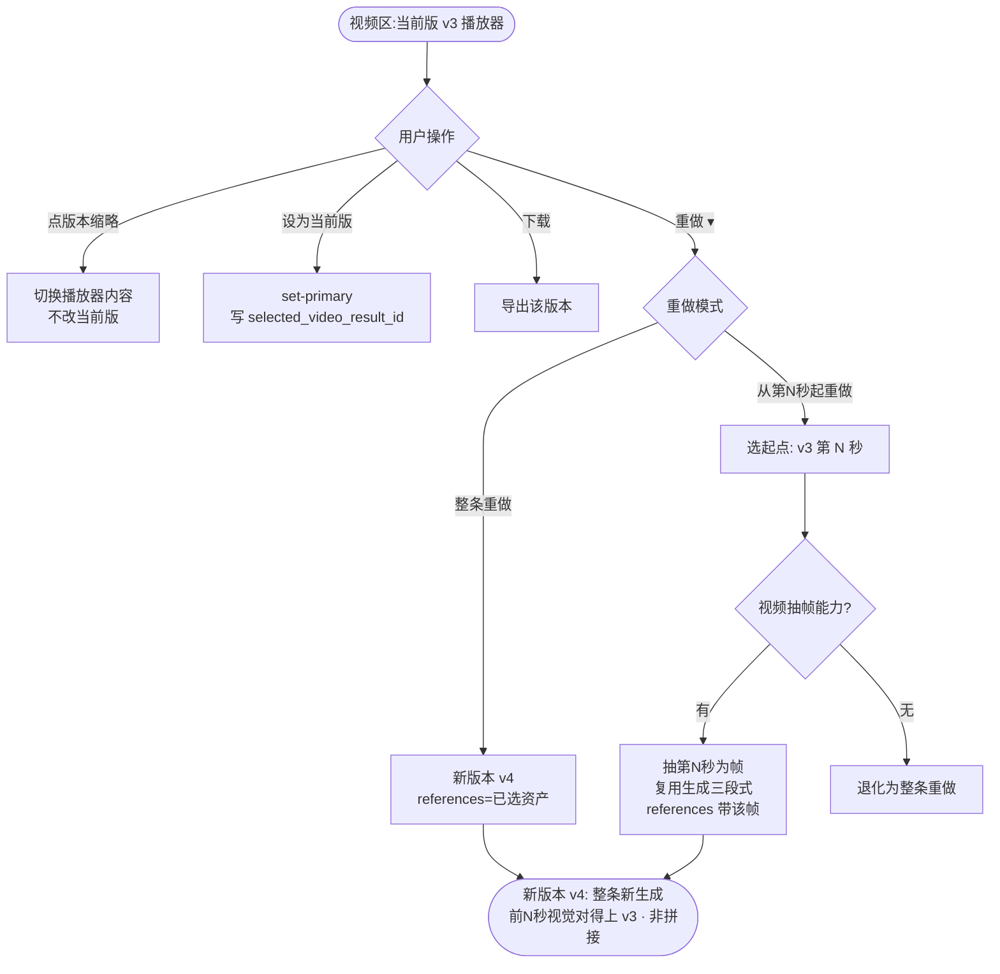
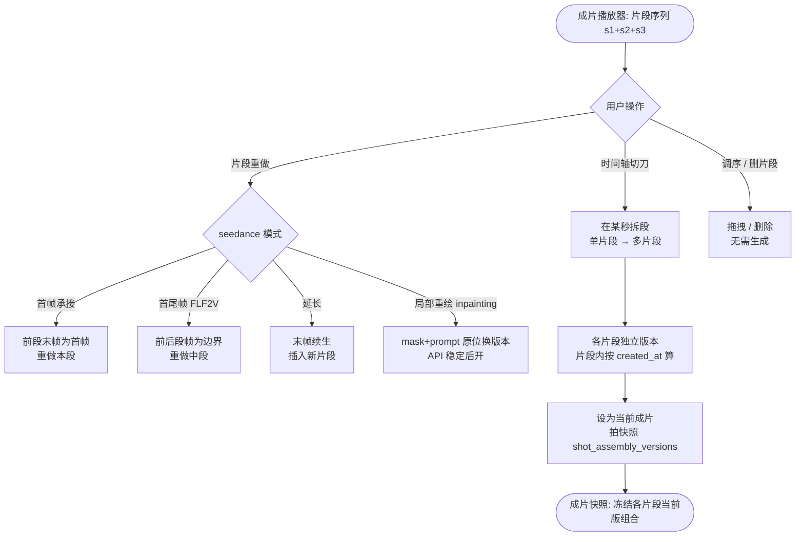
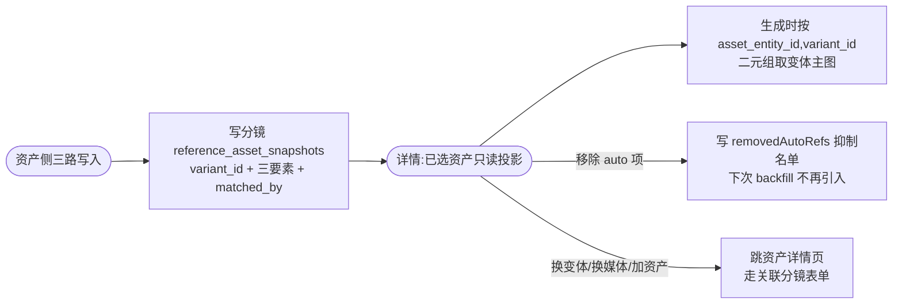

# Lite 分镜页方案

> **文档变更记录**
> - 2026-08-11 初版:集选择器、分镜列表+详情、结构化字段、分镜资产引用、视频提示词、视频版本管理。
> - 2026-08-12 seedance 能力调研裁决:视频模型每次调用输出的是**一条新视频文件**,不存在「原位改某几秒」;据此定下「分镜成片 = 片段序列」的编辑模型,seedance 四模式映射为片段级编辑动作;定下 `shot_segments` / `shot_assembly_versions` 两表设计;`media_results` 新增 `metadata` 列存版本标签。
> - 2026-08-12 合并去期数化:原「第一期/第二期」划分取消——代码未做完即不存在「已做完的期」,整个作为一个统一方案;承接重做与片段编辑合并为统一的「视频重做与编辑」能力,工程节改用「实现顺序」(按表依赖排)。
> - 2026-08-13 v1.4 基础层上线:迁移 `065_lite_shot_refs_and_metadata.sql`(episodes.synopsis、shots.metadata、media_results.metadata、shot_asset_refs 表);production 新增 `GET/POST/PATCH/DELETE /shots/:shot_id/asset-refs` 资产引用 CRUD;shot-media 新增 `PATCH /shots/:shot_id/media/:media_id/version-label`;提示词编译器补读 `breakdown_elements` 与关联资产;Lite 分镜列表页重写为集选择器 + 卡片网格;新建 `lite-shot-detail-page` 分镜详情工作台(已选资产、结构化字段、视频版本、视频提示词、整条重做)。片段编辑/成片快照/片段级重做为实现顺序在后,不在本包。
> - 2026-08-13 v1.4.1 版本弹窗收敛:补**版本详情弹窗**(点版本条任一版本查看该版本播放器/元信息/提示词/参考资产)与**版本编辑弹窗**(改名/备注 + 「整条重新做 / 只改某几秒 / 删掉这个版本」三选);「重做▾」散菜单删除,所有改视频操作统一从版本弹窗进;片段编辑入口改为「版本编辑弹窗 → 只改某几秒 → 下一步」;空态表补无版本/单版本两行。技术模型(片段序列、seedance 映射、版本号查询时算、标签存 metadata)不变。
> - 2026-08-17 v1.5 分镜详情工作台简化收敛(用户反馈第六轮六问):① 顶部同集分镜 tab 改纯镜号数字(1/2/3…),完整场记编码保留在面包屑与当前镜标题;② 已选资产行展示「匹配名称+类型」(如「男主(角色)」),类型映射复用 `ASSET_KIND_LABELS`;③ 剧本原文由只读改可编辑(失焦保存 `script_text`);④ 「场次」改名「场景」并改输入框——失焦按名匹配本集场景,命中绑 `scene_id`,未命中 `POST /episodes/:eid/scenes` 建一场再绑;⑤ 镜头描述(主体/动作/视觉/景别机位)、氛围、结构化对白的独立编辑区删除——分镜内容收敛为「剧本原文(可编辑)+ 场景(输入框)+ 时长」单一文本口径,结构化字段仍由「一键生成本集」拆解落库并喂提示词编译,详情不再手动编辑;⑥ 右栏播放器加高度上限(object-contain 居中),版本条与视频提示词恒可见。线框(三)、决策(四)、工程(五)同步修订。
> - 2026-08-17 v1.5.1 匹配口径对齐 lite-assets:**资产↔分镜匹配逻辑以 `lite-assets-page.md` 问题八 8.8/8.9/八.10「三路统一匹配合同」为唯一口径**——匹配方向单向,资产侧(资产或变体)声明「集、分镜、场景」→ 写入分镜 `reference_asset_snapshots`;一键生成本集 backfill / ✨ 匹配剧集 AI 建议 / 手动关联三路同形同幂等键 `(shot_id, variant_id)`,manual 永不被覆盖。分镜详情「已选资产」改为 `reference_asset_snapshots` 的只读投影;加资产/换变体/换媒体跳资产详情页(关联分镜表单),移除 auto 项写 `removedAutoRefs` 抑制名单;`shot_asset_refs` 不进 lite 写入路径(8.9 明令,仅 full/production 分镜台与提示词编译使用)。决策 4 重写,流程 5 重画,附录 B.7 口径修订。
> - 2026-08-18 v1.6 分镜详情三问(用户反馈第七轮):① **分镜切换 tab 上壳顶栏**(lite-shell 单条导航,返回按钮之后、工作页导航之前)——纯镜号数字(1/2/3…)、悬停显完整场记编码、横向滚动兼容窄屏与多镜、切镜后当前 tab 自动滚进可视区;「已自动保存」随迁壳右组;页内不再渲染页首 tab 条;「分镜详情」四字彻底退役(壳名称区对分镜详情让位给 tab 条,镜名进悬停);Lite 用户隐藏「点击到完整版」切换入口(完整版用户仍可见切精简版;**该单向门已被 2026-08-24 全员双向切换裁决取代**);壳工作页 tab(制作/资产)与顶栏分镜 tab 字体收敛 16px→14px;② 已选资产列表固定高度(约三行资产卡)超出内部滚动——seedance 2.5 参考资产上限放开到 60 张时左栏不被撑爆,计数徽记提示总量;来源徽记收敛为「自动匹配」,「(一键生成本集)」字样退役;③ 生成视频档本镜可选——右栏「模型/比例/清晰度」三级级联下拉(与资产生图弹窗 v1.4 七.3 决策 2 同口径,取值全从 active 档推导,不硬编码),覆盖配置页默认档;提交档 = 用户覆盖档 → 配置页默认档反查 → 最便宜 active 档兜底;参数行改为级联选择器本体,档价如实展示。
> - 2026-08-18 v1.6.1 右栏固定「回溯」行退役:当前版的模型/清晰度/时长/生成时间不再常驻右栏(与右栏级联选择器信息重复),按版回溯(提示词/模型/参数/生成时间)统一在**版本详情弹窗**内看。右栏布局收敛为「播放器(有上限)→ 版本条 → 视频提示词(flex-1 滚动,参数行+生成按钮固定底部)」。
> - 2026-08-18 v1.6.2 版本区空态收敛:分镜还没有视频版本时,版本区只留标题与「暂无版本」徽记——**不占位、不带生成按钮**(生成入口唯一在视频提示词区底部,避免两处付费入口)。
> - 2026-08-18 v1.6.3 分镜详情返回按钮改确定性去向:顶栏切镜 tab 会压历史栈,`history.back()` 会退回上一镜(用户实测反馈)——壳单条返回在分镜详情改名「‹ 返回项目详情」,固定 `navigate` 制作页(带 `?ep=`),不再走历史返回;资产详情「‹ 返回素材」历史返回语义不变。lite-ui-rework.md §2.2 同口径修订。
> - 2026-08-18 v1.6.4 快乐马预览(设计真源 docs/design/happyhorse-preview-integration-2026-08-18.md):正式生成按钮之前加次级入口「预览视频」(outline,开窗免费;快乐马未配置不渲染、参考资产为空或任务进行中禁用);弹窗 = 当前生成视频 + 相关版本(与右栏同一状态,预览版带「预览」徽记)+ 锁定参数(模型/480P·5s·9:16)+ 档价如实;提示词与右栏当前稿一致、不可编辑;付费点击「生成预览(1 次任务)」在窗内,走同一 quote→create 链、tier 强制预览档(params.preview=true)。正式级联过滤预览档。版本管理同流:预览版与正式版同一版本序号,metadata.preview 标记,可设当前版/软删/回溯。
> - 2026-08-24 裁决覆写:恢复 lite/full 全员双向模式切换;v1.6 反馈①的 lite→完整版单向门退役,服务端 `users.ui_mode` 与既有双向 PATCH 仍是唯一事实源。
>
> 本文档是**事实口径真源**(字段名、端点、状态机)——方案与线框合为一处(原两份姐妹文档已并入本文)。线框图里的硬编码以本文档为准。

---

## 一、产品是什么

### 目标

把 Lite 分镜页从「单一集的扁平分镜表 + 逐镜生图生视频」升级为「可切集的分镜工作台 + 分镜详情(场景/对白/动作/时长/关联资产/提示词/视频版本)+ 视频重做与编辑」。

参考形态:完整版分镜的「集导航 + 分镜卡片网格 + 分镜详情三栏(左:分镜内容与场景参数;中:关联资产与图片/视频提示词;右:视频预览与生成)」。Lite 不照搬三栏密度,但要补齐其中所有被扁平表压掉的关键能力。

### 现状核对(已对真源核实)

当前 Lite 分镜页与 `shots` 数据模型都已有真实且相当成熟的基础,**很多被扁平表压掉的能力,字段层面其实已经存在,只是没有接进 Lite 界面与提示词编译**。逐条核对:

- **集路由已存在,但没有集选择器**。`lite-shell.tsx` 的 `readCurrentEpisodeId()` 从 URL `?ep=<id>` 读当前集,`liteProjectPath(projectId, key, episodeId)` 拼路径时带 `?ep=`,顶栏导航在切页时自动把当前集带上——「集全局跟随」机制已经通了。缺口在分镜页本体:它直接 `readCurrentEpisodeId() ?? project.lite_episode_id` 取一个集,界面上没有任何「切到另一集」的入口,用户被钉在默认集上。
- **`shots` 表字段远比 Lite 界面暴露的丰富**。表(`migrations/001_v01_core.sql:78-99`、`021_script_breakdown.sql`、`045_script_breakdown_enrichment.sql`、`src/db/schema.ts:332-359`)已有:`episode_id`(FK)、`scene_id`(FK→scenes)、`shot_code`、`script_text`(台词/对白)、`director_prompt`(画面意图)、`image_prompt`、`video_prompt`、`duration_seconds`、`sort_order`、`reference_asset_snapshots`(jsonb)、`selected_image_result_id`、`selected_video_result_id`,以及 `breakdown_elements`(jsonb: `{subject, action, visual, camera_language}`)、`source_breakdown_run_id`、`source_candidate_id`。**场景、对白、动作、主体、镜头语言这些结构化字段,表里已经有了**——Lite 扁平表只露出 `director_prompt` + `script_text` + `duration_seconds`,其余全压住了。
- **提示词编译器已成型,但口径窄且漏读结构化字段**。`promptCompiler.ts` 是完整的纯函数提示词编译器(模板 + 占位符 `segment_content/characters/scene/shot_intent/...` + 500 字预算截断阶梯),`GenerationRepository.resolvePromptCompilationContext`(`src/modules/generation/repository.ts:2225-2330`)为分镜取 `directorPrompt` 与 `scriptText`。**但它不读 `breakdown_elements`(subject/action/visual/camera_language),也不读 `image_prompt`/`video_prompt`、不读关联资产**——这些已落库的结构化字段没接进编译,是明确的待补缺口。
- **分镜是扁平表格行**,没有「分镜详情页/抽屉」。每行展示镜号、画面描述(`director_prompt` 行内编辑)、时长、状态、操作,下方展开候选图网格与任务卡。镜内的场景、对白、动作、景别、关联资产、提示词、视频版本,全都没有落脚点。
- **分镜与资产的引用是 JSON 快照,不是可查询的关系**。`shots.reference_asset_snapshots`(jsonb)在剧本确认时由 `script-breakdown/mapper.ts` 写入,每条是 `{asset_entity_id, name, asset_kind, matched_by}` 的快照;`project_asset_refs` 是项目级(不分镜)。没有 `shot_asset_refs` 关系表——「这一镜用了哪些资产的哪个变体」「这个资产被哪些镜引用」无法用关系查询回答。
- **候选图 + 首帧锚定 + 登记链已成型**。候选图网格点选首帧(`is_primary`);生视频前首帧图必须走 seedance 素材登记链(`POST` 登记 → 轮询 `refresh` → `active` → `PATCH usage_mode=first_frame`),`references` 提交登记视图的 `asset_media_id`。
- **镜间接续已有**。「延长到下一镜」把本镜视频尾帧登记后接到下一镜首帧(页面状态 `firstFrameOverrides`,只备料不自动生成)。但这是「镜与镜之间」的首帧接续,不是「一条视频中间几秒不对、只改这几秒」的镜内局部重做。
- **参考素材勾选已有**。`GET /lite/reference-assets` 返回本项目登记 active 的资产,生视频时可勾选多张作多模态参考(`usage_mode='reference'`,上限 6,与严格首帧互斥)。
- **视频"版本"是隐式的,没有版本号/标签/回溯**。同一分镜的视频结果散在 `media_results`(`shot_id` + `media_kind='video'`),「当前版」由两种途径定:用户显式选(写 `shots.selected_video_result_id`,对应 `POST /shots/:id/media/:media_id/set-primary`),或隐式兜底(`src/modules/shot-media/effectiveSelection.ts` 的 `resolveEffectiveShotMedia` 取「最新一批通过审核的 succeeded+persisted 结果」,标 `manual` 或 `latest_default`)。**没有版本号、版本标签、版本对比、按版回溯提示词与参数的能力**。
- **Lite 模块没有任何分镜写/读接口**。Lite 路由只有 5 个端点(剧本提交、抽文本、整剧导入、资产 materialize、资产媒体清单、参考资产清单),不碰 shots。分镜的 CRUD 全在 production 模块(`GET/POST /episodes/:id/shots`、`GET/PATCH/DELETE /shots/:id`),shot-media 在 `src/modules/shot-media`。**Lite 前端现在是直接调 production 的 shots/shot-media 接口**(`api.shots`/`api.updateShot`/`api.shotMedia`/`api.setShotPrimary`),不走 Lite BFF。

### 用户反馈第六轮问题清单(2026-08-17,同步进 v1.5)

> 六条反馈来自分镜详情工作台实测,本轮全部落档进 v1.5。每条含:用户问题(原话)、现状核对(代码证据)、解决方案。与 `docs/design/prd-v2/lite-ui-rework.md` 的用户反馈轮次同口径。

**问题① 分镜以 1/2/3 放在顶部导航栏**
- 用户问题:「分镜是否可以以 1/2/3 放置在顶部的导航栏上?这样可以节省下面的内容空间?」
- 现状核对:详情页顶部已有同集横向分镜 tab,但 tab 文案用完整场记编码 `shotCode`(如「1-3-旧宅门口」= 集号-镜号-场景短名,见决策 6),长编码吃满横向空间;当前镜用 ● 标。
- 解决方案:tab 文案改纯分镜序号(当前集排序位 1/2/3…,悬停显示完整编码),当前镜保留 ●。集号由页头集选择器锚定、场景名保留在列表卡片,详情 tab 只留「第几镜」,横向空间省下、可并排更多镜。完整场记编码仍用于面包屑与当前镜标题(决策 6 口径不变)。

**问题② 一键生成本集后,已选资产显示「匹配名称 + 类型」**
- 用户问题:「当点击一键生成本集时,已选的资产是否应该有对应的资产匹配的名称以及类型,比如,男主(角色)?」
- 现状核对:详情左栏「已选资产」行显示 `asset_display_name ?? asset_name` + 「参考」badge + 变体/媒体小字;资产类型(角色/场景/道具/服装/音频)只在无缩略图占位框的灰字里出现,名称旁不标类型,匹配语义(如「男主」)不可见。工作台「本集资产引用」条(R2-15 二轮)已按类型分组横排,详情左栏未沿用同一口径。
- 解决方案:已选资产行改为「匹配名称 + 类型标签」——名称取 `asset_display_name ?? asset_name`(有 role/介绍时优先语义名),类型取 `asset_kind` 经 `ASSET_KIND_LABELS` 映射渲染为徽记(角色/场景/道具/服装/音频),如「男主(角色)」;与工作台「本集资产引用」条用同一套映射,口径统一。

**问题③ 分镜的内容应该是可编辑的**
- 用户问题:「分镜的内容应该是可以编辑的。」
- 现状核对:详情左栏「分镜内容」里,镜头描述、时长、氛围、结构化对白均可编辑,唯独**剧本原文只读**(「剧本原文(只读)…〔查看全本〕」),内容主体改不了。
- 解决方案:剧本原文改可编辑——textarea 失焦保存 `script_text`(走现有 `PATCH /shots/:id`,schema 已接受),与 `video_prompt` 等字段同一条失焦保存路径;「查看全本」保留为跳剧本页看完整正文的入口。内容以剧本原文为唯一文本口径(与问题⑤配套)。

**问题④ 场次改「场景」+ 输入框**
- 用户问题:「场次是否应该改为场景,同时应该是输入框?」
- 现状核对:详情「场次」是下拉 `<Select>` 绑 `shot.scene_id`,选项来自 `api.episodeScenes(episodeId)`;场景不在列表就写不了,且用词「场次」与剧本侧「场景」不一致。
- 解决方案:文案改名「场景」,控件改输入框。失焦保存:输入为空 → `scene_id=null`;与当前场景名相同 → 不动;否则在**本集**场景列表按名字精确匹配,命中绑该 `scene_id`,未命中 `POST /episodes/:eid/scenes` 建一场(名=输入值)再绑 `scene_id`。仍走 `scene_id` FK,不另造字段;输入框下方给「输新名字 = 建新场景」弱提示。

**问题⑤ 镜头描述(主体/视觉)与氛围、结构化对白不需要,合入文本内容**
- 用户问题:「下面的镜头描述的主体和视觉,还有氛围是否不需要?结构化对白应该也不需要,应该都是在文本内容中。」
- 现状核对:详情左栏有「镜头描述」四字段(① 主体 ② 动作 ③ 视觉 ④ 景别机位)、「氛围」textarea、「结构化对白」(角色→台词编辑器,编辑后回写 `script_text`)。三块把同一段内容拆成多格,冗余且占左栏空间。
- 解决方案:详情删除这三个独立编辑区,分镜内容收敛为「剧本原文(可编辑,问题③)+ 场景(输入框,问题④)+ 时长」单一文本口径。`breakdown_elements` 与 `metadata.lite.shot.{atmosphere,dialogue}` 字段仍在库,由「一键生成本集」的剧本拆解落库、继续喂提示词编译(决策 3/5 的编译接线与字段落库不动);详情不再手动编辑,改内容直接改剧本原文。结构化对白编辑器退役,`script_text` 恢复为唯一可编辑文本(不再被编辑器回写)。

**问题⑥ 右栏视频高度太大,版本与提示词看不见**
- 用户问题:「右侧的视频高度太大了,下面的版本还有提示词都看不见了。」
- 现状核对:右栏播放器 `aspect-video w-full`,宽度撑满右栏(w-3/5),高度随之放大;常见视口下播放器 + 头部吃掉大半屏,版本条、回溯、视频提示词被挤出可视区。
- 解决方案:播放器高度加上限(如 `h-64`/`max-h-…`,视频 `object-contain` 居中留黑边),不再随宽度无限放大;右栏固定布局「播放器(有上限)→ 版本条 → 回溯 → 视频提示词(flex-1 滚动)」,保证版本条与提示词同一视口内恒可见。

### 用户反馈第七轮问题清单(2026-08-18,同步进 v1.6)

> 三条反馈来自分镜详情工作台实测,本轮全部落档进 v1.6。每条含:用户问题(原话)、现状核对(代码证据)、解决方案。与 `docs/design/prd-v2/lite-ui-rework.md` 的用户反馈轮次同口径。

**问题① 分镜切换放顶部导航栏,兼容窄屏与多镜;去掉「分镜详情」字样;工作页 tab 字体太大（其中 lite 隐藏完整版入口已被 2026-08-24 裁决取代）**
- 解决方案:五件事一次收敛——① **分镜切换 tab 上壳顶栏**:`lite-shell` 单条导航在返回按钮之后渲染同集分镜 tab 条(`nav[aria-label="同集分镜"]`,纯镜号数字,悬停 `title` = `分镜 N · {集号}-{镜号}-{场景短名}`),横向滚动(`overflow-x-auto`)兼容窄屏与多镜,切镜副作用 `scrollIntoView({ block: "nearest", inline: "center" })` 保证当前位恒可见;「已自动保存」随迁壳右组(仅分镜详情页可见);**页内不再渲染页首 tab 条**——详情页顶部空间全部还给工作台;②「分镜详情」四字彻底退役——壳名称区对分镜详情让位给 tab 条(镜名进悬停),资产详情仍出《剧名》·资产名·类型;③ 原 lite 单向门已被 2026-08-24 裁决取代,lite/full 均显示反向模式入口,继续以服务端 `ui_mode` 为唯一事实源;④ 字体收敛:壳工作页 tab 16px→14px(`text-sm`,active 态保留 font-medium 防字宽跳动),顶栏分镜 tab 同为 `text-sm`,与壳返回/配置按钮 `text-xs` 的层级拉开但不压场;⑤ demo 口径:壳与详情页共用 `lite-demo-fixtures` 同一份演示数据(项目/集/场景/分镜),顶栏 tab 在离线演示下同样可切。
- 现状核对:详情页顶部已有同集分镜 tab 条(`overflow-x-auto` 横向滚动),但切镜后当前 tab 不保证在可视区(几十镜的项目从尾部进入,当前位被挤出屏幕);壳名称区对分镜详情兜底文案是「分镜详情」(有镜名时显示镜名);lite 壳右侧常驻「完整版」切换按钮(`LiteShell` switchTarget);壳工作页 tab(制作/资产)用 `text-base`(16px)+ `font-medium`,详情页 tab 用 `text-body`(16px),在 1440px 容器里顶栏视觉偏大。

**问题② 已选资产固定三行高度,超出内部滚动;来源徽记去掉「一键生成本集」**
- 用户问题:「分镜详情左侧的已选的资产是否固定三个高度,超出的内部滚动,不然 seedance 2.5 要是能传 60 个资产,这里展示不下,展示的(一键生成本集的删除掉),只要展示自动匹配就行」
- 现状核对:左栏已选资产区是 `reference_asset_snapshots` 只读投影,行高约 80px(缩略占位+名称+类型徽记+来源小字);左栏整体 `overflow-y-auto`,资产多时把「分镜内容」挤出可视区;来源徽记文案 `自动匹配（一键生成本集）`——「一键生成本集」是写入路径名,不是用户关心的语义,用户只要知道「自动匹配」。
- 解决方案:资产列表区从「随左栏整体滚动」改为「固定高度内部滚动」——列表容器 `max-h-80`(约三行资产卡)`overflow-y-auto`,超出行数容器内滚;「去素材页关联资产」按钮移出滚动区,常驻列表下方;区头加计数徽记(`N 个`),参考资产上限放开(如 seedance 2.5 的 60 张)时用户对总量心里有数。来源徽记收敛:`isAuto ? "自动匹配" : "手动关联"`,「(一键生成本集)」字样退役——写入路径的区分已由 matched_by 落库可查(`exact_name`/`variant_semantic`/AI 建议/manual),界面文案不背实现名。

**问题③ 生成视频为什么不能选模型、比例、清晰度?应该可选**
- 用户问题:「右侧生成视频为什么不能选择模型,比例,以及清晰度?应该是可以选择的」
- 现状核对:右栏底部参数行只读展示三个徽记(比例/清晰度/模型)+「当前默认参数(在配置页调整)」——档反查自配置页默认策略(`resolveLiteTier`),本镜没有任何改档控件;同一仓库的资产生图弹窗已有「模型/比例/清晰度」三级级联(v1.4 七.3 决策 2),配置页也有维度级联,唯独分镜详情生视频把选择权锁死在配置页。
- 解决方案:参数行原地改为三级级联选择器——**模型**(flex-1)→ **比例**(w-24)→ **清晰度**(w-28),与资产生图弹窗/配置页同口径:维度取值全部从 `capability-tiers` 接口的 active 档推导,不硬编码;切模型 → 该模型下按配置页策略反查默认档(`pickLiteDefaultTier`);切比例 → 当前模型内匹配档、清晰度收敛最便宜;切清晰度 → 精确定位档。用户选中的档以 `tierOverrideId` 记在本镜页面态(不落库、不进策略——配置页默认档语义不变,本镜选择只影响本镜这次提交);**提交档 = 用户覆盖档 → 配置页默认档反查 → 最便宜 active 档兜底**(`override ?? resolveLiteTier(...) ?? cheapestActiveTier(activeTiers(...))`),配置页组合失效不再是死路。选择器右侧如实显示所选档价(`tierPriceLabel`,不虚构);参数徽记行退役(选择器本体即参数展示)。付费红线不变:一次「生成视频」= 一次 estimate = 一次 confirm = 一次 submit,只创建一条任务;选档不产生费用,点生成才产生。

---

## 二、用户怎么走(交互流程)

### 流程 1:切集与回显



切集不改后端状态,只换 URL query;`?ep=` 缺失时回退 `project.lite_episode_id`(默认集)。

### 流程 2:已选资产(资产侧匹配) → 视频提示词 → 生视频(主流程,无生图)



**付费红线**:一次「生成视频」点击 = 一次 estimate = 一次 confirm = 一次 submit,只创建一条 `generation_requests`。**本页不做** 生图 / 选首帧 / 首帧登记(seedance)——视频生成直接引用左栏已选资产的媒体。

### 流程 3:AI 生成视频提示词(复用现有 `/ai/prompt-draft`)



**关键**:这是 LLM 文本调用,**不走 estimate→confirm→submit 付费链**。**本方案只生成视频提示词**(`video_prompt`),图片提示词(`image_prompt`)不在本页暴露。`/ai/prompt-draft` 端点已存在(`src/modules/ai/routes.ts:91`),支持 `selected_assets`、`creative_context`(visual_style/camera_direction/reference_notes),与左栏已选资产 + 场次/氛围字段对齐,直接复用,不新建端点。

> v1.5 备注(反馈⑤):`描述`输入以**剧本原文(可编辑)为主**,`breakdown_elements`/氛围/结构化对白仍是拆解落库的辅助输入;详情不再提供这些字段的独立编辑,AI 提示词草稿随用户改剧本原文而变化。

### 流程 4:视频重做与编辑(统一编辑模型)

**用户侧收敛(2026-08-13)**:所有「改视频」操作统一从**版本条 → 版本详情弹窗 → 〔编辑这个版本〕**进入(版本条 ⋮ 直达),不再散在右栏「重做▾」菜单里。界面只暴露三件事——**整条重新做 / 只改某几秒 / 删掉这个版本**(线框见「三」的版本详情弹窗、版本编辑弹窗、片段编辑视图)。下面 4a/4b 是这套交互背后的技术语义,不是新的界面入口。

一个分镜的视频,用户有几种「不满意,要改」的场景,对应不同操作。这些操作都属于同一个编辑模型——**分镜成片 = 片段序列**(默认只有一个片段,等价一条完整视频)。

#### 4a 基础重做:整条 / 承接

没开片段编辑时,成片就是一个片段 = 一条视频。重做有两种:



**版本号由查询时算**(同 `shot_id`+`media_kind='video'` 按 `created_at` 排序的行号),版本标签存新增的 `media_results.metadata.shot_version.label`(见附录 B.2 裁决)。「从第 N 秒起重做」生成的是**一整条新视频**,不是拼接;诚实命名,避免让用户以为我们在做非线性编辑。无视频抽帧能力则退化为整条重做。

#### 4b 片段编辑:切刀拆段 → 重做某段 → 拼回成片

用户只想改某几秒、保留其余部分时,开启片段编辑:把一条视频像剪辑一样切成几段,哪段不满意就只重做那段,其余原样不动,最后按顺序拼回去。



**两层版本管理**:片段版本(片段内 v1/v2/v3)+ 成片快照(分镜级冻结组合,解决「反复改片段后导出的是哪一版」)。单片段场景两层退化为与基础重做等价(快照单元素 = `selected_video_result_id`)。数据模型见附录 B.8(`shot_segments`)/ B.9(`shot_assembly_versions`)。

### 流程 5:分镜资产引用——资产侧声明驱动(v1.5.1 对齐 lite-assets 8.8)



**写入三路(以 lite-assets 8.8 合同为准)**:① 一键生成本集 backfill(`exact_name`);② 资产详情「✨ 匹配剧集」AI 建议勾选后落 `manual`;③ 资产详情关联分镜表单手动填集/分镜号/场景名,保存即解析(`manual`)。三路同幂等键 `(shot_id, variant_id)`,manual 永不被覆盖。

**分镜侧只读 + 两个轻量出口**:详情「已选资产」是 `reference_asset_snapshots` 的投影;加资产/换变体/换媒体跳资产详情页操作(写入权在资产侧);移除 auto 项写 `removedAutoRefs` 抑制名单。**不做** shot 侧勾选面板、换变体内联编辑、临时禁用。

**反查流程**(资产详情 → 分镜):资产页的「引用状态条」读 `metadata.lite.usages`(资产侧声明),显示「被第 1 集第 2、5 镜引用」,点击跳进对应分镜详情;不查 `shot_asset_refs`(8.9:不引入进 lite)。

---

## 三、界面长什么样(线框)

> 线框是草图,不是最终视觉;视觉守 DESIGN.md。

### 信息架构(页面层级)

```
项目列表 /lite
  └─ 项目内 /lite/projects/:id/…          ← 顶栏六导航,集全局跟随(?ep=)
       ├─ 剧本 script      ← 贴剧本、确认解析(分镜诞生地)
       ├─ 素材 assets       ← 资产工作台(方案另一篇)
       ├─ 分镜 shots        ← 本文档:列表 + 详情
       │    ├─ 列表  /lite/projects/:id/shots?ep=…
       │    └─ 详情  /lite/projects/:id/shots/:shotId?ep=…
       ├─ 图 images
       ├─ 视频 videos
       └─ 下载 downloads
```

**关键**:集是项目内全局状态,靠 URL `?ep=<episodeId>` 承载,顶栏导航切页时自动带上(`lite-shell.tsx` 的 `liteProjectPath`)。分镜页只是给这个已存在的机制加一个可见的「集选择器」入口。

### 分镜列表页线框

```
┌────────────────────────────────────────────────────────────────────┐
│ 顶栏  品牌 返回 │ 剧本 素材 〔分镜〕 图 视频 下载 │ 切换 用户      │
├────────────────────────────────────────────────────────────────────┤
│  分镜                                                               │
│  逐镜生成:先出候选图、选首帧,再生视频。每点一次只建一个任务。      │
│  出图与出片参数以配置页为准(当前:图 9:16·2K;视频 9:16·720p·4s)    │
│                                                                     │
│  ┌─ 集选择器 ──────────────────────────────────────────────────┐  │
│  │ 当前: 〔第 1 集 · 暴雨之夜 ▾〕            〔+ 新建集〕      │  │
│  │ 下拉展开:                                                   │  │
│  │   第 1 集 · 暴雨之夜     12 镜 · 已出片 3          ✓       │  │
│  │   第 2 集 · 重逢          8 镜 · 无图                     │  │
│  │   第 3 集 · 真相         10 镜 · 生成中 2                 │  │
│  │   … (超过 12 个出现搜索框)                                 │  │
│  └────────────────────────────────────────────────────────────┘  │
│                                                                     │
│  ┌─ 第 1 集 · 剧集操作条 ─────────────────────────────────────┐  │
│  │ 〔预览全集〕                                                            │
│  │ 剧本摘要(可编辑): 外景·族群广场·暴雨之夜…〔查看全本〕     │  │
│  │ 使用资产: [林晚] [Caleb] [Selena] [族群广场]              │  │
│  └────────────────────────────────────────────────────────────┘  │
│                                                                     │
│  分镜 (12) · 拖拽可调整顺序                       〔+ 新建分镜〕  │
│  ┌─────────┐ ┌─────────┐ ┌─────────┐ ┌─────────┐                  │
│  │ ▼缩略图  │ │ ▼缩略图  │ │ ▼缩略图  │ │ ▼缩略图  │   ...        │
│  │  (首帧)  │ │  (视频首屏)│ │  (占位)  │ │  (首帧)  │              │
│  ├─────────┤ ├─────────┤ ├─────────┤ ├─────────┤                  │
│  │ 1-1-广场│ │ 1-2-广场│ │ 1-3-客厅│ │ 1-4-客厅│              │
│  │ 中景·平视│ │ 近景·仰拍│ │ 空镜     │ │ 跟拍     │              │
│  │ 全景雨夜 │ │ 林晚推门 │ │ 座钟午夜 │ │ ...      │              │
│  ├─────────┤ ├─────────┤ ├─────────┤ ├─────────┤                  │
│  │●首帧已定 │ │●已出片 2│ │○无图    │ │●生成中   │              │
│  │ 6 秒     │ │ 4 秒     │ │ —       │ │ —        │              │
│  └─────────┘ └─────────┘ └─────────┘ └─────────┘                  │
│  点击任意卡片 → 进入分镜详情                                         │
│                                                                     │
│  〔有 1 个生成任务仍在进行中(来自其它标签页)〕                     │
└────────────────────────────────────────────────────────────────────┘
```

**列表只回答「这一集有哪些镜、各自什么状态」**。候选图网格、登记控件、延长控件、参考勾选全部下沉到详情,列表不渲染。行内只保留「画面描述」一项失焦快速编辑(高频微调)。

**剧集操作条的「剧本摘要」可编辑**(失焦保存 `episodes.synopsis`):与剧本正文(`episodeScriptVersions.scriptText`)分离,改概要不触发拆解。`synopsis` 为空时前端回退显示最新剧本版本正文开头作灰字占位(只读态),用户一旦编辑即写入 `synopsis`、转为可编辑态;〔查看全本〕始终跳剧本页看完整正文。

**状态徽记**(卡片右下角小字):
- `○无图` / `◐待选首帧` / `●首帧已定` / `●已出片 N` / `◌生成中` / `✕失败`
- 进行中/失败用 accent / danger 色;纯文字,不堆图标。

### 分镜详情页线框(基础视图)

```
顶部分镜切换: [1] [2] [3●] … [12]   已自动保存  〔导出〕
              ← 纯镜号数字 tab,点即切(v1.5 反馈①);悬停显示完整编码 1-3-旧宅门口
                集号由页头集选择器锚定,场景名保留在列表卡片

┌── 左栏:分镜内容与资产 ────────────────┐ ┌── 右栏:视频与版本 ────────────────────┐
│                                        │ │ 已生成视频                    〔视频库〕 │
│ 已选资产(只读投影,匹配在资产侧)        │ │ ┌──────────────────────────────┐      │
│ ┌──┐ 男主(角色) · Elara单薄白裙   ✓    │ │ │  ▶ 播放器(高度有上限) 00:04  │      │
│ │图 │ Caleb(角色)                ✓     │ │ │  ▁▃▅▇▅▃▁▁                   │      │
│ │   │ 族群广场(场景)             ✓     │ │ │ 1-2-广场-v3 · manual · 2分钟前│      │
│ └──┘                                   │ │ └──────────────────────────────┘      │
│ 点资产:跳资产详情页关联分镜/移除auto项 │ │ ← 播放器 object-contain 有上限,不随  │
│ ⚠ 林舟未落库→〔去素材页补齐〕          │ │    宽度无限放大(v1.5 反馈⑥)         │
│                                        │ │ 版本条:[v1] [v2] 〔v3〕 ⋮              │
│ ─ 分镜内容 ▼ ─────────────────────── │ │   ↑ 点某版本 = 版本详情弹窗            │
│ 剧本原文(可编辑,失焦保存 script_text): │ │   ⋮ = 直接进「编辑这个版本」           │
│ 外景·族群广场·暴雨之夜…                │ │ 〔设为当前版〕〔下载〕                 │
│  〔查看全本〕                          │ │ 回溯: seedance·提示词〔展开〕          │
│ 场景(输入框): EXT.族群广场-NIGHT       │ │   · 720p/4s · 参考资产 3 张 · 2分钟前  │
│ 时长: 〔4 秒〕                         │ │                                        │
│  (v1.5 反馈③④⑤:镜头描述/氛围/结构化   │ │ ─ 视频提示词 ────────── 〔AI 生成〕── │
│   对白不再单独编辑,改内容直接改剧本原文)│ │ [Segment] 暴雨夜族群广场人群围观反应   │
│                                        │ │ [Asset Definitions]                    │
│                                        │ │ @图1(男主) @图2(Caleb)                 │
│                                        │ │ @图3(族群广场)                         │
│                                        │ │ 画风:奇幻剧标准,ALEXA65,蔡司定焦…     │
│                                        │ │ 色调:高反差冷暗调,暴雨夜冷蓝…         │
│                                        │ │ 〔9:16▾〕〔720p▾〕〔seedance▾〕       │
│                                        │ │ 〔生成视频〕 estimate→confirm→submit   │
└────────────────────────────────────────┘ └────────────────────────────────────────┘
```

**详情左右两栏**(v1.5/v1.5.1 收敛后):左栏 = 分镜内容(剧本原文可编辑 + 场景输入框 + 时长)+ 关联资产(`reference_asset_snapshots` 只读投影,行显示名称+类型);右栏 = 视频版本(`media_results` 组 + `selected_video_result_id`,播放器有高度上限)+ 视频提示词(`video_prompt`)。顶部分镜 tab(纯镜号数字)与列表页卡片是同一份分镜数据的两个入口,点 tab 等价于切到该镜详情。`breakdown_elements`/氛围/结构化对白由「一键生成本集」拆解落库、喂提示词编译,详情不再单独编辑(反馈⑤)。

**本页不做(中栏整条砍)**:`image_prompt` 列、候选图、选首帧、首帧登记(seedance)、延长到下一镜 ——这些都不在 Lite 详情页出现。视频生成不再依赖「本镜先生图当首帧」,`references` 直接传左栏已选资产的 `asset_media_id`。

### 版本详情弹窗(查看具体版本)

点版本条里**任意一个版本**(如 〔v3〕)打开——不看当前版也能点开历史版本。播放器放该版本,只读查看,不改变「当前版」。

```
┌────────────────────────────────────────────┐
│版本详情 · 1-2-广场-v3                      │
│                                            │
│           ┌──────────────────────┐         │
│           │      ▶ 播放器 00:04  │         │
│           │      ▁▃▅▇▅▃▁▁        │         │
│           └──────────────────────┘         │
│  版本: 雨夜版 · manual · 当前版 ✓          │
│  生成: 今天 14:02 · 时长 4s · 720p         │
│  模型: seedance · 参考资产 3 张            │
│                                            │
│  ── 版本提示词(生成时用的)──〔展开〕       │
│   [Segment] 暴雨夜族群广场人群围观反应…    │
│   [Asset Definitions] @图1(Elara)…         │
│                                            │
│  〔设为当前版〕〔下载〕〔编辑这个版本〕    │
│                                  〔关闭 ✕〕│
└────────────────────────────────────────────┘
```

**每个版本都能看**:版本条点哪个看哪个;「设为当前版」在这里或右栏操作等价(都写 `shots.selected_video_result_id`)。历史版本的提示词/模型/参数/参考资产从 `media_results.generation_request_id` 回溯 `generation_requests`,和右栏「回溯」是同一份数据。点〔编辑这个版本〕进入下面的编辑弹窗。

### 版本编辑弹窗(编辑某个版本)

从版本详情弹窗的〔编辑这个版本〕进入(版本条 ⋮ 也可直达)。**这是所有「改视频」操作的唯一入口**,收掉原来的「重做▾」散菜单。

```
┌────────────────────────────────────────────┐
│编辑这个版本 · 1-2-广场-v3                  │
│                                            │
│  现在: 当前版 ✓ · 今天 14:02 生成          │
│                                            │
│  版本名:〔雨夜版〕     (可空,不填就叫 v3)  │
│  备注:  〔上次试的,人物偏暗,先留着〕       │
│                                            │
│  ── 这个视频怎么改? ─────────────────      │
│  ◉ 整条重新做                              │
│     照同样要求重新生成一整条,              │
│     得到新版本 v4(不覆盖这个版本)          │
│  ○ 只改某几秒                              │
│     切成几段,只重做不满意的那段,           │
│     其他段原样保留(下一步进片段编辑)       │
│  ○ 删掉这个版本                            │
│     历史版本不要了(当前版需先换)           │
│                                            │
│  〔保存名称/备注〕   〔下一步: 开始改〕    │
└────────────────────────────────────────────┘
```

**三个选项对应技术模型**:

- **整条重新做** = 基础重做(流程 4a):以这个版本为参考重新生成一整条,得到新版本 v4,**不覆盖 v3**(每条视频是独立 `media_results` 行)。想「从第 N 秒起重做」也在这里:先在播放器上把进度拖到第 N 秒,选「以第 N 秒画面为开头重新做」——新视频前 N 秒视觉上对得上 v3,后面重新生成。**诚实命名**:生成的是整条新视频,不是拼接。
- **只改某几秒** = 片段编辑(流程 4b):〔下一步〕进下面的「片段编辑视图」,把这条切成几段,只重做不满意的段,其余原样保留。
- **删掉这个版本** = 软删(`media_results.deleted_at`),不硬删;当前版需先换成别的版本才能删。

**编辑什么**:版本名 = 版本标签(存 `metadata.shot_version.label`,走 `PATCH /shots/:shot_id/media/:media_id/version-label`);备注 = `metadata.shot_version.note`。改版本名只是语义备注,不改版本编码 `-v3`(编码查询时按 `created_at` 算,永远不变)。

### 分镜详情页线框(片段编辑视图)

从「版本编辑弹窗 → 只改某几秒 → 〔下一步〕」进入(或点播放器旁 ✂ 切刀直接开切)。**左栏(分镜内容与资产)不变**,只有右栏从「一条视频 + 版本条」变成「时间轴 + 分段」。

```
┌── 右栏:分镜视频可切片重做 ──────────────────────────────────┐
│                                                              │
│ 这条 4 秒视频 = 第1段(0-2秒)+ 第2段(2-3秒)+ 第3段(3-4秒) │
│                   ↓ 三段按顺序拼起来,连续播放就是一条 ↓     │
│ ┌──────────────────────────────────────────────────────────┐ │
│ │              ▶ 播放器  00:04                              │ │
│ └──────────────────────────────────────────────────────────┘ │
│                                                              │
│ 时间轴(每段独立,点哪段改哪段,别的段不动)                │
│ ┌─ 第1段 · 0-2秒 ──┐┌─ 第2段 · 2-3秒 ─▾┐┌─ 第3段 · 3-4秒 ─┐│
│ │ 林晚走入广场      ││ 被扇耳光瞬间     ││ 围观人群反应     ││
│ │ 当前用: 第2版    ││ 当前用: 第1版    ││ 当前用: 第3版    ││
│ └───────────────────┘└───────────────────┘└──────────────────┘│
│  〔✂ 在播放轴上切一刀 = 把一段拆成两段〕    ✕ 删掉选中这段   │
│                                                              │
│ ── 现在选中了「第2段·被扇耳光」,要重做这段 ──────────────  │
│   怎么重做?(只动这一段,第1段、第3段不变)                 │
│                                                              │
│   ◉ 接着前面的画面重做                                       │
│      拿第1段最后一帧当开头,重新生成第2段                    │
│   ○ 头尾都不变,只换中间                                     │
│      拿第1段最后一帧 + 第3段第一帧当两头,重生第2段          │
│   ○ 画面留着,只改里面不对的地方                             │
│      在画面上涂出要改的区域 + 说怎么改(能力就绪后开)       │
│                              〔重做这段 → 第2段 变 第2版〕   │
│                                                              │
│ ── 存档(把现在每段用的是第几版记下来,以后能回到这个样子) │
│   存档1「雨夜版」  第1段·1版 + 第2段·1版 + 第3段·2版        │
│  〔存档2〕·在用    第1段·2版 + 第2段·1版 + 第3段·3版        │
│                              〔回溯〕〔下载〕〔+ 新建存档〕 │
│                                                              │
│ ── 视频提示词 ────────────────────────────── 〔AI 生成〕── │
│ 分镜级(三段都默认用它):                                   │
│   暴雨夜族群广场人群围观反应…                               │
│ 第2段单独改提示词: 〔被扇瞬间特写,强调 Elara 表情…〕       │
│ 〔9:16▾〕〔720p▾〕〔模型▾〕              〔生成 / 重做〕    │
└──────────────────────────────────────────────────────────────┘
```

**各区在干什么**(对应决策 7 / 附录 B.8 B.9):

- **拼接播放**:三段按顺序连着播,用户看到的就是一条完整视频,不用关心内部切了几段。没切过的时候只有一段,等于基础视图。
- **时间轴分段**:每段有自己的版本(第1段可能试了 2 版、第2段试了 1 版),互相独立——这是「只改某几秒」的关键:重做第2段不会动第1段、第3段。
- **重做一段的三种方式**:接着前面重做 / 头尾不动换中间 / 画面留着改局部——分别对应 seedance 的首帧承接、首尾帧、局部重绘三种能力(延长 = 在末尾加新段,不在这个菜单)。
- **存档**:反复改各段之后,「现在导出的是哪一版」会乱套。存档就是把「此刻每段用的是第几版」这个组合冻结下来,以后能回到这个样子、能下载。对应数据表的「成片快照」。
- **提示词**:默认三段共用分镜级提示词;某段要单独强调(比如第2段要特写表情),就给那段单独写一条。

#### 怎么切段、切完会怎样

实际操作是从基础视图右栏一步步进来的,完整过程:

```
① 切之前(在版本编辑弹窗选了「只改某几秒」后)  ② 点 ✂ 后,在播放轴上落刀
┌──────────────────────┐          ┌──────────────────────┐
│ ▶ 播放器  00:04       │          │ ▶ 播放器  00:04       │
│                      │          │             ✂ ← 在这落│
│ 版本条 [v1][v2]·v3    │    →     │  在第 2 秒处         │
│ 〔重做 ▾〕〔✂ 切刀〕  │          │                      │
└──────────────────────┘          └──────────────────────┘
  点 ✂ 切刀开始切段                 点播放轴选切的位置

③ 切完:一条变两段(注意:还没生成新视频,两段都还是原视频的内容)
┌──────────────────────────────────────────┐
│ ▶ 播放器 00:04  (两段拼着播,看着跟没切一样)│
│ ┌─ 第1段 · 0-2秒 ──┐ ┌─ 第2段 · 2-4秒 ──┐ │
│ │ 来自原视频       │ │ 来自原视频       │ │
│ │ 当前: 原版       │ │ 当前: 原版       │ │
│ └──────────────────┘ └──────────────────┘ │
│ 这一步不花钱,只是逻辑上把一条标成两段     │
└──────────────────────────────────────────┘

④ 点「第2段」→ 选「重做这段」→ 生成中
┌──────────────────────────────────────────┐
│ ┌─ 第1段 · 0-2秒 ──┐ ┌─ 第2段 · 2-4秒 ──┐ │
│ │ 来自原视频       │ │ ⟳ 正在生成第2版… │ │
│ │ 当前: 原版(不动)│ │                  │ │
│ └──────────────────┘ └──────────────────┘ │
│ 只重做第2段,第1段不动 —— 这一步才花钱     │
└──────────────────────────────────────────┘

⑤ 重做完成
┌──────────────────────────────────────────┐
│ ▶ 播放器 00:04  (第1段原版 + 第2段新版)   │
│ ┌─ 第1段 · 0-2秒 ──┐ ┌─ 第2段 · 2-4秒 ──┐ │
│ │ 来自原视频       │ │ 第2版 · 新生成   │ │
│ │ 当前: 原版       │ │ 当前: 第2版      │ │
│ └──────────────────┘ └──────────────────┘ │
│ 成片 = 原来的前半段 + 新生成的后半段       │
│ 满意就 〔新建存档〕 记下这个组合           │
└──────────────────────────────────────────┘
```

**要点**:

- **切刀不花钱**:切段只是把一条视频在逻辑上标记成几段,内容还是原视频的,不触发生成。只有「重做某段」才走生成(才花钱)。
- **切完两段都是原版**:切完不会凭空产生新视频——第1段就是原视频前半、第2段就是原视频后半,都标「原版」。
- **重做一段只动那段**:点某段重做,生成的是那一段的新版本,别的段不动;成片自动用「各段当前版」拼起来播。
- **原来的整条视频不丢**:切之前那条完整视频还在历史存档里,随时能回到「没切过」的状态。

### 空态与边界

| 场景 | 界面 |
| --- | --- |
| 项目还没有集 / 还没贴剧本 | 空态:「先去剧本页贴剧本」,按钮跳 `/script`(沿用现状) |
| 当前集没有分镜 | 空态:「还没有分镜,去剧本页确认解析结果」 |
| 资产未落库 | 详情资产区该名字显示「未落库」徽记 + 〔去素材页补齐〕 |
| 首帧图未登记 | 生视频按钮禁用,提示「先点登记素材」 |
| 生成中离开本页 | 回来后 sessionStorage 台账 + projectGenerations 恢复进度;孤儿任务页顶计数提示 |
| 配置页未配模型/模板超长 | 页顶配置条带去配置页入口,按钮禁用给原因 |
| 分镜还没有视频版本 | 版本区只留标题 + 「暂无版本」徽记,不占位、不带生成按钮(生成入口唯一在提示词区底部);版本详情/编辑弹窗不可开 |
| 只有一个版本 | 版本条只有 v1,照样可点开版本详情/编辑弹窗;「删掉这个版本」需先换成别的当前版才允许 |

---

## 四、关键决策与为什么

### 决策 1:集选择器——复用 `?ep=`,不另造机制

**结论**:分镜页顶部加集选择器,复用现有 `?ep=` 全局跟随机制,URL 即回显事实源。

**为什么**:Lite-shell 已经把「当前集」放在 URL `?ep=<id>`:顶栏六个导航按钮(剧本/素材/分镜/图/视频/下载)切页时都带 `currentEp`,从任一页都能读到同一集。这意味着「集」已经是项目内全局状态,只是分镜页没给它一个可见的切换入口。再造一套状态会与 `?ep=` 并存,出现「URL 说第 3 集、页面状态说第 1 集」的不一致。

**集选择器形态**:
- 分镜页页头放一个集选择器:当前集显示为「第 N 集 · 集名(可编辑)」,点击展开下拉列出项目全部未软删的集,按 `episode_no` 排序,每条带「分镜数 / 是否已出片」弱状态。
- 切换集 = `navigate(liteProjectPath(projectId, "shots", newEpisodeId))`,即把 `?ep=` 换掉,刷新分镜列表与逐行媒体;其余页随之跟随。
- 集数量超过阈值(建议 12)时下拉自动出现搜索框,不做横向标签栏——横向标签在多集项目会挤占页头。
- 「新建集」入口放在下拉末尾,走现有 `POST /api/v1/projects/:pid/episodes`(`episode_no` 必填)。
- 返回回显:从分镜详情或别的页返回分镜页时,URL 里带 `?ep=` 即回显到原集,不需要额外持久化。`?ep=` 缺失时回退 `project.lite_episode_id`(默认集),与现状一致。

**集与分镜列表的联动**:
- 切集后分镜列表只显示该集的 shots(`api.shots(episodeId)`),逐行媒体按新分镜重新拉取。
- 进行中的生成任务按新集恢复:`sessionStorage` 的 `lite-gen:{shotId}:{kind}` 台账按 shot 归属,新集里没有的 shot 自然不回显;台账里属于旧集的任务不丢,回到旧集时仍可见(孤儿计数提示照旧)。
- 「一键生成本集」放在集信息区,调素材 materialize + 分镜解析的既有流程,不在分镜页新写生成逻辑。

### 决策 2:扁平表 → 列表 + 详情,本页不做生图流程

**结论**:分镜列表保留为可扫读的网格/紧凑表,点击进入分镜详情工作台;详情承担所有「看内容、改资产、编提示词、管视频版本」的重活。

**详情左右两栏**(参考完整版分镜台):
- **左栏**:分镜内容(剧本原文可编辑 + 场景输入框 + 时长)+ 已选资产(`reference_asset_snapshots` 只读投影,行显示名称+类型;匹配与编辑在资产侧,见决策 4)。`breakdown_elements`/氛围/结构化对白由「一键生成本集」拆解落库、喂提示词编译,详情不再单独编辑(v1.5 反馈⑤)。
- **右栏**:已生成视频(播放器 + 版本缩略条,播放器高度有上限)+ 视频提示词(`video_prompt`,AI 生成 / 手编)+ 生成参数(比例/分辨率/模型)+「生成视频」+ 版本回溯。
- 顶部横向分镜 tab(纯镜号数字 `1 2 3 …`,v1.5 反馈①),点即切,等价列表页点卡片进详情——同一份分镜数据的两个入口。

**本页不做(中栏整条砍)**:
- 图库 / 图片提示词(`image_prompt` 列)/ 候选图 / 选首帧 / 首帧登记(seedance) / 延长到下一镜。
- 视频生成**不再依赖「本镜先生图当首帧」**,`references` 直接传左栏已选资产的 `asset_media_id`。

> 本页聚焦视频生成流程。生图当首帧这条路径不在本页暴露,由后续视情况承接。

**列表页的职责收敛**:列表只回答「这一集有哪些镜、各自什么状态」,不再承担行内编辑与生成:
- 镜号 + 缩略图(当前首帧或最新视频首屏)+ 一句话画面描述(截断)+ 状态徽记(无图/待选首帧/首帧已定/已出片 N 条/生成中/失败)+ 进入详情入口。
- 支持拖拽排序(写 `sort_order`)。
- 列表页不再渲染候选图网格、登记控件、延长控件、参考勾选(参考勾选下沉到详情左栏已选资产;其余不在本页做)。列表变轻,扫读效率回来。
- 行内快速编辑保留「画面描述」一项即可(失焦保存 `director_prompt`),其余字段进详情改。理由:画面描述是高频微调,值得留在列表;时长、场景、对白、动作是低频结构化编辑,放详情。
- 剧集操作条的「剧本摘要」可编辑(失焦保存 `episodes.synopsis`),与剧本正文分离——改概要不触发拆解;synopsis 为空时回退显示最新剧本版本正文开头作占位,〔查看全本〕仍跳剧本页看完整正文。

**详情是独立页而非抽屉**:Lite 详情做成独立详情页(路由 `/lite/projects/:id/shots/:shotId`,带 `?ep=`)。原因:详情要同时容纳结构化字段、关联资产、视频提示词、视频版本列表、重做与编辑控件,内容量大,抽屉宽度撑不开;独立页有独立 URL,可以从「资产被引用」反链进来,抽屉做不到。顶部面包屑:`项目 / 第 N 集 / 分镜 M`。

**列表与详情的状态一致性**:详情里改 `director_prompt`、时长、关联资产、提示词后,返回列表时列表摘要刷新;详情里生成成功、选用首帧、登记完成,列表的状态徽记同步更新。

### 决策 3:结构化字段——已有列为主,不新建正式列

**结论**:**大部分字段 `shots` 表已经有了,不需要新建列**。核心工作是把这些已落库但被 Lite 压住的字段暴露到详情页、放开编辑,并接进提示词编译器。只补少量确实缺的(对白结构化、氛围)。

> **v1.5 修订(2026-08-17,用户反馈⑤)**:**「放开编辑」的范围收窄**——详情不再暴露 `breakdown_elements`(主体/动作/视觉/镜头语言)、氛围、结构化对白的独立编辑区,分镜内容收敛为「剧本原文(可编辑)+ 场景(输入框)+ 时长」。结构化字段仍落库(由「一键生成本集」拆解写入),继续作为提示词编译输入,只是详情不手动编辑。下表「详情里的处理」已按 v1.5 口径更新,字段落库与编译接线不变。

对照真源(`migrations/001_v01_core.sql:78-99`、`045_script_breakdown_enrichment.sql`、`src/db/schema.ts:332-359`):

| 用户可见字段 | 现有放在哪 | 是否需新建 | 详情里的处理 |
| --- | --- | --- | --- |
| 镜号 / 排序 | `shot_code` / `sort_order` | 否 | 展示 + 可调(已有 PATCH) |
| 台词/对白原文 | `script_text` | 否 | **剧本原文 textarea 失焦保存**(v1.5 反馈③,已有 PATCH) |
| 画面意图 | `director_prompt` | 否 | 展示 + 可编辑(已放开) |
| 时长 | `duration_seconds` | 否 | 展示 + 可编辑(已放开,排播元数据) |
| 场景(场次) | `scene_id`(FK→scenes) | 否 | **「场景」输入框,失焦匹配/建场后绑 `scene_id`**(v1.5 反馈④) |
| 主体/角色 | `breakdown_elements.subject` | 否 | 不单独编辑,拆解落库、喂编译(v1.5 反馈⑤) |
| 动作 | `breakdown_elements.action` | 否 | 同上 |
| 视觉 | `breakdown_elements.visual` | 否 | 同上 |
| 镜头语言(景别+机位) | `breakdown_elements.camera_language` | 否 | 同上;合并自由文本(「中景·平视」)沿用 |
| 氛围 | **无** | 是(进 `metadata.lite.shot.atmosphere`) | 不单独编辑,拆解落库、喂编译(v1.5 反馈⑤) |
| 对白结构化(角色→台词) | **无**(只有 `script_text` 自由文本) | 是(进 `metadata.lite.shot.dialogue`) | 不单独编辑,拆解落库、喂编译;`script_text` 为唯一可编辑文本(v1.5 反馈⑤) |

**结论:正式列不新增**。景别/机位继续走 `breakdown_elements.camera_language`(合并自由文本);只把「氛围」「结构化对白」两个确实没有的长尾字段放进 `shots` 的 `metadata.lite.shot`(与资产方案的 `metadata.lite` 同口径——固定命名空间、Zod 校验、不与现有 jsonb 冲突)。

**关键缺口:编译器没读 breakdown_elements**。`shots.breakdown_elements` 已经有 `{subject, action, visual, camera_language}`,但 `resolvePromptCompilationContext`(`src/modules/generation/repository.ts:2225-2330`)只为分镜取 `directorPrompt` + `scriptText`,**不读 `breakdown_elements`,也不读 `video_prompt`**。这是「字段已落库、生成却用不上」的明确断点。修改后编译上下文应补:

- `breakdown_elements.subject` → 占位符 `characters` 的补充来源。
- `breakdown_elements.action` + `visual` → 占位符 `segment_content` 的结构化补充。
- `breakdown_elements.camera_language` → 占位符 `shot_intent` 的补充(与 `director_prompt` 合并)。
- `video_prompt`:若分镜有值且未锁定为「仅人工」,优先于自动编译结果(人工全段口径),否则作为自动编译的补充。这与现有「`prompt` 与 `supplement_prompt` 互斥」的两段式合同要对齐——分镜级提示词走 `supplement_prompt`,不另起一路。

`promptCompiler.ts` 本身是纯函数,占位符槽位已定义齐,只需把 `resolvePromptCompilationContext` 的取值补全,不动编译器主体。

**对白的结构化**:对白是「角色 → 台词」的映射,现在只有 `script_text` 一段自由文本,提示词编译时无法把台词精确绑定到角色资产(拿不到角色的标准外貌/服装)。在 `shots.metadata.lite.dialogue` 存结构化对白:

```json
{
  "lines": [
    { "speaker": "林晚", "text": "你怎么会在这里？", "asset_entity_id": "uuid|null" },
    { "speaker": "林舟", "text": "姐，我回来了。", "asset_entity_id": "uuid|null" }
  ]
}
```

`asset_entity_id` 在资产 materialize 后回填,让对白与角色资产绑定。未回填时按名字匹配资产。`script_text` 保留为完整台词的自由文本副本(向后兼容、给展示用),`metadata.lite.dialogue` 是结构化真值。**v1.5 起(反馈⑤)详情不再单独编辑对白**,`script_text` 是用户唯一可编辑文本;「一键生成本集」拆解时结构化对白落库并与 `script_text` 保持一次同步。

**景别/机位不拆枚举**:现状 `breakdown_elements.camera_language` 是自由文本(如「中景·平视」「近景·俯拍」),把景别和机位合在一格。本方案**不拆**——拆成 `shot_type` 枚举 + `camera_angle` 枚举需要新增正式列、改解析输出、改编译占位符,收益不明显(用户在自由文本里写「中景·平视」一样能进提示词)。等出现「按景别筛选分镜」的常态化诉求再拆,口径与资产方案的「高频筛选拆列」一致。

### 决策 4:分镜资产引用——对齐 lite-assets 8.8 统一匹配合同(v1.5.1 修订)

**结论(v1.5.1,2026-08-17 对齐 `lite-assets-page.md` 问题八 8.8/8.9/八.10)**:**分镜与资产的匹配逻辑以 lite-assets 文档的「三路统一匹配合同」为唯一口径,本文档不再另立 shot 侧匹配模型**。匹配方向单向:资产侧(资产或变体)声明「集、分镜、场景」→ 写入分镜的 `reference_asset_snapshots`;分镜是被动方,不自己找资产、没有独立的匹配入口。分镜详情「已选资产」= `reference_asset_snapshots` 的只读投影,编辑全部回到资产详情页做。

**引用真值与消费链(与 lite-assets 现状核对一致)**:
- **写入**:三条路径同形、写入同一张表、同幂等键 `(shot_id, variant_id)`,都写入该分镜的 `reference_asset_snapshots`(带 `variant_id` + 三要素 + `matched_by` + `status`)——① 一键生成本集 backfill(`exact_name`,确定性层挂第一变体 + 变体语义层挂非第一变体,v1.3/v1.7);② 资产详情「✨ 匹配剧集」AI 建议,用户勾选后落 `manual`(v1.5/v1.6);③ 资产详情关联分镜表单手动填集/分镜号/场景名,保存即解析(`manual`,未确认集落 pending、确认时 reconcile)。合同细节与公共规则(manual 永不被覆盖、跨变体并存、删除对称、抑制名单)以 lite-assets 8.8 为准,本文档不复制。
- **读取与消费**:生成时 `resolveControlReferences` → `resolveShotAssetVariantReferences` 按 `(asset_entity_id, variant_id)` 二元组读快照,取变体主图;无 `variant_id` 的旧快照跳过、变体无主图降级文本,不报 500。提交时快照冻结进 `generation_requests`,之后改关联/改主图不影响已提交任务。

**`shot_asset_refs`(迁移 065)在 Lite 的定位**:表已上线(production 模块 `GET/POST/PATCH/DELETE /shots/:shot_id/asset-refs` CRUD,见 A.7),是 **full/production 分镜台的可编辑引用真值表**,提示词编译读它。**Lite 不写这张表、不读它做生成**——lite-assets 8.9 明令「不引入 `shot_asset_refs` 进 lite 流程」。Lite 分镜页与 `shot_asset_refs` 的关系只有两个:① 详情「已选资产」当前渲染读它(v1.4 实现),v1.5.1 代码改造时切换为读 `reference_asset_snapshots`(后端 GET wire 原样下发,不新增端点,字段投影见 B.1);② **删除自动项的出口**:在分镜页移除某条 auto(`exact_name`)引用 = 写 `shots.metadata.lite.removedAutoRefs` 抑制名单(lite-assets 8.8 公共规则 5,v1.7 补齐)——下次 backfill 不重新 push 被移除项。不把它升级为第二事实源。

**详情里的已选资产操作(分镜侧收窄为只读展示 + 两个轻量出口)**:
- **增加引用(匹配+选择)**:跳资产详情页对应资产的「关联分镜」表单(路径③),由资产侧保存;分镜页不提供勾选面板——写入权在资产侧(8.8 方向修正)。
- **换变体/换媒体**:在资产详情页操作(路径②/③ 编辑 usages);分镜页只展示当前变体与主图。
- **移除 auto 项**:分镜页移除 = 写 `removedAutoRefs` 抑制名单(下次 backfill 不再引入);移除 manual 项须去资产详情页删(8.8 规则 5 删除对称:manual 由资产侧删,资产侧删会同步移除分镜快照)。
- **临时禁用**:v1.5.1 不做(8.8 合同无此概念;需要「反复试」时用「移除 auto 项 → 资产页重新关联」替代)。
- **反查**:资产详情的「引用状态条」读 `metadata.lite.usages`(资产侧声明)展示「被第 1 集第 2、5 镜引用」,点进分镜详情——不查 `shot_asset_refs`。

**资产未落库时的处理**:分镜明确点名某角色/场景/道具,但项目资产未落库时,详情里该名字显示为「未落库」徽记,生成前提示「缺少素材详情」,给「去素材页补齐」入口——与资产方案的引用顺序第 5 条一致。

### 决策 5:视频提示词——复用编译器,补 `breakdown_elements`

**结论**:**`shots` 表已经有 `image_prompt` 和 `video_prompt` 两列**,本方案只暴露 `video_prompt`。提示词编译器(`promptCompiler.ts` + `resolvePromptCompilationContext`)已成型,但当前只读 `directorPrompt` + `scriptText`、漏读 `breakdown_elements` 和 `video_prompt` 与关联资产——把这个断点接上(只接 `video_prompt`),是本决策的核心工作。

**已有的提示词基础设施**:
- `shots.video_prompt`:分镜级预计算提示词列(目前 Lite 没暴露、编译器也没读)。
- `promptCompiler.ts`:纯函数编译器,模板 + 占位符(`segment_content/characters/scene/style_description/shot_intent/props/references/negative_prompt/episode_background`)+ 500 字预算截断阶梯。
- `resolvePromptCompilationContext`(`src/modules/generation/repository.ts:2225-2330`):为分镜取 `directorPrompt` + `scriptText`,填入 `shotIntent`/`scriptText` 槽位;关联资产从 `referenceMediaIds` → `asset_media` → `asset_entities` 取(entity role/name/intro/appearance)。
- `generation_default_strategies.parameters.prompt_template` + 资产方案的 `asset_prompt_templates` 子模板。

**提示词的三层结构**(沿用资产方案的模板口径,不新增第二套模板表):
1. **项目通用模板**(`generation_default_strategies.parameters.prompt_template`):全项目共享的画风、一致性约束。
2. **资产类型子模板**(`generation_default_strategies.parameters.asset_prompt_templates`):角色/场景/道具/服装各自的定调。
3. **分镜级提示词**(`shots.video_prompt`):本镜特有的动作、运镜、情绪。

最终提示词 = 项目通用模板 + 类型子模板(按本镜关联资产类型汇聚)+ 分镜结构化字段(`breakdown_elements` + 场景 + 对白)+ 关联资产的标准描述 + 分镜级补充。最终提示词必须写入 `generation_requests.prompt`,用于审计、重试、版本回溯。

**详情里的提示词交互**:
- 「视频提示词」栏绑定 `video_prompt`,失焦保存(走现有 `PATCH /shots/:id`)。
- 「AI 生成」按钮:调 LLM,输入 = 分镜结构化字段(`breakdown_elements` + 对白 + 氛围)+ 关联资产描述 + 项目模板,输出 = 一段可直接用于生成的提示词草稿。
- AI 生成只产出草稿,用户可编辑、可锁定(锁定信息存 `metadata.lite.shot.prompt_locked`,避免被自动编译覆盖)。
- 这是**文本生成**(LLM 调用),不是图片/视频生成,**不走 estimate→confirm→submit 付费流程**;但要计入消耗看板,且一次点击只生成一次,不自动批量。

**与现有两段式合同的衔接**:现有生成提交是「`prompt`(人工全段)与 `supplement_prompt`(补充)互斥同发 422」的两段式。Lite 现在只发 `supplement_prompt` = 配置页模板。修改后:
- 分镜级 `video_prompt` 有值且用户选「用分镜提示词」时,走 `supplement_prompt`(把分镜提示词作为补充拼在自动编译之后),不另起 `prompt` 全段路径——保持 Lite 现有提交形状不变。
- 自动编译(`compileAutoPrompt`)的输入补全:`resolvePromptCompilationContext` 增读 `breakdown_elements`,并从分镜关联资产取标准描述——Lite 口径读 `reference_asset_snapshots`(变体级)→ `asset_entities`(对齐 lite-assets 8.8);full/production 路径读 `shot_asset_refs`(并行事实源,不混读)。
- 存量分镜(`breakdown_elements` 为空、`video_prompt` 为空)回退现状(`directorPrompt` + `scriptText`),保证不破。

### 决策 6:视频版本管理——查询时算版本号,`metadata` 存标签

**结论**:**视频「版本」已经是隐式存在的**——同一分镜多次生成会在 `media_results` 里堆出多条视频行,「当前版」由 `shots.selected_video_result_id` 显式指针或 `effectiveSelection.ts` 的 `latest_default` 兜底决定。不另造版本表,在这个隐式版本之上补「版本号 + 版本标签 + 回溯」,让用户能在详情里看到、命名、回退每个版本。

**现状:隐式版本怎么定的**:
- `media_results` 每条带 `shot_id` + `media_kind`,同一分镜的视频结果天然成组。
- 当前版两种来源(`src/modules/shot-media/effectiveSelection.ts` 的 `resolveEffectiveShotMedia`):
  - `manual`:用户显式选过,写 `shots.selected_video_result_id`(`POST /shots/:id/media/:media_id/set-primary`)。
  - `latest_default`:没人显式选时,取「最新一批通过审核的 succeeded+persisted 结果」兜底。
- 每条结果可经 `media_results.generation_request_id`(或 `attempt_id`)回溯到 `generation_requests`(提示词、模型档、参数、参考图)。

**缺的是**:没有版本号(第几版)、没有版本标签(「雨夜版」「承接前段版」)、详情里看不到版本列表、不能按版命名与回退。

**版本增强放在哪**(不新增独立视频版本表,在现有结构上补薄薄一层):
- 版本号 `version_no`:按 `created_at` 升序的组内序号,**查询时计算**——`media_results` 同 `shot_id`+`media_kind='video'` 按 `created_at` 排序的行号就是版本号,不落库。
- 版本标签 `version_label`:用户可改名(「雨夜版」「承接前段版」)。存新增的 `media_results.metadata` jsonb 列(见附录 B.2 裁决)。
- 当前版:复用现有 `selected_video_result_id` + `effectiveSelection` 兜底逻辑,不动。`set-primary` 已存在。
- 回溯:版本列表点开即从 `generation_request_id` 拉提示词、模型档、参数、参考图、首帧来源、生成时间。

**分镜与版本编码(展示口径)**:所有分镜与版本在前端的可读标识统一用「场记编码」,看一眼就知道是哪集、哪镜、什么场景、第几版:
- **分镜编码**:`{集号}-{镜号}-{场景短名}`,如 `1-1-客厅`。用于分镜卡片标题、详情面包屑、详情头。
- **视频版本编码**:在分镜编码后接 `-v{版本号}`,如 `1-1-客厅-v1`。用于版本下拉标题、下载文件名、回溯面板。
- **纯展示拼接,不落库为主键**:前端拿 `episode.episode_no` + 分镜在集内的顺序号 + 场景短名(`scenes.name`) + 版本号拼接。场景改名或分镜重排时编码自动跟着变,不污染数据。
- **场景短名**取 `scenes.name`,超 4 字截断(悬停看全名);无场景的分镜(空镜/转场)用 `空镜` 占位。
- 版本缩略条在同一分镜上下文里可简写为 `v1 v2 [v3]`(前缀已由面包屑锚定,不必每条重复)。
- 编码与版本标签 `version_label`(用户可改的备注,如「雨夜版」)并存:编码是机读标识、自动生成;标签是人的语义备注、可空。

**版本列表交互**:
- 详情右侧视频区:顶部大图播放器放「当前版」,下方横向版本条列全部版本。点版本条里**某个版本 = 打开「版本详情弹窗」**(看该版本播放器、元信息、提示词、参考资产,不改当前版);播放器下若有切换条,点缩略只切播放器内容不进弹窗。
- 每个版本条目:缩略(首屏)、时长、版本号/标签、生成时间、来源(`manual`/`latest_default` 徽记)。「设为当前版」「下载」「编辑这个版本」三个操作统一收进**版本详情/编辑弹窗**(版本条 ⋮ 直达编辑弹窗),不在版本条上铺满按钮。
- 版本对比:选两个版本并排播放(后续增强,见实现顺序)。
- 删版本:在**版本编辑弹窗**里选「删掉这个版本」,软删(`media_results.deleted_at`),不硬删;已被设为当前版的不能直接删,先换当前版。

**与图片候选的关系**:图片候选(`media_kind='image'` 且非尾帧)沿用现状:点选首帧 = 写 `shots.selected_image_result_id`。不强行套「版本组」概念——图片候选天然就是多选一,不需要版本号。视频则需要版本,因为视频是「多次生成、保留多版、择优播放」。

### 决策 7:视频重做与编辑模型——片段序列,seedance 四模式映射

#### 裁决(2026-08-12,基于 seedance 能力调研)

> **用户侧入口(2026-08-13)**:下面的技术模型不对用户直出——界面统一从「版本详情/编辑弹窗」进,只给三件事:整条重新做 / 只改某几秒 / 删掉这个版本。「只改某几秒」进入本节的片段编辑视图。

经核实,seedance(含 2.5)与所有扩散视频模型一样,**每次调用输出的是一条全新视频文件**,不存在「在原视频上原位改某几秒」的能力。用户「只重做某个时间段」的诉求,**只能靠「把视频切成片段 → 保留满意片段 → 重做不满意片段 → 拼回成片」实现**,不存在「原位编辑同一条视频」这条路径。据此定下编辑模型:

- **分镜成片 = 片段(segment)的有序序列**。默认一个分镜只有一个片段(等价现状的单条视频);用户一旦「切一刀」或做局部重做,单片段即升级为多片段。
- **版本管理分两层**:片段版本(每个片段内部按 `created_at` 算 v1/v2/v3)+ 成片快照(分镜级,各片段当前版的冻结组合,用于导出与回溯)。
- **seedance 的不同生成模式映射为片段级编辑动作**(首帧承接 / 首尾帧 / 延长 / 局部重绘),不是原位编辑。

**这个模型统一了「基础重做」和「片段编辑」**:没切过的时候只有一段,整条重做 / 承接重做就是对那唯一片段的操作;切了之后,同样的操作收窄到某一段。两者是同一个模型的单片段 / 多片段两种形态,不是两套独立机制。单片段场景两层版本管理退化为与「基础重做」等价(成片快照单元素 = `selected_video_result_id`),升级时一次性初始化,不破兼容。

#### seedance 能力 → 编辑动作映射

| seedance 能力 | 实质(输入 → 输出) | 用户编辑意图 | 映射为片段动作 |
|---|---|---|---|
| 首帧承接(i2v) | 旧视频第 N 秒帧 → 一条新视频 | 「前面留,后面重来」 | 在切点拆成 A+B,对 B 以 A 末帧为首帧重做 |
| 首尾帧(FLF2V) | 旧视频第 A 秒 + 第 B 秒帧 → 中间段 | 「头尾留,中间重来」 | 拆成 A+B+C,对 B 以 A 末帧、C 首帧为首尾帧重做 |
| 视频延长 | 旧视频末帧 → 续生一段 | 「后面再加点」 | 在末尾插入新片段 |
| 局部重绘(inpainting,2.5) | 旧视频 + 区域 mask + prompt → 同时长新视频 | 「这段里某处不对」 | 对该片段原位换版本 |

> ⚠ seedance 2.5 的视频级 inpainting 公开 API 成熟度尚未确认(仅见发布会演示)。产品层**先不暴露 UI**,生成参数层预留 `mask` / `edit_mode` 口子,待 API 稳定后再开。

#### 承接重做(单片段场景的诚实命名)

在没开片段编辑时(单片段),「从第 N 秒起重做」= 承接重做:
- 选某旧版本的第 N 秒画面作为首帧,新生成**一整条视频**。**诚实命名**:叫「从第 N 秒重做」,不叫「保留前半段」——它生成的不是拼接,是一整条新视频,只是前 N 秒视觉上对得上。避免让用户误以为我们在做非线性编辑器(实际做不到)。
- 承接重做复用现有生成三段式(estimate→confirm→submit),`references` 带抽帧产物的 `asset_media_id`,**不新增端点**。
- 承接重做生成的新版本仍可继续「延长到下一镜」,流程不破。
- **前置依赖**:视频抽帧能力(从 `media_results` 视频文件抽第 N 秒为静态图)。实现路径:前端 `<video>` + canvas 抽帧 → 上传为 `asset_media` → `references` 引用;或后端 ffmpeg。**若抽帧能力不具备,承接重做退化为整条重做**。

#### 片段编辑(多片段场景)

用户有一条 4 秒视频,第 2-3 秒动作不对,只想重做这 1 秒,但要和第 0-2 秒、第 3-4 秒接上。单片段的承接重做只能「从某秒重生整条」,做不到真正「保留中段两头」;片段编辑靠片段序列实现。

**数据模型**(见附录 B.8 / B.9):
- **`shot_segments` 表**——分镜成片的片段序列:`shot_id`/`sort_order`/`in_time_seconds`/`out_time_seconds`/`current_media_result_id`/`segment_prompt`(可空,覆盖分镜级 `video_prompt`)/审计。
- **`shot_assembly_versions` 表**——成片快照(冻结「各片段当前版」的组合):`shot_id`/`version_label`/`segments_snapshot` jsonb/`is_current`/`created_at`。

**版本管理两层**:
1. **片段版本**:每个片段内部,按 `created_at` 算版本号(同决策 6 口径,范围从「分镜级」收窄到「片段级」)。重做某片段,只是那个片段 +1 版本,别的片段不动。
2. **成片快照**:用户「设为当前成片」时,给「各片段当前版组合」拍快照。回溯成片历史 = 回到某版快照,看当时每个片段用的是哪条视频。**这解决编辑模型下最危险的坑**:用户反复改片段后,「导出 / 给别人看的是哪一版」必须是冻结点,不能是「各片段当前版」的动态拼凑——否则下次回来全变了。

**与现有指针的关系(不破兼容)**:
- **单片段场景**:`shot_assembly_versions` 快照只有一个元素,与 `shots.selected_video_result_id` 等价。基础重做阶段的数据自动兼容(首次升级时按 `selected_video_result_id` 生成单片段 + 单元素快照)。
- **多片段场景**:成片语义由 `shot_assembly_versions.is_current` 接管,`selected_video_result_id` 退化为「首选片段的当前视频」的快路径,两者不冲突。
- 版本编码延伸:片段版本用 `{分镜编码}-s{片段序}-v{片段版本}`(如 `1-1-客厅-s2-v1`);成片快照用 `{分镜编码}-asm{序号}`。

**交互**:
- **时间轴 UI**:切刀(在播放轴上切点拆段)、拖拽调序、片段级「重做」菜单(对应 seedance 四种能力)、删片段。
- **片段级提示词**:按需开放 `segment_prompt` 覆盖;未单独设定时所有片段共享分镜级 `video_prompt`。

#### 为什么片段编辑排在实现顺序靠后

- seedance「每次输出新视频」的事实,决定了编辑必须靠切片段 + 拼接,而**拼接管线(转场、音轨、时长重算)工程量大、与平台能力强绑定**,风险不可控。
- 先把「版本管理 + 承接重做」做扎实,能在不依赖拼接的前提下覆盖大部分「前后要接」的诉求。
- 资产引用、分镜详情、提示词、版本管理是更高优先级的基础能力,先于镜内分段。
- 建议承接重做做出来后,看它实际覆盖了多少「改后半段」诉求——若覆盖 80% 以上,片段编辑优先级可下调。

### 决策 8:v1.5 详情内容简化收敛(用户反馈第六轮)

**结论**:分镜详情工作台按用户反馈六问做一轮「瘦身 + 收敛」,不改数据模型、不动提示词编译接线,只收敛详情页暴露的编辑面与布局。

| 反馈 | 解决方案 | 动代码面 |
| --- | --- | --- |
| ① 顶部 tab 用 1/2/3 | tab 文案改纯镜号数字(当前集排序位),悬停显示完整编码 | 详情页 tab 渲染,纯前端 |
| ② 已选资产显示名称+类型 | 行内加类型徽记,`asset_kind` 经 `ASSET_KIND_LABELS` 映射;数据源切 `reference_asset_snapshots`(只读投影),加资产/换变体跳资产详情页,移除 auto 写 `removedAutoRefs`(决策 4,v1.5.1 对齐 lite-assets 8.8) | 详情页已选资产行 + 数据源切换,不新增端点 |
| ③ 分镜内容可编辑 | 剧本原文只读→textarea 失焦保存 `script_text` | 详情页字段,复用现有 PATCH |
| ④ 场次改场景输入框 | 文案「场景」+ 输入框;失焦按名匹配本集场景,命中绑 `scene_id`,未命中 `POST /episodes/:eid/scenes` 建场再绑 | 详情页字段,复用 `api.episodeScenes` + `api.createScene`(均已存在) |
| ⑤ 结构化编辑区删除 | 删镜头描述/氛围/结构化对白编辑器,收敛为「剧本原文+场景+时长」 | 详情页删除区块;字段落库与编译接线不动 |
| ⑥ 播放器高度上限 | 播放器加高度上限 + `object-contain`,右栏「播放器→版本条→回溯→提示词(flex-1 滚动)」固定布局 | 详情页右栏布局,纯前端 |

**为什么这么收**:
- 用户把「描述、氛围、对白」视为同一段文本内容(反馈⑤),逐格拆分编辑是过度抽象——八条原则第 2 条「不做预防性抽象」。结构化的**落库与编译仍保留**(`breakdown_elements` 喂 `promptCompiler`,决策 3/5 接线不动),只是用户不再手动逐格编辑;「一键生成本集」拆解仍是这些字段的唯一写入源,口径收敛、不引入第二套事实。
- 场景仍走 `scene_id` FK(决策 3 口径),输入框是「匹配或建场」的交互换皮,不新增列、不制造「场景名散落在 shot 上」的第二事实源。
- 这六项全部是**详情页**的字段形态、数据源与布局调整,不新增端点、不新增表、不迁移;只影响 `lite-shot-detail-page.tsx` 与其静态断言测试(数据源从 `shot_asset_refs` 切 `reference_asset_snapshots`,需同步测试 mock 与断言)。
- **v1.5.1(2026-08-17)匹配口径对齐**:`已选资产`的来源与编辑模型整体切换到 lite-assets 8.8 三路统一匹配合同——资产侧声明(集/分镜/场景)→ 分镜 `reference_asset_snapshots`,分镜页只读投影 + 两个轻量出口;`shot_asset_refs` 不进 lite 写入路径(8.9 明令)。详见决策 4 与流程 5。

---

## 五、工程做出来

### 前端

- `frontend/shortdrama-rag-demo/src/pages/lite/lite-shots-page.tsx`
  - 页头加集选择器(下拉 + 新建集入口),切集走 `navigate(liteProjectPath(projectId, "shots", newEpisodeId))`。
  - 列表从「扁平表 + 行内编辑 + 候选图网格」收敛为「分镜卡片网格/紧凑表(镜号/缩略/一句话/状态)」,点击进入详情。
  - 保留行内快速编辑画面描述;其余编辑进详情。
- 新增 `frontend/shortdrama-rag-demo/src/pages/lite/lite-shot-detail-page.tsx`
  - 路由 `/lite/projects/:id/shots/:shotId?ep=...`。
  - 分镜内容区:剧本原文(可编辑 textarea,失焦保存 `script_text`)+ 场景(输入框,失焦匹配/建场后绑 `scene_id`)+ 时长(v1.5 反馈③④⑤;镜头描述/氛围/结构化对白不再单独编辑)。
  - 关联资产区:`reference_asset_snapshots` 只读投影(名称+类型徽记);加资产/换变体/换媒体跳资产详情页关联分镜表单,移除 auto 项写 `removedAutoRefs` 抑制名单(决策 4,v1.5.1)。
  - 视频提示词区(AI 生成 + 手编 + 锁定)。
  - 视频版本列表 + 当前版播放器 + **版本详情弹窗(查看单个版本)** + **版本编辑弹窗(改名/备注 + 整条重新做/只改某几秒/删掉这个版本)**;片段编辑视图(切刀/片段重做/成片快照)按实现顺序在后。
  - 参考勾选从列表迁到详情左栏已选资产;候选图网格、首帧登记链、延长控件 **本页不做**。
- `frontend/shortdrama-rag-demo/src/pages/lite/lite-shell.tsx`:顶栏导航不变;集选择器是分镜页内部组件,不动壳。
- 路由(`app.tsx` 或等价处):注册分镜详情路由,解析 `:shotId` 与 `?ep=`。
- `frontend/shortdrama-rag-demo/src/api.ts`:补分镜结构化字段更新(`breakdown_elements`/`video_prompt` 走现有 production PATCH)、视频版本标签、AI 生成提示词(复用 `/ai/prompt-draft`)、承接重做的客户端方法。注意 shots/shot-media 走 production 路由,AI 生成提示词走 ai 路由。分镜资产引用的匹配与编辑全部复用资产侧既有方法(`liteAddShotUsages`/`liteRemoveShotUsage`),`shotAssetRefs` CRUD 客户端方法保留给 full/production 分镜台,不被 lite 详情页调用(v1.5.1)。

### 后端

- **分镜 CRUD 走 production 模块,不搬进 Lite**。现状 Lite 前端直接调 `api.shots`/`api.updateShot`/`api.shotMedia`/`api.setShotPrimary`(production 路由)。维持这条路径,不把分镜读写搬进 Lite BFF——Lite 的定位是「编排 + 精简界面」,不是第二套分镜写路径。需要补的是 production 侧的 **新增端点**(分镜资产引用、视频版本标签);`updateShotSchema` **已接受** `breakdown_elements`/`video_prompt`(见附录 A.1),PATCH 无需改 schema。AI 生成提示词复用现有 `/ai/prompt-draft`,不新增。
- `src/modules/production/routes.ts` / `service.ts`
  - `updateShotSchema` **已接受** `breakdown_elements`/`video_prompt`(见附录 A.1),无需改 schema。
  - `updateEpisodeSchema` 放开 `synopsis`(配 `episodes.synopsis` 新列,需 migration):集级概要与剧本正文分离,改概要不触发拆解。
  - 分镜资产引用 CRUD:`GET/POST/PATCH/DELETE /shots/:shot_id/asset-refs`(读写 `shot_asset_refs` 表)——已上线,服务 **full/production 分镜台**;**Lite 详情页不写它**(v1.5.1 对齐 lite-assets 8.9:不引入进 lite 流程),Lite 已选资产读 `reference_asset_snapshots`。
  - 新增视频版本标签:`PATCH /shots/:shot_id/media/:media_id/version-label`(版本标签存新增的 `media_results.metadata` jsonb 列,见附录 B.2 裁决)。
- `src/modules/generation/repository.ts`
  - `resolvePromptCompilationContext`(2255-2330 行)扩展:增读 `shots.breakdown_elements`(subject→characters、action+visual→segment_content、camera_language→shot_intent),并从分镜关联资产取标准描述——Lite 口径读 `reference_asset_snapshots`(变体级)→ `asset_entities`;full/production 路径读 `shot_asset_refs`。两事实源并行、不混读(lite-assets 现状核对路径④)。`promptCompiler.ts` 占位符槽位已齐,不动主体。
- `src/modules/shot-media/`
  - 视频版本列表读取:在现有 `GET /shots/:shot_id/media` 基础上,补「同 `shot_id`+`media_kind='video'` 按 `created_at` 排序的行号 = 版本号」的计算,以及版本标签的回显。
  - `effectiveSelection.ts` 不动——当前版指针逻辑保持。
- **AI 生成提示词复用现有 `POST /api/v1/ai/prompt-draft`,不新建端点**(见决策 5)。该端点已支持 `selected_assets`、`creative_context`(visual_style/camera_direction/reference_notes),与左栏已选资产 + 场次/氛围字段对齐。`src/modules/ai/routes.ts` 已实现。
- **承接重做不新增端点**:复用现有生成三段式(estimate→confirm→submit),`references` 带抽帧首帧的 `asset_media_id`(前端 `<video>` + canvas 抽帧 → 上传为 `asset_media`,或后端 ffmpeg)。UI 诚实命名「从第 N 秒重做」。
- **片段编辑新增端点**(实现顺序在后):片段 CRUD `GET/POST/PATCH/DELETE /api/v1/shots/:shot_id/segments`、成片快照 `POST /api/v1/shots/:shot_id/assembly-versions` + `PATCH /api/v1/shots/:shot_id/assembly-versions/:id/set-current`、片段级重做编排 `POST /api/v1/shots/:shot_id/segments/:seg_id/regenerate`(按 seedance 模式:首帧承接 / 首尾帧 / 延长 / 局部重绘)。
- `src/modules/script-breakdown/`
  - 解析输出 `shotCandidates` 对齐结构化字段(对白/动作/氛围),与资产方案的 `AssetCandidates` 扩展同批做;`mapper.ts` 的 `collectReferenceSnapshots` 维持写快照(路径①,审计层);带变体的引用回填由 lite `materialize` 的 `backfillShotAssetReferences` 完成(lite-assets 路径②,v1.7 变体语义层),不双写 `shot_asset_refs`。

### 数据库

- **不新增第二套素材/分镜事实源**,且 `shots` 表的结构化能力基本已齐,**几乎不新增正式列**。
- **复用现有列**:`scene_id`(FK)、`script_text`、`director_prompt`、`image_prompt`、`video_prompt`、`duration_seconds`、`sort_order`、`breakdown_elements`{subject/action/visual/camera_language}、`reference_asset_snapshots`、`selected_image_result_id`、`selected_video_result_id`——这些都已存在;本方案只暴露 `video_prompt`(`image_prompt`/候选图/首帧登记不在本页做,见决策 2)。
- **`shot_asset_refs` 表**(迁移 065,已上线):full/production 分镜台的可编辑引用真值表;**Lite 不写**(v1.5.1 对齐 lite-assets 8.9)——Lite 的分镜引用写在 `reference_asset_snapshots`(三路写入,见决策 4),抑制名单进 `shots.metadata.lite.removedAutoRefs`。
- **新增 `episodes.synopsis`(text,可空)**:集级可编辑概要,供列表页剧集操作条「剧本摘要」失焦保存(`PATCH /episodes/:eid` 放开 `synopsis`)。与剧本正文(`episodeScriptVersions.scriptText`)分离——改概要不触发拆解;`synopsis` 为空时前端回退显示最新剧本版本正文开头作占位。
- **长尾字段进 `metadata.lite.shot`**:氛围(`atmosphere`)、结构化对白(`dialogue.lines[]`)、提示词锁定(`prompt_locked`)。用固定命名空间 + Zod 校验,不与现有 jsonb 冲突。
- **视频版本不新增表**:版本号由查询时计算(同 `shot_id`+`media_kind='video'` 按 `created_at` 排序的行号),当前版复用 `selected_video_result_id` + `effectiveSelection`。版本标签存储**已裁决(见附录 B.2)**:新增 `media_results.metadata` jsonb 列(需 migration),片段版本元数据也复用此列。
- **景别/机位不拆枚举列**:继续用 `breakdown_elements.camera_language` 自由文本。
- **不新增独立提示词模板表**;分镜级提示词直接编辑现有 `video_prompt` 列,与资产方案同源。
- **片段 / 拼接相关表**(实现顺序在后):`shot_segments`(分镜成片的片段序列)+ `shot_assembly_versions`(成片快照)。单片段场景两张表退化为与基础重做等价,升级时按 `selected_video_result_id` 一次性初始化。详见附录 B.8 / B.9。

### 实现顺序(按表依赖排,不叫期)

代码未做出来,以下只是依赖关系给出的合理先后,不是硬性的「期」。

**基础层**(无依赖,先做):
1. 分镜页集选择器 + 切集回显(复用 `?ep=`)。
2. 分镜列表收敛 + 分镜详情页骨架。
3. 暴露并放开已有结构化字段(`breakdown_elements` + `scene_id` + `video_prompt`),补氛围与结构化对白进 `metadata.lite.shot`。
4. 提示词编译器接 `breakdown_elements` + 关联资产(补 `resolvePromptCompilationContext` 的取值断点)。
5. `shot_asset_refs` 表 + CRUD(full/production 分镜台口径,已上线);Lite 详情已选资产数据源切 `reference_asset_snapshots` + `removedAutoRefs` 抑制名单(v1.5.1)。
6. 视频提示词 AI 生成 + 手编 + 锁定。
7. `episodes.synopsis` 列 + `media_results.metadata` 列(migration)。
8. 视频版本列表 + 标签 + 设当前版 + 回溯(复用 `selected_video_result_id` + `effectiveSelection`)。

**编辑能力层**(依赖基础层):
9. 视频抽帧能力(承接重做的前置)。
10. 承接重做(「从第 N 秒重做」,复用生成三段式 + `references` 带抽帧首帧;抽帧不具备则退化为整条重做)。诚实命名。

**片段编辑层**(依赖编辑能力层 + 拼接管线):
11. `shot_segments` + `shot_assembly_versions` 两表(migration)。
12. 片段序列编辑(切刀/片段重做/调序删段)+ seedance 四模式映射;时间轴 UI;片段级版本 + 成片快照两层版本管理。
13. 片段级提示词覆盖(`segment_prompt`)。

**后续增强**:
14. 版本对比并排播放。
15. 资产被引用反链(从资产详情跳进分镜详情)。
16. 景别/机位从 `camera_language` 自由文本拆成枚举列(待「按景别筛选分镜」常态化诉求出现)。

### 验收标准

- 分镜页顶部有集选择器,切换集后分镜列表与逐行媒体刷新;从详情或别的页返回时,URL `?ep=` 回显到原集。
- 分镜列表是可扫读的卡片/紧凑表,点击进入分镜详情;列表不再承担候选图网格与生成控件。
- 分镜详情分镜内容区 = 剧本原文(可编辑,失焦保存 `script_text`)+ 场景(输入框,失焦匹配/建场后绑 `scene_id`)+ 时长;`breakdown_elements`(主体/动作/视觉/镜头语言)与氛围/结构化对白由「一键生成本集」拆解落库并喂提示词编译,详情不单独编辑(v1.5 反馈⑤)。
- (v1.5 反馈①③④⑥)详情顶部 tab 为纯镜号数字 1/2/3…;剧本原文可编辑;「场景」输入框失焦保存;右栏播放器高度有上限,版本条与提示词同一视口可见;已选资产行显示「名称(类型)」徽记。
- 提示词编译器接上 `breakdown_elements` 与关联资产:`resolvePromptCompilationContext` 增读这些字段后,自动编译的提示词包含动作/视觉/镜头语言/角色标准描述(存量分镜回退 `directorPrompt`+`scriptText`,不破)。
- 分镜详情列出本镜关联的资产(角色/场景/道具/服装/音频),数据源 = `reference_asset_snapshots` 只读投影(v1.5.1);加资产/换变体/换媒体在资产详情页完成(关联分镜表单),分镜侧只保留移除 auto 项(写 `removedAutoRefs`);`shot_asset_refs` 不进 lite 写入路径(lite-assets 8.9)。
- 分镜详情右栏有视频提示词区(绑定现有 `video_prompt` 列),支持 AI 生成(带入分镜字段与左栏已选资产)、手动编辑、锁定。
- 视频版本以列表形式展示(版本号由 `media_results` 同 `shot_id` 排序计算,标签存储见附录 B.2),可设当前版(走现有 `set-primary` 写 `selected_video_result_id`)、可回溯每版的提示词/模型/参数/参考图/生成时间。
- 「重做」支持整条重做;若具备视频抽帧能力,另支持「从第 N 秒重做」(承接,复用生成三段式 + `references` 带抽帧首帧,诚实命名——不叫「保留前半段」,因生成的是一整条新视频)。
- 片段编辑(实现顺序在后)上线后:支持切刀拆段、片段级重做(seedance 四模式)、调序删段、成片快照冻结;单片段场景与基础重做等价,升级时一次性初始化不破兼容。
- 提示词最终值写入 `generation_requests.prompt`;AI 生成提示词走 LLM 调用,不走付费生成链。
- 一次按钮点击只创建一次 estimate→confirm→submit;AI 生成提示词一次点击只生成一次,不自动批量。
- Lite 路径不引入硬删除、不跨项目写、不触发自动付费生成。
- 分镜与资产的改动不破坏资产方案的引用顺序与幂等 materialize 口径。

---

## 附录 A:后端接口清单(已对代码核实)

> 数据来源:各模块 `routes.ts` + `src/db/schema.ts`。✅=已存在可复用;🆕=新增;⏸=实现顺序在后 / 本页不做。
> Lite 模块**没有专用 shots 路由**——分镜读写都走 production 模块通用路由。

### A.1 分镜 CRUD(production 模块)✅ 全部已有

| 方法 | 路径 | 用途 |
|---|---|---|
| GET | `/api/v1/episodes/:episode_id/shots` | 列出分镜 |
| POST | `/api/v1/episodes/:episode_id/shots` | 建分镜 |
| GET | `/api/v1/shots/:shot_id` | 分镜详情 |
| **PATCH** | **`/api/v1/shots/:shot_id`** | **更新分镜字段** |
| DELETE | `/api/v1/shots/:shot_id` | 软删 |

> ⚠ `PATCH /api/v1/shots/:shot_id` 的 `updateShotSchema`(`production/routes.ts:80-92,295-310`)**已经接受** `shot_no, scene_id, title, script_text, breakdown_elements{subject,action,visual,camera_language}, director_prompt, image_prompt, video_prompt, duration_seconds, sort_order`。**不需要「放开」**——详情直接调即可。`reference_asset_snapshots`/`selected_*`/`source_*` 不能从此 PATCH 改(系统写入)。

### A.2 分镜媒体(shot-media 模块)✅ 已有

| 方法 | 路径 | 用途 |
|---|---|---|
| GET | `/api/v1/shots/:shot_id/media` | 列出本镜全部媒体(图+视频) |
| POST | `/api/v1/shots/:shot_id/media/:media_id/set-primary` | 设主版本(写 `selected_image/video_result_id`) |
| POST | `/api/v1/shots/:shot_id/media/from-asset` | 把 asset_media 登记为本镜主图 |

> `:media_id` 是 `media_results.id`(不是 asset_media.id)。

### A.3 生成三段式(generation 模块)✅ 已有

- **单条**:`POST /api/v1/generations/estimate` → `POST /api/v1/generation-quotes/:quote_id/confirm` → `POST /api/v1/generations`(submit)
- **批量**:`POST /api/v1/generations/batch-estimate` → `POST /api/v1/generations/batch-confirm` → `POST /api/v1/generation-batches/:authorization_id/submit`
- 辅助:`GET /api/v1/generation-models`(模型目录)、`GET /api/v1/generations/in-flight`、`POST /api/v1/generations/:request_id/retry`

> 付费红线:一次点击 = 一次 estimate = 一次 confirm = 一次 submit。

### A.4 AI 提示词(ai 模块)✅ 已有,复用

| 方法 | 路径 | 用途 |
|---|---|---|
| GET | `/api/v1/ai/prompt-models` | 可用 AI 模型 |
| **POST** | **`/api/v1/ai/prompt-draft`** | **生成提示词草稿(视频提示词复用此端点,不新建)** |
| POST | `/api/v1/ai/prompt-translate` | 翻译提示词 |
| POST | `/api/v1/ai/asset-match` | 按描述匹配资产 |

### A.5 Lite 模块(编排)✅ 已有

| 方法 | 路径 | 用途 |
|---|---|---|
| POST | `/api/v1/projects/:pid/lite/script` | 提交剧本→建版本+拆解 |
| POST | `.../lite/script/extract-text` | 从文件提取文本 |
| POST | `.../lite/script/import-bulk` | 整剧批量导入 |
| POST | `.../lite/assets/materialize` | 候选落资产 |
| GET | `.../lite/assets/:asset_entity_id/media` | 资产媒体 |
| GET | `.../lite/reference-assets` | 可作参考的已登记资产 |

### A.6 资产登记 / 集场 / 剧本 ✅ 已有

- seedance 登记:`POST /api/v1/media-results/:id/seedance-registration` + `/refresh`(查状态)
- 资产更新(含 `usage_mode`):`PATCH /api/v1/assets/:asset_id`
- 集:`POST /api/v1/projects/:pid/episodes`(`episode_no` 必填)、`PATCH /api/v1/episodes/:eid`(🆕 放开 `synopsis`——新增字段,需 migration)
- 场:`POST /api/v1/episodes/:eid/scenes`、`PATCH /api/v1/scenes/:scene_id`
- 剧本版本:`POST /api/v1/episodes/:eid/script-versions`(`client_idempotency_key` 必填 ≥8 位)

### A.7 🆕 新增端点

| 方法 | 路径 | 用途 | 放在哪模块 |
|---|---|---|---|
| GET/POST/PATCH/DELETE | `/api/v1/shots/:shot_id/asset-refs` | 分镜资产引用 CRUD(读写 `shot_asset_refs` 表;服务 full/production 分镜台,**Lite 详情页不写**,v1.5.1) | production |
| PATCH | `/api/v1/shots/:shot_id/media/:media_id/version-label` | 视频版本标签(存 `media_results.metadata`,见附录 B.2) | shot-media |

> 承接重做(「从第 N 秒重做」)**不新增端点**,复用现有生成三段式(A.3),`references` 带抽帧首帧 `asset_media_id`。

### A.8 ⏸ 片段编辑新增端点(实现顺序在后)

| 方法 | 路径 | 用途 |
|---|---|---|
| GET/POST/PATCH/DELETE | `/api/v1/shots/:shot_id/segments` | 片段序列 CRUD |
| POST | `/api/v1/shots/:shot_id/assembly-versions` | 拍成片快照 |
| PATCH | `/api/v1/shots/:shot_id/assembly-versions/:id/set-current` | 设当前成片 |
| POST | `/api/v1/shots/:shot_id/segments/:seg_id/regenerate` | 片段级重做编排(首帧承接 / 首尾帧 / 延长 / 局部重绘) |

### A.9 ⏸ 本页不做的端点(生图流程,不在本页暴露)

- 生图:走 generation 三段式生 `media_kind='image'`(能力已有,详情入口不暴露)
- 首帧登记:`POST .../seedance-registration` 链
- 候选图 set-primary(图片维度)

---

## 附录 B:数据字典(已对 `src/db/schema.ts` 核实)

### B.1 `shots` 表 ✅ 列全存在,无需 migration

| 列 | 说明 | PATCH 可改 |
|---|---|---|
| `id`, `episode_id`, `scene_id`, `shot_code`, `title` | 身份 | `scene_id`/`shot_code`/`title` 可改 |
| `script_text`, `director_prompt` | 脚本/导演意图 | ✅ |
| `breakdown_elements` (jsonb) | `{subject, action, visual, camera_language}` | ✅ |
| `image_prompt`, `video_prompt` | 提示词 | ✅(本方案只暴露 `video_prompt`) |
| `duration_seconds`, `sort_order` | 时长/排序 | ✅ |
| `reference_asset_snapshots` (jsonb[]) | 分镜资产引用真值(Lite 口径,v1.5.1;三路写入见决策 4) | ❌ 系统/资产侧写入 |
| `selected_image_result_id`, `selected_video_result_id` | 当前版指针 | ❌ 走 `set-primary` |
| `source_breakdown_run_id`, `source_candidate_id` | 溯源 | ❌ 系统写入 |
| `created_at`, `updated_at`, `deleted_at`, `deleted_by_user_id` | 审计 | ❌ |

约束:`shots_breakdown_elements_shape_check`(必须含四键)、`shots_episode_code_active_unique(episode_id, shot_code)`。

`reference_asset_snapshots` 元素结构(v1.5.1 起为带变体的引用真值,以 lite-assets 8.8 合同为准;拆解确认时的旧快照无 `variant_id`,消费时跳过):
```json
{ "asset_entity_id": "uuid", "variant_id": "uuid|null", "name": "string", "asset_kind": "character|scene|prop|costume", "matched_by": "exact_name|manual", "status": "bound|pending" }
```
> 生成消费链按 `(asset_entity_id, variant_id)` 二元组读快照取变体主图(`resolveShotAssetVariantReferences`);无 `variant_id` 的旧快照跳过、变体无主图降级文本。Lite 已选资产 UI 直接读本字段只读投影(决策 4)。

### B.2 `media_results` 表 ✅ 版本标签存储已裁决

列:`id, request_id, attempt_id, shot_id, origin_kind('generation'|'asset_media'), source_asset_media_id, registered_by_user_id, media_kind, result_index, provider_result_key, provider_url, provider_url_expires_at, persistence_status, storage_bucket, storage_path, storage_url, sha256, mime_type, width_px, height_px, duration_seconds, review_status, compliance_metadata (jsonb), created_at, updated_at, deleted_at, deleted_by_user_id`。

> 原状:`media_results` 只有 `compliance_metadata`(jsonb,合规元数据),无通用 `metadata` 列。

**裁决(2026-08-12):新增 `media_results.metadata` jsonb 列(需 migration)**。理由:版本信息与合规元数据语义不同,不应混入 `compliance_metadata`;且片段版本元数据也复用此列,一次性建好。版本标签存 `metadata.shot_version.label`,版本号仍由前端按 `created_at` 排序算(不落库)。

### B.3 `generation_requests` 表 ✅

列:`id, user_id, project_id, episode_id, scene_id, shot_id, target_asset_entity_id, media_kind, prompt, reference_media_ids (jsonb[]), reference_asset_snapshots (jsonb[]), parameters (jsonb), quantity, client_idempotency_key, request_hash, charged_points, created_at, updated_at`。

> `reference_asset_snapshots` 元素结构与 shots 表的**不同**(`generation/types.ts:44-54`):`{kind:'image'|'video'|'audio', url, role?, mediaId?}`。

### B.4 `asset_entities` 表 ✅(`usage_mode`/`role` 在这里)

关键列:`id, asset_kind, role, usage_mode, name, display_name, intro, appearance, ..., metadata (jsonb), status, reuse_scope, ...`

- **`usage_mode`**(varchar(16),可空):合法取值 **`reference | first_frame | last_frame`**(`migrations/012` + `assets/routes.ts:60`)。**没有 `subject`**。
- **`role`**:`character_identity | scene | prop | motion | camera_storyboard | style_env`(`migrations/012` + `assets/routes.ts:52-59`)。
- **`asset_kind`**:开放 varchar,由 `asset_kind_vocabulary` 表做建议/别名解析,无 CHECK。

> ⚠ 正文决策 4 若把 `usage_mode` 写成含 `subject`,是错的。`asset_media` 表**没有** `usage_mode` 列——改 usage_mode 走 `PATCH /api/v1/assets/:asset_id`。

### B.5 `project_asset_refs` 表(项目级,无 `shot_id`)

列:`id, project_id, asset_entity_id, asset_variant_id, asset_media_id, version_snapshot (jsonb), created_by_user_id, created_at, deleted_at, deleted_by_user_id`。

> 项目→资产的引用,**没有 `shot_id`**,不能定位「某分镜用了哪份资产」。分镜级引用 Lite 口径落在 `shots.reference_asset_snapshots`(决策 4),full/production 口径落在 `shot_asset_refs`(B.7)。

### B.6 `episodes` / `scenes` ✅

- `episodes`: `id, project_id, episode_no, name, sort_order, status, ...` ＋ 🆕 `synopsis`(text, 可空) —— 新增,集级可编辑概要(列表页「剧本摘要」失焦保存)
- `scenes`: `id, episode_id, scene_no, name, description, sort_order, source_breakdown_run_id, source_candidate_id, ...`

### B.7 `shot_asset_refs` 表 ✅ 已上线(迁移 065)——full/production 口径,不进 Lite

> 迁移 `065_lite_shot_refs_and_metadata.sql` 已建表(`schema.ts:394-413`),production 模块提供 CRUD(A.7)。**v1.5.1 口径(对齐 lite-assets 8.9):Lite 不写这张表、不读它做生成**——Lite 的分镜引用写在 `shots.reference_asset_snapshots`(三路写入,见决策 4);本表仅服务 full/production 分镜台,提示词编译(`resolvePromptCompilationContext`)读它作为 full 路径的关联资产来源。两事实源并行,不混读。

实际结构(已核实):

| 列 | 说明 |
|---|---|
| `id` | PK |
| `shot_id` | FK→shots |
| `asset_entity_id` | FK→asset_entities |
| `asset_variant_id` | 可空,指定变体 |
| `asset_media_id` | 可空,指定某条媒体 |
| `usage_mode` | `reference` / `first_frame` / `last_frame`(同 `asset_entities` 口径,无 `subject`) |
| `sort_order` | 排序 |
| `created_at`, `updated_at`, `deleted_at`, `deleted_by_user_id` | 审计 |

> 唯一约束 `shot_asset_refs_shot_entity_unique (shot_id, asset_entity_id) WHERE deleted_at IS NULL`。**注意**:该约束是实体级,不是 `(shot_id, variant_id)` 二元组——Lite 的变体级多绑口径(`8.8` 公共规则 3)只能由 `reference_asset_snapshots` 表达,这也是 Lite 不写本表的又一个理由。

### B.8 ⏸ `shot_segments` 表(片段编辑,实现顺序在后)

> 分镜成片的片段序列。当前不存在此表,随片段编辑上线(见决策 7)。

| 列 | 说明 |
|---|---|
| `id` | PK |
| `shot_id` | FK→shots |
| `sort_order` | 片段在成片中的顺序 |
| `in_time_seconds` / `out_time_seconds` | 首次切出时映射自源视频的起止秒 |
| `current_media_result_id` | 该片段当前用的视频(FK→media_results) |
| `segment_prompt` | 可空,覆盖分镜级 `video_prompt`;空 = 继承 |
| `created_at` / `updated_at` / `deleted_at` | 审计 |

> 首次升级时按 `selected_video_result_id` 生成单片段(`in=0` / `out=时长` / `current_media_result_id=旧当前版`),与基础重做阶段兼容。

### B.9 ⏸ `shot_assembly_versions` 表(片段编辑,实现顺序在后)

> 成片快照——冻结「各片段当前版」的组合,用于导出与回溯。当前不存在此表。

| 列 | 说明 |
|---|---|
| `id` | PK |
| `shot_id` | FK→shots |
| `version_label` | 快照标签(用户可改) |
| `segments_snapshot` | jsonb:`[{segment_id, media_result_id}]` 有序 |
| `is_current` | 当前成片指针(同分镜仅一条为 true) |
| `created_at` | 审计 |

> 解决编辑模型下「反复改片段后,导出的是哪一版」的冻结需求。单片段场景快照只有一个元素,与 `selected_video_result_id` 等价。

---

## 附录 C:事实纠正(已回填正文)

下列在早期草稿里写法与代码不符,附录 A/B 已用正确口径:

1. **`media_results.metadata` 原不存在**——只有 `compliance_metadata`。**已裁决新增 `metadata` jsonb 列**(见附录 B.2),版本标签存 `metadata.shot_version.label`。
2. **`usage_mode` 取值**(决策 4)——是 `reference/first_frame/last_frame`,**无 `subject`**;且在 `asset_entities` 表,非 `asset_media`。
3. **`PATCH /shots/:shot_id` 已放开** `breakdown_elements`/`image_prompt`/`video_prompt`(做出来清单「放开」措辞实为「已放开,直接用」)。
4. **`shot_asset_refs` 表已上线**(迁移 065,production CRUD 有测试)——但 **Lite 不写**(v1.5.1 对齐 lite-assets 8.9);Lite 分镜引用真值 = `reference_asset_snapshots`(三路写入,见决策 4)。早期草稿「新建此表供 Lite 编辑引用」的口径已作废。
5. **seedance 登记**没有专用 `PATCH usage_mode` 端点——改 usage_mode 走通用 `PATCH /api/v1/assets/:asset_id`。

