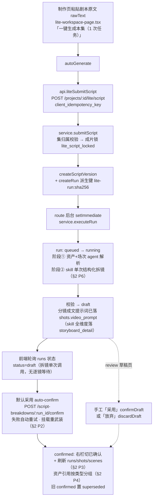
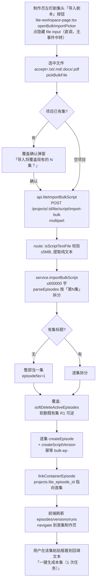

# 一键生成本集 & 一键导入剧本 流程文档（Lite 版）

>
> **版本：v0.9（2026-08-19）—— 音频出现记录 + 音频五类分类落库展示 + AI 自动挂变体（用户拍板）。** ① **音频出现记录**：materialize backfill A 层匹配集加入阶段② `assetDefinitions` 的 audio 引用（parse 已按资产库校验，经 `ShotCandidate.audioNames` 透传）——音频资产确认后即有「第 N 集 · 镜 M · 场景」出现记录，与四类资产同入口可查；**音频只写 usages、不写 `reference_asset_snapshots`**（生成消费链认四栏引用，音频快照是死数据），B 层变体语义匹配跳过音频。② **音频分类**：阶段①抽取的 `audio_kind`（角色声音/旁白/音效/环境声/其他）落 `asset_entities.metadata.audio_kind`（新建写入、存量只补不盖），素材列表卡与资产详情「音频分类」行展示；工作台草稿审核音频组带分类徽记。③ **出现记录覆盖全项目资产/变体**：backfill 匹配集 = 本次落库候选 ∪ 本项目全部五类资产——用户先手动新建的资产/变体，只要本集分镜引用其名（A 层精确名 / B 层变体名子串），同样写出现记录。④ **C 层 AI 自动挂（用户拍板 2026-08-19，改「AI 只建议零写库」为「AI 自动挂、可纠偏」）**：materialize 的 A/B 层之后，对本项目全部变体跑 `variant_match_suggest`（复用 ✨ 匹配剧集 的提示词与校验：幻觉镜号丢弃、同 shot 去重、排除已关联），命中本集的写出现记录 `matched_by="ai_auto"`——**只写 usages 不写生成快照**（生成参考仍由人控，§4 红线不松）；manual 永不被覆盖；资产详情页 ai_auto 条目带「(AI 匹配)」徽记且可删（挂错可纠）。无网关/无变体/异常 → 跳过带原因，不阻断 materialize。零数据库迁移。
>
> **版本：v0.4（2026-08-17）—— 分镜×资产匹配逻辑与素材页对齐。** 在 v0.3（P1–P6）基础上：一键生成本集的分镜与资产匹配逻辑统一以 `docs/design/prd-v2/lite-assets-page.md`（v1.7）为唯一真源——匹配方向（资产侧声明 → 分镜，单向）、三路统一匹配合同（问题八 8.8）、路径① materialize backfill 双层自动匹配（八.10）、生成侧消费链（路径④）；本文不再定义独立匹配规则（见 §3.4.7），并修正 §3.3「重新生成本集」重跑口径为「分镜/场景覆盖重建、资产关联只增不删、manual 不被覆盖」。v0.3：新增 §2「问题与修改方案」（P1–P6），§3 更新到目标行为（五类解析、默认采用、分镜自动刷新、资产引用按类型分组、实体描述、固定 skill 单次结构化拆镜 + 成文提示词）。
>
> **版本：v0.5（2026-08-18）—— P6 三处修订（`PROMPT_VERSION` v8）。** ① 成文分镜提示词改由**模型按生效模板成文**：阶段②输出 JSON 每 Segment 带必填 `video_prompt`，skill 合同写明「模板是创作规范不是填空题」；服务端删除 `compileStoryboardShotPrompt` 的填空题式渲染（模板无占位符时把规范原文当提示词的病灶）。② 确认事务 `materializeAssetCandidates` 由三类（角色/场景/道具）扩到**五类**（加服装/音频，迁移 070 补 `asset_role_vocabulary` 的 costume/audio 两个 id），与 Lite materialize 端点同口径——一键生成本集确认后资产页即见五类资产。③ **退役确认事务的「外来正式内容 409」守卫**（`episode_has_formal_content`）：它与 §3.3 弹窗/§3.4.7 重跑口径（覆盖重建）矛盾，且把「重新生成本集」变死循环（自动确认失败后人工确认同样被拦）；确认后既有场/分镜统一软删（R1 可逆），人工内容不再 409 拦人。
>
> **版本：v0.8（2026-08-18）—— 模板面板「分镜 Shot 数」配置（`PROMPT_VERSION` v10→v11）。** 用户拍板「Shot 数由模板决定」：每 Segment 内 Shot 数改由**模板面板配置决定**——视频配置页模板子 tab 新增「分镜 Shot 数」（1-12 整数，留空=自由），随基础配置保存落 `generation_default_strategies.parameters.shots_per_segment`；阶段② `resolveStoryboardVideoConfig` 重新读取（1..MAX 生效，缺省/越界/非法=null=自由）；skill 规则 1 与阶段②输出 schema 动态两态（配置 N→「恰好 N 个，不多不少」；未配置→「≥1 由剧情内容自然决定」）；`storyboard-parse.ts` 数量校验两态（配置→恰好 N，未配置→≥1）。**本版推翻 v0.7 的「完全放开」**（Shot 数不再由模型自由决定），老 run 重开。
>
> **版本：v0.7（2026-08-18）—— 推翻固定几段式约束（`PROMPT_VERSION` v9→v10）。** 用户拍板「完全放开，由模型自由决定」：每 Segment 内 Shot 数不再由配置决定，改由**剧情内容自然决定**（至少 1 个，skill 规则 1 与阶段②输出 schema 同步改为「不设固定数量」）；`shots_per_segment` 配置字段**废弃**——`resolveStoryboardVideoConfig` 不再读取、`generation_default_strategies.parameters` 里残留该键不影响行为（宽松 record 宽容接受）；`storyboard-parse.ts` 数量校验从「恰好 N」放宽为「≥1」。输出 JSON 形状不变（shots 数组长度自由），老 run 重开。（**v0.8 已推翻本条**：Shot 数改回模板面板「分镜 Shot 数」配置决定，见上。）
>
> **版本：v0.6（2026-08-18）—— 阶段②固定 skill 换为附件《通用动态模板配套标准化Skill · 跨模型统一约束完整版》全文（`PROMPT_VERSION` v8→v9）。** §2 P6 A 的 skill 从初版精简改写替换为产品批准的**附件全文**：①统一**4 类切割边界**（角色台词块 / 情绪转折动作 / 场景环境描述 / 剧情重大转折），1 独立剧情单元 = 1 Segment，数量对齐；②单 Shot **四模块顺序固定**（主体动作→物理细节→镜头语言→独立光影），光影禁止并入镜头语言；③Segment **固定模块排版**（原文行锚定 covered_line_range / 标题 / 核心摘要 / Asset Definitions / 全局风格 / 画风&摄影参数 / 色调 / 运镜 / Native Audio / 固定收尾）+ `duration_sec`（时间）+ `video_prompt`（成文提示词）+ `shots[N]`（左栏表单四模块）；④统一**摄影基准**（真人电影实拍 / 4K / 浅景深 / 禁卡通）；⑤**无前置总结、后台自检**硬性禁令。适配：剧本为中文（原文不重发、以行号锚定）；资产五类 + 参考通道；Shot 数**默认固定 5**，项目配置了几段式 N 则按 N（沿用 §2 P6 A/C 决策，不拆配置功能；v0.7 已推翻本条）。输出 JSON 形状不变，老 run 重开。

> Lite 版（`pages/lite/`）= 精简界面，同一应用同一库的第二套界面。本文只覆盖 Lite 版两条流程：
>
> - **一键生成本集**（§3）：制作页拿整集剧本一次解析 → **默认采用** → 生成整集分镜（含五类资产候选：角色/场景/道具/服装/音频，资产描述为实体描述）；付费出片在分镜详情页逐镜操作。已知问题与修改方案见 **§2（P1–P6）**。
> - **一键导入剧本**（§5）：制作页左栏剧集头「导入剧本」上传纯文本 → 按集标题拆分 → 覆盖式重建全部集。
>
> Lite 版剧本解析只走 AI 调用账（`ai_calls`），不进积分账；Lite 版**没有「就绪」开关**（`pages/lite/` 全目录无 `就绪 / readyMarks / ready_marked / 标记就绪` 引用），也不经过付费批量生成链（无 `generation_quotes → generation_batch_authorizations → generation_attempts`）。

## 1. 功能总览

### 1.1 两个功能

| 功能 | 入口 | 说明 |
|---|---|---|
| **一键生成本集** | 制作页「一键生成本集（1 次任务）」（`lite-workspace-page.tsx`） | 整集剧本一次解析 → **默认采用** → 生成整集分镜（含服装/音频候选）；付费出片在分镜详情页（§3） |
| **一键导入剧本** | 制作页左栏剧集头「导入剧本」（`lite-workspace-page.tsx`，唯一文件导入入口） | txt/md/docx/pdf → 提取纯文本 → 按集标题拆分 → 覆盖式重建全部集（§5） |

### 1.2 功能判定

- Lite 版**没有就绪开关**：`pages/lite/` 全目录无 `就绪 / readyMarks / ready_marked / 标记就绪` 引用。
- Lite 版「一键生成本集」不按逐镜就绪准入——拿整集剧本一次解析、自动 confirm 生成全部分镜；付费出片在分镜详情页逐镜操作。
- 「一键导入剧本」解析**纯文本（.txt/.md/.docx/.pdf）→ 剧本版本（episode_script_versions）**，不直接产 shots；随后在制作页点「一键生成本集（1 次任务）」（§3）才解析。

### 1.3 函数归属速查表（逐功能 / 逐函数）

> 图例：**✓** = Lite 界面直接用到的函数（§3/§5 覆盖）；**⚠** = 已实现但前端未接线。每个函数节开头同样标注。

#### Lite 版「一键生成本集」（§3）—— 全链 ✓

| 函数 / 机制 | 归属 | 说明 |
|---|---|---|
| `lite-workspace-page.tsx` `autoGenerate` + auto-confirm effect + 3s 轮询 effect | ✓ | Lite 界面直接驱动 |
| `api.ts` `liteSubmitScript / confirmScriptBreakdown` | ✓ | |
| `lite/routes.ts` `POST /projects/:id/lite/script`（含 `setImmediate` schedule） | ✓ | |
| `lite/service.ts` `submitScript / deriveRunIdempotencyKey` | ✓ | |
| `script-breakdown/service.ts` `createScriptVersion / createRun / executeRun / confirmRun` | ✓ | 模块注册了公开路由；本功能范围内只有 Lite 前端驱动 |
| `script-breakdown/storyboard-skill.ts`（固定 skill 常量）+ `storyboard-parse.ts`（单次结构化输出解析/校验） | 新增（§2 P6） | 阶段② 拆镜：system = skill 全文，单次 `gateway.runToolTurn` 出全部分镜 |
| `generation/repository.ts` `resolveProjectGenerationConfig` | 复用（§2 P6） | 拆镜阶段取默认视频风格 + 默认视频模板（只读） |

#### Lite 版「一键导入剧本」（§5）—— 全链 ✓

| 函数 / 机制 | 归属 | 说明 |
|---|---|---|
| `lite-workspace-page.tsx` 左栏剧集头「导入剧本」按钮 + `openBulkImportPicker` + 隐藏 file input | ✓ | 直调文件选择（R2-14 起无壳按钮、无事件中转） |
| `lite-workspace-page.tsx` `pickBulkFile/handleImportBulk`、覆盖确认弹窗 | ✓ | |
| `api.ts` `liteImportBulkScript` | ✓ | |
| `lite/routes.ts` `extract-text / import-bulk` 两端点 | ✓ | |
| `lite/service.ts` `importBulkScript` | ✓ | |
| `production/episodeParser.ts` `parseEpisodes` | ✓ | Lite 导入整部专用 |
| `api.ts` `liteExtractScriptText` | ⚠ 未接线 | 路由与 API 方法已实现，但**前端无调用方**（全前端只有 api.ts 定义）；界面当前无「从文件导入」按钮（见 §5.1） |

## 2. 一键生成本集：问题与修改方案（P1–P6）

> 本节为 v0.2 新增、v0.3 扩为六项。P1–P4 来自 2026-08-17 实测反馈；P5–P6 来自 2026-08-17 用户对一键生成本集的需求（资产描述应为实体描述、分镜拆分改版为固定 skill 单次结构化输出并带分镜提示词）。根因均已对照当前代码核实（见各「根因」内的文件/行号）；修改方案只落本文档，**代码暂不改**，待批准后按 §3 目标行为施工。P1–P6 与 §3 对应小节互相引用。

**改动清单速查（文件 / 函数 / 数据库）**——所有改动只在 **PostgreSQL 主库**（唯一正式事实源），不涉及 Milvus 检索投影与 TOS 媒体存储结构：

| 项 | 改动文件 / 函数 | 改数据库 |
|---|---|---|
| **P1** 服装/音频资产 | `script-breakdown/agent/tools.ts`：新增 `add_costume`/`add_audio` 并入 `BREAKDOWN_TOOL_NAMES`；`agent/workspace.ts`：新增 `addCostume`/`addAudio`，扩 `checkAssetInput`/`namesOf`/`firstUnknownName`；`agent/runner.ts`：`breakdownSystemPrompt`（:440/:456）扩为五类 | 否——草稿/校验/落库链路已支持 costume/audio |
| **P2** 默认采用 | `lite/routes.ts` `submitLiteScriptBodySchema`（:27）加 `auto_confirm`；`lite/service.ts` `submitScript`（:49）透传；`script-breakdown/service.ts` `finalizeRunDraft`（:444）/`confirmRun`（:211）draft 后直写正式；前端 `lite-workspace-page.tsx` `autoGenerate`（:808）/自动确认 effect（:545-562）简化为只轮询 | 否——run 状态流转（draft→confirmed）已有 |
| **P3** 分镜刷新 | `lite-workspace-page.tsx` 自动确认成功回调（:549-553）与 `confirmDraft`（:611）补 `runsState.retry()/shotsState.retry()/scenesState.retry()` | 否 |
| **P4** 资产引用 | `lite-workspace-page.tsx` `renderAssetRefBar`（:1682）：confirmed 分支改读 `detail.draft.assetCandidates` 按 kind 分组（含服装/音频）；review 候选 chips 补 costume/audio | 否——数据已在 run 的 draft |
| **P5** 资产描述 | `agent/runner.ts` `breakdownSystemPrompt`（:435-489）加实体描述规则；`agent/tools.ts` `characterParameters`/`assetParameters` description 细则；（可选）`agent/workspace.ts` `checkAssetInput` 硬校验 | 否——description 直通 `asset_entities`/`asset_media` 既有列 |
| **P6** 分镜拆分改版 | 见 §3.4.6 清单：新增 `storyboard-skill.ts`/`storyboard-parse.ts`；改 `script-breakdown/service.ts` `executeRun`、`ai/service.ts` `purposeModels`、`agent/runner.ts`/`tools.ts`、`types.ts`/`mapper.ts` `mapShot`、`generation/promptCompiler.ts` `compileStoryboardShotPrompt`、前端两页 | **是**——迁移 **067**：PostgreSQL `shots` 表加 `storyboard_detail jsonb` 列 + 扩展 `breakdown_elements`/`ShotLiteMetadata`；**不新增表**；skill 不落库（代码常量 + `PROMPT_VERSION`） |

**结论**：P1–P5 **零数据库结构改动**；唯一需要迁移的是 **P6 的 `shots` 表（迁移 067）**。数据库层面没有新表、没有删表、不动既有列。

### 2.1 P1 · 一键生成不产音频 / 服装资产

**现象**：一键生成本集后，解析结果里只有**角色、场景、道具**三类资产候选，没有**服装、音频**；资产页与分镜里拿不到这两类，后续素材与出片缺服装/音频。

**根因**（已核实）：数据/校验/Lite 层早已支持服装/音频，但 **agent 工具层没有写入入口**——能力在从 v4 散文提示词迁到 v5 agent 工具路时丢失。

- 类型与草稿：`types.ts` `AssetCandidateKind = "character" | "scene" | "prop" | "costume" | "audio"`；`schemas.ts` 草稿区已存 `costumes / audios`（`storedCostumeCandidateSchema` / `storedAudioCandidateSchema`，各占 `ASSETS_PER_KIND_MAX = 60` 预算）。
- 校验/映射/Lite 落库：`validators.ts` `collectUnmatchedAssets` 已知集合含 costume/audio；`mapper.ts` 已把 `shot.costumeNames` 映射进 `referenceAssetNames.costumes` 与 `collectReferenceSnapshots`；`lite/service.ts` `materializeAssets` 已把 costume/audio 候选落成项目资产。**v8 修订**：确认事务 `repository.ts` `materializeAssetCandidates` 原只转三类（角色/场景/道具），已扩到五类（加服装/音频）——一键生成本集确认后资产页即见五类资产，与 Lite materialize 端点同口径。
- **缺的是 agent 侧**：
  - `agent/tools.ts:24-31` `BREAKDOWN_TOOL_NAMES = ["write_story_outline","add_scene","add_character","add_location","add_prop","add_shot","finish_breakdown"]` —— **无 `add_costume` / `add_audio` 工具**。
  - `agent/workspace.ts` `checkAssetInput / namesOf / firstUnknownName` 只认 角色|场景|道具；`costumes / audios` 数组只在续跑时从旧草稿恢复，agent 没有写入方法。
  - `agent/runner.ts:435` `breakdownSystemPrompt` 只要求模型登记 角色、场景、道具。
- 佐证：遗留 v4 提示词 `prompts.ts`（`buildAssetsPrompt`）仍描述服装/音频提取——切 agent 路时未平移过来。

**修改方案**：
1. `agent/tools.ts` 新增 `add_costume`（字段对齐现有资产候选 schema）与 `add_audio`（含 `audioKind: character_voice|narration|sfx|ambience|other`、`speakerNames`、`emotion`、`sceneContext`），并入 `BREAKDOWN_TOOL_NAMES`。
2. `agent/workspace.ts` 新增 `addCostume / addAudio` 方法；`checkAssetInput`（名称照抄原文、去重、`ASSETS_PER_KIND_MAX` 上限）与 `firstUnknownName` 扩展覆盖 costume/audio，未知名校验同样提示。
3. `agent/runner.ts` 提示词（**必须与工具一起改，缺一不可**）：
   - **系统提示 `breakdownSystemPrompt` 两处**：`runner.ts:440`「把出现的角色、场景、道具登记进来…」→ 扩为 角色/场景/道具/**服装/音频** 五类；`runner.ts:456`「镜头引用的角色、场景、道具名称必须先登记过。」→ 同样扩到服装/音频名称。
   - **工具描述文本（`tools.ts`，随每轮工具调用发给模型，本身就是提示词）**：新增 `add_costume` / `add_audio` 的描述里写清「什么算服装/音频」（如服装=角色标志性穿着/戏服；音频=剧本明写或可推断的音乐/音效/语气，`audioKind: character_voice|narration|sfx|ambience|other`），否则模型不知道何时触发。
   - **用户提示 `breakdownUserPrompt`（runner.ts:470-489）无需结构改动**：已通过资产行是通用的 `- [assetKind] name`，三类五类都打得出；仅当想把「本集已登记的服装/音频」回填给续跑时才是可选增强。
4. 收尾：`confirmRun` → `mapDraftToFormal` → 确认事务物化。v8 前确认事务只物化三类，服装/音频要等用户进资产页触发 Lite materialize 才落库；**v8 起确认事务直接物化五类**，一键链路不再依赖资产页访问。

### 2.2 P2 · 一键生成后仍要手动点「采用」

**现象**：点了「一键生成本集（1 次任务）」，解析跑完后右栏仍停在草稿 review，要再点一次「采用这份草稿」；期望是**默认就采用，全程无人工步骤**。

**根因**（已核实）：自动确认 effect **存在**（`lite-workspace-page.tsx:516-527`），但它是**纯客户端、内存态 `autoGenerating` 门控的一次性尝试**，不是确定性的默认行为：

- effect 依赖本会话 `autoGenerating` 标志；**刷新页面、切集（切集清空录入态 effect 会 `setAutoGenerating(false)`）、解析期间离开再回来**都会让它失效 → 落到 review 视图手动采用。
- 自动确认调用失败（网络抖动、`prompt_version_outdated`、`run_not_confirmable`、服务端 5xx 等）时 `catch` 只提示「自动确认失败，请在草稿页手动确认」并把 `autoGenerating` 置 false → 退回手动采用，且**不重试**。

**修改方案**（推荐根因方案，选简单者）：
- 把「默认采用」下沉到服务端——`submitScript` 输入带 `auto_confirm: true`，`finalizeRunDraft` 后服务端直接写正式 scenes/shots（run → confirmed），前端只轮询展示；`view` 判定不再依赖 `autoGenerating`。草稿 review + 手工采用只保留给「单独解析」入口（非一键生成）。
- **改数据库：否**——沿用 run 状态流转（draft→confirmed 已有），无新表/新列。

> 目标行为（§3.1 已按此描述）：一键生成 = 提交 → 解析 → **默认采用** → 分镜自动出现，全程无人工点「采用」。

### 2.3 P3 · 采用后分镜不刷新

**现象**：一键生成（或手动采用）完成后，右栏分镜区仍是空的/旧的，新分镜卡不出现，要手动刷新页面才有。

**根因**（已核实）：确认成功后**没有刷新分镜/场数据源**，`view` 又由 `confirmResult` 直接切到 `confirmed`，分镜区渲染的是确认前加载的旧 `shotsState`：

- 自动确认成功回调（`lite-workspace-page.tsx:523-526`）只 `setConfirmResult(result)` + notify + navigate，**没有** `runsState.retry() / shotsState.retry() / scenesState.retry()`。
- 手工 `confirmDraft`（:594-602）只 `setConfirmResult` + `runsState.retry()`，同样**没刷 `shotsState` / `scenesState`**。

**修改方案**：确认成功后（自动与手工两条路径）统一调用 `runsState.retry() / shotsState.retry() / scenesState.retry()`（必要时 `versionsState.retry()`），让分镜区与各状态点在采用完成时立即呈现新分镜；加载态沿用现有 skeleton。**改数据库：否**——只动前端状态刷新，服务端无需改动。

### 2.4 P4 · 本集资产引用不显示解析出的资产

**现象**：一键生成本集（已确认）后，右栏「本集资产引用」是空的，提示「还没有资产引用；确认剧本解析后会列出分镜用到的资产」；要等去资产页「落库」才有。期望是**直接列出本次解析出的资产名，按类型分组**。

**根因**（已核实）：已确认视图读的是**物化后的项目资产**，不是本次解析候选：

- `renderAssetRefBar`（confirmed 分支）读 `referenceAssets = api.liteReferenceAssets(projectId)` → `LiteAssetService.listReferenceAssets` → `repository.listReferenceAssets`，只列**已登记 active 的项目资产**；一键生成只写 scenes/shots，资产候选**不会自动落库** → 空。
- review 分支「资产候选 · 待确认」chips 只取 `characters/scenes/props`（`lite-workspace-page.tsx` `renderAssetRefBar`），**丢了服装/音频**。
- 数据已在手边：confirmed run 的 `detail.draft.assetCandidates` 含五种 kind（`detailState` 对 confirmed 也会拉取），无需新接口。

**修改方案**：本集资产引用栏改为渲染**本集已确认 run 的解析资产候选**，按类型分组 chips（角色 / 场景 / 道具 / 服装 / 音频）；review 分支同样把 costume/audio 纳入候选 chips；保留「去资产页」入口。物化后的 `liteReferenceAssets` 仅作为「已落库」补充，不作为默认展示。**改数据库：否**——数据已在 run 的 draft，无需新接口/新列。

**现状核对（用户 2026-08-17 问：解析输出是否带「具体资产的集数-分镜数-场景名称」，如 1-2-花园？）**——**拆解解析产物本身不带，但系统已存在两处「集-镜-场」定位载体**：
- **分镜定位串 `shotCode()`**（`lite-shot-detail-page.tsx:145-148`）：`[episode_no, shot_no, sceneNameShort(scene.name)].join("-")`，就是「1-2-花园」格式——它给**分镜**生成定位串（集号-分镜号-场景名），展示在分镜详情/列表。
- **资产「出现记录」`metadata.lite.usages[]`**：每个资产可挂多条，每条 = 一个「集-镜-场」定位。API `GET /api/v1/projects/:project_id/lite/assets/:asset_entity_id/usages` 返回 `episode_no / shot_no / scene_name / shot_label / status(bound|pending) / matched_by(exact_name|manual)`；资产详情页「出现记录」（`lite-asset-detail-page.tsx:612-714`）渲染为「第1集 · 镜2 · 花园（G02）」。写入路径 = 三路统一合同（素材页问题八 8.8）：① materialize backfill 双层（A 层资产名精确对拍挂第一变体 + B 层变体名/别名语义命中非第一变体，两层同写 `exact_name`，素材页八.10）；② AI 匹配（✨ 匹配剧集，建议勾选后按 manual 写入）；③ 手动关联（`shot_id` 或 `episode_no+shot_no+scene_name`，`lite/routes.ts:330-349`；目标集未确认落 pending，确认后 `reconcilePendingAssetUsages` 在确认事务内按三要素转 bound，`script-breakdown/repository.ts:647-754`）。同幂等键 `(shot_id, variant_id)`，manual 永不被 exact_name 覆盖，只增不删（删除抑制名单 `shots.metadata.lite.removedAutoRefs`）。合同唯一真源 = 素材页文档，本文匹配口径见 §3.4.7。
- **拆解解析产物本身（asset candidates / 分镜草稿 / 工作台「本集资产引用」chips）不带 per-asset 定位**：`AssetCandidate`（`types.ts:67-70`）无 episode/shot/scene 字段；定位只单向挂在分镜候选侧（`ShotCandidate.sceneIndex + referenceAssetNames`，`types.ts:137-160`）；「资产 → 出现在哪几镜哪几场」需按分镜反查或读 usages。
- **对 P4/P6 的落点**：若要「本集资产引用」或资产页按资产展示「1-2-花园」，**数据基础已具备**（`shotCode` + usages），属 P4 前端展示增强，**无需新接口/新列**；阶段② `Asset Definitions` 不必内嵌出现位置——确认后由 usages 自动建立。

### 2.5 P5 · 资产描述是剧本原文，不是资产实体描述

**现象**：一键生成本集后，资产候选的**名称**按剧本原文（正确，保持跨集字符串一致），但**描述**（`description`）直接是剧本里那一行原文，不是资产的实体描述——角色看不出「是谁 / 什么特征」、场景看不出「长什么样」，后续素材检索与出片拿不到可用描述。期望：名称照抄剧本（不动），描述写**这个资产的具体描述**（实体描述），与剧本原句解耦。比如角色应该是某个角色的形象秒速特征，但是要是剧本上的，不能瞎写。

**根因**（已核实）：服务端**没有**「剧本原文 → 实体描述」的后处理，描述直接透传模型输出；提示词又没要求「写实体描述」，模型默认把剧本行照抄进 `description`。

- `agent/workspace.ts` `addCharacter / addLocation / addProp`（:199-233）直接存模型传入的 `checked.description`，服务端无「描述 ≠ 剧本原文」的替换/回填逻辑。
- 系统提示 `breakdownSystemPrompt`（`agent/runner.ts:435-489`）只要求「只写剧本里真有的内容」「除了名字一律中文」，**没有**「description 写资产实体描述、不得照抄剧本原句」的规则。
- 工具描述 `agent/tools.ts`（`assetParameters` / `characterParameters`）的 description 字段细则目前是「定位或用途要点，剧本没写就给 null」——引导模型填「要点」，没堵住照抄。

**修改方案**（属提示词缺陷，不改 DB、不动名称逻辑）：
1. **系统提示**（`agent/runner.ts` `breakdownSystemPrompt`）新增资产描述规则一句：「登记资产时,description 要写成这个资产的实体描述(角色的身份/外貌/性格特征,场景的地点/陈设/氛围),不要照抄剧本原文行。」
2. **工具描述**（`agent/tools.ts` 的 `characterParameters` / `assetParameters`）：description 字段细则改为「资产实体描述：身份/外貌/特征 或 地点/陈设/氛围；**不得照抄剧本原文**；剧本没写就给 null」。
3. **确定性兜底（可选增强）**：`agent/workspace.ts` `checkAssetInput` 增加「`description` 与剧本任一原行逐字节相同 → 退回重写」的校验（workspace 已持有编号剧本行，可实现）——让「描述 ≠ 剧本原文」成为硬约束，而非只靠提示词。
4. 不需要改 DB / mapper / materialize：`description` 本就是 模型 → 候选 → `asset_entities` / `asset_media.description` 的直通字段。

### 2.6 P6 · 分镜拆分改版：固定 skill 单次结构化输出 + 分镜提示词落库

**现象**：当前一键生成本集的分镜拆分走 **agent 多轮「工具调用」循环逐镜填草稿**（`add_shot` 一镜一次模型调用、`MAX_TURNS = 60` 轮，前端每 3s 轮询等 agent 逐镜生成）——拆得慢、逐镜顺序不确定；且 v2 运行的分镜**只存要素、不存成文提示词**（`types.ts` `ShotCandidate.videoPrompt` 新运行固定 null），点击分镜看不到「分镜提示词」。

**期望**（用户）：分镜拆分改为——固定 skill 文件（附件《跨模型统一影视分镜生成约束规范》）作约束 + 本集剧本 + 配置页默认视频风格（多选一默认）+ 默认视频提示词模板（多选一默认），**一次生成具体分镜数**（= 独立剧情单元数，skill 对齐承诺）；且**每个分镜生成「分镜提示词」，点击分镜可见**。

**根因**（已核实）：
- 拆镜架构：`agent/runner.ts` `runBreakdownAgent`（:171）多轮工具循环，`add_shot` 工具一镜一次模型调用；不是「给全剧本 + 约束，一次返回全部分镜」的单次结构化输出。
- 前端逐镜轮询：`lite-workspace-page.tsx:565-572` 每 3s `runsState.retry()` 等 agent 逐镜填草稿。
- 无成文提示词：`mapper.ts` `mapShot`（:56-81）只写 `breakdownElements`（subject/action/visual/cameraLanguage），**不写 `video_prompt`**；`types.ts:137-155` 注释明确「v2 只存要素,不存成文提示词」→ 分镜详情页 `video_prompt` 为空。

**修改方案**（五部分）：

**A. 新增固定 skill 文件**：`src/modules/script-breakdown/storyboard-skill.ts`（常量，内容 = 附件《通用动态模板配套标准化Skill · 跨模型统一约束完整版》全文，2026-08-18 定版；或 `.md` 资源文件）。规范要点：统一 **4 类切割边界**（角色台词块 / 情绪转折动作 / 场景环境描述 / 剧情重大转折）+ 数量对齐、每 Segment 的 Shot 数（**模板面板「分镜 Shot 数」配置恰好 N；未配置由剧情内容自然决定 ≥1**，见 C 与决策项）、每 Shot 四模块（主体动作→物理细节→镜头语言→**独立光影**）、Asset Definitions（@ 引用**当前资产库**资产——资产页全部 **8 类 tab**：五类可解析资产 角色/场景/道具/服装/音频 + 三类纯上传参考通道 光线参考 light_ref / 摄影参考 photo_ref / 视频参考 video_ref，见 B/D）、Segment 固定模块排版（原文行锚定 / 标题 / 核心摘要 / 全局风格 / 画风&摄影参数 / 色调 / 运镜 / Native Audio / 固定收尾）、摄影基准（真人实拍 4K / 禁卡通）、无前置总结 + 后台自检、固定收尾（禁字幕、禁 BGM）。此文件即拆镜阶段的 system prompt。

**B. 拆镜改为单次结构化输出（`executeRun` 拆两阶段）**：
- **阶段 ①「资产与场次」**：沿用现 agent 循环（`write_story_outline / add_scene / add_character/add_location/add_prop`，P1 后含 `add_costume / add_audio`）→ `finish_breakdown`（校验**去掉「必须有 shot」**要求，或新增无 shot 收尾分支）。
- **阶段 ②「分镜拆分」**：一次 `gateway.runToolTurn({ purpose: "script_breakdown_storyboard", ... })`（新 purpose）：
  - **system** = storyboard-skill 全文 + JSON 输出 schema 说明；
  - **user** = 编号剧本全文 + 目标总时长 + **当前项目资产库（资产页全部 8 类 tab：五类可解析资产 角色/场景/道具/服装/音频 + 三类纯上传参考通道 光线参考 light_ref / 摄影参考 photo_ref / 视频参考 video_ref，逐条「名称 + 描述」——可解析资产给实体描述、参考通道给参考说明）** + 默认视频风格 + 默认视频模板 + 输出约束——**每个分镜从资产库引用资产**（参考通道同样可被引用，作光线/摄影/运镜参考），成文提示词对引用资产打 `@` 标签（见 D）；阶段① 解析出的新资产候选需在阶段② 前物化进资产库供 `@` 引用（物化时机与 §2 P2/P4 联动，施工时按目标行为定，候选仍不自动落库的约束不冲突——物化指 P1 已就绪的 materializeAssets 链路）；
  - **输出** = 单个 JSON（`segments[]`，每段含 **若干 Shot 四模块**（数量 = 模板面板「分镜 Shot 数」配置恰好 N；未配置自由 ≥1）+ 光影 + SFX/对白 + Asset Definitions（`@` 引用资产库资产）+ 画风/色调/运镜策略 + 自检字段：segmentCount / 行覆盖 / 资产已登记）；
  - 服务端 `storyboard-parse.ts`（新文件）解析 + 校验：Segment 数 = 剧情单元数、行覆盖、**资产引用全部 ∈ 资产页 tab 资产库**、每段 Shot 数 = 配置恰好 N（未配置 ≥1）、收尾无字幕无 BGM → 生成分镜候选。

**C. 默认风格 + 默认视频模板来源**：`resolveProjectGenerationConfig(projectId, "video")`（`generation/repository.ts:263`）——默认视频风格 = `project_styles` 表 is_default 行镜像到 `projects.video_style_description`；默认视频模板 = `generation_default_strategies.parameters->>'prompt_template_id'` 生效引用 → `prompt_templates`（用户模板）/ `prompt_default_templates`（平台默认，迁移 064）兜底。拆镜阶段只读，不新增配置。**每 Segment 内 Shot 数 = 模板面板「分镜 Shot 数」配置**（v0.8 恢复）：`resolveStoryboardVideoConfig` 读 `generation_default_strategies.parameters.shots_per_segment`（1..MAX 生效，缺省/越界/非法=null=自由，见决策项）。

**决策项（待批）：集级目标总时长**——阶段② user 提示的「目标总时长」目前 Lite 恒为 null（`lite/service.ts:74` 写死 `targetDurationSec: null`，`liteSubmitScript` 请求体无此字段，模型收到「这一集没有设定目标总时长。」）。
- Lite 不设集级总时长，skill 按剧本节奏自由分配各分镜时长（`shots.duration_seconds` 仍逐镜由模型给、详情页可手改）。与用户原始需求范围一致，零新增。

**决策项（v0.7 已否决 → v0.8 翻案通过）：几段式配置来源**——「几段式」= 每 Segment 的 Shot 数：
- 曾拟（v0.7 前）：视频默认参数新增 `shots_per_segment`（`generation_default_strategies.parameters`，项目级可配）——拆镜阶段 `resolveStoryboardVideoConfig` 一并读取；与「默认视频模板 / 风格」同一处配置，用户可见可改。
- **v0.7 推翻**：用户拍板「完全放开，由模型自由决定」——Shot 数不再可配置，`shots_per_segment` 字段废弃、后端不再读取（残留键被宽松 `parameters` record 宽容接受，无行为影响）；skill 规则 1 与阶段②输出 schema 改「数量由剧情内容自然决定（至少 1 个）」。
- **v0.8 翻案通过（当前生效）**：用户再拍板「Shot 数由模板决定（新机制）」——**恢复** `shots_per_segment`：视频配置页模板子 tab 新增「分镜 Shot 数」输入（1-12 整数，留空=自由），随基础配置保存落 `generation_default_strategies.parameters.shots_per_segment`；`resolveStoryboardVideoConfig` 重新读取（1..MAX 生效，缺省/越界/非法=null=自由）；skill 规则 1 与阶段②输出 schema 动态两态（配置 N→恰好 N；未配置→≥1 自由）；`storyboard-parse.ts` 校验两态。

**D. 分镜提示词 + skill 全维度落库（映射决策 + 迁移 067）**：
- **映射决策**：**分镜（`shots` 表一行）= 一个 Segment（独立剧情单元）**，分镜数 = 剧情单元数（skill 对齐承诺）；Segment 内 **若干 Shot**（数量 = 模板面板「分镜 Shot 数」配置恰好 N；未配置自由 ≥1，四模块）作为该分镜的内部结构化内容落 `storyboard_detail`，成文提示词涵盖全部 Shot。备选「每 Shot → N 行 shots」会让分镜数 ≠ 剧情单元数、与 skill 对齐承诺冲突，本设计不采用。
- **成文提示词（v8 修订）**：每 Segment 的 `video_prompt` 由**模型按「生效的视频提示词模板」成文**（skill 合同：模板是创作规范不是填空题——给公式/结构时按它组织内容，含 `{{占位符}}` 时逐格填充；必须融入默认视频风格、引用资产写 `@资产名`、结尾固定禁字幕禁 BGM）→ 非空校验后存 `shots.video_prompt`。**服务端不再渲染**（v7 的 `compileStoryboardShotPrompt` 已删：本项目模板是 Seedance 创作规范、无占位符，填空题式渲染会把规范原文当提示词）。
- **skill 全维度**：新增 **`shots.storyboard_detail jsonb`** 列（迁移 **067**）存 skill 结构化全量（segment_title / 若干 Shot 四模块 / 光影 / sfx / dialogue / asset_definitions（@ 引用资产库）/ 画风·色调·运镜策略）；扩展 `shots.breakdown_elements` jsonb 结构（$type 加 `lighting/sfx/dialogue`）与 `ShotLiteMetadata`（`src/db/schema.ts:340-356`）。
- 无需新增提示词表：`video_prompt` 列已存在。

**E. 前端**：
- 移除「等 agent 逐镜生成」的 3s 轮询语义（run 状态刷新与幂等/预算红线保留）；拆镜阶段一次调用出全部分镜，前端只显示两阶段进度。
- 分镜卡/详情展示该镜成文提示词（详情页 `video_prompt` 展示位已有）；`storyboard_detail` 供高级查看。

**F. skill 删除降级路径（fallback）**：storyboard-skill 是代码常量、不落库；**删除 skill 不取消阶段②**，而是降级为**通用拆镜提示**：
- **阶段②（降级）**：system = 通用拆镜指令（「按剧本拆分分镜，并为每镜生成成文分镜提示词」，无 skill 结构化约束）；user = **剧本原文剧集内容 + 默认视频风格 + 默认视频模板**（+ 资产库清单、`@` 引用与成文提示词渲染机制不变）；模型输出分镜拆分 + 每镜成文提示词 → 照落 `shots.video_prompt`，分镜卡/详情可见性不变。**降级态的完整输入/输出契约见 §3.4.6「阶段②输入/输出 —— skill 删除降级态」。**
- **`storyboard_detail` 恒 NULL**（无 skill 结构化输出可存；列本可空，前端隐藏「高级查看」入口）；`storyboard-parse.ts` 校验降级为最小校验（分镜数 > 0、成文提示词非空），skill 专属校验（N Shot 完整 / 行覆盖 / 收尾禁字幕禁 BGM）不适用。
- **表结构零改动**：降级态 = 列写 NULL；反向恢复 skill 常量即恢复全量落库，对称可逆。

**是否改数据库**：**是——新增迁移 `068_shot_storyboard_detail.sql`**（`shots.storyboard_detail jsonb` 列 + 扩展 jsonb 结构）；`shots.video_prompt` 等既有列直接复用，不改表结构。需要修改的**文件 / 函数 / 提示词**清单与**改后流程**见 §3.4.6。

---

## 3. [Lite 版] 一键生成本集 —— 一键生成本集（1 次任务）

### 3.1 功能定义

Lite 的「一键生成本集（1 次任务）」走**另一条链**：整集剧本（粘贴框 `rawText`）一次提交 → `script-breakdown` 模块解析 → **自动 confirm（默认采用，无人工「采用」步骤）** → 生成整集 scenes/shots。解析产出**五类资产候选：角色、场景、道具、服装、音频**，资产描述为**实体描述**（非剧本原文，§2 P5）；分镜拆分走**固定 skill 单次结构化输出**（§2 P6）：阶段① 资产+场次 agent 解析，阶段② 固定 skill《跨模型统一影视分镜生成约束规范》+ 默认视频风格 + 默认视频模板，**一次出全部分镜**（分镜数 = 独立剧情单元数，每 Segment **N Shot** 四模块，N = 用户配置几段式、默认 5；分镜引用**资产页 tab 资产库**资产，成文提示词带 `@` 标签），每镜**成文「分镜提示词」**拆镜时算好落 `shots.video_prompt`，点击分镜详情可见。采用后右栏自动切到已确认并刷新分镜卡，本集资产引用按类型分组显示本次解析出的资产名（目标行为，问题与修改方案见 §2 P1–P6）。它不存在"逐镜就绪准入"——不需要标就绪，不经过付费批量生成链（quote → authorization → attempt），不产生付费调用（只走 AI 调用账）。

### 3.2 流程图



### 3.3 前端函数内容（`frontend/shortdrama-rag-demo/src/pages/lite/`）

> **归属：✓ Lite 已有** —— `autoGenerate`、auto-confirm effect、3s 轮询 effect、按钮守卫，均为 Lite 界面直接驱动。

**一键生成本集**（`autoGenerate`，`lite-workspace-page.tsx:737-790`）：`busy || autoGenerating` 互斥；`rawText` 为空报「请先粘贴剧本原文」；幂等键——同文本复用 `submitKey`，新文本 `newId()`，提交前落 state：

```ts
const key = submitKey && submitKey.text === rawText ? submitKey.key : newId();
setSubmitKey({ text: rawText, key });
const result = await api.liteSubmitScript(projectId, {
  episode_id: episodeId, raw_text: rawText, client_idempotency_key: key,
});
setJustSubmittedRunId(result.run_id);
projectState.retry(); runsState.retry(); versionsState.retry();
```

**自动确认 effect**（`lite-workspace-page.tsx:516-527`）——解析出 `draft` 后自动 confirm，留在本页：

```ts
useEffect(() => {
  if (!autoGenerating || !latestRun) return;
  if (latestRun.status === "draft") {
    setAutoGenStage("confirming");
    void api.confirmScriptBreakdown(latestRun.id).then((result) => {
      setAutoGenerating(false); setConfirmResult(result);
      notify("一键生成完成", "success");
      navigate(liteProjectPath(projectId, "workspace", episodeId));
    }).catch(() => {
      setAutoGenerating(false);
      notify("自动确认失败，请在草稿页手动确认", "error");
    });
  } else if (latestRun.status === "failed") { setAutoGenerating(false); }
}, [autoGenerating, latestRun?.status, latestRun?.id]);
```

> **已知问题与目标（v0.2）**：当前 effect 是内存态一次性尝试——失败即退回手工采用、成功后未刷新分镜。目标行为见 §2.2（P2：默认采用，失败自动重试 + 挂载重武装，或服务端 `auto_confirm`）与 §2.3（P3：确认后刷新 runs/shots/scenes）。

**轮询**：`waitingForSubmittedRun || runActive` 时每 3s `runsState.retry()`（拉 `GET /episodes/:id/script-breakdowns`），直到 `latestRun.status` 落到 `draft / confirmed / failed`。

**按钮守卫**（~:1310-1372）：`disabled={empty || busy !== null}`、`title={empty ? "先粘贴剧本原文，才能一键生成" : undefined}`；文案「一键生成本集（1 次任务）」。重跑走「重新生成本集」（幂等键提交；分镜/场景每次重跑覆盖重建，资产关联只增不删、manual 不被覆盖、被删自动引用不复活，§3.4.7）。

**API 客户端**（`api.ts`）：

```ts
async liteSubmitScript(projectId, input): Promise<LiteSubmitScriptResult> {
  return this.request(`/projects/${encodeURIComponent(projectId)}/lite/script`,
    { method: "POST", body: JSON.stringify(input) });
}
```

### 3.4 后端函数内容

#### 3.4.1 路由（`lite/routes.ts:79-149`）

> **归属：✓ Lite 已有** —— `POST /projects/:id/lite/script`（一键生成本集）。

```ts
const schedule = (runId: string, actorId: string) => {
  if (dependencies.executeRunsInline) return;              // 测试内联执行
  setImmediate(() => { void service().executeRun(runId, actorId).catch(...); });
};

// POST /api/v1/projects/:project_id/lite/script —— 201；run 创建后后台执行，前端另行轮询。
app.post("/api/v1/projects/:project_id/lite/script", async (request, reply) => {
  // requireCurrentUser → 集归属校验 → submitScript → outcome==="created" 时 schedule
  return reply.code(201).send(success({ episodeId, runId, outcome }));
});
```

#### 3.4.2 service `submitScript`（`lite/service.ts:49-90`）——「一键生成本集」的 BFF 编排

> **归属：✓ Lite 已有** —— Lite 一键生成本集 BFF 编排。

```ts
async submitScript(actor, projectId, input): Promise<SubmitLiteScriptResult> {
  await this.access.require(actor, projectId, "create");
  const episode = await this.repository.findEpisode(projectId, input.episodeId);
  if (!episode) throw new BadRequestError("找不到这一集，请刷新后再试");
  // 成片保护(服务端强制)：有未软删成片的集不可重新解析。
  if (await this.repository.hasPersistedMedia(episode.id)) {
    throw new ConflictError("这一集已经有成片了，不能重新解析", "lite_script_locked");
  }
  const version = await this.breakdown.createScriptVersion(actor, episode.id, {
    title: null, scriptText: input.rawText, clientIdempotencyKey: input.clientIdempotencyKey,
  });
  const run = await this.breakdown.createRun(actor, episode.id, {
    scriptVersionId: version.version.id, targetDurationSec: null,
    clientIdempotencyKey: deriveRunIdempotencyKey(input.clientIdempotencyKey),
  });
  await this.repository.linkContainerEpisode(projectId, episode.id, this.now());
  return { episodeId: episode.id, runId: run.run.id, outcome: run.outcome };
}
```

#### 3.4.3 幂等键派生（`lite/service.ts:180-185`）

> **归属：✓ Lite 已有** —— run 幂等键确定性派生。

```ts
/** run 幂等键确定性派生：同一客户端键重放必得同一派生键（命中 existing 返回同 run），长度恒定不超 255。 */
export function deriveRunIdempotencyKey(clientIdempotencyKey: string): string {
  return `lite-run:${sha256Hex(clientIdempotencyKey)}`;
}
```

#### 3.4.4 剧本解析执行（`src/modules/script-breakdown/`）

> **归属：✓ Lite 已有** —— script-breakdown 模块（模块本身共享、注册了公开路由；本功能范围内只有 Lite 前端在驱动）。

> 该模块注册了自己的公开路由（`POST /episodes/:episode_id/script-breakdowns`、`POST /script-breakdowns/:run_id/confirm|discard|resume` 等，`agentAccess: "human_only"` 于 confirm），模块本身共享；但在「一键生成本集」功能范围内，**只有 Lite 前端在驱动这条链**。

- **`createScriptVersion`**（`service.ts:92-116`）：`assertScriptBounds` 校验 + `scriptSha256` 哈希；幂等唯一索引 `(created_by_user_id, client_idempotency_key)`，同键复用返回 `existing`。
- **`createRun`**（`service.ts:127-153`）：校验 version 归属；`requestHash = sha256(episode_id + script_version_id + target_duration_sec)`、`inputSha256 = sha256(scriptSha256 + promptVersion)`；run 初态 `status='queued'`。run 表幂等键独立于 version 表。
- **`executeRun`**（`service.ts:274+`）：`claimExecution`（queued/failed → running，租 executionToken，防并发抢占）→ 校验 promptVersion/集可用性 → 预算 `stageOutputBudgetFor("script_breakdown_enrich")` → `runBreakdownAgent` 逐轮调 `gateway.runToolTurn`（围栏 `executionFence` 防付费调用越权）→ 模型只通过工具写**草稿区**（`add_scene / add_character / add_location / add_prop / add_costume / add_audio / add_shot / finish_breakdown / write_story_outline`，`agent/tools.ts:24-31`，服装/音频工具为目标新增，见 §2 P1），每填一格落一次 `script_breakdown_run_stages`（stageKey=`fill_events`）→ `finish_breakdown` 校验通过后 `finalizeRunDraft`（run → `draft`，带未截断资产清单重算的 `validationJson`）；失败 `finalizeRunFailed`（run → `failed`，可 `resumeRun` 断点续跑，已填好的不重做）。
- **`confirmRun`**（`service.ts:211-272`）：`status==='confirmed'` → 幂等返回 `already_confirmed`；仅 `draft` 可确认；校验 promptVersion、script version、集未删、草稿完整 → `mapDraftToFormal` 把草稿映射进正式 `scenes/shots`（写 `source_breakdown_run_id` / `source_candidate_id`，资产引用 `collectReferenceSnapshots` 写**无变体快照**——只作审计溯源、不驱动生成媒体选取；驱动生成的带变体匹配由 materialize backfill 按素材页合同落，§3.4.7）→ `repository.confirmRun` 单事务写正式表，run → `confirmed`，并把此前 `confirmed` 的旧 run 置 `superseded`。**两段式确认在服务端保留**（解析与确认是两次事务），但「一键生成」路径默认自动 confirm（§2 P2）；草稿 review + 手工采用只作为失败/单独解析的兜底。

#### 3.4.5 AI 调用细节（接口 / 模型 / 提示词 / 文件位置）

> **归属：✓ Lite 已有** —— 一键生成本集的实际 AI 调用全部落在 `script-breakdown` 模块；统一走同一个 AI 网关 `AiGatewayService`。

**直接回答三个问题**：

1. **一键拆解本集调用的接口是什么**？HTTP 层只有**一个入口**：`POST /api/v1/projects/:project_id/lite/script`（前端 `api.liteSubmitScript` → `lite/routes.ts`）。该接口**同步路径不调模型**——只建 script version + run（`queued`）就返回 201；路由随即在后台 `setImmediate` 调度 `executeRun`，真正拆解在后台异步跑。**模型没有第二个 HTTP 端口**：agent 通过 `gateway.runToolTurn` 调**模型供应商的 `chat/completions`**（火山方舟 ark 或公司通道 col，见下「接口」）。所以「接口」分两层：**你的接口（Lite BFF）→ 模型供应商接口（`chat/completions`）**。
2. **这个接口是否调用了模型**？**调用了**，但不在提交接口的同步路径里——提交返回后后台 `executeRun → runBreakdownAgent` 跑多轮「工具调用」循环，**每一轮 `gateway.runToolTurn({ purpose: "script_breakdown_enrich" })` 都是一次真实模型调用**（记一条 `ai_calls`、占用当日 AI 额度）。上限：`MAX_TURNS = 60` 轮、`MAX_TOOL_CALLS = 600` 次工具调用（`service.ts` 常量）。
3. **调用模型的提示词是什么**？现役 **v5**（`PROMPT_VERSION = "script-breakdown.v5"`，`types.ts:28`），载体是「系统提示 + 用户提示 + 工具 schema」三条（**原文见下**）：
   - 系统提示 `breakdownSystemPrompt()`（`agent/runner.ts:435`）
   - 用户提示 `breakdownUserPrompt()`（`agent/runner.ts:470`）
   - 工具 schema + 逐字段细则 `agent/tools.ts`

**调用链（谁在调、调什么）**：

```
前端「一键生成本集」→ POST /api/v1/projects/:id/lite/script（lite/routes.ts:79 附近）
  → LiteScriptService.submitScript（lite/service.ts:49）→ ScriptBreakdownService.createRun（run=queued）
  → routes 后台 setImmediate → executeRun（script-breakdown/service.ts:274）
  → claimExecution 抢执行权 → 预算 stageOutputBudgetFor("script_breakdown_enrich")
  → runBreakdownAgent（script-breakdown/agent/runner.ts）多轮「工具调用」循环
  → 每轮 gateway.runToolTurn({ purpose:"script_breakdown_enrich", ... })（ai/service.ts:743，purpose 在 :350）
  → modelForPurpose 解析模型（ai/service.ts:748）
  → RoutedAiCompletionProvider.completeToolTurn（ai/routedCompletionProvider.ts:60）
  → 模型按通道路由：
      · ark → ArkAiCompletionProvider → ArkChatClient.completeToolTurn（integrations/arkClient.ts:215）
             HTTP POST {ARK_BASE_URL}/chat/completions（默认 https://ark.cn-beijing.volces.com/api/v3/chat/completions）
      · col → ColCompletionProvider → {COL_BASE_URL}/chat/completions（OpenAI-compatible）
  → 每次往返 reserve/complete 一条 ai_calls 审计行；script_breakdown_runs.model_name 记最终模型
```

**接口**：没有独立的「AI 服务」HTTP 端口——就是模型供应商的 `chat/completions`。网关 `AiGatewayService`（`src/modules/ai/service.ts`）启动时按 env 建路由表 `textCompletionRoutes`（service.ts:1244），每个模型 ID 固定绑定一个通道（ark 优先、col 兜底，`textModelRoutes` service.ts:71）。

**模型（一键生成本集实际调用的模型）**：不硬编码，运行时解析。解析是一条确定代码链，四步都在 `src/modules/ai/service.ts`：

```ts
// ① 每轮工具调用的入口,模型在这一步定下来（ai/service.ts:743-748）
async runToolTurn(input) {
  const model = this.modelForPurpose(input.purpose);   // 一键生成本集传的 purpose = "script_breakdown_enrich"

// ② 用途 → 模型（ai/service.ts:453-454）
private modelForPurpose(purpose) {
  const model = this.configuration.purposeModels?.[purpose] ?? this.configuration.defaultModel;

// ③ 用途 → 模型映射表（ai/service.ts:234-239）
purposeModels: {
  script_breakdown_enrich: arkFirst(arkBreakdownModel, source.colScriptBreakdownModel),
},

// ④ arkBreakdownModel / arkFirst 定义（ai/service.ts:209-213）
const arkBreakdownModel = onArk(source.arkLlmModel ?? source.doubaoLlmModel) ?? arkQualityModel;
const arkFirst = (arkModel, colModel) => (arkConfigured ? arkModel : colConfigured ? colModel ?? null : null);
```

**落到环境变量**（`src/config/env.ts` 映射，`.env.example` 三个值默认全留空）：
- **火山方舟优先**：`ARK_LLM_MODEL`（env.ts:432）→ 或 `DOUBAO_LLM_MODEL`（env.ts:472）→ 兜底目录最便宜质量档 `arkQualityModel`
- **公司通道兜底**：`COL_SCRIPT_BREAKDOWN_MODEL`（env.ts:438）
- **结论：「模型是哪个」= 部署环境里 `ARK_LLM_MODEL` / `DOUBAO_LLM_MODEL` / `COL_SCRIPT_BREAKDOWN_MODEL` 按 ④③ 规则算出的那个**。运行后最终真身另记在 `ai_calls.model` / `script_breakdown_runs.model_name`——去这两张表能看到每次一键生成本集到底用了哪个模型 ID
- dev 默认全空（`AI_GATEWAY_ENABLED=false`）→ `modelForPurpose` 抛 `503 ai_gateway_not_configured`

**提示词（现役 v5 agent 路，原文）**：`PROMPT_VERSION = "script-breakdown.v5"`（`types.ts:28`）。规则载体已从散文提示词迁到「agent 路」（系统提示 + 工具入参 schema；types.ts:10-17 注释说明）。

**系统提示 `breakdownSystemPrompt()`（`agent/runner.ts:435-468`）—— 原文**（`${SCENE_HEADING_FORMS_RULE}` 是模板插值，运行时会代入 `tools.ts` 里「场标行怎么认」的细则常量）：

```text
你是短剧拆解助手。你的工作是读一集剧本,用给你的工具把它一层层拆开填进制作框架。
只能通过工具改内容,不要在回复里写拆解结果——写在回复里的内容不会被保存。
按这个顺序做:先写故事梗概,再按剧本顺序一场一场地拆,
把出现的角色、场景、道具登记进来,然后逐场拆镜头,最后调用完成拆解。
场次要把剧本从头到尾铺满:每一场紧接上一场结束的下一行,不重叠也不留空。
有几场不由你判断:剧本里明写了几行场标就是几场,
照抄场标行原文当这一场的名字,不要按剧情自己再切、也不要自编场名。
场标行怎么认:${SCENE_HEADING_FORMS_RULE}
只有整份剧本一行场标都没有时,才轮到你自己划分场次:按地点或时间的切换切,那种稿子场名给 null。
镜头引用的角色、场景、道具名称必须先登记过。
名字一律照抄剧本原文的语言与字符:英文剧本里的名字就写英文原文,不许翻译或音译成中文。
名字是后面唯一按字符串比对的东西,同一个人跨集必须始终是同一个字符串,改一个字就成了另一个人。
除了名字,其余内容一律用中文写:简介、外貌、性格标签、场次梗概、镜头四栏都不跟着剧本的语言走。
只写剧本里真有的内容。剧本没写的信息就留空,不要靠名字、职业或称谓推测。
某一次调用被退回时,只要按退回说明改这一次重来,已经填好的不用重做。
```

> 注：当前 v5 系统提示只要求登记「角色、场景、道具」——**没有服装/音频**，这正是 §2 P1 的根因；目标行为为五类登记。

**P1 修改后的目标提示词（§2 P1 同步，代码待批）**——上面原文只需改两行，其余不动：

```text
把出现的角色、场景、道具、服装、音频登记进来,然后逐场拆镜头,最后调用完成拆解。   ← 原 runner.ts:440「…角色、场景、道具…」→ 五类
镜头引用的角色、场景、道具、服装、音频名称必须先登记过。                         ← 原 runner.ts:456「…角色、场景、道具名称…」→ 含服装/音频
```

- **用户提示 `breakdownUserPrompt` 无需结构改动**：已通过资产行是通用 `- [assetKind] name`，三类五类都打得出；仅当想把「本集已登记的服装/音频」回填给续跑时才是可选增强。
- **工具描述是提示词的另一个载体**（`tools.ts` 的 `add_costume` / `add_audio` 入参描述随每轮发给模型）：描述里要写清「什么算服装/音频」，否则模型不知道何时触发（服装=角色标志性穿着/戏服；音频=`audioKind: character_voice|narration|sfx|ambience|other`）。工具本身补齐见 §2 P1 修改方案第 1、2 条。

**用户提示 `breakdownUserPrompt()`（`agent/runner.ts:470-489`）—— 结构（含剧本原文，动态拼装）**：

```text
剧本按行编号如下(L 后面是行号):
<这里放入整段剧本,每行前面带行号,formatLinesForPrompt>
这一集的目标总时长是 N 秒。       ← 未设定时长则为「这一集没有设定目标总时长。」
这个项目已通过的资产(镜头里可以直接引用):
- [character] 张三                ← 逐条「- [kind] name」;没有则「(这个项目还没有已通过的资产)」
<续跑时追加>
这一次是接着上次继续拆,已经填好的部分不要重做:
- 已拆出 N 场、M 个镜头;
- 下一场要从第 X 行开始。
```

**工具 schema + 逐字段细则**：`agent/tools.ts` —— `add_scene / add_character / add_location / add_prop / add_shot / finish_breakdown / write_story_outline`（目标新增 `add_costume / add_audio`，见 §2 P1），细则常量 `SCENE_HEADING_FORMS_RULE` / `SCENE_NAME_VERBATIM_RULE` / `NAME_VERBATIM_RULE` 等。模型每一轮可同时输出文本 + 多个工具调用，`gateway.runToolTurn` 把工具 schema 随本轮消息一起发给模型。

**校验 / 工作区**：`agent/workspace.ts` —— 工具入参逐格校验（名称照抄、`ASSETS_PER_KIND_MAX` 上限、未知名退回），`finish_breakdown` 过 `validateRunDraft` 才 `finalizeRunDraft`。

**遗留散文提示词（v4 旧路，规则已搬 agent 路但文件保留）**：`prompts.ts` —— `buildStructurePrompt/buildAssetsPrompt/buildShotsPrompt/buildRepairPrompt/buildRepairValidationPrompt`，`PROMPT_VERSION = "script-breakdown.v4"`（prompts.test.ts 仍锁 v4；现役版本走 types.ts 的 v5）

**提示词组装逻辑（一键拆解每轮实际发给模型什么）**：

一次提交 = 一次后台运行，多轮「工具调用」循环（`runBreakdownAgent`，`agent/runner.ts`）。**一轮 = 一次真实模型调用**（`gateway.runToolTurn`，purpose `script_breakdown_enrich`），上限 `MAX_TURNS=60` 轮 / `MAX_TOOL_CALLS=600` 次。每轮发给模型的是四样拼起来的：

1. **系统提示**（每轮相同，runner.ts:231/252）：`breakdownSystemPrompt()` —— 即上文 v5 原文（`场标行怎么认:${SCENE_HEADING_FORMS_RULE}` 运行时展开成 `tools.ts:169` 完整规则）。
2. **消息序列 `messages`**（随轮次累积）：
   - 第 0 条（循环开始前注入，runner.ts:313）= 用户提示 `breakdownUserPrompt()`：剧本按行编号全文 + 目标总时长 + 项目已通过资产 + 续跑提示。
   - 之后每轮追加：模型回复（文本 + 工具调用）→ 工具执行结果（填进草稿 / 退回原因）。
   - 两种「插话」：
     - 工具调用内容没读全 → 插入「这一步的内容没读全,正在请它重来」（最多 `maxUnreadableRetries` 次，runner.ts:211-225）；
     - 模型活没干完就停口 → 插入「还缺 XX,请接着用工具补完,补完后调用完成拆解」（最多 `maxNudges` 次，runner.ts:294-312）。
3. **工具 schema**（每轮相同，runner.ts:254-258）：7 个工具的 name + description + parameters —— **工具描述本身就是提示词**，模型靠它决定怎么拆。
4. **预算闸**（发请求前，runner.ts:240-249）：`stopReason` / `turns` 超限即抛 `BreakdownBudgetExhausted`，不继续扣费。

**轮次终止**：模型调 `finish_breakdown` 且校验通过（`finished=true`）→ 下一轮前 `terminate` 停（runner.ts:287-290）；或 超轮数 / 超工具次数 / 停口达上限 / 往返失败 → 如实报未完成原因。收尾 `workspace.validate()` → 草稿落 `run.draft`（status=draft）→ 前端轮询到后自动 confirm（§2 P2）。

**逐步输入→输出走查（真实样例，剧本取自 `agent/runner.test.ts:21`）**：

> 剧本（rawText）：
> ```
> 场景一 客栈门口
> 林晚提着行李站在门口。
> 掌柜迎上来:客官打尖还是住店?
> ```

1. **提交**（前端 → `lite/routes.ts`）：输入 rawText → 输出 script version + run（`queued`）+ 后台 `executeRun`。
2. **剧本切行**（`lines.ts` `chunkScriptLines` / `formatLinesForPrompt`）：输入 rawText → 输出模型看到的编号行：
   ```
   L0	场景一 客栈门口
   L1	林晚提着行李站在门口。
   L2	掌柜迎上来:客官打尖还是住店?
   ```
3. **组装每轮输入**（`runner.ts` `runBreakdownAgent:171`）：每轮模型固定收到三样——
   - ① `system` = `breakdownSystemPrompt()` 全文（上文原文）；
   - ② `messages[0]` = `breakdownUserPrompt()` 输出：`剧本按行编号如下(L 后面是行号):` + 编号剧本 + 目标总时长 + 项目已通过资产 + 续跑提示；
   - ③ `tools` = 7 个 schema（`tools.ts:286`，name/description/parameters）。
4. **第一轮模型调用**（`ai/service.ts` `runToolTurn:743`）：输入 = `{system, messages:[user 提示], tools:7, model:<ARK_LLM_MODEL>, max_tokens:预算, thinking:"disabled"}`；输出 = `{content:"好的，先写故事梗概。", tool_calls:[{name:"write_story_outline", arguments:{summary:"林晚到客栈投宿…"}}]}`。
5. **执行工具**（`tools.ts:286` → `workspace.ts` `setStoryOutline:150`）：输入 = 上一步 tool_calls；输出 = `{status:"accepted", description:"已记录故事梗概…"}` → 草稿填上 + `onFilled` 落库（service.ts:386）；非法则 `{status:"rejected", reason}` 退回，理由回给模型重改。
6. **第二轮模型调用**：输入 = `messages` 变长 `[user 提示, assistant(tool_calls), tool(执行结果)]`（system/tools 不变）；输出 = `{tool_calls:[{name:"add_scene", arguments:{name:"客栈门口", startLineIndex:0, endLineIndex:2, summary:"…"}}]}`。
7. **循环往复**：`add_character(林晚)` → `add_character(掌柜)` → `add_location(客栈门口)` → `add_shot(…角色/场景/道具引用…)` → `finish_breakdown`。**每轮 = 一次真实模型调用 = 一条 ai_calls**（`gateway-turn.test.ts` 断言 `audit.reserved.length === result.turns`）。
8. **终止**（`runner.ts` `afterToolCall:287`）：`finish_breakdown` 校验通过 → `finished=true` → 下一轮前 `terminate`；`workspace.validate()` → `finalizeRunDraft`（service.ts:423）→ `run.draft`，status=draft。
9. **前端收尾**：轮询到 `status=draft` → 自动 confirm（§2 P2）→ 写正式 scenes/shots。

> 要点：唯一「和模型说话」的是第 4/6 步 `gateway.runToolTurn`——输入=系统提示+累积消息+工具表，输出=文本+一串工具调用；其余步骤只做 组装输入 / 执行工具 / 存草稿，不碰模型。

**文件位置清单**：

| 角色 | 文件 | 关键符号 / 行 |
|---|---|---|
| Lite 提交端点 | `src/modules/lite/routes.ts` | `POST /api/v1/projects/:id/lite/script`（:79 附近）；后台 `setImmediate(executeRun)` :70-76 |
| Lite 编排 | `src/modules/lite/service.ts` | `submitScript` :49-90（含成片锁 :63-64） |
| 拆解服务（核心） | `src/modules/script-breakdown/service.ts` | `executeRun` :274+；`gateway.runToolTurn` :350-360 |
| agent 执行器 | `src/modules/script-breakdown/agent/runner.ts` | `runBreakdownAgent`；`breakdownSystemPrompt` :435；`breakdownUserPrompt` :470 |
| 工具 schema | `src/modules/script-breakdown/agent/tools.ts` | 工具入参细则常量 |
| 工作区 / 校验 | `src/modules/script-breakdown/agent/workspace.ts` | |
| 遗留提示词（v4） | `src/modules/script-breakdown/prompts.ts` | 散文提示词构建器 |
| AI 网关 | `src/modules/ai/service.ts` | `AiGatewayService.runToolTurn` :743；`modelForPurpose` :748；`aiGatewayConfiguration`（模型解析）；`createAiGatewayService` :1215；`textCompletionRoutes` :1244 |
| 模型路由 | `src/modules/ai/routedCompletionProvider.ts` | `completeToolTurn` :60 |
| Ark 适配器 | `src/integrations/arkClient.ts` | `ArkChatClient.completeToolTurn` :215；endpoint 拼装 :82 |
| 公司通道适配器 | `src/modules/ai/colCompletionProvider.ts` | |
| 配置映射 | `src/config/env.ts` | `arkLlmModel` :432 / `doubaoLlmModel` :472 / `colScriptBreakdownModel` :438 |
| 配置模板 | `.env.example` | `ARK_LLM_MODEL=` :165 / `DOUBAO_LLM_MODEL=` :169 / `COL_SCRIPT_BREAKDOWN_MODEL=` :178 / `AI_GATEWAY_ENABLED=false` :203 |

#### 3.4.6 分镜拆分改版细节（固定 skill 单次结构化输出，§2 P6）

> **归属：改造项（§2 P6，代码待批）** —— 现 v5 拆镜是 agent 多轮工具循环（§3.4.5），本节描述改版后的单次结构化输出；两阶段都跑在同一个后台 run（`executeRun`），继续遵守幂等/预算/断点续跑红线。

**直接回答四个问题**：

1. **需要修改哪些文件 / 函数**？
   - **新文件** `src/modules/script-breakdown/storyboard-skill.ts`——固定 skill 内容常量（附件《通用动态模板配套标准化Skill · 跨模型统一约束完整版》全文，v0.6 起）。
   - **新文件** `src/modules/script-breakdown/storyboard-parse.ts`——解析模型返回的 JSON → 分镜候选 + 校验（Segment 数对齐 / 行覆盖 / 资产引用 ∈ 资产库 / 每段 Shot 数 = 配置恰好 N（未配置 ≥1）/ 无字幕无 BGM）。
   - **改** `src/modules/script-breakdown/service.ts`——`executeRun` 拆两阶段：阶段① 现 agent 循环（去掉 shot 工具与「必须有 shot」校验）→ 阶段② 调 `gateway.runToolTurn`（单次）。
   - **改** `src/modules/ai/service.ts`——`purposeModels`（:234-239）新增 `script_breakdown_storyboard` 映射（可复用 `arkFirst(arkBreakdownModel, source.colScriptBreakdownModel)` 或单独配置 `COL_SCRIPT_BREAKDOWN_MODEL` 同款）。
   - **改** `src/modules/script-breakdown/agent/runner.ts`——`runBreakdownAgent` 阶段①收尾（无 shot 的 finish 分支）；系统提示 P5 加资产描述规则（§2 P5）。
   - **改** `src/modules/script-breakdown/agent/tools.ts`——P1 加 `add_costume/add_audio`；P5 改 description 字段细则。
   - **改** `src/modules/script-breakdown/types.ts` / `mapper.ts`——`ShotCandidate` 与 `mapShot` 扩展（成文 `video_prompt` + `storyboard_detail` 字段写入）。
   - **改** `src/modules/generation/promptCompiler.ts`——v7 曾新增 `compileStoryboardShotPrompt` 服务端渲染；**v8 删除**：成文提示词改由模型按生效模板成文（见 §2.6 D 修订），模板是创作规范不是填空题。
   - **改前端** `lite-workspace-page.tsx`——去「等 agent 逐镜生成」轮询语义（run 状态刷新保留）；分镜卡展示成文提示词预览；`lite-shot-detail-page.tsx` 已有 `video_prompt` 展示位，补 `storyboard_detail` 高级查看。
2. **需要修改哪些提示词**？
   - **新增**：storyboard-skill 全文（system）+ 阶段② user 提示（编号剧本 + 目标时长 + **当前项目资产库清单（资产页全部 tab）** + 默认风格 + 默认模板 + JSON 输出约束）。
   - **改**：P5 资产描述规则（`breakdownSystemPrompt` + `tools.ts` description 细则）；阶段① `finish_breakdown` 校验放宽（无 shot 允许）。
   - **不改**：`breakdownUserPrompt` 结构（§2 P1 已确认）。
3. **是否修改数据库**？**是**：新增迁移 **067** 加 `shots.storyboard_detail jsonb` 列 + 扩展 `breakdown_elements` / `ShotLiteMetadata` jsonb 结构；**不新增表**（`shots.video_prompt` / `breakdown_elements` / `metadata` 已存在）。**storyboard-skill 本身不落库**——它是平台固定约束（与现 v5 `breakdownSystemPrompt` 同性质，`runner.ts:435`），作为代码常量 + `PROMPT_VERSION` 版本化：改 skill 必升版本 → 旧 run 走既有 `prompt_version_outdated` 拒绝（`service.ts:184`），线上可审计。DB 里落库的只有**用户可配置**的默认视频风格 / 视频模板（`prompt_templates` / `prompt_default_templates` / `generation_default_strategies`，§3.4.6 C）。
   - **skill 删除降级**：删 skill 不取消阶段②——降级为「剧本原文剧集内容 + 默认视频风格 + 默认视频模板」通用拆镜 + 每镜成文提示词，`storyboard_detail` 写 NULL（§2.6 F）。
4. **改后流程**？粘贴剧本 → `POST /lite/script` → 后台两阶段（① 资产+场次解析；② skill 单次结构化拆镜）→ 自动 confirm（§2 P2）→ 分镜网格带成文提示词 → 点击分镜详情见提示词（可锁定 `prompt_locked`）。

**阶段②输入/输出**（单次 `gateway.runToolTurn`，purpose `script_breakdown_storyboard`）：

```
system = storyboard-skill 全文 + JSON 输出 schema 说明
user   = 剧本按行编号全文（formatLinesForPrompt）
       + 目标总时长（未设则「这一集没有设定目标总时长。」）——**Lite 当前恒未设定**：`lite/service.ts:74` 写死 `targetDurationSec: null`，前端 `liteSubmitScript` 请求体无此字段；要按集级总时长对齐拆需在 P6 顺带加输入 + 透传
       + 当前项目资产库（资产页全部 8 类 tab，逐条列出——不止 5 类）：
         - [character] 张三 | 实体描述（身份/外貌/特征）
         - [scene] 家宅客厅 | 实体描述（地点/陈设/氛围）
         - [prop] 青花瓷瓶 | 实体描述（外观/用途）
         - [costume] 旗袍 | 实体描述（款式/颜色/材质）
         - [audio] 雨声 | 实体描述（音色/情绪/适用场景）
         - [light_ref] 黄昏逆光 | 参考说明（光线参考图）
         - [photo_ref] 电影感构图 | 参考说明（摄影参考图）
         - [video_ref] 手持运镜 | 参考说明（视频参考）
         —— 分镜引用的资产须 ∈ 资产库；三类参考通道同样可被 @ 引用（作光线/摄影/运镜参考）
       + 默认视频风格：projects.video_style_description（resolveProjectGenerationConfig）
       + 默认视频模板：生效 prompt_template（generation_default_strategies → prompt_templates/prompt_default_templates）
       + 输出约束：必须输出单个 JSON（segments[]），Segment 数 = 独立剧情单元数
输出 = { segments: [{
          segment_title, scene_ref, covered_line_range,
          assets: { kind, name, @标签 }（引用资产库资产，@ = 资产页 tab 标签）,
          audio: { sfx_layers[], dialogue[{speaker,text,lip_sync}] },
          style: { art_style, color_tone, camera_strategy },
          shots: [ N × { subject_action, physics_detail, camera_language, lighting } ]  // N = 配置的「分镜 Shot 数」；未配置则 ≥1 由剧情自然决定
        }], self_check: { segment_count, covered_lines, registered_assets（引用 ∈ 资产库） } }
```

**阶段②输入/输出 —— skill 删除降级态**（同上单次 `runToolTurn`、同 purpose；§2.6 F）：

```
system = 通用拆镜指令：「把这集剧本拆成分镜，每个分镜对应一段连续的独立剧情，
         并为每个分镜写一条可直接用于视频生成的成文分镜提示词；
         提示词须按给定的视频模板格式书写，引用资产用 @资产名 标签，
         末尾固定一行：严禁任何字幕，严禁背景音乐」
user   = 剧本按行编号全文（剧集内容，formatLinesForPrompt）
       + 当前项目资产库（8 类 tab，逐条列出；可空——降级态允许无引用）
       + 默认视频风格：projects.video_style_description（resolveProjectGenerationConfig）
       + 默认视频模板：生效 prompt_template（generation_default_strategies → prompt_templates/prompt_default_templates）
       + 输出约束：必须输出单个 JSON（segments[]），一个 segment = 一个分镜（独立剧情单元），条数自定
输出 = { segments: [{
         segment_title, scene_ref, covered_line_range,
         reference_assets: [{ kind, name, @tag }]（引用 ∈ 资产库，可为空数组）,
         video_prompt   // 成文提示词全文，含 @标签与固定收尾行，直接落 shots.video_prompt
       }] }
```

降级态与 skill 态的差异收口：
- **映射**：与 skill 态同一条映射决策（§2.6 D）——一个 segment = 一行 `shots` 表记录（segment = 分镜 = 独立剧情单元）；差异仅在 segment 内部：降级态无 Shot 四模块数组 / audio / style / self_check，`video_prompt` 由模型直出而非渲染。**注意区分两层"镜头"**：segment 内的 `shots[]`（若干 Shot 四模块）是纯 skill 创作手法产物，物化后只进 `storyboard_detail`、不产生 `shots` 表行；skill 删除后既无规范可学、又...
- **落库**：`video_prompt` 照落；`storyboard_detail` 写 **NULL**（前端隐藏「高级查看」）；
- **校验（`storyboard-parse.ts` 最小集）**：分镜数 > 0、`video_prompt` 非空、`reference_assets` 全部 ∈ 资产库（付费消费链 = 分镜快照的变体主图，@ 校验保证生成时可解析，不可省，§3.4.7）；skill 专属的 Segment 数对齐 / 行覆盖 / 每段 Shot 数（配置恰好 N / 未配置 ≥1）/ 收尾校验全部跳过——收尾禁字幕禁 BGM 由 system 指令固定写死，不依赖用户模板；
- **不变**：阶段①（资产+场次 agent 解析）、幂等/预算红线（`ai_calls` 一条、`stageOutputBudgetFor` 预算闸）、自动 confirm 链路（§2 P2）。

**迁移 067 DDL 草案**（§2 P6 D）：

```sql
-- 068_shot_storyboard_detail.sql
ALTER TABLE shots ADD COLUMN storyboard_detail jsonb;
-- 列可空：skill 删除降级路径（通用拆镜，无结构化输出）写 NULL，表结构无需改动（§2.6 F）。
COMMENT ON COLUMN shots.storyboard_detail IS
  'skill 单次结构化拆镜输出全量：segment_title / 若干 Shot 四模块 / 光影 / sfx / dialogue / asset_definitions / 画风·色调·运镜策略（§2 P6）';
```

> 校验与幂等不变：阶段② 也是 `runToolTurn`，记一条 `ai_calls`、占用当日额度，走 `stageOutputBudgetFor` 预算闸；失败按现有 `finalizeRunFailed`（`breakdown_budget_exhausted` / `breakdown_incomplete`）收尾，前端可重试。

#### 3.4.7 分镜 × 资产匹配合同（与素材页一致，唯一真源 = lite-assets）

> **匹配逻辑不在本文另立定义**：一键生成本集的分镜与资产匹配全部执行 `docs/design/prd-v2/lite-assets-page.md`「现状：当前资产↔分镜匹配逻辑」+ 问题八 8.8（三路统一匹配合同）+ 八.10（路径①变体级兼容）的合同，素材页文档为唯一真源；两文不一致时以素材页为准。本节只作一键生成视角的摘要。

**方向（单向）**：资产侧（资产或变体）声明「集、分镜、场景」→ 写入分镜的 `reference_asset_snapshots`；分镜是被动方，不反向找资产、分镜侧没有独立匹配入口。一键生成本集不发明第四条匹配路径——它的自动匹配就是合同里的路径①（materialize backfill）。

**自动匹配 = materialize backfill 双层（八.10）**：由 P6 阶段② 前置物化（或用户手动 `POST /lite/assets/materialize`）触发，与资产落库同一事务：

- **A 确定性层**：`(asset_kind, name)` 与 confirmed run 的 shotCandidates `characterNames / sceneNames / propNames / costumeNames` 精确对拍，经 `shots.source_candidate_id` 反查真实分镜，挂**第一个变体**；**v0.9 起音频同路**：阶段② `assetDefinitions` 的 audio 引用（parse 已按资产库校验，透传为 `ShotCandidate.audioNames`）进匹配集，音频资产同样写出现记录；
- **B 变体语义层**：非第一变体的名称/别名（剥资产名前缀）对分镜 `breakdown_elements.subject / visual + script_text` 保守子串命中；同镜歧义命中 → 全部跳过，留给路径②/③ 人工补；**v0.9 起跳过音频**（变体语义认分镜文本，音频变体不参与）；
- 两层同写 `matched_by: "exact_name"`，同落三要素（episode_no / shot_no / scene_name）+ variant_id 条目进 `metadata.lite.usages`；四类资产并 push 带 variant_id 快照进 `shots.reference_asset_snapshots`，**音频只写 usages 不写快照**（生成消费链认四栏引用，音频快照是死数据）。


**C AI 语义层（v0.9，用户拍板 2026-08-19）**：A/B 层之后，对本项目全部活动变体逐个跑 `variant_match_suggest`（与 ✨ 匹配剧集 同一提示词/同一服务端校验），命中**本集**分镜的写出现记录 `matched_by="ai_auto"`。与人工建议路的差异：① 自动触发（materialize 内，无网关/异常跳过不阻断）；② **只写 usages 不写生成快照**——生成参考（reference_asset_snapshots）仍由人控，§4 付费红线不松；③ ai_auto 条目在资产详情页带「(AI 匹配)」徽记且可删（挂错可纠），manual 永不被覆盖。
**公共规则（8.8，三路共同遵守）**：同幂等键 `(shot_id, variant_id)`（确定性 usage_id `asset:{assetId}:{variantId}:{episodeId}:{shotNo}:exact_name`）；`manual` 永不被 `exact_name` 覆盖；同镜跨变体并存、生成时各取各变体主图；未确认集没有真实分镜、无可回填；零迁移（全部既有 jsonb 字段）。

**重跑口径（修正 §3.3「重新生成本集」表述）**：分镜/场景每次重跑覆盖重建；资产关联只增不删；manual 条目不被覆盖；分镜侧删除过的自动引用进抑制名单 `shots.metadata.lite.removedAutoRefs`，A/B 两层重跑不复活，资产侧重新手动关联解除抑制（八.10.4）。

**阶段② 的 @ 引用不是匹配写入**：`@资产名` 只是成文提示词里的文本渲染（拆镜时模型引用资产库名单），不写快照、不绕过三路合同。付费生成时服务端按分镜 `reference_asset_snapshots` 的 `(asset_entity_id, variant_id)` 二元组读取（无 `variant_id` 的快照——即 confirmRun `collectReferenceSnapshots` 写的审计快照——不参与），取各变体 `asset_media.is_primary` 主图入参考媒体——消费链与素材页路径④完全一致，@ 文本解析不是第二套匹配来源。

### 3.5 数据库表

> **归属：✓ Lite 已有** —— Lite 一键生成本集用的表（episode_script_versions / script_breakdown_runs / script_breakdown_run_stages / scenes / shots / episodes）。

| 表 | schema.ts 行 | 角色 |
|---|---|---|
| `episode_script_versions` | :482 | 剧本版本：`version_no / script_text / script_sha256 / source / client_idempotency_key`（幂等唯一） |
| `script_breakdown_runs` | :495 | 拆解运行：`status ∈ queued/running/draft/confirmed/failed/discarded/superseded`；`draft_json / validation_json / usage_json` 草稿与校验；`estimated_cost_fen / actual_cost_fen`；确认/放弃/被替换指针 |
| `script_breakdown_run_stages` | :525 | 阶段落库（续跑真源）：`stage_key`（含 `fill_events`）/`stage_order`/`status`/`output_json`/`validation_json`/`usage_json` |
| `episodes` | :304 | 集（覆盖导入先软删旧集，靠 `episodes_project_number_active_unique` 同集号重建） |
| `scenes` / `shots` | :319 / :357 | 确认后正式落库：`source_breakdown_run_id` / `source_candidate_id` 溯源；shots 另有 `reference_asset_snapshots`、`selected_image_result_id / selected_video_result_id` |

> **v0.3 新增（§2 P6）**：`shots` 将新增 **`storyboard_detail jsonb`** 列（迁移 **067**）承载 skill 单次结构化拆镜全量（segment_title / 若干 Shot 四模块 / 光影 / sfx / dialogue / asset_definitions / 画风·色调·运镜策略）；每镜**成文提示词**复用已有 `shots.video_prompt` 列，**不新增表**。扩展 `breakdown_elements` jsonb 结构（$type 加 `lighting/sfx/dialogue`）与 `ShotLiteMetadata`（schema.ts:340-356）。

### 3.6 红线与幂等

| 项 | 规则 |
|---|---|
| 成片锁 | 有未软删成片的集不可重新解析 → 409 `lite_script_locked` |
| 两段式确认 | 服务端保留「解析 → 确认」两次事务；confirm 幂等（`already_confirmed` 不重复建行） |
| 默认采用 | 一键生成路径自动 confirm（§2 P2：失败自动重试/挂载重武装，或服务端 `auto_confirm`）；手工「采用」仅兜底 |
| 解析产出 | 五类资产候选：角色/场景/道具/服装/音频（agent 工具补齐后，§2 P1）；资产描述为实体描述、非剧本原文（§2 P5） |
||| 拆镜 | skill 单次结构化输出（§2 P6，v8 修订 / v11「分镜 Shot 数」配置）：分镜数 = 独立剧情单元数，每 Segment **若干 Shot** 四模块（数量 = 模板面板「分镜 Shot 数」配置恰好 N；未配置由剧情自然决定 ≥1）；分镜引用**资产页 tab 资产库**资产；每 Segment 成文提示词由**模型按生效模板成文**（必填 `video_prompt`，非空校验）落 `shots.video_prompt` |
| 资产匹配 | 唯一真源 = 素材页合同（§3.4.7）：资产侧声明 → 分镜单向；materialize backfill 双层（A 资产名精确挂第一变体 / B 变体名语义命中非第一变体），同写 `exact_name` 带三要素；幂等键 `(shot_id, variant_id)`；manual 永不被覆盖；只增不删 + 抑制名单；audio 不参与分镜匹配 |
| 幂等 | `client_idempotency_key` 提交前落 state；version 表直接按键、run 表用 `lite-run:sha256(key)` 派生键；网络超时重发不产生重复 run |
| 上限 | 单集粘贴/提取 ≤60,000 字 |
| 边界 | 集已有成片 → 409 拒绝重新解析 |
| 付费分离 | 解析只走 AI 调用账（`ai_calls`），不进积分账；后续视频/图片生成才走付费生成链（quote → authorization → attempt） |

---

## 5. [Lite 版] 一键导入剧本 —— 导入剧本

### 5.1 功能定义与入口

Lite「导入剧本」= 上传**纯文本文件（.txt/.md/.docx/.pdf）**→ 后端提取纯文本 → 按集标题拆分 → **覆盖式重建全部集**（先软删既有集再逐集建 episode + 剧本版本）。**不自动解析**——产出的集在制作页粘贴框看到回填文本，用户点「一键生成本集（1 次任务）」（§3）才解析。

入口（设计文档 `docs/design/prv-v2/lite-ui-rework.md` §4.2.2）：

| 入口 | 位置 | 行为 | 落库 |
|---|---|---|---|
| 粘贴剧本原文 | 制作页左栏文本框 | `autoGenerate()` 一键提交（§3） | 建 version + run |
| 从文件导入（**尚未接线**） | 计划在制作页文本框旁；当前界面**无此按钮** | 后端 `extract-text` 路由 + `api.liteExtractScriptText` 已实现，但**前端无调用方**（grep 全前端仅 api.ts 定义）。接口语义：multipart 上传 → 提取纯文本 → 填进粘贴框（不落库、不解析） | 无（未接线） |
| 导入剧本 | **唯一文件导入入口 = 制作页左栏剧集头**（`§4.2.2`；2026-08-17 按钮标签由「导入整部剧本」改为「导入剧本」） | `api.liteImportBulkScript` → 按集标题拆分 → 覆盖式重建全部集 | 逐集 episode + version |

红线：`§4.2.2` 规定「唯一文件导入入口 = 制作页左栏剧集头」——内容卡不放文件导入按钮；按钮在 `lite-workspace-page.tsx` 左栏剧集头行内轻动作（`openBulkImportPicker` 直调隐藏文件选择）。壳（`lite-shell.tsx`）**不再有**导入按钮与 `LITE_IMPORT_SCRIPT_EVENT` 事件中转（R2-14，2026-08-17：事件中转随壳按钮一并退役）。

### 5.2 流程图



### 5.3 前端函数内容

> **归属：✓ Lite 已有** —— 左栏剧集头「导入剧本」按钮、`pickBulkFile` / `handleImportBulk`、覆盖确认弹窗、隐藏 file input。

**左栏剧集头「导入剧本」按钮**（`lite-workspace-page.tsx`，R2-14 起唯一文件导入入口）——直调隐藏文件选择，不走壳、无事件中转：

```tsx
<button
  type="button"
  className="flex items-center gap-1 rounded-md px-2 py-1.5 text-xs text-accent-text transition-colors hover:bg-accent-subtle"
  title="导入剧本（替换现有全部集）"
  disabled={bulkImporting}
  onClick={openBulkImportPicker}
>
  <UploadSimple className="size-3.5" aria-hidden="true" />
  导入剧本
</button>
```

`openBulkImportPicker`（`lite-workspace-page.tsx`）——点击即打开隐藏文件选择，导入中禁用：

```ts
function openBulkImportPicker(): void {
  if (bulkImporting) return;
  bulkFileInputRef.current?.click();
}
```

**隐藏文件输入与选文件守卫**（`lite-workspace-page.tsx`，`bulkImportFileInput` 共享 JSX——左栏剧集头 + 空项目空态卡两处挂载）：

```tsx
<input ref={bulkFileInputRef} type="file" accept=".txt,.md,.docx,.pdf" className="hidden"
  onChange={(event) => {
    const file = event.target.files?.[0];
    if (file) pickBulkFile(file);
    event.target.value = "";   // 清空：同一文件可再次选择
  }} />
```

```ts
/** 整剧导入选文件入口：项目已有集时先弹覆盖确认（导入会替换现有全部集），空项目直接导入。 */
function pickBulkFile(file: File): void {
  if (demoMode) { notify("离线演示不会上传整部剧本", "info"); return; }
  if (episodes.length > 0) { setBulkPendingFile(file); return; }
  void handleImportBulk(file);
}

/** 整部剧本导入：上传一个大文件 → 后端按集标题拆分 → 覆盖现有集后逐集建 episode + 剧本版本。 */
async function handleImportBulk(file: File): Promise<void> {
  if (demoMode || bulkImporting) return;
  setBulkImporting(true);
  try {
    const result = await api.liteImportBulkScript(projectId, file);
    episodesState.retry(); versionsState.retry(); runsState.retry();
    const first = result.episodes[0];
    if (first) navigate(liteProjectPath(projectId, "workspace", first.episode_id));
    const imported = result.episodes.length === 1
      ? "文件没有集标题，已作为一集导入"
      : `已导入 ${result.episodes.length} 集`;
    notify(result.replaced > 0 ? `${imported}（已覆盖原来的 ${result.replaced} 集）` : imported, "success");
  } catch (reason) {
    notify(reason instanceof Error ? reason.message : "整部剧本导入失败，请重试", "error");
  } finally { setBulkImporting(false); }
}
```

**API 客户端**（`api.ts`）：

```ts
async liteExtractScriptText(projectId, file) {
  const form = new FormData(); form.append("file", file);
  return this.request(`/projects/${encodeURIComponent(projectId)}/lite/script/extract-text`,
    { method: "POST", body: form });
}
async liteImportBulkScript(projectId, file) {
  const form = new FormData(); form.append("file", file);
  return this.request(`/projects/${encodeURIComponent(projectId)}/lite/script/import-bulk`,
    { method: "POST", body: form });
}
```

### 5.4 后端函数内容

#### 5.4.1 路由（`lite/routes.ts:79-149`）

> **归属：✓ Lite 已有** —— `extract-text` / `import-bulk` 两端点。

```
POST /api/v1/projects/:project_id/lite/script/extract-text
  - isScriptTextFile(.txt/.md/.docx/.pdf)、非空、≤5MB → service 提取纯文本（≤60,000 字）→ 返回文本（不落库不解析）

POST /api/v1/projects/:project_id/lite/script/import-bulk   // 201
  - isScriptTextFile 校验 → 提取纯文本 → service.importBulkScript
```

#### 5.4.2 service `importBulkScript`（`lite/service.ts:128-177`）——「导入整个剧本」核心

> **归属：✓ Lite 已有** —— Lite 导入整部剧本核心。

```ts
async importBulkScript(actor, projectId, filename, buffer): Promise<ImportBulkScriptResult> {
  await this.access.require(actor, projectId, "create");
  const extracted = await this.extractor.extract(filename, buffer);   // 打不开 → BadRequest
  if (extracted.text.length > 600_000) throw new BadRequestError("整部剧本提取出的文本超过 600,000 字上限…");
  let parsed: EpisodeParseResult;
  try {
    parsed = parseEpisodes(extracted.text);
  } catch (err) {
    if (err instanceof AppError && err.code === "unrecognized_episode_format") {
      // 没有集标题 → 整个文件作为一集导入；覆盖语义下集号恒从 1 开始。
      parsed = { preamble: "", episodes: [{ episodeNo: 1, title: "第1集", content: extracted.text }], warnings: [] };
    } else throw err;
  }
  // 先覆盖(软删)既有集，再建新集：同集号才能通过 episodes_project_number_active_unique。
  const replaced = await this.repository.softDeleteActiveEpisodes(projectId, actor.id, this.now());
  const results: ImportedEpisodeResult[] = [];
  for (const ep of parsed.episodes) {
    const episodeId = await this.repository.createEpisode(projectId, ep.episodeNo, ep.title, this.now());
    const version = await this.breakdown.createScriptVersion(actor, episodeId, {
      title: ep.title, scriptText: ep.content, clientIdempotencyKey: `bulk-ep-${episodeId}`,
    });
    results.push({ episodeId, episodeNo: ep.episodeNo, scriptVersionId: version.version.id });
  }
  if (results.length > 0) await this.repository.linkContainerEpisode(projectId, results[0]!.episodeId, this.now());
  return { episodes: results, replaced };
}
```

#### 5.4.3 剧本拆分 `parseEpisodes`（`src/modules/production/episodeParser.ts`）

> **归属：✓ Lite 已有** —— Lite 导入整部专用。

按行扫描中文 `第N集/话`、英文 `Episode N / Ep. N` 标题（阿拉伯数字 + 中文/英文数字）拆分：

| 情况 | 结果 |
|---|---|
| 无任何集标题 | 抛 `unrecognized_episode_format` → service 捕获后**整部当一集**（集号=1） |
| 集号重复 | `duplicate_episode_number` 报错 |
| 空正文 | `empty_episode_content` 报错 |
| 场号与所在集不一致 | 只记 warning，不阻断 |

### 5.5 数据库表

> **归属：✓ Lite 已有** —— Lite 导入整部用的表。

| 表 | schema.ts 行 | 角色 |
|---|---|---|
| `episodes` | :304 | 集（覆盖导入先软删旧集，靠 `episodes_project_number_active_unique` 同集号重建） |
| `episode_script_versions` | :482 | 每集一个剧本版本（幂等键 `bulk-ep-<episodeId>`） |
| `projects.lite_episode_id` | :228 | 容器指针指向首集 |

### 5.6 红线与幂等

| 项 | 规则 |
|---|---|
| 覆盖语义 | 「重新导入」= 替换不是追加：先软删既有集（R1 特许可逆，回收站可恢复）再逐集重建，不会叠出重复集 |
| 幂等 | 每集 version 幂等键 `bulk-ep-<episodeId>`；网络超时重发不产生重复集 |
| 上限 | 整部导入 ≤600,000 字；文件 ≤5MB，仅 .txt/.md/.docx/.pdf |
| 边界 | 无集标题 → 整部当一集（集号=1）；集号重复/空正文 → 报错不导入 |
| 付费分离 | 解析只走 AI 调用账（`ai_calls`），不进积分账；后续视频/图片生成才走付费生成链（quote → authorization → attempt） |
