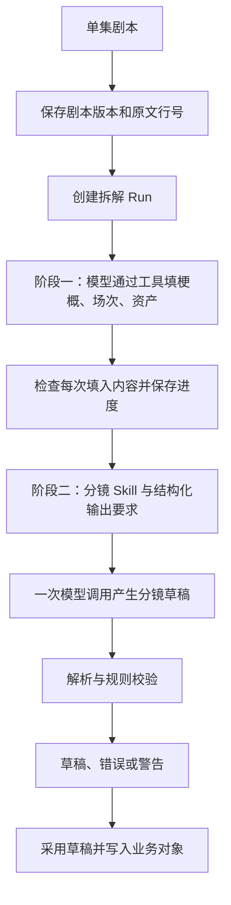

# 短剧智能体：源码分析与个人 MVP 建议

调研日期：2026-09-14。源码基线：`e1f879204be39518f01e663f8025963112c87336`。

最新范围纠正：用户要求在全新独立目录从零开发短剧 Agent，第一步剧本拆解；旧平台仅供提炼规则，不在旧平台上二次开发，也不迁移其业务场景。后续开发记录以 [新项目说明](./shortdrama-agent-lab/README.md) 为准。本文保留为旧源码调研资料。

这是一份源码调研与候选设计，尚不是已确认的开发规格。检查覆盖三个目录的入口、关键执行链、数据结构、提示词、状态与相关测试；没有逐行审计全部文件，也没有启动旧系统、连接公司服务或进行真实模型调用。下文区分“代码已实现”“旧原型/占位”“新系统建议”。

## 1. 已确定的目标与决策树

用户已经确认：

- 使用者：个人自用。
- 输入：已有的一集剧本。
- 第一版输出：剧本拆解与可编辑分镜表。
- 图片、视频生成与自动剪辑不属于当前第一版范围。
- 创作边界：允许补镜头设计，保留原剧情。
- 交互：先集中追问关键缺口，再自动生成草稿。
- 界面：本地网页，对照原文并编辑分镜。
- 分镜粒度：一行对应一个连续镜头。
- 文件范围：粘贴剧本或 TXT 输入，导出 CSV＋JSON。
- 重做规则：按场重做，保护人工修改，新草稿可比较后采用。
- 首批优化范围：中文单集剧本，先聚焦一种题材；具体题材与样本尚待确定。

```text
个人短剧智能体
├── 第一版用户：自己【已确定】
│   ├── 操作入口：本地网页【已确定】
│   └── 模型、费用、等待时间：用户委托助手建议【建议见第10节；待总体确认】
├── 输入：已有一集剧本【已确定】
│   ├── 创作边界：可补镜头设计、保留原剧情【已确定】
│   ├── 输入格式：粘贴或 TXT【已确定】
│   └── 中文、单题材【已确定】；具体题材、长度、代表性样本【后续确认】
├── 输出：拆解＋可编辑分镜表【已确定】
│   ├── 一行一个连续镜头【已确定】
│   ├── 导出格式：CSV＋JSON【已确定】
│   ├── 必需字段【后续确认】
│   └── 验收样本、质量标准【第三轮与后续确认】
└── 交互：先集中追问、再自动出草稿【已确定】
    ├── 哪些答案阻止生成、哪些可以未知【随后细化】
    └── 按场重做、保护人工修改、比较后采用【已确定】
```

这里的“蒸馏”先按**提炼制作知识、流程、提示词、数据结构和校验规则**理解。已检查的主链使用现成模型推理，未包含专用短剧模型训练步骤。第一版先积累真实输入、模型草稿、人工修改与质量记录；以后是否训练模型，要在有数据证明现成模型的具体不足后另作决定。

## 2. 三个目录实际承担什么职责

| 目录 | 从代码确认的职责 | 对当前 MVP 的价值 |
|---|---|---|
| `短剧Main` | React 前端、Fastify API、PostgreSQL 业务状态、剧本拆解、助手/Grill、资产、生成任务、交付等 | 首要参考：拆解、状态保存、校验、Grill 思路；业务平台按需裁减 |
| `shortdrama-cli` | 将平台动作封装为命令与 JSON 输出，真实业务通过 HTTP 调用 Main | 学习工具接口与操作顺序；不能当作已经独立运行的智能体 |
| `shortdrama-agent` | Pi HTTP 适配层、AgentKit/test-agent 实验助手、production-chain 与 sd-* 原型并存 | 学习原型如何拆步骤、约束输出；不宜原样复制多套运行时 |

Main 的实际应用入口是 [app.ts](./短剧Main/src/app.ts#L56)，业务注册集中在 [http/routes.ts](./短剧Main/src/http/routes.ts#L73)。这里只能据代码说明运行结构，不能据此断言旧公司线上部署与这份快照完全一致。

CLI 的自然语言编排主要交给读取其 Skill 的外部 Agent；CLI 自身解析命令、发 HTTP、返回结果。证据：[命令注册](./shortdrama-cli/src/shortdrama_cli/cli/app.py#L47)、[HTTP client](./shortdrama-cli/src/shortdrama_cli/server_api/client.py#L29)、[剧本命令](./shortdrama-cli/src/shortdrama_cli/cli/v030/script.py#L15)。

Agent 目录里的 Pi wrapper 也通过 Main API 提交和查询剧本拆解，不能只提取 wrapper 就得到拆解引擎。证据：[main_chain.py](./shortdrama-agent/pi-http-wrapper/src/pi_http_wrapper/main_chain.py#L499)。Main 的架构合同要求在线 Agent 嵌入单体应用，其他 wrapper/实验链应分别看待，不能把所有目录拼成一张已经接通的生产链。

## 3. Main 的剧本拆解实际如何工作



### 3.1 先固定输入，给每次运行留下依据

`episode_script_versions` 保存原文、版本号与 hash；`script_breakdown_runs` 保存输入版本、提示词版本、草稿、状态、模型用量、错误等。业务场次与镜头又保留来源 run/candidate。

价值：以后改了剧本或提示词，能知道某份分镜究竟根据哪一版产生，也能比较两次结果。

证据：[剧本版本与 Run 数据结构](./短剧Main/src/db/schema.ts#L537)、[镜头来源字段](./短剧Main/src/db/schema.ts#L410)。

### 3.2 第一阶段是有工具约束的填表过程

当前提示词明确要求：先写梗概，再逐场登记，提取角色、场景、道具、服装和音频；**分镜由后续阶段处理**。模型必须调用工具才能保存结果，写在聊天回复中的内容不会自动入库。

它还约束：有明确场标就按场标；场次覆盖原文；名字保留原文；没有写出的属性可以为空；工具拒绝时只修正那次操作。

证据：[当前阶段一提示词](./短剧Main/src/modules/script-breakdown/agent/runner.ts#L435)。

提示词规定并不自动等于代码保障。新系统应把名称引用、编号、范围等能机械判断的规则落实到校验器；外貌描述是否编造等语义问题，还需要证据与人工检查。

### 3.3 第二阶段才做分镜

当前 service 在阶段一成功后调用 `runStoryboardStage`，将编号剧本、场次、资产、模板等组成输入，用分镜 Skill 与结构要求进行一次模型调用。它并非同时启动多个“导演 Agent”各自创作。

证据：[阶段切换](./短剧Main/src/modules/script-breakdown/service.ts#L515)、[阶段二输入组成](./短剧Main/src/modules/script-breakdown/service.ts#L562)。

这值得借鉴：先得到比较稳定的剧情事实，再在这些事实与约束上设计镜头。不要让同一次自由生成既改故事、又决定资产、又拆镜头，导致错误难以定位。

### 3.4 完整性由程序检查，质量还要另验

现有规则包含：候选 ID 唯一、镜号连续、场次引用存在、原文引用不越界；以及漏覆盖、重复覆盖、未匹配资产、时长偏差等警告。阶段二解析器还要求 Segment 的原文范围连续覆盖全文。

证据：[运行级校验](./短剧Main/src/modules/script-breakdown/validators.ts#L40)、[阶段二原文覆盖检查](./短剧Main/src/modules/script-breakdown/storyboard-parse.ts#L125)。

局限：解析器对部分镜头字段只转成字符串或 null；非法/缺失时长有默认值；对白并没有逐字与原文核对。因此“JSON 合法、运行成功”不能证明对白准确或分镜可用。对个人第一版，尤其要显示哪些内容源于原文、哪些是 AI 设计、哪些尚未确定。

### 3.5 每步保存，才有真实恢复能力

阶段一每次成功填入内容都会持久化草稿；再次执行会恢复已有草稿。阶段二已有分镜时可以跳过重拆。另有执行令牌与失联运行回收机制。

证据：[恢复已有草稿](./短剧Main/src/modules/script-breakdown/service.ts#L418)、[每次填入后落库](./短剧Main/src/modules/script-breakdown/service.ts#L478)、[失联回收](./短剧Main/src/modules/script-breakdown/recovery.ts#L17)。

借鉴原则是“已完成的成果与失败原因都保存”，个人版无需照搬企业部署的全部并发设施。

### 3.6 采用策略与草稿编辑需要单独设计

普通拆解路径有草稿采用；Lite 路径设置 `autoConfirm` 时会自动采用。不能根据旧表注释声称所有结果都必须由人逐次确认。

证据：[自动采用分支](./短剧Main/src/modules/script-breakdown/service.ts#L545)。

当前独立拆解页面与 API 主要提供预览、采用、放弃和恢复，并没有完整的“编辑 AI 草稿 → 保存 → 再校验 → 只重拆指定部分”闭环。Main 的正式镜头另有编辑能力，但不能据此当作上述草稿闭环已经具备。新 MVP 需要明确实现它。

另一个需要改变的地方：旧系统确认重建会软删原来的场次与镜头，包括人工创建的内容。新版本应保存为新修订供比较，局部重做应保护人工修改。证据：[确认重建事务](./短剧Main/src/modules/script-breakdown/repository.ts#L639)。

## 4. Grill 是怎样做的，与你的产品怎样连接

Grill 可以理解成一张会动态追问的需求表：先检查已经知道什么，只追问缺失而且重要的字段；从用户回答中抽取字段，再检查是否足够。

现有 Main 的思路包括：

1. `TaskProfile` 配置必需字段、可选字段、候选项与追问限制。
2. 规则先检查明确的缺口，必要时调用模型判断信息是否足够。
3. 缺信息时追问或给候选；信息足够时组成待确认摘要。
4. 从回答中提取字段，记录来源为用户提供、推断、默认值或偏好。
5. 接受修正，保存会话状态，支持之后继续对话。

证据：[Grill 引擎实际分支](./短剧Main/src/modules/assistant/grill/engine.ts#L62)、[字段来源与返回动作](./短剧Main/src/modules/assistant/grill/types.ts#L80)、[服务层上下文恢复](./短剧Main/src/modules/assistant/grill/service.ts#L103)。

**关键事实：注册表实际只有 registration 与 content_creation。** 类型中虽然出现 `script_breakdown`，但它的场景配置尚未注册，不能说“上传剧本后先 Grill，再拆解”已经完整接通。

证据：[实际注册表](./短剧Main/src/modules/assistant/grill/profiles.ts#L127)。

你的个人版建议新建一个专用 `BreakdownBrief`：例如目标时长、镜头设计权限、表现风格、特殊限制。先从剧本与用户已有设置提取信息，再对剩余关键缺口集中追问。用户明确提供的内容直接进入拆解上下文；推断与默认值要保留标记。不要让聊天记录成为唯一的需求存储。

Grill 的计数器部分使用进程级单例。新个人版宜让完整问答状态跟随同一项目/运行保存，避免重启后遗忘或不同项目互相影响，不必直接复制该实现。

## 5. 另外两个目录的可学之处与不能照搬的部分

### CLI：学动作契约，避开模拟流水线

可学：动作小而清楚；参数结构化；返回真实 ID；查询状态与提交任务分开；失败可识别；以后让聊天 Agent 调用这些动作会更稳。

但是 `agents/runner.py` 用的是 `MockProvider`，所谓图片与视频只写出 `.txt` 占位文件；几个云 provider 是未实现的占位。模拟 runner 只在开头和全部结束保存 manifest，不能当作成熟断点续跑。

证据：[Mock runner](./shortdrama-cli/src/shortdrama_cli/agents/runner.py#L19)、[占位媒体输出](./shortdrama-cli/src/shortdrama_cli/providers/mock.py#L70)。

现行 API 命令还耦合公司端点、认证、业务对象与费用模型。因此第一版直接设计自己的几项内部操作，比先迁移整个 CLI 更贴近已确定需求。

### Agent 原型：学步骤与证据，避开内存审批和复制目录

`production-chain` 展示了直接的做法：提示词要求结构化信息与证据，模型返回 JSON，校验后转成领域对象。`test-agent` 的分镜 schema 还列出景别、运镜、角色、台词、时长等字段，可作为字段设计参考。

证据：[原型提取与原文证据](./shortdrama-agent/production-chain-agent/production_chain/workflow.py#L37)、[test-agent 分镜结构](./shortdrama-agent/test-agent/short_drama_agent/script_breakdown.py#L42)。

要避开的做法：

- 某些审批只是内存集合，部分 orchestrator 自动填 reviewer 放行；这不能当作用户实际选定了结果。
- 某些失败返回空字典、空 URL，费用使用固定值；新系统必须保留真实失败状态，不将占位值表示为成功。
- 将全部资产绑定到每场、只给生图接口传文本，不足以证明角色视觉一致性。
- 多个 sd-* 目录复制同一份实现，再靠同步脚本覆盖；个人版只保留一套核心逻辑。
- 名为 `run_dry_run` 的入口实际走真实模型链，不能仅凭名称判断它是否离线。

证据：[原型审批与任务状态](./shortdrama-agent/production-chain-agent/production_chain/workflow.py#L396)、[orchestrator 自动审批](./shortdrama-agent/sd-orchestrator/app.py#L208)、[目录同步](./shortdrama-agent/sync_production_chain.py#L23)、[dry-run 实现](./shortdrama-agent/production-chain-agent/agent.py#L189)。

## 6. 个人第一版建议怎样做

以下方案已按“保留原剧情、可补镜头设计、集中追问、本地网页、一行一个连续镜头、按场重做保护人工修改、粘贴/TXT 输入与 CSV＋JSON 导出”收敛；样本范围、模型接入与验收细节仍在确认。

```text
输入一集剧本
→ 保存原文版本与行号
→ 读取已知要求，追问关键缺口
→ 提取梗概、场次、角色与道具
→ 根据事实和已确认要求设计分镜
→ 校验并显示问题
→ 人工编辑、保存与再次校验
→ 导出分镜表和结构化制作包
```

建议一个应用、一个协调器，内部使用明确步骤。第一版可先实现提取和分镜各自的受控模型调用，再根据真实失败案例决定是否需要更复杂的工具循环。无需先拆成四个服务或四个自主 Agent。

### 必须保留的业务底座

| 能力 | 第一版最小做法 | 必要原因 |
|---|---|---|
| 作品与剧本版本 | 本地项目、单集原文、hash、版本 | 修改原文后知道哪些结果已过期 |
| 结构化创作要求 | 已知字段、答案、来源、未决问题 | 追问结果能真正影响后续生成 |
| 人物/场次/镜头关系 | 稳定 ID、原文引用、实体引用 | 方便校验、修改与以后接图像生成 |
| 运行记录 | 步骤、状态、输入/提示词版本、用量、错误 | 失败可见、结果可比较、进度不丢 |
| 草稿和编辑保存 | 自动保存、修订版本、人工修改标记 | 用户改完能找回，重做不覆盖人工成果 |
| 校验 | 结构、引用、覆盖、对白、时长问题列表 | 防止看起来完整、实际有缺漏 |
| 导出 | 可阅读分镜表＋结构化 JSON | 结果能进入后续制作与迭代 |
| 模型配置与调用限制 | 一个模型接入、超时、有限重试、用量记录 | 核心步骤可执行、错误不会无限重试 |

单人本地版可以用一个本地数据库与项目文件夹保存这些状态。SQLite 是候选；也可以沿用熟悉的 PostgreSQL。具体技术栈尚未冻结，没必要为这些数据一开始建设多套服务。

建议第一版分镜字段：镜头 ID、所属场次、原文引用、画面动作、人物/道具、对白、景别、机位/运镜、预计时长、备注、字段来源。字段集还需结合实际导出使用方式确认。

原版分镜 Skill 还写入了真人电影风格、禁止卡通、禁止字幕/BGM 等约束。这些是特定产品的选择，不应自动继承为个人工具的通用规则；新工具应明确哪些是用户要求、哪些可配置。证据：[原 Skill 风格约束](./短剧Main/src/modules/script-breakdown/storyboard-skill.ts#L104)。

### 可以后置的业务

- 多租户、企业登录、多人角色权限、组织与群组。
- 充值、积分、完整计费后台、运营看板、邀请码。
- 通用资产审核、资产广场、复杂项目审批。
- TOS/Milvus/企业知识库、长期记忆、多个模型供应商调度。
- 3D 导演台、素材登记、视频生成队列、自动剪辑。
- Kubernetes、公司密钥系统、五平台 CLI 打包发行。

这不表示它们永远没有价值，而是当前“单人、文本输入、文本分镜输出”的闭环不需要承担它们。

### 必须澄清的命名问题

Main 当前把数据库 `shots` 的一行当作 **Segment 剧情单元**，其中还嵌套多个真正 Shot。用户已确认新产品第一版一行表示一个连续镜头，剧情段落可作为分组。这样修改、计算时长以及以后按镜生成都更清楚。

证据：[Main 的 Segment/Shot 定义](./短剧Main/src/db/schema.ts#L369)。

相应地，不应把“Segment 的原文必须无重叠覆盖”直接当作所有镜头的规则：同一句对白可能需要正反打或反应镜头，多个镜头引用同一句原文可以合理。覆盖检查应识别遗漏，重复引用需结合镜头意图判断。

## 7. 建议的实现顺序与验收

### 第一步：先证明拆解结果有用

选少量自己能判断的单集剧本，覆盖简单对话、多场切换、闪回或旁白等情况。先约定输出表长什么样，手工标出重要人物、道具、对白与剧情事件。

做出“剧本 → 提取 → 分镜 → 校验 → 导出”的最小真实模型闭环。即使最终选网页，也可先用内部脚本验证数据流；脚本不是另一套产品。

验收建议：每个重要事件和对白有镜头承接或明确处理理由；原文能回查；虚构信息有标记；失败可定位；同一剧本重跑能够比较结果。

### 第二步：让它成为能用的个人工具

接入专用追问逻辑与已选界面，提供保存、编辑、恢复、导出。修改后再次校验，并记录人工修改；至少能选择需要重做的范围，避免为了改一个错误重跑全部内容。

“按场重做”与旧系统的“整集一次分镜调用”不是同一能力，需要新的输入边界与合并规则。局部重做时保持稳定 ID，避免修改了某行却悄悄改变其他镜头的引用。

### 第三步：用样本改进，再接媒体

每次改 prompt/模型，跑相同样本，比对遗漏、编造、对白变化、人工修改量、耗时与用量。先证明哪一步不够好，再决定增加工具、检索或专门 Agent。

后续可以依次增加：角色设定与参考图 → 分镜图 → 单镜头视频 → 整集合成与音频。每引入一种媒体能力，才补其异步任务、产物存储、版本选择与成本控制。

不能把旧 Main 的播放列表当成已经实现自动剪辑：当前 `delivery` 的核心是选定媒体、清单、连播与导出记录；本次在其运行代码中未找到整集 MP4 合成实现。证据：[播放清单与交付记录](./短剧Main/src/modules/delivery/service.ts#L41)。

## 8. 评测资产值得学，但现成数字不能直接继承

仓库有固定样本、参照答案、准确率/召回率、稳定性与成本统计，这种“改之前和改之后用同一批材料比较”的方法非常值得保留。

但有两个实际限制：

1. 当前 harness 直接调用 `runBreakdownAgent`，只覆盖阶段一，没有走 service 的阶段二分镜。因此不能据它证明完整分镜质量。
2. 现有参照答案的说明明确写着由单个模型标注，仍是草稿，需要独立标注与人工裁定；不能直接当作人工最终答案。

证据：[评测调用范围](./短剧Main/scripts/eval/breakdown/harness/run-one.ts#L75)、[参照答案局限](./短剧Main/eval/breakdown/README.md#L58)。

个人 MVP 应补自己的完整链样本，分别验证“程序契约能否执行”和“内容是否满足制作需求”。本次没有运行这些评测，不对它们的通过率、生成质量或实际费用作推断。

## 9. 下一轮需要收敛的决定

第二轮已全部回答，结论已更新到本文件开头。第三轮已提问：

- Q7【已确定】：一行一个连续镜头。
- Q8【已确定】：粘贴/TXT 输入，CSV＋JSON 导出。
- Q9【已确定】：按场重做，保护人工修改，新草稿可比较后采用。
- Q10【已确定】：中文单集剧本，先聚焦一种题材；具体题材与样本待定。
- Q11【已回答】：用户不确定模型服务与预算，委托助手给出建议；建议见第10节。

第四轮已提问：

- Q12：先优化哪一种题材？没有偏好时建议现代都市情感。
- Q13：已有熟悉的真实剧本作为验收样本，还是先由助手创作三份样本？优先真实样本。
- Q14：原文未说明的事实留空，只追问关键设计要求，还是持续追问所有缺失信息？建议前者。

之后将输出字段与验收标准汇总，确认是否已达成共同理解，再写具体开发规格与任务。当前文档中的候选设计不应被当作用户已经批准的所有细节。

## 10. 模型服务、费用与等待时间建议

官方文档核对日期：2026-09-14。以下为助手建议与示例计算，未实际开通服务、充值或调用模型。

**第一版建议先接阿里云百炼北京区 `qwen3.7-plus`。** 它支持严格 JSON Schema 输出，便于约束分镜字段；程序仍须验证原文、对白和实体引用。选择依据是接口适配与结构化输出能力，短剧质量需样本验证。[结构化输出官方文档](https://help.aliyun.com/zh/model-studio/qwen-structured-output)

| 候选 | 未缓存输入价（元/百万 token） | 输出价（元/百万 token） | 价格条件 |
|---|---:|---:|---|
| 首选 `qwen3.7-plus` | 2 | 8 | 北京区，单次输入≤256K，原价 |
| 后续对照候选 `deepseek-flash` | 2 | 8 | 高峰时段，未计缓存折扣 |

来源：[Qwen3.7-Plus 官方模型与价格](https://help.aliyun.com/zh/model-studio/qwen3-7-plus)、[DeepSeek 官方价格](https://api-docs.deepseek.com/zh-cn/quick_start/pricing/)。第一版先接一个服务；备选用于将来的样本对照，不增加自动多供应商调度。

示例：假设一集的追问、拆解、逐场分镜等全部调用累计输入 30,000 token、计费输出 10,000 token，在上表价格条件内：

`30,000 / 1,000,000 × 2 + 10,000 / 1,000,000 × 8 = 0.14 元`

这不是已测出的平均每集费用。上下文反复发送、输出长度、思考与修复会改变实际用量；每次调用按服务返回 usage 记账。先默认关闭思考模式，用固定样本判断是否值得开启。

个人首版建议：

- 每集预留 1 元，初期总测试预算 30 元；这些是预算建议，仍需纳入最终共同确认。
- 每个失败的结构化生成步骤最多自动修复 1 次，再失败则保存进度与错误，供人处理。
- 发起调用前估算输入并预留输出额度，避免只在费用发生后发现超预算；无法确定是否计费的中断请求保留预留额，不盲目重复调用。
- 出初稿的产品目标为 2–5 分钟，从追问完成后开始计时，不含用户答题和编辑时间。真实耗时待样本实测，界面持续显示阶段与可恢复状态。
- 第一批样本先同时检查原文忠实度、编辑保护与完整流程耗时，再决定模型或参数调整。

后续接入只需要配置官方 API 服务与本地后端密钥，不依赖旧公司的模型网关。具体开通与配置应在实现接入步骤时完成。
